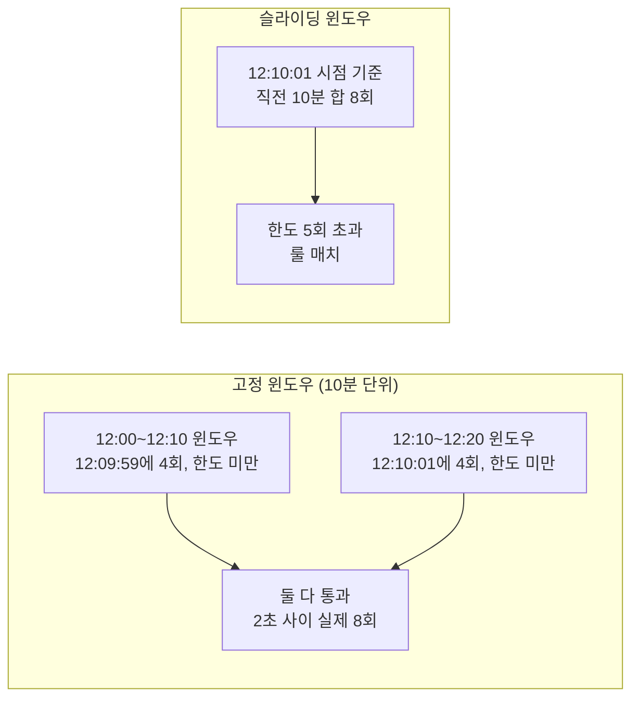
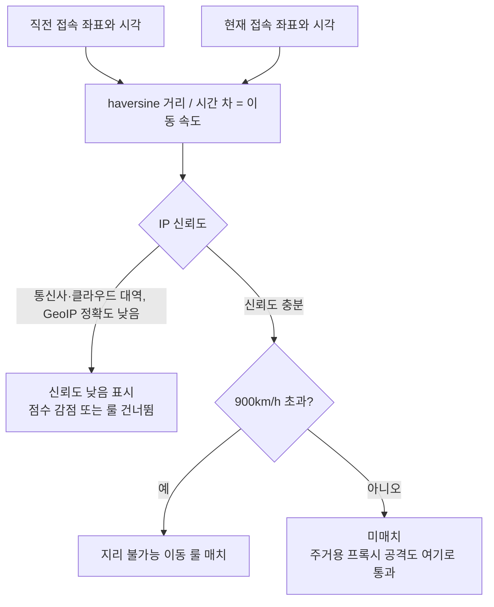
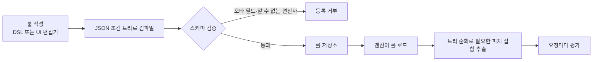
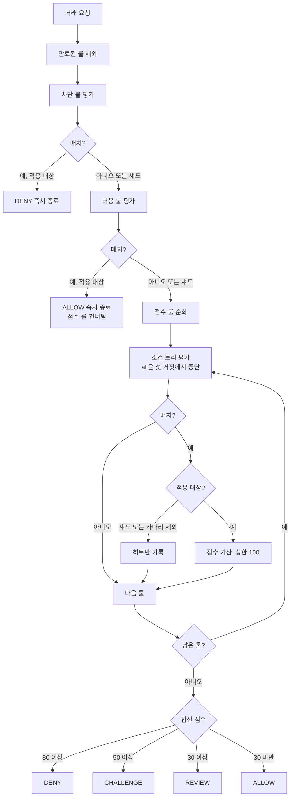
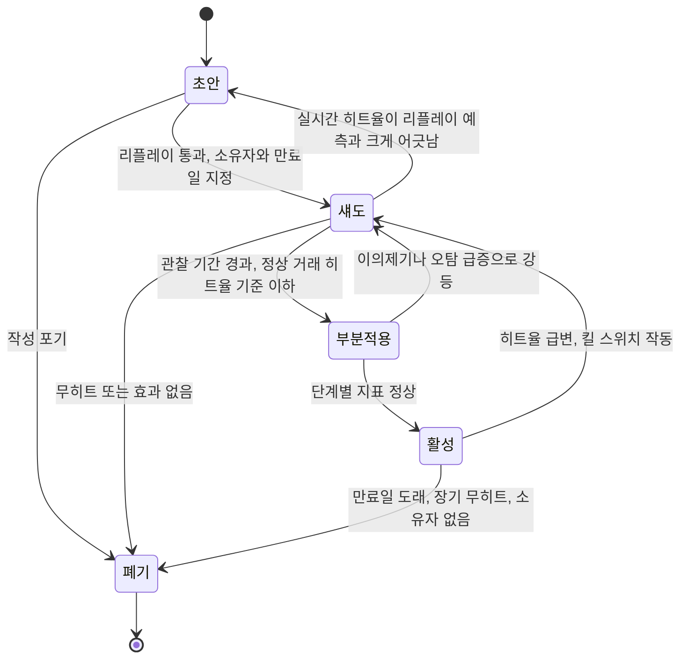
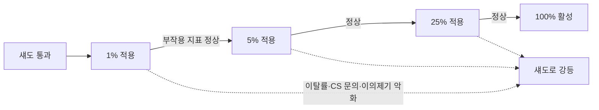
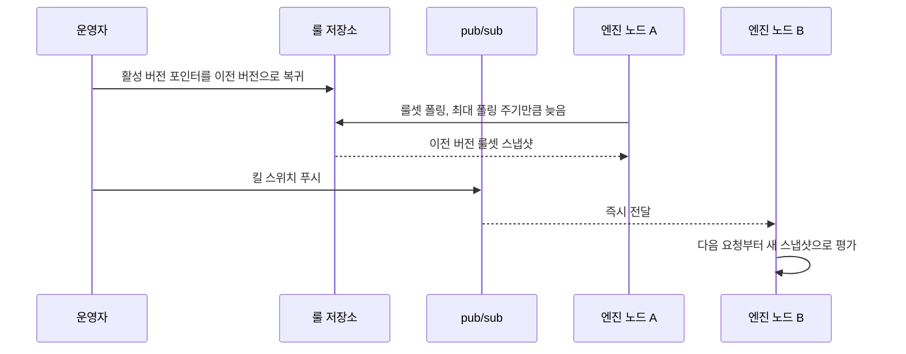
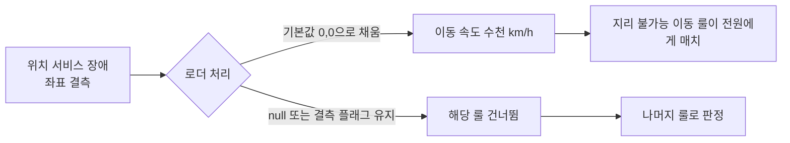
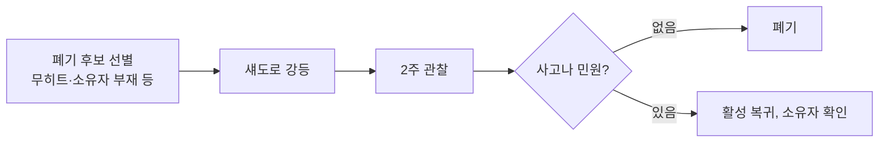

# FDS 룰 엔진 설계와 운영

FDS 룰 엔진을 처음 만들 때는 `if (amount > 1000000 && accountAge < 7)` 같은 조건을 코드에 박아 넣고 시작하는 경우가 많다. 룰이 열 개 안쪽일 때는 문제가 없다. 사기 패턴이 하나 새로 보고될 때마다 룰이 하나씩 늘고, 룰 수정이 곧 서비스 배포가 되고, 어느 날 룰 하나가 정상 결제를 한 시간 동안 막고 나서야 "이 룰을 누가 언제 왜 넣었는지"를 아무도 모른다는 걸 알게 된다.

룰 엔진에서 어려운 부분은 조건을 평가하는 코드가 아니다. 그건 100줄이면 끝난다. 어려운 건 룰을 운영 중인 시스템에 안전하게 넣고, 문제가 생기면 빼고, 쌓인 룰을 정리하는 과정이다. 이 문서는 룰 종류별로 무엇을 놓치는지, 룰을 데이터로 표현하는 방법, 실제로 동작하는 평가기, 배포 수명주기, 운영에서 겪는 사고 유형을 순서대로 다룬다. 승인 경로 안에서 FDS가 어떻게 호출되고 타임아웃을 어떻게 처리하는지는 [FDS 이상거래탐지 시스템 구조](FDS_Architecture.md)에서 다뤘으므로 여기서는 반복하지 않는다. 룰 엔진은 그 문서의 "정책 결정" 단계 안에 들어가는 부품이다.

## 룰 유형별로 잡는 것과 놓치는 것

룰은 크게 다섯 갈래로 나눠 관리하면 편하다. 유형마다 필요한 피처와 오탐이 나오는 원인이 달라서, 오탐이 터졌을 때 어느 갈래를 의심할지 정해진다.

| 룰 유형 | 탐지 대상 | 주된 오탐 원인 | 필요한 피처 |
|---|---|---|---|
| 속도 룰 (velocity) | 짧은 시간에 몰리는 시도. 카드 테스트, 계정 탈취 후 연속 결제 | 정각 이벤트와 쿠폰 오픈, 결제 실패 후 자동 재시도, 정기결제 일괄 처리 | 키별(계정·기기·카드·IP) 슬라이딩 윈도우 카운터, 윈도우 내 금액 합 |
| 금액·시간대 룰 | 평소와 다른 고액, 새벽 시간대 거래 | 고액 사용자에게 고정 임계값 적용, 야간 근무자와 해외 체류자 | 계정별 평소 금액 분포, 계정 시간대, 거래 로컬 시각 |
| 지리 불가능 이동 (impossible travel) | 물리적으로 갈 수 없는 거리에서 연달아 발생한 로그인·거래 | VPN, 모바일 통신사 게이트웨이 IP, GeoIP DB 오차, 해외 로밍 | 직전 접속 좌표와 시각, 이동 속도 계산 결과, IP 신뢰도 |
| 블랙리스트·화이트리스트 | 확정된 사기 기기·카드·계정, 신뢰하는 가맹점·내부 계정 | 중고폰과 공용 기기 재사용, 만료되지 않은 오래된 항목, 공용 IP | 리스트 조회 결과, 항목 등록일과 등록 사유, TTL |
| 신규 계정 + 고액 | 가입 직후 현금화 시도, 대포 계정 | 가입 이벤트 직후 정상 대량 구매, 법인 계정 | 계정 나이, 첫 결제 수단 등록 시각, 거래 금액 |

### 속도 룰

속도 룰이 놓치는 건 "한도 아래로 쪼갠 공격"이다. 10분에 5회를 넘으면 걸리는 룰이라면 공격자는 4회씩 보낸다. 계정 키로만 세면 계정 100개로 나눈 공격도 못 본다. 같은 기기나 같은 카드 BIN으로 키를 바꿔 센 룰이 따로 있어야 한다. 고정 윈도우를 쓰면 윈도우 경계에서 두 배가 통과한다. 12:09:59에 4회, 12:10:01에 4회가 오면 10분 단위 고정 윈도우로는 각각 4회라 둘 다 통과한다. 슬라이딩 윈도우를 쓰고, 구현이 무거우면 Redis sorted set이나 두 개의 겹치는 고정 윈도우로 근사한다. 윈도우 구현은 [Rate Limiting](Rate_Limiting.md)과 같은 문제라 거기서 쓰는 방식을 그대로 가져와도 된다.

아래 그림은 같은 8회가 고정 윈도우에서는 통과하고 슬라이딩 윈도우에서는 걸리는 차이다.



오탐은 대부분 서비스 쪽에서 온다. 결제 실패 시 클라이언트가 세 번 재시도하게 만들어 둔 앱이라면 사용자 한 명이 실패 한 번에 요청 세 건을 만든다. 룰이 보는 건 요청 수라서 정상 사용자가 걸린다. 재시도는 같은 `requestId`로 보내서 FDS가 중복을 한 건으로 세게 하거나, 속도 룰의 카운트 대상을 "승인 시도"가 아니라 "고유 거래 시도"로 정의한다.

### 금액·시간대 룰

고정 금액 임계값은 사용자에 따라 오탐이 되기도 하고 미탐이 되기도 한다. 평소 월 300만 원을 쓰는 사용자의 100만 원 결제는 정상이고, 평소 3만 원짜리만 결제하던 사용자의 100만 원은 이상하다. 고정 임계값 하나로는 둘을 구분하지 못한다. 절대 금액 대신 "이 계정의 최근 90일 결제 금액 대비 배수" 같은 상대 피처를 쓰는 쪽으로 가는 이유다. 룰은 여전히 조건 트리 하나지만, 피처가 `amount_ratio_to_p95` 처럼 계정별로 계산된 값이 된다.

임계값 바로 아래로 맞춘 공격도 흔하다. 인증 면제 한도가 50만 원이면 49만 9천 원이 반복된다. 이런 금액 분포는 임계값 직전에 몰리는 모양이 나오므로, 룰이 걸리는 구간 바로 아래의 거래 수를 따로 집계해 두면 공격자가 임계값을 알아냈다는 신호로 쓸 수 있다.

시간대 룰은 계정의 시간대를 알아야 의미가 있다. 서버 시각 새벽 3시가 해외 체류 중인 사용자에게는 낮이다. 시간대 정보 없이 서버 시각으로 만든 룰은 해외 사용자가 많은 서비스에서 오탐 비중이 높다.

### 지리 불가능 이동

직전 접속 좌표와 현재 접속 좌표 사이 거리를 시간 차로 나눠 속도가 비행기 속도보다 빠르면 걸린다. 계산 자체는 haversine 한 줄이다.

```typescript
interface Login { lat: number; lon: number; at: number }

export function haversineKm(a: Login, b: Login): number {
  const R = 6371;
  const rad = (d: number) => (d * Math.PI) / 180;
  const dLat = rad(b.lat - a.lat);
  const dLon = rad(b.lon - a.lon);
  const h = Math.sin(dLat / 2) ** 2 +
    Math.cos(rad(a.lat)) * Math.cos(rad(b.lat)) * Math.sin(dLon / 2) ** 2;
  return 2 * R * Math.asin(Math.sqrt(h));
}

export function travelSpeedKmh(prev: Login, cur: Login, minGapMs = 60_000): number {
  const hours = Math.max(cur.at - prev.at, minGapMs) / 3_600_000;
  return haversineKm(prev, cur) / hours;
}
```

서울과 프랑크푸르트를 90분 간격으로 넣으면 거리 8,550km, 속도 5,700km/h가 나오고, 서울과 부산을 같은 간격으로 넣으면 325km, 217km/h가 나온다. 임계값을 900km/h 안팎에 두면 앞의 것만 걸린다. `minGapMs` 하한은 시각이 같거나 역전된 로그에서 0으로 나누는 걸 막는 용도다. 이걸 빼먹으면 속도가 `Infinity`가 되어 룰이 항상 참이 된다.

이 룰이 놓치는 건 공격자가 피해자와 같은 지역의 프록시를 쓰는 경우다. 주거용 프록시(residential proxy) 서비스는 도시 단위로 IP를 고를 수 있어서 이동 속도가 정상 범위로 나온다. 반대로 오탐은 모바일 통신사의 게이트웨이 때문에 난다. 통신사가 트래픽을 특정 지역 게이트웨이로 모아 내보내면 GeoIP는 사용자 실제 위치와 수백 km 떨어진 곳을 가리킨다. 사용자가 와이파이와 LTE를 오가기만 해도 위치가 튄다. GeoIP 정확도가 낮은 구간(통신사 대역, 클라우드 대역)은 이 룰의 피처 자체를 "신뢰도 낮음"으로 표시해 점수를 깎거나 건너뛰는 처리가 필요하다.

속도 계산 뒤에 IP 신뢰도 분기가 들어가는 위치를 보라. 신뢰도가 낮은 구간은 룰 판정 앞에서 갈라진다.



### 블랙리스트와 화이트리스트

블랙리스트는 과거 사실만 안다. 새 기기, 새 카드, 새 계정은 리스트에 없으므로 처음 한 번은 반드시 통과한다. 그래서 블랙리스트에 걸리는 거래는 "재범"이고, 초범을 잡는 건 다른 룰의 몫이다. 오탐은 기기 재사용에서 온다. 사기에 쓰인 중고폰이 중고 시장을 거쳐 다음 사용자에게 넘어가면, 그 사용자는 영문도 모른 채 차단된다. 항목마다 등록일과 사유, 만료일을 같이 저장하고 기기 단위 항목은 만료를 짧게 잡는다.

화이트리스트가 더 위험하다. 허용 룰이 매치하면 점수 룰을 건너뛰는 구조에서, 화이트리스트에 들어간 계정이나 가맹점이 탈취되면 그 뒤 모든 룰을 우회한다. 뒤의 평가기 예제에서도 급여 가맹점 허용 룰이 걸린 거래가 1,200km/h 이동 속도를 무시하고 통과하는 걸 볼 수 있다. 화이트리스트는 "전부 건너뛰기"가 아니라 "특정 룰 묶음만 건너뛰기"로 범위를 좁혀 두는 편이 안전하다.

### 신규 계정과 고액 조합

단일 신호로는 약한 것들을 묶는 대표적인 조합 룰이다. 가입 7일 미만이면서 100만 원 이상이면 점수를 얹는다. 놓치는 건 계정 숙성이다. 공격자가 대포 계정을 만들어 소액 거래로 몇 주 키운 뒤 고액을 시도하면 "신규"가 아니다. 또 탈취된 오래된 계정은 처음부터 이 룰의 대상이 아니다. 오탐은 가입 이벤트로 들어온 사용자가 첫 주에 큰 금액을 쓰는 경우, 법인이 계정을 새로 만들어 대량 구매를 하는 경우에서 나온다. 이 룰은 단독으로 차단 점수를 주기보다 다른 신호와 합산되는 점수 룰로 두는 게 맞다.

## 룰을 표현하는 방식

룰을 코드에 박아 두면 수정할 때마다 배포가 필요하고, 판정 로그에 "어떤 조건이 참이어서 걸렸는지"를 남기기도 어렵다. 룰을 데이터로 빼서 저장소에 두고 엔진이 읽어 해석하는 구조가 기본이다. 표현 방식은 세 가지를 주로 본다.

| 방식 | 예시 | 장점 | 단점 |
|---|---|---|---|
| JSON 조건 트리 | `{"all":[{"field":"amount","op":"gte","value":1000000}, ...]}` | 파싱 불필요, 스키마 검증이 쉬움, UI 편집기와 궁합이 좋음, 버전 비교(diff)가 구조적 | 사람이 직접 쓰기엔 장황함, 중첩이 깊어지면 읽기 어려움 |
| 문자열 DSL | `amount >= 1000000 and account_age_days < 7` | 짧고 읽기 쉬움, 운영자가 직접 작성 | 파서와 에러 메시지를 직접 만들어야 함, 문법 확장이 잦으면 엔진이 복잡해짐 |
| 코드(함수) | `(tx) => tx.amount >= 1e6 && ...` | 표현력 제한 없음 | 배포 필요, 샌드박스 없이 로드하면 룰 한 줄로 서비스가 죽음, 정적 분석 불가 |

처음에는 JSON 조건 트리를 권한다. 스키마 검증으로 오타 난 필드명과 알 수 없는 연산자를 등록 단계에서 거부할 수 있고, 트리를 순회하면 어떤 피처가 필요한지를 룰 로드 시점에 뽑아낼 수 있다. 뒤에서 다룰 평가 지연 문제를 풀려면 이 정보가 필요하다. DSL은 운영팀이 룰을 직접 쓰는 일이 많아질 때 JSON 위에 얹는 입력 계층으로 두고, 내부 표현은 JSON 트리로 컴파일한다. 코드로 룰을 로드하는 방식은 피하는 게 낫다. 룰 한 개의 무한 루프가 승인 경로 전체의 지연이 된다.

아래 그림은 DSL을 입력 계층으로 얹었을 때 룰이 등록되어 평가되기까지의 경로이고, 필요한 피처 집합이 로드 시점에 나오는 자리를 보여준다.



## 평가 순서와 점수 합산

룰이 여러 개일 때 "어떤 순서로, 어디서 멈추고, 결과를 어떻게 합치는가"가 판정을 바꾼다. 같은 룰 집합이어도 방식에 따라 결과가 달라진다.

| 방식 | 동작 | 맞는 경우 | 문제 |
|---|---|---|---|
| 첫 매치 승리 | 우선순위 순으로 평가하다 처음 매치한 룰의 동작을 채택 | 룰 수가 적고 동작이 명확히 갈릴 때 | 순서가 곧 정책이 됨. 룰을 추가하면 기존 룰의 의미가 바뀜 |
| 전부 평가 후 합산 | 모든 룰을 돌려 점수를 더하고 임계값으로 판정 | 약한 신호를 모아야 할 때 | 모든 룰을 항상 평가하니 지연이 룰 수에 비례. 상관된 룰이 같은 신호를 두 번 더함 |
| 계층 방식 | 차단 룰 → 허용 룰 → 점수 룰 순으로 계층을 나눠, 앞 계층 매치 시 즉시 종료 | 확정 사실(리스트)과 확률적 신호(점수)가 섞일 때 | 허용 계층이 점수 계층을 가림. 계층 간 우선순위를 문서로 못 박아야 함 |

실무에서는 계층 방식에 점수 합산을 얹은 형태가 가장 많다. 블랙리스트처럼 확정된 사실은 점수를 계산할 이유가 없으므로 즉시 차단하고 평가를 끝낸다. 점수 룰끼리는 합산한다. 점수를 합치는 방법도 선택지가 있다.

| 합산 방식 | 계산 | 특징 |
|---|---|---|
| 단순 합 (상한 있음) | `min(100, s1 + s2 + ...)` | 직관적이고 설명이 쉬움. 약한 신호 여러 개가 쌓여 임계값을 넘는 구조. 상관된 룰이 겹치면 과대 계상 |
| 최댓값 | `max(s1, s2, ...)` | 겹침에 강하지만 약한 신호 여러 개가 모여도 올라가지 않음 |
| 확률 결합 (noisy-OR) | `1 - (1-p1)(1-p2)...` | 각 룰 점수를 사기 확률로 해석할 때 자연스러움. 0.45와 0.30이 결합하면 0.615. 점수를 확률로 보정해야 쓸 수 있음 |

단순 합이 설명하기 가장 쉽다. 심사자가 "이 거래는 45점과 30점이 더해져 75점이라 추가인증으로 갔다"를 바로 이해한다. 상관된 룰이 문제가 되는 경우는 룰 그룹을 지정해 그룹 안에서는 최댓값만 취하게 하면 단순 합의 직관을 유지하면서 이중 계상을 줄일 수 있다.

아래 그림은 이 문서의 평가기가 따르는 순서다. 차단 계층에서 매치하면 곧바로 종료하고, 허용 계층도 마찬가지다. 점수 계층에서는 조건 트리 안의 `all`이 첫 번째 거짓에서 멈추는 단락 평가가 일어나고, 섀도 룰은 기록만 하고 점수에는 더하지 않는다.



임계값 분기가 [FDS 구조 문서](FDS_Architecture.md)의 판정 4종(승인, 추가인증, 차단, 보류)에 그대로 대응한다. 이 임계값은 룰이 아니라 별도 설정으로 두고 룰 배포와 따로 바꿀 수 있게 해야 한다. 임계값을 룰 안에 박으면 "점수는 그대로인데 판정만 바꾸는" 조정을 할 때마다 모든 룰을 건드려야 한다.

## TypeScript 룰 평가기

위 순서를 그대로 구현한 평가기다. 세 가지에 신경 썼다. 피처는 룰이 실제로 요구할 때만 로드하고 한 번 로드한 값은 재사용한다. `expiresAt`이 지난 룰은 평가 대상에서 빠진다. 섀도와 카나리 모드가 평가 결과가 아니라 "적용 여부"에서 갈린다.

```typescript
type Op = 'eq' | 'ne' | 'gt' | 'gte' | 'lt' | 'lte' | 'in' | 'between';

type Cond =
  | { all: Cond[] }
  | { any: Cond[] }
  | { not: Cond }
  | { field: string; op: Op; value: unknown };

type Kind = 'deny' | 'allow' | 'score';
type Mode = 'shadow' | 'canary' | 'active';

interface Rule {
  id: string;
  version: number;
  kind: Kind;
  mode: Mode;
  rollout?: number; // canary 일 때 0~100
  score?: number; // kind=score 일 때
  expiresAt: string; // 만료일 없는 룰은 등록 자체를 막는다
  when: Cond;
}

interface Tx { requestId: string; accountId: string; amount: number }
type FeatureLoader = (name: string, tx: Tx) => Promise<number | string | boolean>;
type Decision = 'ALLOW' | 'REVIEW' | 'CHALLENGE' | 'DENY';

interface Hit { ruleId: string; version: number; kind: Kind; mode: Mode; applied: boolean; score: number }
interface Result { decision: Decision; total: number; hits: Hit[]; fetched: string[] }

const THRESHOLDS: { min: number; decision: Decision }[] = [
  { min: 80, decision: 'DENY' },
  { min: 50, decision: 'CHALLENGE' },
  { min: 30, decision: 'REVIEW' },
  { min: 0, decision: 'ALLOW' },
];
const SCORE_CAP = 100;

function bucket(key: string): number {
  let h = 2166136261;
  for (let i = 0; i < key.length; i++) {
    h ^= key.charCodeAt(i);
    h = Math.imul(h, 16777619) >>> 0;
  }
  return h % 100;
}

function compare(actual: any, op: Op, expected: any): boolean {
  switch (op) {
    case 'eq': return actual === expected;
    case 'ne': return actual !== expected;
    case 'gt': return actual > expected;
    case 'gte': return actual >= expected;
    case 'lt': return actual < expected;
    case 'lte': return actual <= expected;
    case 'in': return Array.isArray(expected) && expected.includes(actual);
    case 'between': return actual >= expected[0] && actual <= expected[1];
  }
}

async function evalCond(c: Cond, get: (f: string) => Promise<any>): Promise<boolean> {
  if ('all' in c) {
    for (const child of c.all) if (!(await evalCond(child, get))) return false;
    return true;
  }
  if ('any' in c) {
    for (const child of c.any) if (await evalCond(child, get)) return true;
    return false;
  }
  if ('not' in c) return !(await evalCond(c.not, get));
  return compare(await get(c.field), c.op, c.value);
}

function isApplied(r: Rule, tx: Tx): boolean {
  if (r.mode === 'active') return true;
  if (r.mode === 'canary') return bucket(`${r.id}:${tx.accountId}`) < (r.rollout ?? 0);
  return false;
}

export async function evaluate(
  rules: Rule[], tx: Tx, load: FeatureLoader, now = new Date(),
): Promise<Result> {
  const cache = new Map<string, Promise<any>>();
  const fetched: string[] = [];
  const get = (f: string) => {
    if (!cache.has(f)) {
      fetched.push(f);
      cache.set(f, load(f, tx));
    }
    return cache.get(f)!;
  };

  const live = rules.filter((r) => new Date(r.expiresAt) > now);
  const order: Kind[] = ['deny', 'allow', 'score'];
  const hits: Hit[] = [];
  let total = 0;

  for (const kind of order) {
    for (const r of live.filter((x) => x.kind === kind)) {
      if (!(await evalCond(r.when, get))) continue;
      const applied = isApplied(r, tx);
      hits.push({ ruleId: r.id, version: r.version, kind, mode: r.mode, applied, score: r.score ?? 0 });
      if (!applied) continue; // 섀도 룰은 기록만 남기고 판정에 영향을 주지 않는다
      if (kind === 'deny') return { decision: 'DENY', total, hits, fetched };
      if (kind === 'allow') return { decision: 'ALLOW', total, hits, fetched };
      total = Math.min(SCORE_CAP, total + (r.score ?? 0));
    }
  }
  const decision = THRESHOLDS.find((t) => total >= t.min)!.decision;
  return { decision, total, hits, fetched };
}
```

카나리 대상을 고르는 `bucket`은 요청 ID가 아니라 `룰ID:계정ID`를 해시한다. 요청 ID로 해시하면 같은 계정이 거래마다 다른 판정을 받는다. 어떤 때는 추가인증이 뜨고 어떤 때는 안 뜨는 상황이 되어 CS 문의가 늘고, 오탐 분석도 어려워진다. 계정 기준으로 고정하면 카나리 대상 계정은 항상 새 룰을 적용받는다. 룰 ID를 키에 섞은 이유는 룰마다 대상 집단이 달라지게 하려는 것이다. 모든 룰이 "계정 해시 하위 5%"를 쓰면 같은 5%의 사용자만 모든 신규 룰의 실험 대상이 된다.

룰 정의와 프로필을 넣고 네 건을 돌려 본 결과다. 룰은 차단 1개, 허용 1개, 점수 3개(그중 하나는 섀도), 만료된 점수 룰 1개다.

```typescript
const far = '2099-01-01';
const rules: Rule[] = [
  { id: 'BL-DEVICE', version: 3, kind: 'deny', mode: 'active', expiresAt: far,
    when: { field: 'device_blacklisted', op: 'eq', value: true } },
  { id: 'WL-PAYROLL', version: 1, kind: 'allow', mode: 'active', expiresAt: far,
    when: { all: [
      { field: 'merchant_group', op: 'eq', value: 'payroll' },
      { field: 'amount', op: 'lte', value: 5_000_000 },
    ] } },
  { id: 'NEW-ACCT-HIGH', version: 2, kind: 'score', mode: 'active', score: 45, expiresAt: far,
    when: { all: [
      { field: 'amount', op: 'gte', value: 1_000_000 },
      { field: 'account_age_days', op: 'lt', value: 7 },
    ] } },
  { id: 'VELOCITY-10M', version: 5, kind: 'score', mode: 'active', score: 30, expiresAt: far,
    when: { all: [
      { field: 'amount', op: 'gte', value: 100_000 },
      { field: 'tx_count_10m', op: 'gte', value: 5 },
    ] } },
  { id: 'TRAVEL', version: 1, kind: 'score', mode: 'active', score: 40, expiresAt: far,
    when: { field: 'travel_speed_kmh', op: 'gt', value: 900 } },
  { id: 'NIGHT-HIGH', version: 4, kind: 'score', mode: 'shadow', score: 25, expiresAt: far,
    when: { all: [
      { field: 'hour', op: 'between', value: [0, 5] },
      { field: 'amount', op: 'gte', value: 500_000 },
    ] } },
  { id: 'OLD-EVENT', version: 1, kind: 'score', mode: 'active', score: 90, expiresAt: '2025-01-01',
    when: { field: 'amount', op: 'gte', value: 1 } },
];
```

```text
a1 1500000 CHALLENGE 75 NEW-ACCT-HIGH,VELOCITY-10M,NIGHT-HIGH(shadow) | fetched: device_blacklisted,merchant_group,amount,account_age_days,tx_count_10m,travel_speed_kmh,hour
a2 3000000 ALLOW 0 WL-PAYROLL | fetched: device_blacklisted,merchant_group,amount
a3 10000 DENY 0 BL-DEVICE | fetched: device_blacklisted
a4 20000 ALLOW 0  | fetched: device_blacklisted,merchant_group,amount,travel_speed_kmh,hour
```

결과에서 읽을 것이 네 가지다.

- `a1`은 신규 계정 룰(45)과 속도 룰(30)이 합산되어 75점, 추가인증이 나왔다. 야간 고액 룰은 매치했지만 섀도라 `hits`에만 남고 점수는 오르지 않았다.
- `a2`는 급여 가맹점 허용 룰에서 끝났다. 이 계정의 `travel_speed_kmh`는 1,200이었지만 허용 계층이 먼저 종료해서 `fetched`에 이동 속도 피처가 아예 없다. 앞에서 말한 화이트리스트가 다른 신호를 가리는 경우가 이렇게 나온다.
- `a3`은 기기 블랙리스트 한 건으로 피처를 하나만 읽고 끝났다.
- `a4`(2만 원)는 `fetched`에 `account_age_days`와 `tx_count_10m`이 없다. 두 룰 모두 `amount >= ...` 조건이 `all`의 첫 항목이라 금액에서 거짓이 되자 뒤 조건이 평가되지 않았고, 비싼 피처를 읽을 이유가 없었다. 조건 순서를 "싸고 많이 거르는 것 먼저"로 쓰는 이유가 이 출력에 그대로 나타난다. 만료된 `OLD-EVENT`(90점)가 `amount >= 1`로 모든 거래에 걸릴 룰이었는데도 아무 영향이 없었다는 점도 같이 확인된다.

이 구현은 피처를 필요할 때 하나씩 읽으므로 원격 저장소 조회가 직렬로 일어난다. 조회 한 번이 0.5ms라고 가정하면 룰이 서로 다른 피처를 120개 읽을 때 60ms다. 지연 예산이 빡빡한 환경에서는 룰 로드 시점에 조건 트리를 순회해 필요한 피처 집합을 뽑고, 자주 쓰이는 원격 피처는 요청 시작 때 파이프라인이나 MGET으로 한 번에 읽어 두는 방식으로 바꾼다. 필요 없는 피처까지 읽는 낭비와 직렬 왕복 비용 사이의 절충이라, 로컬 메모리 피처는 지연 로딩으로 두고 원격 피처만 선읽기하는 식으로 나누는 경우가 많다.

## 룰 상태와 배포 과정

룰은 작성하자마자 켜지 않는다. 한 룰이 여러 상태를 거치며 점점 판정에 미치는 영향을 키우고, 단계마다 다음으로 넘어갈 조건이 있다. 아래 상태 다이어그램에서 화살표에 붙은 문구가 전이 조건이다. 앞으로만 가지 않고, 문제가 보이면 한 단계 되돌리는 화살표(강등)가 있다는 점을 봐야 한다.



### 리플레이에서 보는 것

초안을 쓰면 먼저 과거 판정 로그에 돌려 본다. 판정 로그에 거래 당시 피처 스냅샷이 저장되어 있어야 가능하다. 판정 시점의 값을 저장하지 않고 지금 값으로 다시 계산해서 돌리면 미래 정보가 섞여 결과가 좋게 나온다. 예를 들어 "이 계정은 나중에 정지됐다" 같은 사실이 피처에 들어가는 식이다. 로그에 어떤 필드를 남겨야 하는지는 [FDS 구조 문서의 판정 로그 절](FDS_Architecture.md)에 정리해 뒀다.

리플레이에서 가장 먼저 보는 숫자는 사기를 몇 건 잡느냐가 아니라 정상 거래를 몇 건 건드리느냐다. 사기 확정 라벨은 차지백이 들어오기까지 몇 주에서 몇 달 늦게 채워져서, 최근 구간의 재현율은 항상 낮게 나온다. 정상으로 확정된 거래는 상대적으로 빨리 쌓인다. 룰이 DENY급 점수를 주는 룰이라면 승인됐고 이후 이상 신고가 없는 거래 중 몇 건에 걸리는지를 세고, 그 절대 건수가 CS가 하루에 감당할 수준인지로 통과 여부를 정한다. 비율만 보면 안 된다. 0.1%라도 일 거래가 100만 건이면 하루 1,000건이다.

리플레이는 룰 간 충돌도 드러낸다. 새 룰을 넣었더니 기존 허용 룰에 가려 거의 걸리지 않거나, 기존 룰과 점수가 이중으로 쌓여 DENY 구간으로 넘어가는 거래가 늘어나는 걸 배포 전에 볼 수 있다.

### 섀도 모드

섀도는 룰을 실제 트래픽에서 평가하되 판정에는 반영하지 않고 `applied: false`로 기록만 한다. 리플레이가 있는데 섀도가 따로 필요한 이유는, 리플레이는 과거 스냅샷 위에서 돌고 실시간 경로에서는 피처가 다르게 들어오기 때문이다. 피처 저장소의 지연 반영, 결측, 클라이언트 SDK 버전별 필드 차이는 로그 리플레이에서 나타나지 않는다. 섀도로 돌려서 얻는 정보는 세 가지다. 히트율이 리플레이 예측과 맞는지, 평가 지연이 룰 하나 때문에 늘지는 않는지, 피처 결측으로 조건이 항상 거짓 또는 참이 되지는 않는지.

섀도 기간은 요일과 월 주기를 포함해야 한다. 평일만 돌려 보고 올린 룰이 주말이나 월급날, 월말 정기결제 일괄 처리 때 터지는 경우가 있다. 최소 1~2주를 잡고, 월 단위 패턴이 있는 룰이면 월 경계를 한 번 지나게 둔다.

### 부분 적용

섀도를 통과하면 일부 계정에만 실제 적용한다. 계정 해시 기준으로 1%, 5%, 25%, 100% 순으로 올린다. 각 단계에서 보는 건 룰의 사기 적중률이 아니라 부작용 지표다. 추가인증 이탈률(인증 화면까지 갔다가 포기한 비율), 차단 후 CS 문의 증가, 이의제기 건수다. 처음 적용할 때는 DENY 점수 대신 CHALLENGE 점수로 시작하는 방법이 있다. 오탐이어도 사용자가 본인 인증을 한 번 더 하는 정도로 끝나고, 인증 통과 이력이 정상 라벨이 되어 룰 평가 데이터로 돌아온다.

단계마다 부작용 지표를 확인하고, 악화되면 어느 단계에서든 섀도로 내려간다.



### 롤백

룰 롤백은 쉬워야 한다. 룰을 수정하면 기존 레코드를 덮어쓰지 않고 새 버전을 만들고, "현재 활성 버전" 포인터만 갈아 끼우는 구조로 두면 롤백이 포인터 복귀 한 번으로 끝난다. 재배포가 필요 없다. 구조를 이렇게 만들 때 신경 쓸 점이 몇 가지 있다.

- 판정 로그에 룰 ID만 쓰지 말고 `ruleId`와 `version`, 그리고 평가 시점의 룰셋 전체 해시를 같이 남긴다. 그래야 장애 시간대에 어느 버전이 돌았는지 복원된다.
- 엔진이 룰셋을 폴링으로 갱신한다면 노드마다 반영 시점이 다르다. 폴링 주기가 30초면 롤백 후 최대 30초 동안은 일부 노드가 문제 있는 버전으로 판정한다. 롤백 시간의 상한은 폴링 주기에 묶인다. 긴급 차단용 킬 스위치는 폴링 대신 푸시(pub/sub)로 전달하는 별도 경로를 둔다.
- 룰셋을 한 번에 원자적으로 교체해야 한다. 룰 단위로 하나씩 반영하면 평가 도중 일부 룰만 새 버전인 상태가 생기고, 그 상태로 나간 판정은 재현이 안 된다. 요청이 시작될 때 룰셋 스냅샷을 하나 잡고 끝까지 그것으로 평가한다.

아래 시퀀스는 포인터 복귀 뒤 폴링 노드와 푸시 노드가 새 버전을 받는 시점이 어떻게 다른지 보여준다.



## 운영 사고

### 룰 하나가 정상 결제를 대량으로 막는 경우

룰이 잘못 짜였다는 단순 원인보다, 룰은 맞는데 입력이 달라져서 터지는 경우가 더 많다. 유형을 나누면 대응이 쉽다.

| 유형 | 상황 | 증상 |
|---|---|---|
| 트래픽 변화 | 정각 세일이나 쿠폰 오픈으로 정상 사용자의 시도가 동시에 몰림 | 속도 룰의 히트율이 특정 시각에 급등 |
| 피처 결측과 기본값 | 위치 서비스 장애로 좌표가 비었는데 기본값 `0,0`으로 채워짐 | 모든 사용자의 이동 속도가 수천 km/h로 계산되어 지리 불가능 이동 룰이 전원에게 걸림 |
| 단위와 의미 변경 | 상류 서비스가 금액 단위를 원에서 전 단위로 바꿨거나 통화가 섞임 | 금액 룰이 거의 모든 거래에 매치 |
| 룰 자체의 허점 | `and`와 `or` 괄호를 잘못 묶거나 `not`을 빼먹음 | 의도보다 훨씬 넓은 범위에 매치 |
| 배포 불일치 | 일부 노드만 새 룰셋을 받은 상태 | 같은 사용자가 요청마다 다른 판정을 받음 |

피처 결측은 특히 조심해야 한다. 위 평가기에서도 `compare`에 `undefined`가 들어가면 `undefined > 900`은 거짓이라 조용히 지나가지만, 기본값 0으로 채워 넣는 로더가 있으면 정반대 결과가 나온다. 피처 값이 "없음"이라는 사실을 값으로 구분할 수 있게 두고(`null` 또는 별도 플래그), 결측 시 룰은 건너뛰도록 만든다. 결측을 0이나 빈 문자열로 채우는 순간 룰은 결측된 사용자 전체에게 같은 판정을 내린다.

같은 결측이 로더 처리에 따라 어떻게 갈라지는지 아래에 정리했다.



잡는 장치는 룰별 히트율 감시다. 각 룰의 시간당 히트 수를 지난 몇 주 같은 요일·시간대의 값과 비교해 몇 배 이상 벌어지면 알림을 보낸다. 더 나아가 활성 룰의 히트율이 기준을 크게 넘으면 자동으로 섀도로 강등하는 장치를 두기도 한다. 자동 강등은 사기 공격 중에 룰이 스스로 꺼지는 위험이 있어서, DENY급 룰은 자동 강등 대신 즉시 호출로 사람에게 알리는 쪽이 낫다.

### 룰 간 충돌

충돌은 세 가지 모양으로 나온다.

첫째는 허용 룰이 다른 룰을 가리는 경우다. 앞의 `a2`가 그 예다. 허용 계층이 점수 계층보다 먼저 평가되니 급여 가맹점 허용 룰에 걸린 거래는 이후 룰을 전부 우회한다. 허용 룰을 추가할 때는 그 룰이 가리게 될 룰의 목록을 리플레이로 뽑아 확인해야 한다.

둘째는 상관된 룰의 이중 계상이다. "신규 계정 고액" 룰과 "신규 계정의 연속 결제" 룰은 둘 다 신규 계정이라는 같은 신호를 보고 있다. 각각 45점과 30점이면 단독으로는 임계값 아래인데 같이 걸리면 75점이 되어 추가인증으로 넘어간다. 이 점수가 의도한 것인지 아무도 모른다. 룰 간 상관 계수를 보는 습관이 필요하다. 리플레이 결과에서 두 룰이 동시에 걸린 비율이 한 룰의 히트 중 80% 이상이면 한쪽 점수를 낮추거나 같은 그룹으로 묶는다.

셋째는 같은 조건에 다른 동작이 붙은 경우다. 담당 팀이 다른 두 사람이 비슷한 조건으로 하나는 CHALLENGE, 하나는 REVIEW를 걸어 두면 어느 쪽이 이기는지는 평가 순서나 점수 합계에 우연히 달려 있다. 룰 등록 시 조건 트리를 정규화해서 동일하거나 포함 관계인 룰을 경고하는 검사를 넣으면 막을 수 있다. 완전한 포함 관계 판정은 어렵지만, 필드와 연산자가 같은 룰 쌍을 찾는 정도의 검사만으로도 대부분의 중복이 잡힌다.

### 룰이 늘수록 느려지는 문제

룰은 쌓이기만 하고 줄지 않는다. 룰 수가 늘면 지연이 어디서 느는지 정확히 나눠 봐야 한다. 평가기 자체의 CPU 시간은 조건 트리 몇 개를 도는 수준이라 룰이 수백 개여도 대개 문제가 아니다. 지연의 대부분은 룰이 요구하는 피처를 읽는 네트워크 왕복에서 나온다. 룰이 하나 추가될 때마다 새 피처를 하나 더 읽는 구조라면, 룰 추가는 곧 원격 조회 추가다.

대응은 세 방향이다. 첫째, 거래 유형별로 룰을 인덱싱한다. 이체용 룰을 카드 결제 요청에서 평가할 이유가 없다. 룰에 `appliesTo: ['transfer']` 같은 대상 범위를 두고 요청 유형으로 먼저 걸러낸다. 둘째, 룰 로드 시점에 필요 피처 집합을 계산해 원격 피처를 한 번에 선읽기한다(앞 절). 셋째, 룰별 평가 시간과 읽은 피처 수를 계측해서 비싼 룰이 눈에 보이게 한다. 이걸 안 해 두면 "평가가 느려졌다"는 알림만 오고 어느 룰 때문인지 찾는 데 하루가 걸린다. 지연 예산 설정은 [구조 문서의 지연 예산](FDS_Architecture.md) 절과 같이 본다.

### 만료일 없는 룰

사고 이후 급하게 넣은 룰은 사고가 끝나도 남는다. 2년 뒤에는 누가 왜 넣었는지 기록이 없고, 지우자니 무슨 영향이 있을지 몰라 아무도 못 건드린다. 이 상태가 오래되면 룰 수가 늘고 지연이 커지고, 오탐의 원인 후보 목록이 길어져 오탐 조사 시간이 늘어난다.

예방은 등록 단계에서 한다. 평가기 예제의 `expiresAt`은 필수 필드이고, 만료된 룰은 평가에서 제외된다. 만료일을 무한대로 쓰려는 사람이 생기므로 최대 허용 기간(예: 180일)을 두고, 연장은 소유자가 사유를 적어 다시 승인받게 한다. 블랙리스트 항목도 같다. 항목마다 TTL을 두지 않으면 폐기된 기기와 이미 해지된 카드가 영구히 리스트에 남는다.

이미 쌓인 룰은 아래 기준으로 폐기 후보를 뽑는다. 후보를 뽑는 것과 지우는 것은 별개 단계다. 후보가 되면 곧바로 삭제하지 않고 먼저 섀도로 강등해서 2주 동안 판정 변화를 본다. 섀도로 내렸는데도 사고나 민원이 없으면 폐기한다.

| 기준 | 후보로 올리는 조건 |
|---|---|
| 무히트 | 최근 90일간 매치 0건 |
| 소유자 부재 | 등록자가 퇴사했거나 팀이 해체되어 담당자가 없음 |
| 섀도 장기 체류 | 섀도 상태로 30일이 넘었는데 부분 적용 요청이 없음 |
| 기여도 낮음 | 히트 중 사기로 확정된 비율이 다른 룰 대비 현저히 낮고, 같은 거래를 다른 룰도 같이 잡고 있음 |
| 대체 룰 존재 | 포함 관계인 새 룰이 있어 기존 룰이 항상 같이 걸림 |

후보가 된 뒤 폐기까지의 절차는 다음과 같다.



기여도 낮음 기준은 주의가 필요하다. 사기가 드물게 발생하지만 한 건당 피해가 큰 유형의 룰은 히트가 적고 확정 건수도 적어서 통계로는 쓸모없어 보인다. 이런 룰은 통계만으로 지우지 않고 소유자 확인을 거친다.

## 정리

룰 엔진의 품질은 평가기가 아니라 룰이 지나가는 통로에서 결정된다. 평가기는 계층 순서, 단락 평가, 섀도·카나리 적용 여부, 만료 제외 정도만 맞게 구현하면 된다. 나머지는 룰마다 소유자와 만료일을 붙이고, 리플레이와 섀도로 정상 거래 영향을 먼저 재고, 카나리를 계정 단위로 올리고, 버전 포인터로 롤백하고, 히트율 이상을 감시하는 운영 장치가 맡는다. 룰 로직이 [UEBA](UEBA.md) 같은 행위 분석이나 모델 점수와 섞이는 단계에서도 이 통로는 그대로 쓰인다. 모델 점수도 하나의 점수 룰로 취급하면 같은 방식으로 섀도에 넣고 카나리로 올릴 수 있다.
