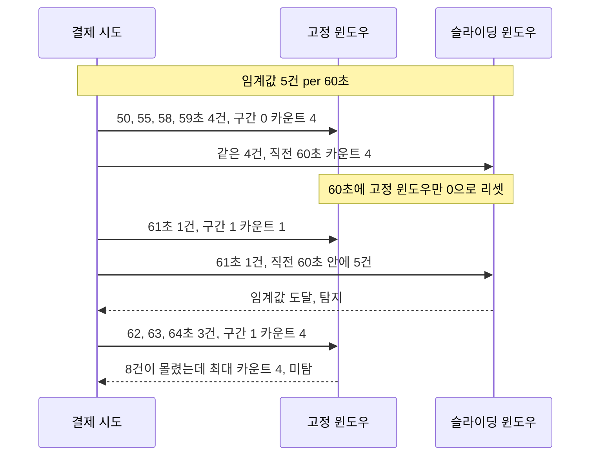
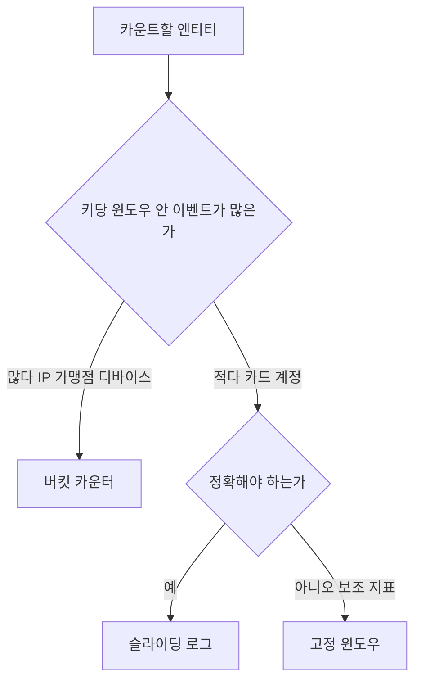
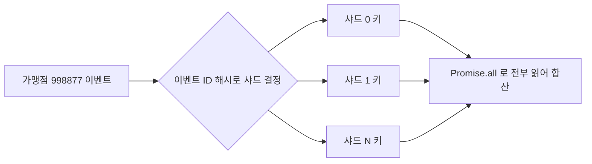
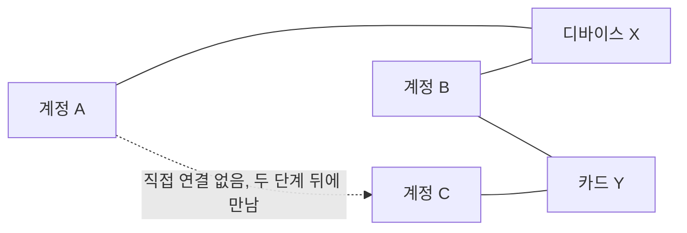
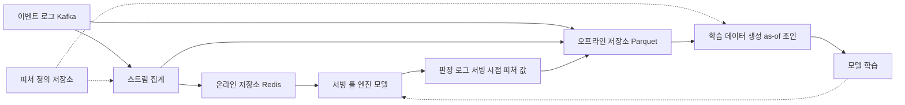
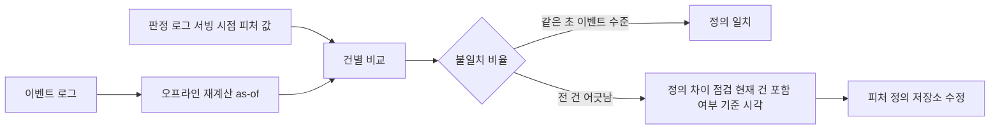
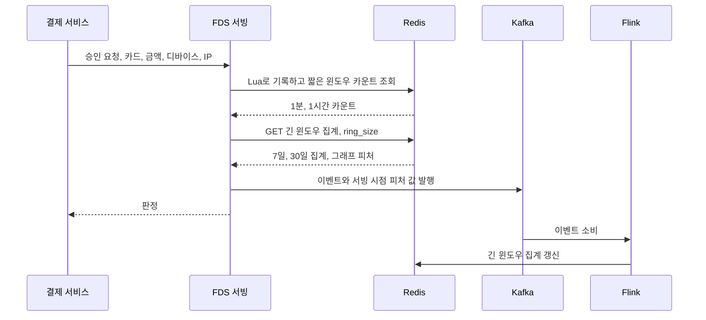
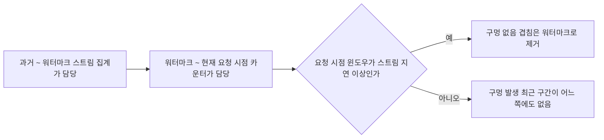
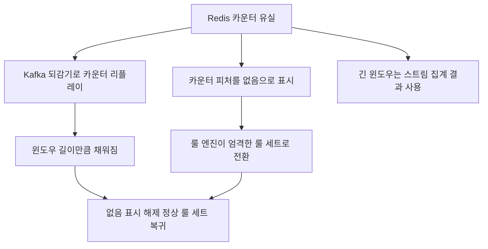

# FDS 속도 카운터와 피처 저장소

FDS 룰의 절반은 "최근 N분 동안 몇 번"이라는 질문이다. 같은 카드로 1분에 5번 시도했는지, 한 단말에서 24시간 동안 계정이 몇 개 나왔는지, 이 IP에서 실패한 승인이 몇 건인지. 이 숫자를 승인 경로 안에서 수 밀리초에 돌려주는 것이 속도 카운터(velocity counter)이고, 카운터와 그 밖의 파생값을 모델과 룰이 읽을 수 있게 모아 둔 곳이 피처 저장소다.

카운터는 구현이 쉬워 보여서 `INCR` 한 줄로 시작하는 경우가 많다. 그렇게 만든 카운터는 윈도우 경계에서 공격을 놓치고, 학습 때 쓴 숫자와 서빙 때 읽는 숫자가 한 칸씩 어긋난 채로 몇 달을 돌아간다. 에러도 로그도 없고 탐지율만 서서히 내려간다. 이 문서는 카운터 방식별로 무엇을 놓치는지, 실제로 동작하는 Lua 스크립트, 키를 어떻게 잡는지, 같은 단말에서 여러 계정이 나오는 패턴을 어떻게 잡는지, 학습과 서빙의 피처가 갈라지는 지점과 점검 방법, 스트림 집계와 요청 시점 계산의 경계를 순서대로 다룬다.

승인 경로에서 FDS가 호출되는 방식과 타임아웃 처리는 [FDS 이상거래탐지 시스템 구조](FDS_Architecture.md), 카운터 값을 받아 판정하는 쪽은 [FDS 룰 엔진 설계와 운영](FDS_Rule_Engine.md)에 있다. 이 문서의 코드는 fakeredis(Lua 실행 포함)와 ioredis-mock으로 직접 돌려서 출력을 확인한 것이다. 예외는 본문에서 따로 적었다.

---

## 같은 폭주가 윈도우 방식에 따라 다르게 센다

임계값이 "60초에 5건"이라고 하자. 공격자가 0~60초 구간의 끝과 다음 구간의 시작에 걸쳐 8건을 몰아서 보낸다. 시각은 50, 55, 58, 59, 61, 62, 63, 64초다.

고정 윈도우는 시각을 60초 단위로 잘라 구간마다 키를 따로 쓴다. 59초까지의 4건은 구간 0에, 61초부터의 4건은 구간 1에 들어가서 어느 쪽도 5에 닿지 않는다. 슬라이딩 윈도우는 매 이벤트 시각에서 직전 60초를 센다. 61초 이벤트를 받는 순간 직전 60초 안에 50, 55, 58, 59, 61초 다섯 건이 있다.



이 시나리오를 두 방식으로 실제로 돌린 결과는 이렇다. 고정 윈도우의 카운트는 1, 2, 3, 4 다음에 리셋되어 다시 1, 2, 3, 4가 나왔다. 슬라이딩 윈도우는 1부터 8까지 단조롭게 올라갔고 61초에 5가 찍혔다. 공격자가 윈도우 경계를 알 필요도 없다. 요청 속도를 임계값 바로 아래로 유지하면서 몇 번 시도하면 경계에 걸리는 구간이 나온다. 카드 테스팅(소액 승인을 여러 번 던져 살아 있는 카드를 찾는 수법)이 실제로 이런 식으로 임계값 아래를 맴돈다.

## 카운터 방식 네 가지

| 방식 | 자료구조 | 정확도 | 키당 메모리 | 구현 난이도 | 금액 합계 |
|---|---|---|---|---|---|
| 고정 윈도우 | 윈도우마다 문자열 키, `INCR` | 경계에서 임계값 직전씩 두 번 나뉘면 두 배 가까이 통과 | 정수 하나. 가장 작고 일정 | 가장 쉽다 | `INCRBY`로 바로 |
| 슬라이딩 로그 | `ZSET`, 이벤트 하나당 멤버 하나 | 정확. 이벤트 ID를 멤버로 쓰면 재전달에도 중복 집계 없음 | 윈도우 안 이벤트 수에 비례 | Lua 필요. 중간 | 멤버에서 파싱, 호출마다 O(N) |
| 버킷 카운터 | `HASH`, 버킷 시각이 필드 | 버킷 한 칸 폭만큼 오래된 쪽을 일찍 버려 과소 계산 | 윈도우/버킷 크기 개수로 상한 고정 | Lua 필요. 중간 | 필드를 하나 더 |
| 가중 근사 | 고정 윈도우 키 두 개 | 이벤트가 구간 안에서 고르게 퍼졌다고 가정한 추정치 | 고정 윈도우와 같음 | 쉬움 | 가능 |

가중 근사는 현재 구간 카운트에 직전 구간 카운트 × (직전 구간이 윈도우에 겹치는 비율)을 더한다. 계산이 싸고 키 두 개만 읽으면 된다. 폭주가 구간 안에서 한 점에 몰려 있으면 추정이 크게 틀리므로, 폭주를 잡으려는 FDS 룰에는 부적합하고 일반 API 호출 제한에나 맞는다. 일반적인 제한 알고리즘 비교는 [Rate Limiting](Rate_Limiting.md)에 있다.

메모리는 숫자를 외우지 말고 직접 재야 한다. 슬라이딩 로그가 부담이 되는 지점은 키 하나에 이벤트가 많이 쌓이는 경우다. 초당 500건이 들어오는 가맹점을 1시간 윈도우로 잡으면 키 하나에 180만 멤버가 들어간다. 멤버당 100바이트로 넉넉히 잡아도 180MB다. 카드나 계정 단위에서는 윈도우 안 이벤트가 몇 건 안 되므로 슬라이딩 로그가 문제되지 않는다. 가맹점·IP·디바이스처럼 한 키에 이벤트가 몰리는 단위는 버킷 카운터로 내리거나 샤딩해야 한다. 실제 크기는 `MEMORY USAGE <key>`로 운영 데이터 하나를 재서 곱한다.

카드·계정처럼 키당 이벤트가 적고 정확해야 하는 곳은 슬라이딩 로그, IP·가맹점처럼 키당 이벤트가 많은 곳은 버킷 카운터, 정확도보다 값싼 게 중요한 보조 지표만 고정 윈도우로 둔다.

아래 도식은 이 선택을 분기로 정리한 것이다. 키당 이벤트 수가 먼저고, 정확도 요구가 그다음이다.



---

## Lua 스크립트로 구현하기

카운터는 "오래된 것 지우기, 기록하기, 세기"가 한 덩어리여야 한다. 클라이언트에서 명령 세 개로 나누면 동시에 들어온 두 요청이 서로의 기록을 보지 못한 채 각자 4를 읽는다. Redis는 Lua 스크립트를 쪼개지 않고 실행하므로 이 세 단계를 스크립트에 넣는다.

### 슬라이딩 로그

```lua
-- KEYS[1] 카운터 키
-- ARGV[1] 이벤트 시각(ms), ARGV[2] 윈도우(ms), ARGV[3] 이벤트 ID, ARGV[4] 금액(원 단위 정수)
local key      = KEYS[1]
local now      = tonumber(ARGV[1])
local window   = tonumber(ARGV[2])
local event_id = ARGV[3]
local amount   = tonumber(ARGV[4])

redis.call('ZREMRANGEBYSCORE', key, '-inf', now - window)
redis.call('ZADD', key, now, event_id .. ':' .. amount)
redis.call('PEXPIRE', key, window * 2)

local members = redis.call('ZRANGEBYSCORE', key, now - window + 1, '+inf')
local sum = 0
for i = 1, #members do
  sum = sum + tonumber(string.match(members[i], ':(%-?[%d%.]+)$'))
end
return {#members, tostring(sum)}
```

멤버를 `이벤트ID:금액`으로 쓴 이유가 두 가지 있다. 같은 이벤트가 Kafka 재전달이나 클라이언트 재시도로 두 번 들어와도 멤버가 같으니 `ZADD`가 새로 추가하지 않는다. 그리고 금액 합계를 별도 키 없이 같은 자료구조에서 구한다. 합계를 `tostring`으로 돌려주는 건 Lua 숫자가 Redis 응답에서 정수로 잘리기 때문이다.

범위 조회가 `now - window + 1`부터인 것도 의도다. `ZREMRANGEBYSCORE`는 `now - window` 이하를 지우므로 두 경계가 맞아야 방금 지운 것과 센 것이 같은 구간이다. 이 경계가 어긋나면 윈도우가 1ms 길거나 짧아지는데, 학습 쪽 계산과 비교할 때 같은 초에 찍힌 이벤트에서 건수가 어긋나는 원인이 된다.

아래 도식은 위 스크립트가 한 번 실행될 때의 순서다. 이 다섯 단계가 Redis 안에서 끊기지 않고 실행된다는 점을 보면 된다.


Node.js에서는 ioredis의 `defineCommand`로 등록한다. 호출마다 스크립트 본문을 보내지 않고 SHA로 부른다.

```javascript
const Redis = require('ioredis');
const redis = new Redis(process.env.REDIS_URL);

redis.defineCommand('velocityAdd', { numberOfKeys: 1, lua: SLIDING_LUA });

const key = (entity, id, metric, win) => `fds:v1:{${entity}:${id}}:${metric}:${win}`;

async function record(entity, id, eventId, amount, eventTimeMs, windowMs, label) {
  const [count, sum] = await redis.velocityAdd(
    key(entity, id, 'txn', label), eventTimeMs, windowMs, eventId, amount
  );
  return { count, sum: Number(sum) };
}

// 카드, 계정, 디바이스, IP는 키가 서로 다른 슬롯에 갈 수 있으므로 호출을 따로 보낸다
async function velocityFeatures(evt) {
  const t = evt.eventTimeMs;
  const [card1m, card1h, acct1h, dev1h, ip1h] = await Promise.all([
    record('card', evt.cardToken, evt.id, evt.amount, t, 60_000, '1m'),
    record('card', evt.cardToken, evt.id, evt.amount, t, 3_600_000, '1h'),
    record('acct', evt.accountId, evt.id, evt.amount, t, 3_600_000, '1h'),
    record('dev', evt.deviceHash, evt.id, evt.amount, t, 3_600_000, '1h'),
    record('ip', evt.ipKey, evt.id, evt.amount, t, 3_600_000, '1h'),
  ]);
  return { card1m, card1h, acct1h, dev1h, ip1h };
}
```

위 8건 시나리오를 이 함수 형태로 돌리면 카운트가 1, 2, 3, 4, 5, 6으로 올라가고, 같은 이벤트 ID로 재전달된 마지막 호출은 6 그대로 돌려준다.

### 고정 윈도우

```lua
local c = redis.call('INCR', KEYS[1])
if c == 1 then redis.call('PEXPIRE', KEYS[1], ARGV[1]) end
return c
```

키 이름에 `floor(eventTimeMs / windowMs)`를 붙여 윈도우마다 다른 키를 쓴다. `INCR`과 `PEXPIRE`를 스크립트로 묶은 이유는 `INCR` 직후 프로세스가 죽으면 TTL이 없는 키가 영원히 남기 때문이다. TTL은 윈도우의 2배로 잡아야 직전 구간 값을 가중 근사에서 읽을 수 있다. 이 방식은 재전달에 약하다. 같은 이벤트가 두 번 들어오면 그대로 두 번 센다. 멱등성이 필요하면 `SET dedup:<event_id> 1 NX EX <윈도우>`를 앞에 두고 성공한 경우에만 올려야 하는데, 그러면 명령이 늘어나서 슬라이딩 로그와 비용 차이가 줄어든다.

### 버킷 카운터

```lua
local key       = KEYS[1]
local now       = tonumber(ARGV[1])
local bucket_ms = tonumber(ARGV[2])
local nbuckets  = tonumber(ARGV[3])

local cur = math.floor(now / bucket_ms)
redis.call('HINCRBY', key, cur, 1)
redis.call('PEXPIRE', key, bucket_ms * (nbuckets + 1))

local total = 0
local all = redis.call('HGETALL', key)
for i = 1, #all, 2 do
  local b = tonumber(all[i])
  if b <= cur - nbuckets then
    redis.call('HDEL', key, all[i])
  else
    total = total + tonumber(all[i + 1])
  end
end
return total
```

1분 버킷 60개로 1시간 윈도우를 만들고 이벤트를 0초, 3599초, 3600초, 3660초, 3721초에 넣으면 합계가 1, 2, 2, 3, 4로 나온다. 3600초에 합계가 3이 아니라 2인 이유는 0초 이벤트가 든 버킷 0이 그 시점에 지워지기 때문이다. 이 방식은 버킷이 통째로 지워지므로 버킷 안에서 늦게 찍힌 이벤트일수록 실제 윈도우보다 일찍 사라진다. 오차가 항상 과소 계산 쪽이라 "5건 이상이면 차단" 같은 룰에서는 놓치는 방향으로만 틀린다. 버킷 폭을 윈도우의 1/60 정도로 두면 대부분 감수할 수 있는 오차다.

---

## 키 설계와 TTL

키는 `fds:v1:{엔티티:ID}:지표:윈도우` 형태로 통일한다. 맨 앞 `v1`은 지표 정의가 바뀔 때 올린다. 윈도우 길이나 현재 건 포함 여부를 바꿀 때 같은 키를 재사용하면 새 정의와 옛 정의가 섞인 값이 윈도우 길이만큼 남는다. 버전을 올려 새 키로 쓰기 시작하고 옛 키는 TTL로 사라지게 둔다.

| 단위 | 키 예 | 주로 보는 윈도우 | 주의 |
|---|---|---|---|
| 카드 | `fds:v1:{card:tok_8f2a}:txn:1m` | 1분, 1시간, 24시간 | PAN을 키에 넣지 않는다. 토큰이나 HMAC 해시를 쓴다 |
| 계정 | `fds:v1:{acct:u_10492}:txn:1h` | 1시간, 24시간 | 로그인 실패와 결제 시도는 지표를 분리 |
| 디바이스 | `fds:v1:{dev:fp_c71d}:txn:1h` | 1시간, 24시간 | 핑거프린트가 바뀌면 카운트가 끊긴다 |
| IP | `fds:v1:{ip:203.0.113.7}:txn:1h` | 1분, 1시간 | IPv6는 /64로 묶는다. 이동통신 CGNAT IP는 정상 사용자가 수천 명 |
| 가맹점 | `fds:v1:{mrc:998877}:txn:5m` | 5분, 1시간 | 대형 가맹점은 핫키. 샤딩이나 버킷 카운터 |

중괄호 안만 해시 슬롯 계산에 쓰이므로 같은 카드의 `1m`, `1h` 키는 같은 슬롯에 들어간다. 한 스크립트로 두 키를 같이 만지려면 이게 필요하다. 반대로 카드, 계정, IP는 슬롯이 달라서 한 스크립트에 못 묶는다. 위 코드에서 `Promise.all`로 따로 보낸 이유다. 파이프라인으로 묶는 방법은 클라이언트와 클러스터 설정에 따라 슬롯이 다른 키에서 실패하는 경우가 있어서 `Promise.all`이 안전하다. 왕복이 다섯 번이면 지연 예산에 들어오는지 먼저 잰다.

TTL은 윈도우보다 길게, 보통 2배로 잡는다. 마지막 쓰기 이후 윈도우만큼 지나면 키 안의 모든 데이터가 윈도우 밖이라 지워도 되기 때문에 정확히는 윈도우 길이면 된다. 2배로 두는 이유는 서버 간 시계 차이와 늦게 도착한 이벤트 때문이다. 다만 TTL은 정리용이지 정확도를 보장하는 수단이 아니다. 쓰기가 뜸한 키는 만료 전까지 오래된 멤버를 들고 있다. 읽기 전용 경로(조회만 하는 룰)에서는 `ZCARD`가 아니라 `ZCOUNT key (now-window +inf`처럼 시각 범위를 직접 걸어야 한다. `ZCARD`를 쓰면 한 시간 전에 한 번 쓰고 방치된 키가 지금도 "5건"으로 나온다.

가맹점 같은 핫키는 키를 여러 개로 쪼갠다. `fds:v1:{mrc:998877}:s3:txn:5m`처럼 샤드 번호를 해시 태그 밖에 두고 이벤트 ID의 해시로 샤드를 정하면 쓰기가 여러 슬롯에 퍼진다. 읽을 때는 샤드 전부를 `Promise.all`로 읽어 합산한다. 샤드가 8개면 읽기가 8번이므로 가맹점 룰은 승인 경로가 아니라 스트림 쪽으로 빼는 편이 낫다. 이 결정은 아래 스트림 집계 절에서 다시 다룬다.

아래 도식은 가맹점 핫키를 샤드로 나눠 쓰고 읽는 모습이다. 쓰기는 이벤트 ID 해시로 한 샤드에 가고, 읽기는 샤드 전부를 모아 합산한다.



---

## 한 단말에서 계정이 여러 개 나오는 패턴

카운터는 "한 엔티티가 몇 번 나왔는가"를 센다. 신규 가입 남용이나 탈취 계정 돌려쓰기는 "한 엔티티에 다른 엔티티가 몇 종류 붙었는가"를 봐야 한다. 같은 디바이스에서 24시간 동안 계정이 6개 나오면 가족 태블릿일 수도 있고, 계정 공장일 수도 있다. 여기서 필요한 건 건수가 아니라 서로 다른 값의 개수(cardinality)다.

| 관계 | 의심되는 패턴 |
|---|---|
| 디바이스 하나에 계정 N개 | 가입 남용, 탈취 계정 돌려쓰기 |
| IP 하나에 카드 N개 | 카드 테스팅, 크리덴셜 스터핑 ([Credential Stuffing](Credential_Stuffing.md)) |
| 카드 하나에 디바이스 N개 | 도용된 카드번호를 여러 단말에서 시도 |
| 카드 하나에 가맹점 N개 (짧은 시간) | 소액 승인으로 카드 생존 확인 |
| 계정 하나에 카드 N개 (24시간) | 도용 카드 일괄 시험 |

서로 다른 값의 개수는 `SET`이나 `HyperLogLog`로 센다. 목록이 필요하면 `SET`(`SADD`, `SCARD`), 개수만 필요하면 `HyperLogLog`가 메모리에 유리하다. HyperLogLog 표준 오차는 Redis 문서 기준 0.81%라서 "6개 이상이면 의심" 같은 작은 임계값에서는 오차가 판정에 영향을 주지 않는다. 슬라이딩 윈도우가 안 되는 게 문제인데, 시간별 키를 따로 쓰고 읽을 때 `PFCOUNT`로 24개를 합치면 된다.

```javascript
const HOUR = 3_600_000;

async function recordDeviceAccount(deviceId, accountId, eventMs) {
  const key = `fds:v1:{dev:${deviceId}}:accts:h:${Math.floor(eventMs / HOUR)}`;
  await redis.pipeline().pfadd(key, accountId).expire(key, 25 * 3600).exec();
}

async function distinctAccounts24h(deviceId, nowMs) {
  const hour = Math.floor(nowMs / HOUR);
  const keys = Array.from({ length: 24 }, (_, i) =>
    `fds:v1:{dev:${deviceId}}:accts:h:${hour - i}`);
  return redis.pfcount(...keys);
}
```

같은 해시 태그를 쓰기 때문에 24개 키가 한 슬롯에 있고 `PFCOUNT`가 클러스터에서도 돈다. 한 디바이스에 계정 30개를 20분 간격으로 넣고 24시간 합산하면 30이 나오고, 이미 들어간 계정을 다시 넣어도 늘지 않는다. 이 동작은 fakeredis로 확인했다. Node 쪽은 `ioredis-mock`이 `pfadd` 파이프라인을 지원하지 않아 직접 돌려 보지 못했고, 실제 ioredis에서는 표준 호출이다. 문제는 키 수다. 디바이스 수백만 개에 시간별 키 24개를 곱하면 키 수가 늘어난다. HyperLogLog는 원소가 적으면 희소 인코딩으로 작게 저장되지만, 디바이스 규모에서는 `MEMORY USAGE`로 대표 키 몇 개를 재서 계획해야 한다.

### 믿으면 안 되는 연결

연결 신호는 기본적으로 약하다. 단말 하나에 계정이 여러 개 붙는 정상 상황이 흔하다.

- 디바이스 핑거프린트는 같은 기종·같은 OS 버전의 브라우저끼리 충돌하는 경우가 있고, 브라우저 업데이트나 시크릿 모드에서 값이 바뀐다. 앱이면 설치 ID와 합쳐서 쓴다.
- IP는 회사·학교·카페의 공용 NAT와 이동통신 CGNAT에서 수백~수천 명이 같은 주소를 쓴다. IP 단독 카운트는 IP 유형 정보(데이터센터·VPN·Tor·이동통신)를 붙인 뒤에 의미가 있다. 이 정보는 외부 IP 정보 DB를 주기적으로 받아 두고 룩업한다.
- 카드 BIN(발급 식별 번호)은 발급 국가·카드 종류(신용·체크·선불)를 알려 준다. 8자리 BIN이 쓰이기 시작했으므로 테이블을 8자리 키로 만들고 6자리로 폴백한다. 결제 IP 국가와 BIN 국가가 다르다는 신호는 해외 직구 사용자도 많이 만들어서 단독으로는 약하다.

이런 신호는 룰 하나로 차단하지 않고 점수에 더하는 편이 맞다. UEBA 쪽에서 정상 행동 기준선을 만들어 두면 "이 계정은 원래 다른 단말을 자주 바꾸는 사용자"라는 맥락을 줄 수 있다. 기준선은 [UEBA](UEBA.md)에서 다룬다.

### 그래프 질의가 필요해지는 지점

`SET`과 HyperLogLog로 풀리는 건 한 단계 연결이다. 디바이스 → 계정 개수까지는 이걸로 충분하다. 연결이 두 단계 이상 이어질 때부터 막힌다. 계정 A와 B가 단말 X를 공유하고, B와 C가 카드 Y를 공유하면, A와 C는 직접 만난 적이 없는데 같은 조직일 수 있다. 이런 고리(ring)의 크기, 연결된 컴포넌트에 사기 확정 계정이 몇 개 있는가는 카운터로 계산할 수 없다.

아래 도식에서 계정 A와 C는 직접 공유하는 것이 없는데, 단말 X와 카드 Y를 거치면 한 덩어리로 이어진다. 카운터는 A에서 X까지의 한 단계만 본다.



```groovy
// 단말 X를 쓴 계정 → 그 계정들이 쓴 다른 단말 → 그 단말을 쓴 다른 계정의 수
g.V().has('device', 'id', 'dev_9f3a').
  in('USED_DEVICE').hasLabel('account').dedup().
  out('USED_DEVICE').hasLabel('device').dedup().
  in('USED_DEVICE').hasLabel('account').dedup().
  count()
```

이 쿼리는 [Neptune](../Cloud/AWS/Database/Neptune.md)에서 쓰는 Gremlin 문법이고 이 문서에서 직접 실행하지는 않았다. 그래프 DB를 승인 경로에서 호출하는 설계는 위험하다. 지연 편차가 크고, 슈퍼노드(공용 IP 하나에 정점 수천 개가 붙는 경우) 하나가 탐색을 폭발시킨다. 그래서 그래프 질의는 승인 경로 밖에서 돌려 결과만 피처로 내린다. 신규 계정·디바이스 이벤트가 들어올 때 배치나 스트림으로 `ring_size`, `linked_fraud_accounts` 같은 값을 계산해 Redis에 계정·디바이스 키로 써 두고, 승인 시점에는 그 값을 `GET`한다. 슈퍼노드는 탐색 전에 차수가 일정 이상인 IP·단말 정점을 제외하는 필터를 둔다.

---

## 학습 피처와 서빙 피처가 갈라지는 곳

카운터를 승인 경로에 올려 룰이 잘 돌아가면, 다음은 같은 숫자를 모델 입력으로 쓰고 싶어진다. 이때 학습 데이터는 로그 저장소(Parquet, 웨어하우스)에서 SQL로 계산하고 서빙은 Redis에서 읽는다. 계산 경로가 둘이라 값이 달라질 틈이 생긴다. 모델은 에러를 내지 않고 틀린 입력으로도 점수를 낸다. 오프라인 AUC는 괜찮은데 운영 탐지율이 내려가고, 룰 임계값을 학습 분포로 정해 둔 곳은 운영에서 너무 자주 혹은 너무 드물게 발동한다.

아래 구조에서 핵심은 두 경로가 같은 피처 정의를 읽는다는 점이다. 윈도우 길이, 기준 시각, 현재 건 포함 여부, 결측값 표현이 한 곳에 적히고 스트림 집계와 학습 데이터 생성이 둘 다 이 정의를 따른다.



점선은 정의를 읽는 관계이고 실선은 데이터 이동이다. 마지막의 판정 로그가 중요하다. 서빙이 실제로 읽은 피처 값을 판정 시점에 로그로 남겨 오프라인 저장소에 쌓으면, 나중에 오프라인에서 다시 계산한 값과 건별로 비교할 수 있다. 어떤 필드를 남길지는 [FDS 이상거래탐지 시스템 구조](FDS_Architecture.md)의 판정 로그 절에 있다.

### 실제로 어긋나는 자리

| 갈라지는 지점 | 서빙 | 학습 | 증상 |
|---|---|---|---|
| 현재 건 포함 | 기록 후 센다 (포함) | 현재 행을 빼고 센다 | 모든 카운트가 1씩 차이 |
| 기준 시각 | 이벤트 발생 시각 | 로그 수집 시각 | 지연 이벤트가 다른 윈도우에 들어감 |
| 늦게 도착한 이벤트 | 판정 시점에는 없었음 | 배치에는 이미 들어 있음 | 학습 쪽 카운트가 크다 |
| 날짜 경계 | UTC 자정 | KST 자정 | 오전 9시 전후 일간 지표가 어긋남 |
| 결측 | 키 없음을 0으로 | NaN을 평균으로 대치 | 신규 사용자 점수 왜곡 |
| 평판 테이블 조인 | 판정 당시 값 | 오늘 스냅샷을 과거 거래에 조인 | 미래 정보 누수, 오프라인 지표가 낙관적 |

마지막 줄이 가장 늦게 발견된다. IP 평판 목록을 학습 시점의 최신본으로 모든 과거 거래에 조인하면, 지난달 거래의 IP가 이번 주에 사기 IP로 등록된 경우 그 거래는 "블랙리스트 IP + 사기"로 학습된다. 서빙 시점에는 그 IP가 아직 목록에 없었으므로 모델이 믿은 신호가 운영에서는 존재하지 않는다. 평판 같은 변하는 테이블은 등록 시각을 같이 저장하고 학습 때 "거래 시각 이전에 등록된 것만" 붙여야 한다(as-of 조인).

### 점검 방법

서빙이 로그에 남긴 값을 정답으로 두고 오프라인 재계산 값을 맞춰 보는 코드다. 합성 데이터(카드 41장, 6시간, 3,000건, 윈도우 1시간)로 돌려서 정의가 같은 경우와 학습만 현재 건을 뺀 경우를 비교했다. 아래 도식은 점검이 어떤 순서로 이어지는지 보여준다. 기준은 서빙이 로그에 남긴 값이고, 오프라인 재계산이 그 값을 따라간다.



```python
import bisect
from collections import defaultdict

WINDOW = 3600

def offline_asof(events, include_current):
    # events: (event_id, card, ts). 서빙 정의가 현재 건 포함이면 include_current=True
    ts_by_card = defaultdict(list)
    for _, card, ts in events:
        ts_by_card[card].append(ts)
    for arr in ts_by_card.values():
        arr.sort()
    out = {}
    for eid, card, ts in events:
        arr = ts_by_card[card]
        hi = bisect.bisect_right(arr, ts) if include_current else bisect.bisect_left(arr, ts)
        lo = bisect.bisect_left(arr, ts - WINDOW)
        out[eid] = hi - lo
    return out

def mismatch(logged, recomputed):
    diff = [k for k in logged if logged[k] != recomputed[k]]
    return len(diff), len(logged)
```

출력은 이렇다.

```text
정의 일치 : (5, 3000)
현재 제외 : (3000, 3000)
PSI 현재 제외: 0.1667
```

정의가 같으면 3,000건 중 5건만 어긋난다. 이 5건은 같은 초에 찍힌 이벤트의 선후 때문이다. 서빙은 먼저 도착한 쪽만 세고 오프라인은 같은 초를 전부 센다. 시각 해상도가 낮을수록 늘어난다. 학습만 현재 건을 뺀 경우는 3,000건이 전부 어긋난다. 모든 값이 정확히 1씩 작으므로 눈으로 로그 몇 줄을 봐서는 구분이 안 된다. 분포 안정성 지표인 PSI는 0.1667이었다. PSI는 구간을 어떻게 나누느냐에 따라 값이 달라지고, 한 칸 이동이 분포 모양에 따라 작게도 크게도 보인다. 건별 일치율을 먼저 보고 PSI는 보조로 둔다.

이 점검은 배포 때마다 돌려야 한다. 피처 정의나 Lua 스크립트를 바꾼 날 일치율이 떨어지면 그 변경이 원인이다. 점검을 주 단위 모니터링에만 두면 몇 주간 낮은 탐지율을 모델 노후화 탓으로 돌리게 된다.

---

## 스트림 집계와 요청 시점 계산

위 구조도에서 "스트림 집계" 상자가 실제로 하는 일은 두 가지로 나뉜다. 승인 경로에서 요청이 들어올 때 Redis 카운터를 바로 갱신하고 읽는 방식(요청 시점 계산)과, Kafka 이벤트를 컨슈머나 Flink가 읽어서 집계해 Redis에 써 두는 방식(스트림 집계)이다.



짧은 윈도우는 요청 시점에 직접 갱신하고, 긴 윈도우는 스트림이 갱신한 값을 읽는다. 아래 표로 어느 쪽을 쓸지 정한다.

| 기준 | 요청 시점 Redis 카운터 | 스트림 집계 |
|---|---|---|
| 현재 건 반영 | 같은 요청 안에서 즉시 | 불가. 이벤트가 로그를 거쳐 돌아오기 전까지 안 보임 |
| 갱신 지연 | 없음 | 슬라이드 간격 + 워터마크 지연 (초~분) |
| 윈도우 길이 | 분~몇 시간 | 일~월 |
| 키당 이벤트 수가 많을 때 | 핫키 위험, 버킷·샤딩 필요 | 집계 노드에 분산 |
| 늦은 이벤트·순서 | 이벤트 시각 기준으로 직접 처리 | 워터마크와 허용 지연으로 처리 |
| 운영 부담 | Redis만 | Flink 클러스터, 체크포인트, 상태 크기 |
| 재처리 | 로그를 다시 흘려야 함 | 오프셋 되감기로 가능 |

짧은 윈도우를 Flink로 계산하면 안 되는 이유는 첫 행에 있다. 슬라이딩(HOP) 윈도우 집계는 윈도우가 닫힐 때 결과를 낸다. 1분 슬라이드면 방금 들어온 폭주가 최대 1분 뒤에야 카운터에 반영된다. 카드 테스팅은 그 1분 안에 끝난다. 반대로 30일 윈도우를 요청 시점 `ZSET`으로 들고 있으면 키마다 수십만 멤버가 쌓인다.

```sql
CREATE TABLE txn (
  event_id STRING, card_token STRING, amount BIGINT,
  event_time TIMESTAMP(3),
  WATERMARK FOR event_time AS event_time - INTERVAL '10' SECOND
) WITH ('connector' = 'kafka', /* ... */);

SELECT card_token, window_start, window_end,
       COUNT(*) AS cnt, SUM(amount) AS amt
FROM TABLE(HOP(TABLE txn, DESCRIPTOR(event_time),
               INTERVAL '1' HOUR, INTERVAL '7' DAY))
GROUP BY card_token, window_start, window_end;
```

이 SQL은 Flink 1.13 이후 윈도우 TVF 문법이고 이 문서에서 직접 실행하지는 않았다. 위 SQL의 `WATERMARK ... - INTERVAL '10' SECOND`가 "10초까지 늦게 오는 이벤트는 기다린다"는 뜻이다.

### 두 값을 이어 붙일 때의 틈

긴 윈도우는 스트림이 쓰고 짧은 윈도우는 요청 시점이 쓴다. 7일 카운트가 필요하면 "스트림이 집계한 값(워터마크까지) + 그 뒤 요청 시점 카운터"를 합친다. 이때 스트림 지연보다 짧은 쪽 카운터 윈도우가 짧으면 구멍이 생긴다. 스트림 결과가 5분 늦게 반영되는데 요청 시점 카운터가 1분 윈도우뿐이면, 최근 5분 중 4분은 어느 쪽에도 없다. 짧은 카운터 윈도우를 스트림 지연의 2배 이상으로 두거나, 스트림 값이 어디까지 반영됐는지(워터마크 시각)를 같이 저장해 겹치는 구간을 빼야 한다. 겹침을 빼지 않으면 같은 이벤트가 두 번 센다.

아래 도식은 시간축에서 어느 구간이 누구의 담당인지 보여준다. 워터마크와 현재 시각 사이를 요청 시점 카운터가 덮어야 구멍이 없다.



---

## 늦게 오거나 순서가 뒤바뀐 이벤트

Kafka는 파티션 안에서만 순서를 지킨다. 키를 카드로 파티셔닝하면 카드 단위 순서는 유지되지만, 컨슈머 재시작·리밸런스·재시도 토픽을 거친 이벤트는 수 초에서 수 분 늦게 돌아온다. 이 이벤트를 처리하는 방식은 카운터 종류별로 다르다.

슬라이딩 로그는 점수가 이벤트 시각이라 늦게 온 이벤트도 제 위치에 들어간다. 위 Lua에서 `now`를 이벤트 시각으로 쓰기 때문에 정리 기준도 그 이벤트의 시각이다. 늦은 이벤트의 `now`는 최신 이벤트보다 작으므로 덜 지울 뿐 더 지우지는 않는다. 반환된 카운트는 "그 이벤트 시점에서 본 값"이라 과거 시점 재현에는 맞다. 다만 이 반환값을 실시간 판정에 쓰면 안 된다.

고정 윈도우와 버킷 카운터도 이벤트 시각으로 버킷 키를 계산하면 제 버킷에 들어간다. 다만 이미 TTL이 지나 사라진 윈도우로 돌아가는 이벤트는 새 키를 만들고 TTL이 붙은 채 남아서 아무도 읽지 않고 사라진다. 낭비일 뿐 오류는 아니다.

반대로 처리 시각(`Date.now()`)으로 키를 계산하면 늦은 이벤트가 현재 윈도우에 들어가서 카운트가 부풀고, 학습 쪽(이벤트 시각 기준)과의 차이가 커진다. 위 표의 "기준 시각" 행이 이 경우다. 서빙 카운터의 시각은 이벤트 시각으로 통일한다. 단말 시계를 믿을 수 없으니 이벤트 시각은 서버가 요청을 받은 시각으로 정한다.

재전달은 별개 문제다. Kafka 컨슈머는 at-least-once가 기본이라 같은 이벤트가 두 번 올 수 있다. 슬라이딩 로그는 이벤트 ID를 멤버로 써서 자연스럽게 막고, `INCR` 기반 카운터는 앞에 dedup 키가 필요하다. 이 차이가 슬라이딩 로그를 FDS 기본으로 고르는 큰 이유다. 리플레이로 카운터를 복구할 때도 같은 성질이 쓰인다.

---

## 카운터가 사라졌을 때

Redis는 비동기 복제라서 장애 조치 시 마지막 몇백 ms~수 초의 쓰기가 새 마스터에 없을 수 있다. 영속화 없이 재시작하거나 캐시 노드를 교체하면 키 전체가 비어 돌아온다. 이때 카운터는 0이거나 작게 시작한다.

문제는 룰이 이 상태를 정상으로 읽는다는 점이다. `card_txn_1m >= 5`는 카운터가 비면 거짓이 된다. 룰이 조용해지는 시간이 윈도우 길이만큼 이어진다. 1분 카운터는 1분, 24시간 카운터는 하루다. 공격자는 이 시간을 모르지만 장애 직후에 트래픽이 몰리는 경우는 실제로 있다. 영향을 줄이는 방법은 세 가지다.

1. 복구 중에는 카운터 피처를 "없음"으로 표시해 룰이 0과 구분하게 한다. 룰 엔진이 결측을 어떻게 평가할지는 [FDS 룰 엔진 설계와 운영](FDS_Rule_Engine.md)에서 정한 정책을 따르고, 결측일 때 더 엄격한 룰 세트로 넘어가는 선택지를 둔다.
2. Kafka에서 최대 윈도우 길이만큼 되감아 컨슈머로 카운터를 다시 채운다. 이벤트 ID가 멤버인 슬라이딩 로그는 리플레이 구간이 실시간 쓰기와 겹쳐도 중복 집계되지 않는다. `INCR` 방식은 새 키(`v2`)로 채운 뒤 전환해야 한다.
3. 긴 윈도우는 스트림 집계 결과가 따로 있으므로 Redis만 날아가도 완전히 사라지지 않는다. 짧은 윈도우만 몇 분 비는 정도로 줄어든다.

아래 도식은 세 가지 대응이 복구 중에 어떻게 이어지는지 보여준다. 결측 표시는 즉시, 리플레이는 병행, 스트림 집계는 원래 별도 경로다.



AOF `everysec`을 켜면 유실이 대략 1초로 줄지만, 쓰기 지연과 디스크 비용이 늘고 장애 조치 때의 비동기 복제 유실은 그대로다. 카운터의 정확성이 위험 수용 범위 안인지 먼저 정한 뒤 영속화 수준을 고른다. 복제 구성과 장애 조치 때의 쓰기 유실에 대한 일반 내용은 [Redis 운영 패턴](../Backend/Caching/Redis_운영_패턴.md)에 있다.

카운터가 비는 상황은 한 번은 겪게 된다. 복구 절차가 문서에만 있고 한 번도 돌려 본 적이 없으면 장애 중에 처음 돌리게 된다. 스테이징에서 Redis를 비우고 리플레이를 걸어 복구 시간(윈도우를 채우는 데 걸리는 시간)을 한 번 재 두면, 그 시간이 곧 룰이 조용한 시간의 상한이다.
