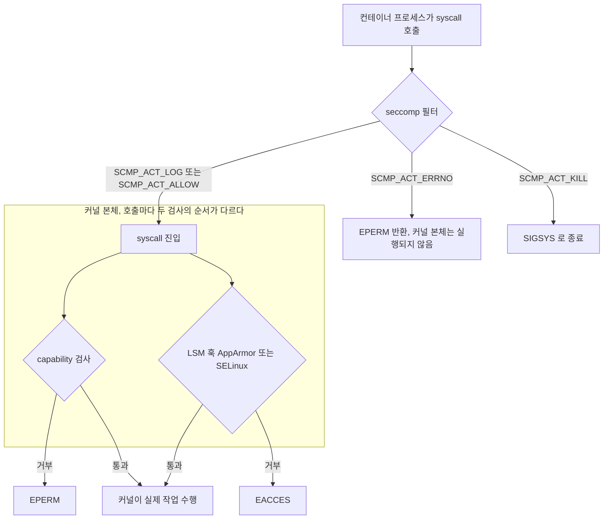
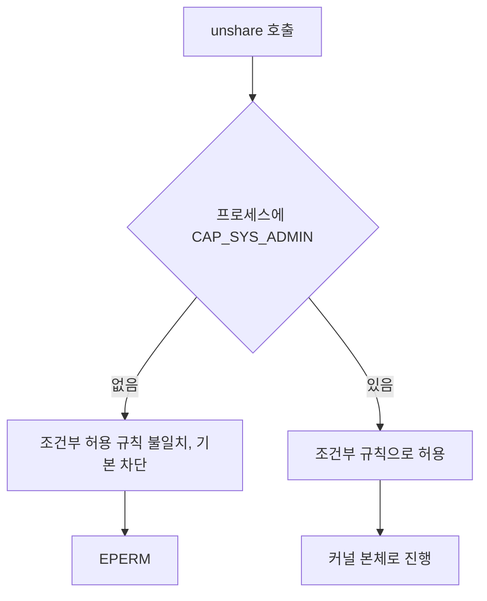
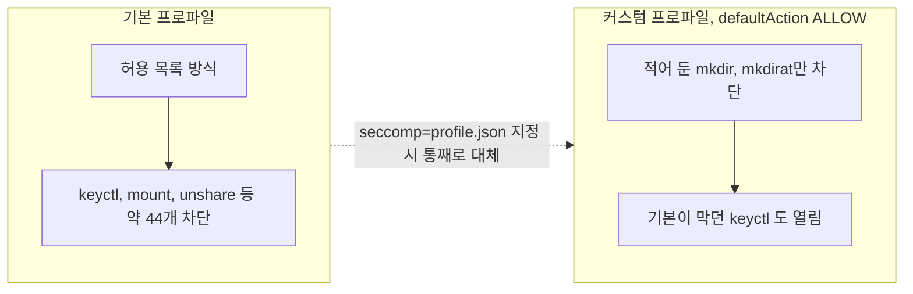
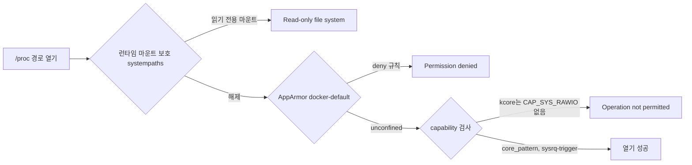
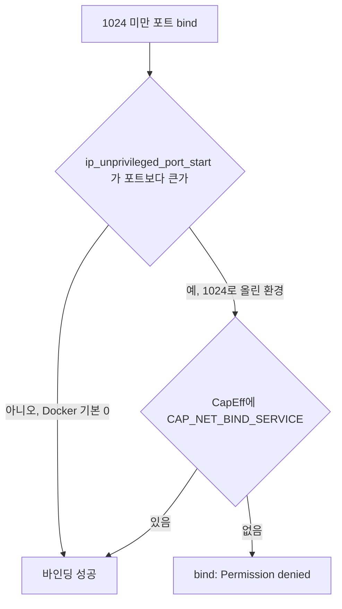
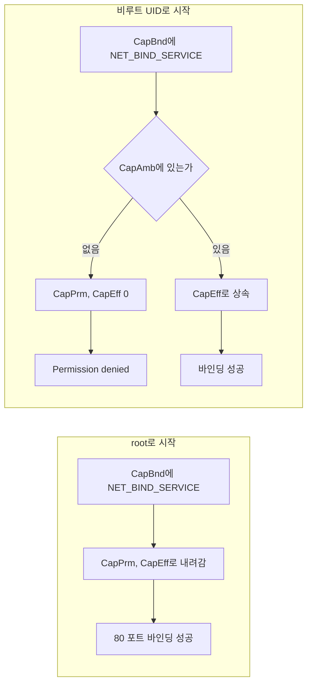
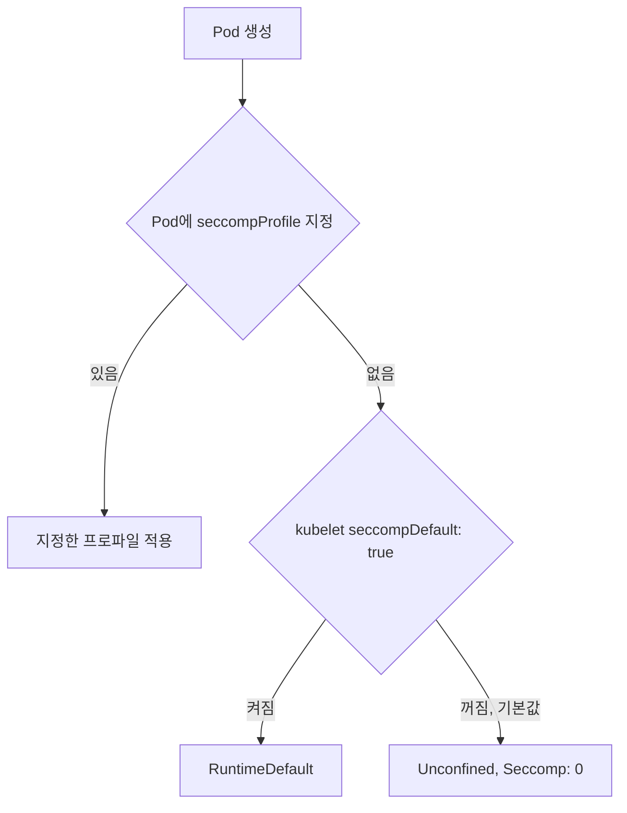
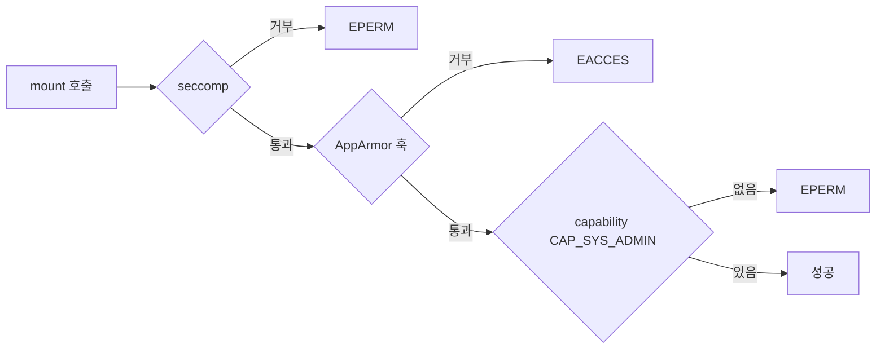
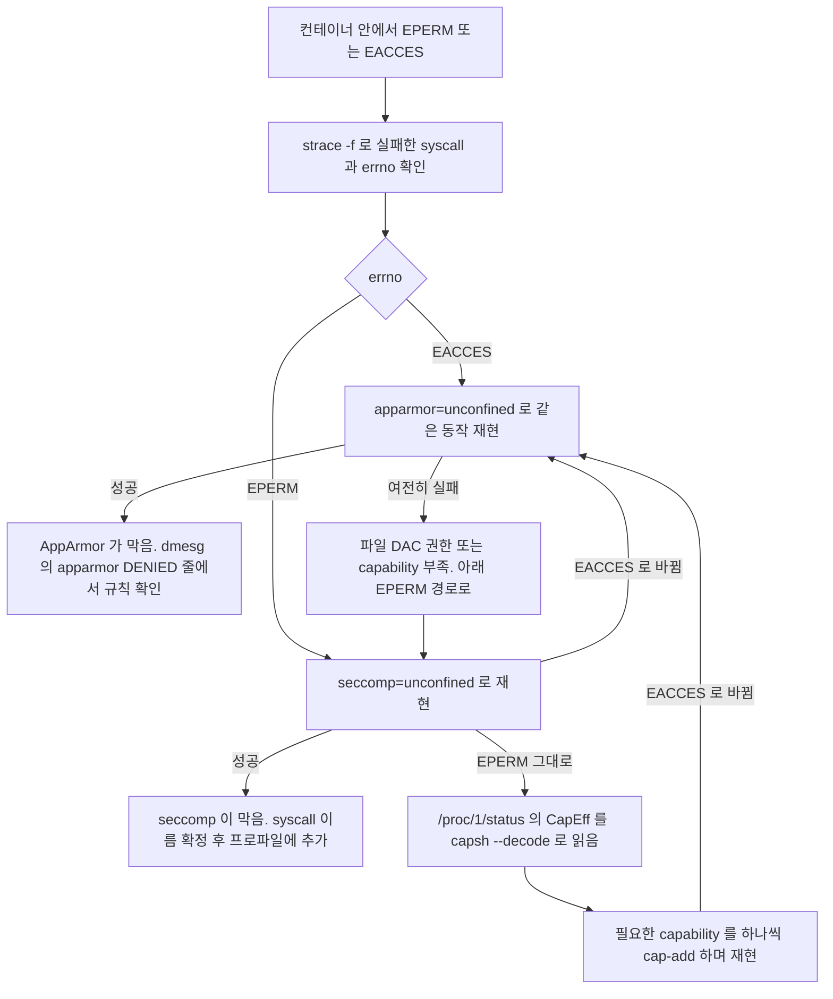

# Linux Capabilities, Seccomp, AppArmor

[컨테이너 탈출](Container_Escape.md)에서 `--cap-drop=ALL`, `seccomp=unconfined` 같은 옵션을 한 줄씩만 언급했다. 이 문서는 그 옵션 뒤에 있는 세 장치가 syscall을 어떤 순서로 검사하는지, 프로파일을 어떻게 쓰는지, 적용하고 나면 무엇이 깨지는지를 다룬다.

본문의 출력은 전부 `docker run`으로 직접 돌린 결과다. 환경은 Ubuntu 22.04, 커널 5.15.0-52, Docker 29.1.3, cgroup v2다. 쿠버네티스 클러스터, SELinux 호스트, 호스트 audit·커널 로그는 이 환경에서 쓸 수 없어서 돌리지 못했고, 해당 자리에 그렇게 적었다.

## syscall 하나가 지나가는 길

컨테이너 안 프로세스가 syscall을 부르면 세 장치를 차례로 지난다.



그림에서 볼 것은 seccomp이 맨 앞이라는 점이다. "capability, seccomp, LSM 순서"로 외우고 있다면 틀린 순서다. seccomp은 커널 본체가 시작되기 전에 syscall 번호와 인자 값만 보고 판단한다. 인자가 가리키는 문자열(파일 경로)은 읽지 못한다. 그래서 "어떤 경로에 쓰는가"는 seccomp이 아니라 AppArmor의 몫이다.

capability와 LSM의 순서는 syscall 구현마다 다르다. `mount`는 LSM 훅(`security_sb_mount`)이 capability 검사보다 먼저 나온다. 뒤의 디버깅 절에서 이 순서가 errno로 드러나는 것을 직접 본다.

역할을 한 줄씩 나누면 이렇다.

| 장치 | 보는 것 | 거부할 때 errno | 프로파일 단위 |
|---|---|---|---|
| seccomp | syscall 번호, 인자 값 | EPERM (설정에 따라 다름) | JSON, 컨테이너마다 |
| capability | 프로세스가 가진 비트 | EPERM | 비트 마스크 |
| AppArmor | 경로, 파일, 마운트 | EACCES (capability 규칙은 EPERM) | 텍스트 프로파일 |

## capability, root를 41조각으로 쪼갠 것

전통적인 root는 전부 아니면 전무였다. capability는 root 권한을 비트로 쪼갠 것이고, 이 호스트의 `--privileged` 컨테이너는 `CapEff: 000001ffffffffff`, 즉 비트 41개가 전부 켜져 있다.

기본 컨테이너가 받는 값은 `00000000a80425fb`다. `capsh --decode`로 풀면 14개다.

```bash
$ docker run --rm alpine:3.20 sh -c 'grep -E "^(CapEff|CapBnd)" /proc/self/status'
CapEff:	00000000a80425fb
CapBnd:	00000000a80425fb

$ capsh --decode=00000000a80425fb
0x00000000a80425fb=cap_chown,cap_dac_override,cap_fowner,cap_fsetid,cap_kill,cap_setgid,cap_setuid,cap_setpcap,cap_net_bind_service,cap_net_raw,cap_sys_chroot,cap_mknod,cap_audit_write,cap_setfcap
```

이 14개에 `CAP_SYS_ADMIN`, `CAP_SYS_MODULE`, `CAP_SYS_PTRACE`, `CAP_DAC_READ_SEARCH`는 없고, `CAP_NET_RAW`는 있다. 탈출과 공격에서 자주 나오는 다섯 개를 표로 묶었다.

| capability | 쓰이는 공격·탈출 | 기본 허용 |
|---|---|---|
| `CAP_SYS_ADMIN` | `mount`, `unshare`, `setns`로 새 마운트·네임스페이스를 만든다. cgroup v1이면 `release_agent`에 호스트에서 실행될 명령을 써 넣는다. `bpf`도 이 capability를 요구한다. 이름만 admin이지 사실상 "나머지 전부"를 모아 둔 비트다 | 아니오 |
| `CAP_SYS_MODULE` | `insmod`로 커널 모듈을 올리면 호스트 커널 안에서 임의 코드가 돈다. 컨테이너가 호스트의 `/lib/modules`를 보거나 모듈을 직접 빌드해 올릴 수 있으면 그대로 끝난다 | 아니오 |
| `CAP_SYS_PTRACE` | `hostPID: true`처럼 PID 네임스페이스를 공유한 상태에서 호스트 프로세스에 `ptrace`·`process_vm_writev`로 코드를 주입하거나 메모리의 시크릿을 읽는다 | 아니오 |
| `CAP_DAC_READ_SEARCH` | `open_by_handle_at`로 파일 핸들을 직접 열어 마운트 네임스페이스 밖의 호스트 파일을 읽는다. 2014년 Shocker 익스플로잇이 이 경로였다 | 아니오 |
| `CAP_NET_RAW` | raw·packet 소켓으로 같은 브리지의 다른 컨테이너를 ARP 스푸핑하거나 패킷을 스니핑한다. AF_PACKET 메모리 손상 취약점(CVE-2020-14386)은 이 capability가 있어야 발동했다 | 예 |

마지막 줄이 실무에서 가장 자주 놓친다. 위험 capability 중 기본으로 열려 있는 건 `CAP_NET_RAW`뿐이고, 평소에는 ping 때문에 있는 줄 알고 넘어간다. 실제로 raw 소켓이 열리는지는 바로 확인된다.

```bash
$ docker run --rm debian:12-slim perl -MSocket -e 'print socket(S,AF_INET,SOCK_RAW,1) ? "raw socket OK\n" : "FAIL: $!\n"'
raw socket OK
$ docker run --rm --cap-drop ALL debian:12-slim perl -MSocket -e 'print socket(S,AF_INET,SOCK_RAW,1) ? "raw socket OK\n" : "FAIL: $!\n"'
FAIL: Operation not permitted
```

cgroup v2 호스트에는 `release_agent`가 없어서 `CAP_SYS_ADMIN`의 그 경로는 닫혀 있다. 이 호스트가 v2라 위 표의 첫 줄 중 `release_agent`는 재현하지 않았다. `CAP_SYS_ADMIN` 자체가 위험하다는 결론은 v2에서도 같다. 마운트와 네임스페이스 조작이 남기 때문이다.

쿠버네티스에서는 `capabilities.drop: [ALL]`로 시작하고 필요한 것만 `add`로 되돌린다. Pod Security Standards의 `restricted` 프로파일은 `ALL` drop을 요구하고 `NET_BIND_SERVICE` 외의 add를 허용하지 않는다.

## 기본 seccomp 프로파일이 막는 syscall

Docker의 기본 프로파일은 허용 목록 방식이다. 300개가 넘는 syscall 중 44개 정도를 막는다고 [Docker 문서](https://docs.docker.com/engine/security/seccomp/)에 적혀 있다. `mount`, `unshare`, `setns`, `keyctl`, `add_key`, `bpf`, `perf_event_open` 등이 여기에 든다.

기본 프로파일로 막힌 것과 `seccomp=unconfined`로 푼 결과를 같은 호출로 비교했다. 인자는 의도적으로 NULL이나 0을 준 호출이라, 에러가 `EFAULT`나 `EBADF`로 바뀌면 "seccomp을 통과해 커널 본체까지 들어갔다"는 뜻이다.

| syscall | 기본 프로파일 | `seccomp=unconfined` | 읽는 법 |
|---|---|---|---|
| `keyctl` | EPERM | 성공(keyring ID 반환) | seccomp이 단독으로 막고 있었다 |
| `add_key` | EPERM | EFAULT | 인자 NULL을 커널이 검사하는 데까지 들어갔다 |
| `setns` | EPERM | EBADF | 위와 같다 |
| `perf_event_open` | EPERM | EACCES | seccomp을 풀자 커널 쪽 설정(`perf_event_paranoid`)이 거부한다 |
| `bpf` | EPERM | EPERM | 풀어도 같다. 커널이 capability를 요구한다 |
| `unshare` (UTS) | EPERM | EPERM | 풀어도 같다. `CAP_SYS_ADMIN`이 없다 |
| `mount` | EPERM | EACCES | seccomp 다음 계층인 AppArmor가 막는다 |

`bpf`와 `unshare` 두 줄이 중요하다. seccomp을 풀었는데 에러가 그대로면 seccomp은 범인이 아니다. 같은 EPERM이라 에러 문자열만 봐서는 구분이 안 된다.

### SYS_ADMIN을 주면 seccomp 규칙도 같이 풀린다

기본 프로파일에는 "이 capability가 있으면 이 syscall을 허용한다"는 조건부 규칙이 들어 있다. `--cap-add SYS_ADMIN` 한 줄이 capability만 추가하는 게 아니라 `mount`, `unshare` 같은 syscall의 seccomp 차단도 같이 푼다.

```bash
$ docker run --rm --cap-add SYS_ADMIN debian:12-slim perl /sc.pl unshare 0x04000000
unshare ret=0 errno=0 ()

$ docker run --rm debian:12-slim perl /sc.pl unshare 0x04000000
unshare ret=-1 errno=1 (Operation not permitted)
```

(`/sc.pl`은 번호로 syscall을 직접 부르는 8줄짜리 Perl 스크립트다. 호출 번호는 x86_64 기준이다.)

아래 그림은 기본 프로파일의 조건부 규칙이 동작하는 방식이다. capability 보유 여부가 seccomp 판정 자체를 바꾼다.



"SYS_ADMIN 하나만 추가했을 뿐인데" 하는 말이 틀린 이유가 이것이다. 이 효과는 뒤의 AppArmor 절에서 한 번 더 나온다.

### 커스텀 프로파일은 기본을 대체한다

`--security-opt seccomp=profile.json`은 기본 프로파일에 덧붙이는 게 아니라 바꿔치기한다. `defaultAction`을 `SCMP_ACT_ALLOW`로 두고 막을 것만 적은 프로파일을 쓰면 기본 프로파일이 막던 것이 전부 열린다.

```json
{
  "defaultAction": "SCMP_ACT_ALLOW",
  "syscalls": [
    { "names": ["mkdir", "mkdirat"], "action": "SCMP_ACT_ERRNO", "errnoRet": 1 }
  ]
}
```

```bash
$ docker run --rm --security-opt seccomp=/tmp/deny_mkdir.json debian:12-slim sh -c 'mkdir /tmp/x; echo rc=$?'
mkdir: cannot create directory '/tmp/x': Operation not permitted
rc=1

$ docker run --rm --security-opt seccomp=/tmp/deny_mkdir.json debian:12-slim perl /sc.pl keyctl 0 -3 0
keyctl ret=937427090 errno=0 ()
```

`mkdir`은 막혔는데 기본 프로파일이 막던 `keyctl`이 열렸다. 프로파일은 Docker의 `default.json`을 복사해서 필요한 항목만 고치는 방식으로 쓴다. 맨 처음부터 쓰면 허용 목록이 수백 줄이고, 하나 빼먹으면 앱이 기동 중에 죽는다.

아래 그림은 기본 프로파일과 커스텀 프로파일을 비교한 것이다. 커스텀은 덧붙이기가 아니라 대체라서, 기본이 막던 `keyctl` 같은 항목이 사라진다.



액션 이름에 오타가 나면 컨테이너가 뜨지 않고 런타임 에러가 난다.

```text
docker: Error response from daemon: failed to create task for container: failed to create shim task: OCI runtime create failed: runc create failed: string SCMP_ACT_LOGG is not a valid action for seccomp
```

### 적용 여부 확인

프로세스의 `/proc/<pid>/status`에 `Seccomp` 필드가 있다. 0은 필터 없음, 1은 strict, 2는 필터 모드다.

```bash
$ docker run --rm alpine:3.20 sh -c 'grep -E "^(Seccomp|NoNewPrivs)" /proc/self/status; cat /proc/self/attr/current'
NoNewPrivs:	0
Seccomp:	2
Seccomp_filters:	1
docker-default (enforce)

$ docker run --rm --security-opt seccomp=unconfined alpine:3.20 sh -c 'grep -E "^Seccomp" /proc/self/status'
Seccomp:	0
Seccomp_filters:	0
```

이 값이 가장 믿을 만한 판정 기준이다. 설정 파일이나 매니페스트에 뭐라고 적혀 있든, 실제로 적용된 건 이 값이다.

## AppArmor docker-default와 SELinux

`docker-default`는 도커 데몬이 시작할 때 만들어서 커널에 올리는 프로파일이다. 템플릿은 `dockerd` 바이너리 안에 들어 있어서 `strings`로 규칙이 보인다.

```text
deny @{PROC}/* w,
deny @{PROC}/sys/[^k]** w,
deny @{PROC}/sys/kernel/{?,??,[^s][^h][^m]**} w,
deny @{PROC}/sysrq-trigger rwklx,
deny @{PROC}/kcore rwklx,
deny mount,
deny /sys/[^f]*/** wklx,
deny /sys/f[^s]*/** wklx,
```

`/proc`과 `/sys` 쓰기를 막고, `mount`를 통째로 거부하고, `sysrq-trigger`와 `kcore`는 읽기·쓰기 모두 거부한다. 다만 기본 컨테이너에서 이 규칙은 거의 보이지 않는다. 런타임(runc)이 같은 경로를 이미 읽기 전용으로 마운트하거나 가려 두기 때문이다. AppArmor 규칙만 따로 보려면 런타임의 마운트 보호(`systempaths`)를 풀어서 AppArmor를 노출시켜야 한다. 아래는 각 경로를 열기만 하고(`>>` append open) 아무것도 쓰지 않는 스크립트로 확인한 것이다.

```text
## docker run --rm alpine:3.20 (기본)
OPEN FAIL /proc/sysrq-trigger          -> Read-only file system
OPEN FAIL /proc/sys/kernel/core_pattern -> Read-only file system
OPEN FAIL /proc/sys/kernel/hostname     -> Read-only file system
OPEN FAIL /proc/kcore                   -> Permission denied

## --security-opt systempaths=unconfined (마운트 보호 해제, AppArmor는 그대로)
OPEN FAIL /proc/sysrq-trigger          -> Permission denied
OPEN FAIL /proc/sys/kernel/core_pattern -> Permission denied
OPEN FAIL /proc/sys/kernel/hostname     -> Permission denied
OPEN FAIL /proc/kcore                   -> Permission denied

## --security-opt systempaths=unconfined --security-opt apparmor=unconfined
OPEN OK   /proc/sysrq-trigger
OPEN OK   /proc/sys/kernel/core_pattern
OPEN OK   /proc/sys/kernel/hostname
OPEN FAIL /proc/kcore                   -> Operation not permitted
```

세 단계에서 읽을 것은 두 가지다. 에러가 `Read-only file system`에서 `Permission denied`로 바뀌는 지점이 런타임 벽에서 AppArmor 벽으로 넘어간 곳이다. 그리고 AppArmor까지 빼면 `core_pattern`이 열린다. 이 파일은 네임스페이스에 속하지 않는 호스트 전역 설정이라서, 컨테이너가 쓸 수 있으면 코어 덤프 핸들러로 호스트 root 권한 명령을 지정하는 고전적인 탈출 경로가 된다. AppArmor는 런타임 마운트 보호 뒤의 두 번째 벽이다. 첫 번째 벽만 믿다가 `systempaths=unconfined`를 편하게 켜 두면 두 번째 벽 하나로 버티고 있다는 뜻이다.

마지막 줄의 `/proc/kcore`가 `Operation not permitted`로 바뀐 점도 보인다. AppArmor 거부(`Permission denied`)가 사라지자 그 뒤의 capability 검사(`CAP_SYS_RAWIO` 없음)가 거부한다. 장치가 겹겹이라는 게 이런 모습이다.

아래 그림은 `/proc` 쓰기 시도가 벽을 하나씩 넘는 과정이다. 벽을 풀 때마다 에러 문구가 바뀌는 지점이 위 세 단계 출력과 대응한다.



### SELinux container_t와의 차이

호스트가 하나의 LSM만 켜는 경우가 많다. 이 호스트의 목록은 `lockdown,capability,landlock,yama,apparmor`라서 SELinux는 없다. 그래서 SELinux 쪽은 실행하지 못했고, 아래 비교는 동작 원리 설명이다.

| 항목 | AppArmor (`docker-default`) | SELinux (`container_t`) |
|---|---|---|
| 판단 기준 | 경로 | 파일·프로세스에 붙은 라벨 |
| 컨테이너 프로세스 | `docker-default` 프로파일 | `container_t` 타입 + 컨테이너별 MCS 카테고리(`s0:c123,c456`) |
| 컨테이너끼리 분리 | 마운트 네임스페이스와 파일 권한에 의존 | 같은 `container_t`여도 카테고리가 다르면 서로의 파일을 읽지 못한다 |
| 호스트 파일 접근 | 프로파일에 허용된 경로만 | 컨테이너용 라벨(`container_file_t`)이 아닌 파일은 기본 거부 |
| 자주 겪는 문제 | 새 경로를 쓰는 앱이 `Permission denied` | 볼륨 마운트가 `Permission denied`, `:z`·`:Z`로 재라벨 |
| 주 사용 배포판 | Ubuntu, Debian, SUSE | RHEL, Fedora |

AppArmor는 "이 프로파일이 이 경로에 쓸 수 있는가"를 보고, SELinux는 "이 주체의 라벨이 저 객체의 라벨에 접근할 수 있는가"를 본다. 두 번째 방식은 컨테이너 하나가 탈출해도 다른 컨테이너 파일이나 호스트 파일을 라벨 단위로 막는다. RHEL 계열에서 bind mount에 `:Z`를 붙이는 이유가 이것이고, `/home`이나 `/var` 같은 공유 디렉터리에 무심코 `:Z`를 붙이면 호스트 디렉터리 라벨이 바뀌어 호스트 서비스가 깨질 수 있다.

## 네 가지 설정이 허용하는 범위

같은 시험 항목(chown, mknod, raw socket, chroot, mount, unshare, keyctl, sysrq 파일 열기)을 네 가지 설정으로 실행했다. "Unconfined"는 `seccomp=unconfined`와 `apparmor=unconfined`를 같이 준 경우이고, capability는 기본 14개 그대로다.

| 항목 | 기본 | `--cap-drop ALL` | `--privileged` | Unconfined |
|---|---|---|---|---|
| `CapEff` | `a80425fb` (14개) | `0` | `1ffffffffff` (41개) | `a80425fb` (14개) |
| `Seccomp` | 2 | 2 | 0 | 0 |
| AppArmor | docker-default | docker-default | unconfined | unconfined |
| chown | 허용 | 거부 | 허용 | 허용 |
| mknod | 허용 | 거부 | 허용 | 허용 |
| raw socket | 허용 | 거부 | 허용 | 허용 |
| chroot | 허용 | 거부 | 허용 | 허용 |
| mount tmpfs | 거부 | 거부 | 허용 | 거부 |
| unshare (UTS) | 거부 | 거부 | 허용 | 거부 |
| keyctl | 거부 | 거부 | 허용 | 허용 |
| `/proc/sysrq-trigger` 열기 | 거부 | 거부 | 허용 | 거부 |

`--privileged`는 열 전체가 허용이다. 이 한 줄이 위 세 장치를 전부 끄기 때문이다. 더 눈여겨볼 열은 Unconfined다. 기본과 다른 건 `keyctl` 한 줄뿐이라서 "풀어 놓아도 별일 없네" 하고 넘어가기 쉽다. 하지만 이 열은 capability가 14개로 제한된 덕에 막혀 있을 뿐이다. 여기에 capability 하나만 더하면 상황이 달라진다.

```bash
$ docker run --rm --cap-add SYS_ADMIN --security-opt apparmor=unconfined alpine:3.20 sh -c 'mount -t tmpfs none /mnt; echo rc=$?'
rc=0
```

AppArmor 하나를 푼 상태에서 `--cap-add SYS_ADMIN`을 붙이면 `mount`가 성공한다. 기본 AppArmor와 함께였다면 이 조합은 `Permission denied`였다(다음 절의 표). 장치 하나를 풀어 두면 그 뒤에 capability 하나가 추가되는 순간 두 단계가 한꺼번에 무너진다.

## 적용하고 나면 깨지는 것들

### cap-drop ALL 뒤 80 포트 바인딩

`--cap-drop ALL`을 적용하고 앱이 80 포트를 못 연다는 이야기는 `CAP_NET_BIND_SERVICE` 때문이라고 알려져 있다. Docker에서는 재현이 되지 않는다. 실행해 본 결과는 이렇다.

| 조건 | 결과 |
|---|---|
| `--cap-drop ALL`, Docker 기본 | 바인딩 성공 |
| `--user 1000 --cap-drop ALL`, Docker 기본 | 바인딩 성공 |
| `--cap-drop ALL --sysctl net.ipv4.ip_unprivileged_port_start=1024` | `nc: bind: Permission denied` |
| 위 + `--cap-add NET_BIND_SERVICE` (root) | 바인딩 성공 |
| `--user 1000 --cap-drop ALL --cap-add NET_BIND_SERVICE --sysctl ...=1024` | `nc: bind: Permission denied` |

```bash
$ docker run --rm --cap-drop ALL alpine:3.20 sh -c 'cat /proc/sys/net/ipv4/ip_unprivileged_port_start; timeout 1 nc -l -p 80; echo rc=$?'
0
punt!
Terminated
rc=143

$ docker run --rm --cap-drop ALL --sysctl net.ipv4.ip_unprivileged_port_start=1024 alpine:3.20 sh -c 'cat /proc/sys/net/ipv4/ip_unprivileged_port_start; timeout 1 nc -l -p 80; echo rc=$?'
1024
nc: bind: Permission denied
rc=1
```

첫 실행의 `rc=143`은 바인딩이 성공해서 `nc`가 1초 타임아웃으로 죽었다는 뜻이다. Docker는 컨테이너의 네트워크 네임스페이스에서 `ip_unprivileged_port_start`를 0으로 내려 두기 때문에, capability가 없어도 1024 미만 포트를 연다. 이 값이 1024인 환경(Docker가 아닌 런타임, 또는 명시적으로 올린 경우)에서야 `CAP_NET_BIND_SERVICE` 문제가 나타난다. 컨테이너에서 "bind: permission denied"를 만나면 이 파일의 값부터 읽는다.

아래 그림은 1024 미만 포트 바인딩이 허용되는 판정 순서다. 위 표의 다섯 행이 이 분기 안에 모두 들어간다.



마지막 행이 더 속기 쉽다. 비루트 사용자에게 `NET_BIND_SERVICE`를 `--cap-add`로 줘도 소용없다.

```bash
$ docker run --rm --user 1000 --cap-drop ALL --cap-add NET_BIND_SERVICE --sysctl net.ipv4.ip_unprivileged_port_start=1024 alpine:3.20 \
    sh -c 'grep -E "^Cap(Prm|Eff|Bnd|Amb)" /proc/self/status'
CapPrm:	0000000000000000
CapEff:	0000000000000000
CapBnd:	0000000000000400
CapAmb:	0000000000000000
```

`CapBnd`(바운딩 셋)에는 0x400, 즉 `NET_BIND_SERVICE`가 있다. 그러나 허용 한도일 뿐이고 `CapPrm`·`CapEff`는 0이다. 컨테이너가 root가 아닌 UID로 시작하면 `CapAmb`(ambient)에 넣어 주지 않는 한 capability가 프로세스에 내려가지 않는다. 위 출력에서 `CapAmb`도 0이다.

아래 그림은 같은 `NET_BIND_SERVICE`가 root와 비루트에서 어떻게 다르게 내려가는지다. 바운딩 셋은 한도일 뿐이고, 실제 검사는 effective 셋에서 한다.



해결은 셋 중 하나다.

- `ip_unprivileged_port_start`를 0으로 내린다. Docker는 기본이 0이고, 쿠버네티스는 Pod의 `securityContext.sysctls`로 같은 값을 줄 수 있다(클러스터가 없어서 실행하지는 못했다).
- 컨테이너는 8080에서 받고 Service나 `-p 80:8080`으로 80을 맞춘다. capability도 sysctl도 건드리지 않아서 가장 단순하다.
- 바이너리에 `setcap cap_net_bind_service=+ep`를 건다. `no-new-privs`(쿠버네티스의 `allowPrivilegeEscalation: false`)와 같이 쓰면 파일 capability가 무시되므로 둘 중 하나를 포기해야 한다.

### seccomp 때문에 syscall이 EPERM일 때

앱이 `Operation not permitted`로 죽는데 어느 syscall인지 로그에 안 나오는 경우가 가장 흔하다. 첫 단서는 `strace -f`다. `-f`가 없으면 `sh -c`로 감싼 자식 프로세스의 syscall이 안 보인다.

```bash
$ strace -f -e trace=mkdir,mkdirat -o /tmp/st.log mkdir /tmp/x
$ cat /tmp/st.log
11    mkdir("/tmp/x", 0777)             = -1 EPERM (Operation not permitted)
11    +++ exited with 1 +++
```

(위 `deny_mkdir.json` 프로파일을 적용한 컨테이너 안에서 돌린 결과다. 이 환경은 외부망이 막혀서 `apt`로 strace를 설치하지 못했다. 호스트의 strace 바이너리와 `libunwind` 두 개를 `-v ...:ro`로 마운트해서 실행했다.)

호출 수가 많으면 `-c`로 에러 칸만 본다.

```bash
$ strace -f -c -o /tmp/c.log sh -c "mkdir /tmp/a; mkdir /tmp/b; true"
$ grep -E "syscall|mkdir|total" /tmp/c.log
% time     seconds  usecs/call     calls    errors syscall
  0.03    0.000026          13         2         2 mkdir
100.00    0.083711         422       198        16 total
```

`errors` 열이 0이 아닌 syscall이 후보다. 전체 에러 16건 중 `mkdir`은 2건이고 나머지는 다른 syscall의 실패라서, 요약 표에서 `errors`가 찍힌 줄을 전부 보고 EPERM인 것만 `-o` 파일에서 `grep EPERM`으로 다시 거른다. 운영 컨테이너에는 strace가 없는 경우가 많아서 호스트에서 컨테이너의 PID로 `strace -fp`를 붙이게 되는데, 이때 호스트의 ptrace 설정(yama)에 걸릴 수 있다.

strace가 알려 주는 건 "이 syscall이 EPERM이었다"까지다. 누가 거부했는지는 모른다. seccomp이 돌려준 EPERM도, 커널의 capability 검사가 돌려준 EPERM도 strace에는 똑같이 찍힌다.

필요한 syscall 목록을 만들 때는 `SCMP_ACT_LOG`를 쓴다. 이 액션은 syscall을 막지 않고 커널의 audit 로그에 한 줄 남긴다. 기본 프로파일을 복사해서 `defaultAction`만 `SCMP_ACT_ERRNO`에서 `SCMP_ACT_LOG`로 바꾸면, 허용 목록에 없는 syscall이 호출될 때마다 로그가 남고 앱은 정상 동작한다. 프로파일을 조이기 전에 스테이징에서 부하와 테스트를 돌려 이 로그를 모으는 방식이다.

`log_mkdir.json`은 위 `deny_mkdir.json`에서 `mkdir`·`mkdirat`의 액션만 `SCMP_ACT_LOG`로 바꾼 파일이다.

```bash
$ docker run --rm --security-opt seccomp=/tmp/log_mkdir.json debian:12-slim sh -c 'mkdir /tmp/x; echo rc=$?; grep -E "^Seccomp" /proc/self/status'
rc=0
Seccomp:	2
Seccomp_filters:	1
```

`mkdir`이 `SCMP_ACT_LOG` 규칙에 걸렸는데도 `rc=0`으로 통과하고 필터는 켜져 있다(`Seccomp: 2`). 여기까지가 이 환경에서 확인한 범위다. 로그 읽는 쪽은 돌리지 못했다. 호스트의 audit·커널 로그를 이 환경에서 조회할 수 없었다. 호스트에서는 `ausearch -m SECCOMP`나 `journalctl -k`로 `type=SECCOMP` 줄을 찾고, 그 줄의 `syscall=` 숫자를 `ausyscall <숫자>`로 이름으로 바꾸는 순서가 된다. 이 로그는 호스트의 audit 설정에 따라 아예 남지 않는 경우가 있어서, 처음 한 번은 의도적으로 막히는 syscall을 하나 호출해서 로그가 실제로 쌓이는지부터 본다.

### 쿠버네티스에서 RuntimeDefault가 기본이 아니었던 점

Docker는 아무 옵션 없이 `docker run`만 해도 위에서 본 대로 `Seccomp: 2`다. 쿠버네티스는 달랐다. Pod의 `securityContext.seccompProfile`을 쓰지 않으면 컨테이너는 Unconfined로 뜬다. Docker에서 쓰던 컨테이너를 쿠버네티스로 옮기면 seccomp이 조용히 사라진다.

아래 그림은 Pod가 어떤 seccomp 프로파일로 뜨는지 결정되는 분기다. Pod에 `seccompProfile`이 없을 때 kubelet의 `seccompDefault` 설정이 갈림길이 된다.



기본값을 바꾸는 장치가 kubelet의 `SeccompDefault`다(alpha 1.22, beta 1.25, GA 1.27). kubelet 설정에 `seccompDefault: true`(또는 `--seccomp-default`)를 켜야 `seccompProfile`이 없는 Pod도 `RuntimeDefault`로 뜬다. GA가 됐어도 켜는 건 노드 관리자의 몫이고 기본값은 꺼짐이다. 이 부분은 클러스터가 없어서 실행하지 못했고, 동작은 [쿠버네티스 문서](https://kubernetes.io/docs/tutorials/security/seccomp/)를 따랐다.

Pod 쪽에서 명시하는 방법은 이 한 블록이다.

```yaml
spec:
  securityContext:
    seccompProfile:
      type: RuntimeDefault
  containers:
    - name: app
      image: my-app:1.0
      securityContext:
        allowPrivilegeEscalation: false
        capabilities:
          drop: ["ALL"]
```

적용 확인에서 매니페스트를 믿으면 안 된다. kubelet이 기본값으로 `RuntimeDefault`를 적용한 경우에는 Pod spec에 `seccompProfile`이 적히지 않아서 `kubectl get pod -o yaml`만 보면 "설정이 없다"고 읽힌다. 실제 값은 프로세스에서 읽는다.

```bash
$ kubectl exec <pod> -- grep -E "^Seccomp" /proc/1/status
```

값이 2면 필터가 걸린 것이고 0이면 Unconfined다. 출력 형식은 위 Docker 실험의 `/proc/1/status` 결과와 같다(기본 컨테이너 `Seccomp: 2`, 풀어 둔 컨테이너 `Seccomp: 0`). 클러스터에서 이 명령을 직접 돌려 보지는 못했다.

### Unconfined로 풀어 놓고 잊은 경우

디버깅 중에 `seccompProfile: Unconfined`나 `--security-opt seccomp=unconfined`를 넣어서 문제를 확인한 뒤, 원인을 찾고도 되돌리지 않는 경우가 실제로 가장 많다. 값이 Helm values나 compose 파일에 그대로 남는다. 위 비교표에서 Unconfined 열이 기본과 거의 차이가 없어 보이는 것이 오히려 문제다. 풀어 놓은 걸 아무도 못 느낀다.

실행 중인 컨테이너에서 찾는 방법은 `docker inspect`다.

```bash
$ docker ps -q | xargs docker inspect --format '{{.Name}} privileged={{.HostConfig.Privileged}} secopt={{.HostConfig.SecurityOpt}}'
/t_a privileged=true secopt=[label=disable]
/t_b privileged=false secopt=[seccomp=unconfined]
/t_c privileged=false secopt=[]
```

`t_a`는 `--privileged`, `t_b`는 `seccomp=unconfined`, `t_c`는 아무 옵션 없는 컨테이너다. `--privileged`는 SecurityOpt에 `label=disable`로 보인다. `secopt=[]`는 옵션을 따로 주지 않았다는 뜻이고, Docker 기본 프로파일이 적용된 상태다. 쿠버네티스 매니페스트는 `grep -rn "Unconfined"`로 저장소에서 찾고, `restricted` 프로파일을 강제하는 네임스페이스에서는 Unconfined 자체가 거부된다.

디버깅 목적으로 푸는 것은 괜찮다. 어느 계층이 범인인지 보려고 한 번 푸는 것이고, 범인을 찾은 뒤에는 그 계층에서 필요한 syscall이나 규칙 하나만 열어 주고 원래대로 되돌린다. 아래 절이 그 순서다.

## EPERM의 출처를 가려내는 순서

에러 문자열은 `Operation not permitted` 아니면 `Permission denied`이고, 세 계층이 같은 말을 한다. 계층을 하나씩 풀어 보면서 errno가 어떻게 바뀌는지 보는 것이 가장 확실했다. 같은 `mount(2)` 호출을 설정만 바꿔 여섯 번 돌린 결과다.

| 실행 옵션 | `mount` 결과 | 누가 거부했나 |
|---|---|---|
| (기본) | EPERM | seccomp (기본 프로파일이 `mount`를 막는다) |
| `--cap-add SYS_ADMIN` | EACCES | AppArmor (seccomp은 `SYS_ADMIN`이 있어 통과) |
| `--cap-add SYS_ADMIN --security-opt apparmor=unconfined` | 성공 | 없음 |
| `--security-opt seccomp=unconfined` | EACCES | AppArmor (capability 검사보다 앞) |
| `--cap-add SYS_ADMIN --security-opt seccomp=unconfined` | EACCES | AppArmor |
| `--security-opt seccomp=unconfined --security-opt apparmor=unconfined` | EPERM | capability (`SYS_ADMIN` 없음) |

네 번째 행이 앞에서 말한 `mount`의 검사 순서를 보여 준다. capability가 없는 상태에서 seccomp만 풀었더니 EPERM이 아니라 EACCES가 나왔다. capability 검사 이전에 AppArmor 훅이 먼저 거부했다는 뜻이다. 마지막 행에서 두 장치를 다 풀어야 비로소 capability의 EPERM이 드러난다.

아래 그림은 위 표의 `mount` 호출이 계층을 지나는 순서다. 각 계층에서 거부될 때 나오는 errno를 따라가면 표의 여섯 행이 그대로 나온다.



errno는 단서일 뿐 증거가 아니다. AppArmor의 `capability` 규칙은 EPERM을 돌려주고 seccomp은 `errnoRet`에 쓴 값을 돌려준다. 그래서 errno를 보고 한 번 추정한 뒤, 계층을 풀어서 확인한다.



그림에서 보면 EACCES와 EPERM이 서로 순환한다. `mount`처럼 계층이 겹쳐 있으면 한 계층을 통과할 때마다 에러가 바뀌고, 그때마다 다음 계층으로 넘어가게 된다. 풀어 보는 작업은 반드시 테스트 환경에서 한 번에 한 계층만 하고, 범인 계층을 찾으면 바로 되돌린다.

AppArmor 거부는 호스트 커널 로그에 `apparmor="DENIED"` 줄로 남는다. `dmesg | grep -i apparmor`나 `journalctl -k`로 찾는다. 이 로그도 이 환경에서는 읽지 못해서 출력은 싣지 않는다.

## 참고

- [Container Escape](Container_Escape.md): 이 세 장치가 풀렸을 때 열리는 탈출 경로
- [Docker 컨테이너 보안](Container_Security.md): 실행 옵션 전체 목록
- [Rootless 컨테이너와 User Namespace](Rootless_Containers_User_Namespaces.md): capability가 user namespace 안에서만 유효하게 만드는 방식
- [샌드박스 런타임 gVisor·Kata](Sandboxed_Container_Runtimes_g_Visor_Kata.md): 세 장치로 부족할 때 커널 자체를 분리하는 방식
- [Docker seccomp 문서](https://docs.docker.com/engine/security/seccomp/)
- [쿠버네티스 seccomp 튜토리얼](https://kubernetes.io/docs/tutorials/security/seccomp/)
- [capabilities(7)](https://man7.org/linux/man-pages/man7/capabilities.7.html)
