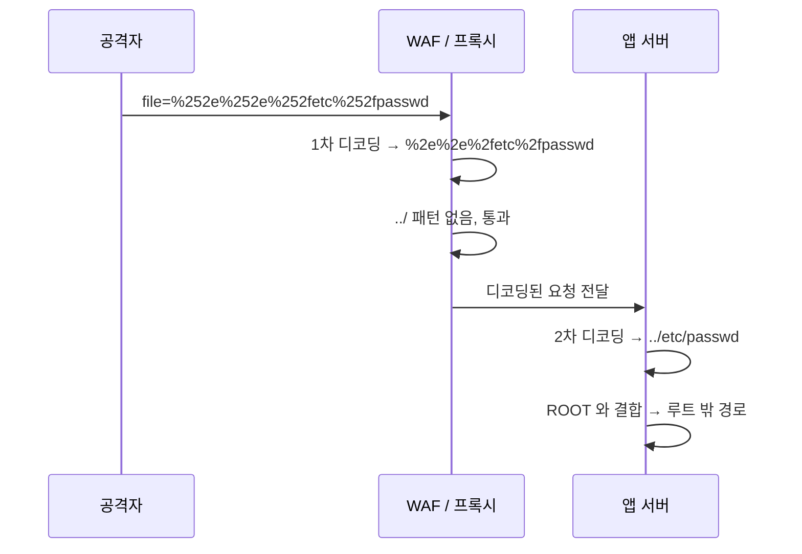
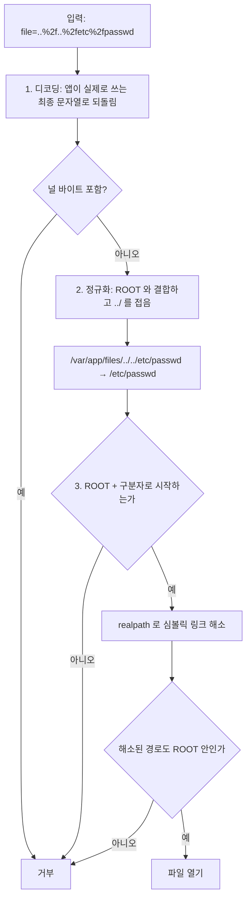
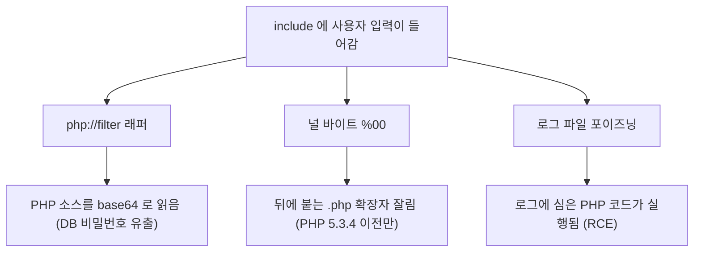

# Path Traversal

서버가 파일 경로를 만들 때 사용자 입력을 그대로 끼워 넣으면, 공격자가 `../`를 섞어 의도하지 않은 디렉토리로 빠져나간다. 디렉토리 순회(Directory Traversal)라고도 부른다. 파일 다운로드, 첨부파일 미리보기, 이미지 리사이저, 템플릿 로더처럼 "파일명을 받아서 디스크에서 읽는" 기능이 있으면 거의 다 후보가 된다.

기본 원리는 SQL Injection과 같다. 데이터로 다뤄야 할 입력이 경로 문법의 일부로 해석되는 순간 뚫린다. `../`는 부모 디렉토리를 가리키는 정상 표기인데, 이걸 충분히 반복하면 어떤 깊이의 디렉토리에 있든 결국 루트(`/`)까지 올라간다. 거기서 `etc/passwd`를 붙이면 `/etc/passwd`가 된다.

```
요청: GET /download?file=report.pdf
서버: /var/app/files/ + report.pdf  →  /var/app/files/report.pdf   (정상)

요청: GET /download?file=../../../../etc/passwd
서버: /var/app/files/ + ../../../../etc/passwd  →  /etc/passwd       (유출)
```

`/var/app/files`에서 `../`를 4번 올라가면 `/`에 도달한다. 디렉토리 깊이를 모르더라도 `../`를 넉넉하게 10번쯤 넣으면 루트를 넘지 못하므로 어차피 루트에서 멈춘다. 그래서 공격자는 깊이를 정확히 셀 필요도 없다.

---

## 어디서 터지는가

실무에서 마주치는 패턴은 거의 정해져 있다.

- **파일 다운로드**: `?file=`, `?name=`, `?path=` 쿼리로 파일명을 받아 `res.download()` 하는 엔드포인트
- **파일 포함(LFI)**: PHP의 `include($_GET['page'])` 같은 코드. 읽기를 넘어 코드 실행까지 이어질 수 있다. 아래 "PHP 파일 포함(LFI)" 절에서 따로 다룬다
- **압축 해제**: zip 안의 엔트리 이름에 `../`가 들어있으면 압축을 풀 때 바깥 디렉토리에 파일을 덮어쓴다(Zip Slip). 쓰기 쪽 순회라 더 위험하다
- **템플릿/언어 파일 로더**: `lang=ko` 파라미터로 `./locales/ko.json`을 읽는데 `lang=../../config/secret` 같은 입력을 거르지 않는 경우
- **이미지 프록시/썸네일**: 원본 경로를 받아 변환하는 서비스

읽기만 되는 경우에도 소스코드, `.env`, 설정 파일, 개인키, 세션 파일이 노출되면 그 자체로 전체 침해로 번진다. `.env` 하나만 새도 DB 비밀번호와 API 키가 통째로 넘어간다.

---

## 우회 기법 — 단순 문자열 필터가 막지 못하는 것들

방어를 처음 시도할 때 흔히 "입력에서 `../`를 지우면 되겠지"라고 생각한다. 이 접근은 거의 다 우회된다. 정확히 어떤 식으로 뚫리는지 알아야 제대로 막을 수 있다.

### 1. `../` 문자열 치환의 함정

`replace('../', '')`로 한 번만 지우는 코드는 겹친 패턴에 뚫린다.

```javascript
// 잘못된 방어
const safe = input.replace(/\.\.\//g, '');

// 입력: ....//....//etc/passwd
// "../"를 지우면 남는 것: ../../etc/passwd
```

`....//`에서 가운데 `../`를 떼어내면 양쪽의 `..`와 `/`가 다시 붙어 `../`가 복원된다. 정규식 한 번 돌리는 방식은 이런 식으로 거의 다 뚫린다. 재귀적으로 사라질 때까지 돌려도, 다음 인코딩 우회가 기다린다.

### 2. URL 인코딩

웹 서버나 프레임워크가 디코딩을 한 단계 더 해주면, 필터를 통과한 뒤 실제 경로 단계에서 `../`로 되살아난다.

```
%2e%2e%2f        →  ../          (.  =  %2e,  /  =  %2f)
..%2f            →  ../
%2e%2e/          →  ../
```

### 3. 이중 인코딩 (%252e)

가장 자주 놓치는 부분이다. `%`를 `%25`로 한 번 더 인코딩해두면, 앞단 프록시나 WAF가 한 번 디코딩해서 `%2e`로 만들고, 뒷단 애플리케이션이 또 한 번 디코딩해서 `.`로 만든다. 디코딩 단계가 두 곳이라 단일 디코딩 가정이 깨진다.

```
%252e%252e%252f  →(1차 디코딩)→  %2e%2e%2f  →(2차 디코딩)→  ../
```

아래 시퀀스에서 WAF가 보는 문자열과 앱이 최종적으로 쓰는 문자열이 다르다는 점을 확인하면 된다. WAF는 `../`가 없다고 판단해 통과시키지만, 앱은 한 번 더 디코딩해서 `../`를 얻는다.



직접 짠 코드뿐 아니라 리버스 프록시 + WAF + 앱 서버처럼 디코딩 주체가 여러 개일 때 발생한다. 어디서 몇 번 디코딩되는지 전부 추적하기보다, 최종 경로를 정규화한 뒤 검증하는 쪽이 안전하다.

### 4. 널 바이트 (%00)

오래된 시스템에서 통하던 기법이다. C 기반 파일 API는 널 바이트를 문자열 끝으로 인식한다. 확장자를 강제로 붙이는 코드를 우회할 때 썼다.

```
file=secret.txt%00.webp
// 앱은 확장자가 .png라 통과시키지만
// 하위 C API는 %00에서 끊어 secret.txt를 연다
```

최신 Node.js는 경로에 널 바이트가 있으면 `fs` 호출이 즉시 에러를 던진다.

```javascript
fs.readFile('secret.txt\0.webp', () => {});
// TypeError [ERR_INVALID_ARG_VALUE]: The argument 'path' must be a string,
// Uint8Array, or URL without null bytes.
```

그래도 입력 단계에서 명시적으로 거부하는 편이 깔끔하다. 의도가 분명하고, 런타임 버전에 의존하지 않는다.

### 5. 절대 경로 주입

`../`만 막느라 절대 경로를 놓치는 경우가 있다. `file=/etc/passwd`처럼 처음부터 절대 경로를 넣으면 `path.join`의 동작 때문에 베이스 경로가 무시되기도 한다. 뒤에서 다룬다.

### 6. 백슬래시 (윈도우)

윈도우는 `\`도 경로 구분자로 받는다. `..\..\..\windows\win.ini` 형태가 통하고, `..%5c`(`\`의 인코딩)로도 들어온다. `/`만 거르는 필터를 우회한다.

---

## 제대로 된 방어 — 정규화 후 루트 고정

블랙리스트(`../` 차단)는 위 우회들 때문에 늘 진다. 방향을 바꿔야 한다. **경로를 절대 경로로 정규화한 다음, 그 경로가 허용된 루트 디렉토리 안에 있는지 확인한다.** 입력이 무엇이든, 최종적으로 만들어진 실제 경로가 루트 밖을 가리키면 거부한다.

검증 순서가 중요하다. 디코딩이 정규화보다 먼저여야 하고, 접두사 비교는 정규화가 끝난 문자열에만 해야 한다. 순서가 뒤집히면 비교 대상 문자열에 `../`가 남아 있거나, 비교 뒤에 다시 디코딩되어 검사가 무의미해진다.



도식의 E 단계가 핵심이다. 정규화를 거치면 `../`가 문자열에서 사라지고 `/etc/passwd`라는 최종 위치만 남기 때문에, F 단계의 접두사 비교가 입력 모양과 무관하게 동작한다.

핵심 함수는 두 가지다.

- `path.resolve()` / `path.normalize()`: `../`, `./`, 중복 슬래시를 정리해 정규 경로를 만든다. 문자열 수준 정리다
- `fs.realpath()`: 심볼릭 링크까지 따라가서 디스크상의 진짜 경로를 돌려준다. 링크를 이용한 우회를 막을 때 필요하다

`path.normalize`만으로는 심링크를 못 잡는다. 루트 안에 바깥을 가리키는 심볼릭 링크가 하나 있으면, 문자열상으로는 루트 안이지만 실제로는 바깥 파일을 읽는다. 그래서 `realpath`까지 가야 완전하다.

### path.join의 절대 경로 함정

먼저 알아둬야 할 동작이 있다. `path.join`은 인자 중에 절대 경로가 나오면 그 앞을 버린다.

```javascript
const path = require('path');

path.join('/var/app/files', 'report.pdf');
// → /var/app/files/report.pdf

path.join('/var/app/files', '/etc/passwd');
// → /var/app/files/etc/passwd   (join은 앞에 / 가 있어도 상대처럼 이어붙임)

path.resolve('/var/app/files', '/etc/passwd');
// → /etc/passwd   (resolve는 절대 경로를 만나면 베이스를 버린다!)
```

`resolve`와 `join`의 차이가 보안 사고로 이어진다. 그래서 정규화한 결과가 루트로 시작하는지 **반드시 별도로 검사**해야 한다. 정규화 자체는 안전을 보장하지 않는다.

### 안전한 파일 접근 구현

```javascript
const path = require('path');
const fs = require('fs').promises;

// 허용된 루트. 반드시 절대 경로로 고정한다.
const ROOT = path.resolve('/var/app/files');

async function resolveSafePath(userInput) {
  // 1. 널 바이트 명시적 거부
  if (userInput.includes('\0')) {
    throw new Error('INVALID_PATH');
  }

  // 2. 루트 기준으로 결합 + 정규화 (../ ./ 중복슬래시 정리)
  //    join은 절대경로 주입을 막지 못하므로 다음 단계 검사가 필수다.
  const resolved = path.resolve(ROOT, userInput);

  // 3. 정규화된 경로가 루트 안에 있는지 확인 (문자열 단계 1차 방어)
  //    path.sep을 붙여 /var/app/files-secret 같은 접두사 우회를 막는다.
  if (resolved !== ROOT && !resolved.startsWith(ROOT + path.sep)) {
    throw new Error('PATH_TRAVERSAL');
  }

  // 4. 심볼릭 링크까지 따라간 실제 경로로 재검증 (2차 방어)
  //    파일이 없으면 realpath가 ENOENT를 던지므로 호출부에서 처리한다.
  const real = await fs.realpath(resolved);
  if (real !== ROOT && !real.startsWith(ROOT + path.sep)) {
    throw new Error('PATH_TRAVERSAL_SYMLINK');
  }

  return real;
}
```

3번에서 `startsWith(ROOT + path.sep)`로 구분자까지 붙여 검사하는 부분이 중요하다. 단순히 `resolved.startsWith(ROOT)`만 하면, 루트가 `/var/app/files`일 때 `/var/app/files-secret/db.key`가 통과한다. 접두사만 같고 실제로는 다른 디렉토리인 경우다. 구분자를 붙이면 이걸 막는다.

### 다운로드 엔드포인트에 적용

```javascript
const express = require('express');
const path = require('path');
const fs = require('fs').promises;
const fsSync = require('fs');

const app = express();
const ROOT = path.resolve('/var/app/files');

app.get('/download', async (req, res) => {
  const requested = req.query.file;

  if (typeof requested !== 'string' || requested.length === 0) {
    return res.status(400).send('bad request');
  }

  try {
    const safePath = await resolveSafePath(requested);

    // 디렉토리를 내려보내지 않도록 일반 파일인지 확인
    const stat = await fs.stat(safePath);
    if (!stat.isFile()) {
      return res.status(404).send('not found');
    }

    res.download(safePath);
  } catch (err) {
    // 순회 시도와 파일 없음을 같은 응답으로 처리한다.
    // 에러 메시지로 경로 구조를 노출하면 안 된다.
    if (err.code === 'ENOENT') {
      return res.status(404).send('not found');
    }
    return res.status(403).send('forbidden');
  }
});
```

에러 응답을 통일한 부분을 눈여겨봐야 한다. "파일 없음(404)"과 "순회 차단(403)"의 응답이나 타이밍이 다르면, 공격자가 어떤 파일이 실제로 존재하는지 추론한다. 정보 노출을 줄이려면 메시지를 뭉뚱그리는 편이 낫다. 적어도 내부 경로나 스택트레이스는 절대 밖으로 내보내지 않는다.

---

## 화이트리스트가 가능하면 그게 제일 낫다

위 방식은 임의 파일명을 받아야 할 때 쓴다. 하지만 다운로드 가능한 파일 목록이 정해져 있다면, 경로를 직접 받지 말고 **식별자(ID)를 받아 서버가 매핑**하는 구조가 가장 안전하다. 순회 자체가 성립하지 않는다.

```javascript
// 사용자는 경로를 모른다. ID만 넘긴다.
const FILE_MAP = {
  'manual-2026': 'manuals/user-guide-v3.pdf',
  'terms':       'legal/terms.pdf',
};

app.get('/doc/:id', async (req, res) => {
  const entry = FILE_MAP[req.params.id];
  if (!entry) {
    return res.status(404).send('not found');
  }
  // 맵의 값은 개발자가 통제하므로 순회 입력이 끼어들 여지가 없다.
  res.download(path.join(ROOT, entry));
});
```

DB로 파일을 관리한다면 파일명 대신 행 ID(`file_id`)를 받고, 실제 디스크 경로는 서버가 들고 있는 값을 쓴다. 사용자 입력이 경로 생성에 직접 닿지 않는 구조가 핵심이다. 가능하면 항상 이쪽을 택한다.

파일명에 사용자 표시용 이름이 필요하면 다운로드 헤더에서만 쓴다.

```javascript
res.download(path.join(ROOT, entry), '사용자_가이드.pdf');
// 디스크 접근 경로(entry)와 표시 이름은 완전히 분리한다.
```

---

## PHP 파일 포함(LFI)

PHP에서는 순회가 파일 읽기에서 끝나지 않는다. `include`와 `require`는 파일 내용을 출력하는 게 아니라 PHP 코드로 실행한다. 사용자 입력이 경로에 들어가면 읽기 취약점이 아니라 코드 실행 취약점이 된다.

```php
<?php
// 취약한 코드
include('pages/' . $_GET['page'] . '.php');
```

`page=../../uploads/avatar_123`처럼 확장자가 `.php`로 붙어도 다른 디렉토리의 `.php` 파일을 포함시킬 수 있고, 아래 세 가지 방식으로 읽기와 실행까지 확장된다.



- **php://filter**: `include`에 입력 전체를 넘기는 코드라면 `page=php://filter/convert.base64-encode/resource=config`처럼 소스를 base64로 읽어낼 수 있다. 일반 포함은 PHP 코드를 실행해 버려서 소스가 안 보이는데, base64로 바꾸면 실행되지 않고 텍스트로 나온다. `allow_url_include`가 꺼져 있어도 동작한다. 앞에 `'pages/'` 같은 접두사가 붙는 코드에서는 스킴이 깨져서 쓸 수 없다
- **널 바이트**: `page=../../etc/passwd%00`으로 뒤에 붙는 `.php`를 잘라내던 기법이다. PHP 5.3.4에서 파일 함수가 널 바이트를 거부하도록 바뀌어서 그 이전 버전에서만 통한다. 지금 운영 중인 서버에서 재현될 일은 거의 없지만, 오래된 레거시 서버 점검에서는 확인 대상이다
- **로그 파일 포이즈닝**: 공격자가 `User-Agent` 헤더에 `<?php system($_GET['c']); ?>`를 넣어 요청하면 웹 서버 access 로그에 그 문자열이 그대로 기록된다. 이어서 `page=../../../var/log/nginx/access`처럼 로그 파일을 포함시키면 로그 안의 PHP 코드가 실행된다. PHP 프로세스가 로그를 읽을 권한이 있어야 하는데, Debian 계열 기본 설정에서는 읽기 권한이 있는 경우가 많다

세 방식 모두 원인은 같다. 포함 경로를 만드는 데 사용자 입력이 직접 닿는다. 각 기법의 세부 동작과 PHP 설정(`open_basedir`, `allow_url_include`)은 [PHP_Security_Vulnerabilities](PHP_Security_Vulnerabilities.md)에서 다룬다.

---

## PHP에서 realpath()로 막기

Node의 `resolve` + `startsWith` 조합과 같은 구조다. 허용 루트와 요청 경로를 둘 다 `realpath()`로 해소한 뒤 접두사를 비교한다.

```php
<?php
const UPLOAD_ROOT = '/var/www/uploads';

function resolve_upload_path(string $userInput): string
{
    // PHP 8 이상. 7.x 이하는 strpos($userInput, "\0") !== false
    if (str_contains($userInput, "\0")) {
        throw new InvalidArgumentException('INVALID_PATH');
    }

    $root = realpath(UPLOAD_ROOT);
    if ($root === false) {
        throw new RuntimeException('ROOT_NOT_FOUND');
    }

    $real = realpath($root . DIRECTORY_SEPARATOR . $userInput);
    if ($real === false) {
        throw new RuntimeException('NOT_FOUND');
    }

    // 구분자까지 붙여서 비교한다
    if (!str_starts_with($real, $root . DIRECTORY_SEPARATOR)) {
        throw new RuntimeException('PATH_TRAVERSAL');
    }

    return $real;
}

// 사용
$path = resolve_upload_path($_GET['file'] ?? '');
if (!is_file($path)) {
    http_response_code(404);
    exit;
}
readfile($path);
```

여기서 두 군데에서 실수가 많이 난다.

### realpath()는 없는 파일에 false를 돌려준다

`realpath()`는 경로 문자열만 정리하는 함수가 아니라 디스크를 실제로 조회한다. 파일이 없으면 `false`를 반환하고, 경로 중간 디렉토리에 실행(탐색) 권한이 없을 때도 `false`가 나온다. 반환값을 문자열로 가정하고 다음 줄로 넘기면 두 가지로 깨진다.

- `declare(strict_types=1)` 파일에서 `str_starts_with(false, ...)`는 TypeError를 던진다. 존재하지 않는 파일을 요청할 때마다 500이 나가고, 에러 로그에 경로가 찍힌다
- `false`가 나오면 원본 경로로 대체하는 코드를 쓰는 경우가 있다. 이건 보안 구멍이다

```php
// 잘못된 폴백: 없는 파일이면 정규화되지 않은 문자열이 그대로 비교 대상이 된다
$real = realpath($candidate) ?: $candidate;
// $candidate = /var/www/uploads/../../../etc/shadow 는 접두사 비교를 통과한다
```

위 예제처럼 `=== false`를 먼저 걸러 404로 처리하고, 정규화되지 않은 문자열은 비교에 쓰지 않는다.

읽기에서는 `false`를 그냥 404로 처리하면 끝이다. 파일을 새로 만드는 업로드 저장 경로에서는 문제가 된다. 아직 없는 파일이라 `realpath()`가 항상 `false`이기 때문이다. 이때는 대상 파일이 아니라 **부모 디렉토리**를 `realpath()`로 해소하고 파일명은 따로 검증한다.

```php
function resolve_new_file_path(string $name): string
{
    $root = realpath(UPLOAD_ROOT);
    if ($root === false) {
        throw new RuntimeException('ROOT_NOT_FOUND');
    }

    // 파일명에 경로 구분자가 들어오는 것 자체를 막는다
    if ($name !== basename($name) || $name === '' || str_contains($name, "\0")) {
        throw new InvalidArgumentException('INVALID_NAME');
    }

    return $root . DIRECTORY_SEPARATOR . $name;
}
```

하위 디렉토리까지 허용해야 한다면 `dirname($root . '/' . $name)`을 `realpath()`로 해소해서 같은 접두사 비교를 거친 뒤 `basename`을 붙인다.

### 접두사 비교에서 구분자를 빼먹으면 형제 디렉토리가 통과한다

가장 흔한 실수다. 루트가 `/var/www/uploads`일 때 접두사만 비교하면 이름이 비슷한 형제 디렉토리가 매치된다.

```php
// 잘못된 비교
if (strpos($real, '/var/www/uploads') !== 0) {
    throw new RuntimeException('PATH_TRAVERSAL');
}
```

| 해소된 경로 | 접두사만 비교 | 루트 + `/` 로 비교 |
|---|---|---|
| `/var/www/uploads/a.png` | 통과 | 통과 |
| `/var/www/uploads_evil/a.png` | **통과** | 차단 |
| `/var/www/uploads-backup/db.sql` | **통과** | 차단 |
| `/var/www/uploads` (루트 자체) | 통과 | 차단 |

`uploads_evil`이나 `uploads-backup` 같은 디렉토리가 같은 부모 아래에 있으면 `../uploads_evil/a.png` 한 줄로 넘어간다. 백업 디렉토리를 `uploads.bak`처럼 옆에 두는 운영 습관 때문에 실제로 자주 만나는 구조다. `$root . DIRECTORY_SEPARATOR`로 끝에 구분자를 붙여 비교해야 한다. 마지막 행의 루트 자체는 디렉토리라 파일로 열 일이 없으므로 차단되어도 문제없다. 루트 자체를 허용해야 하는 코드라면 `$real === $root ||` 조건을 따로 추가한다.

`realpath()`가 반환하는 경로에는 끝 슬래시가 없다. `UPLOAD_ROOT`를 `/var/www/uploads/`처럼 슬래시를 붙여 정의하고 `realpath()`를 거치지 않은 채 `. DIRECTORY_SEPARATOR`를 더하면 `//`가 되어 모든 요청이 차단된다. 루트도 반드시 `realpath()`를 거쳐 같은 형태로 맞춘다.

---

## Zip Slip — 쓰기 쪽 순회

압축 해제는 읽기가 아니라 쓰기라서 더 위험하다. 업로드받은 zip을 풀 때, 아카이브 엔트리 이름에 `../`가 들어있으면 바깥 디렉토리에 파일을 만든다. `../../../../etc/cron.d/job` 같은 엔트리로 cron 작업을 심거나, 웹 루트에 셸을 떨군다.

엔트리를 풀어 쓰기 전에, 목적지 경로를 똑같이 정규화하고 루트 안인지 검사한다.

```javascript
function safeExtractPath(destRoot, entryName) {
  const root = path.resolve(destRoot);
  const target = path.resolve(root, entryName);

  if (target !== root && !target.startsWith(root + path.sep)) {
    throw new Error(`ZIP_SLIP: ${entryName}`);
  }
  return target;
}
// 압축 라이브러리가 엔트리를 줄 때마다 이 함수로 목적지를 검증한 뒤 기록한다.
```

읽기든 쓰기든 방어 논리는 같다. 최종 경로를 절대 경로로 만들고, 허용된 루트 밖이면 거부한다.

---

## 운영에서 챙기는 것들

- **프로세스 권한 최소화**: 앱이 읽을 수 있는 파일 자체를 줄인다. 컨테이너로 격리하거나 전용 계정으로 돌리면, 순회에 성공해도 `/etc/passwd`나 다른 서비스 파일에 손이 닿지 않는다. 코드 방어가 뚫려도 OS 권한이 한 겹 더 막는다
- **`fs.realpath` 비용**: 심링크 검증은 디스크 stat을 동반한다. 호출이 잦은 경로면 부담이 된다. 화이트리스트로 풀 수 있는 구조면 realpath까지 갈 일이 줄어든다
- **로깅**: 순회 시도를 막았으면 입력 원본과 함께 남긴다. 같은 IP에서 `../` 패턴이 반복되면 스캐닝 중이라는 신호다. 단, 로그에 남긴 입력을 나중에 그대로 화면에 다시 뿌리면 2차 사고가 나니 출력 시 이스케이프한다
- **프레임워크 정적 서빙 신뢰**: `express.static`이나 nginx의 정적 파일 서빙은 자체적으로 순회를 막는다. 직접 `fs.readFile`로 파일을 내려주는 커스텀 코드가 위험하다. 정적 파일이면 가급적 검증된 서버 기능에 맡긴다

순회 방어의 결론은 하나다. 사용자 입력으로 경로를 만들었다면, 그 경로의 최종 실제 위치가 허용 루트 안인지 매번 확인한다. `../`를 지우는 게 아니라, 어디에 도착했는지를 검사한다.
