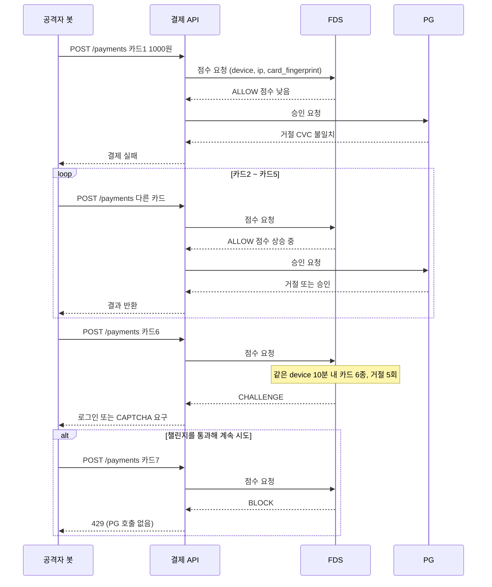
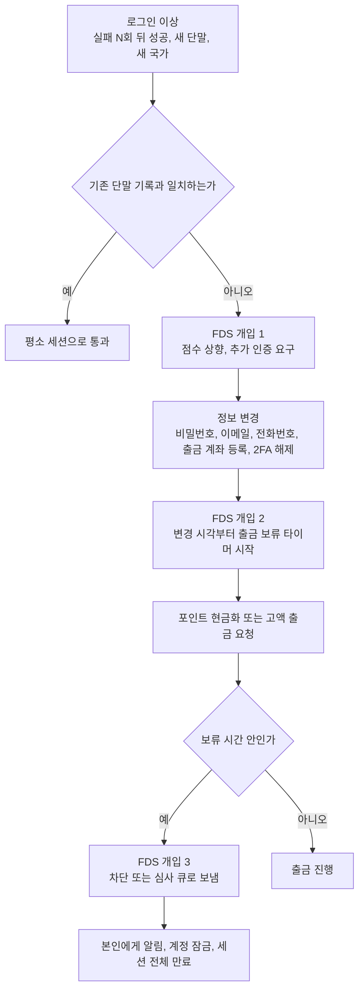
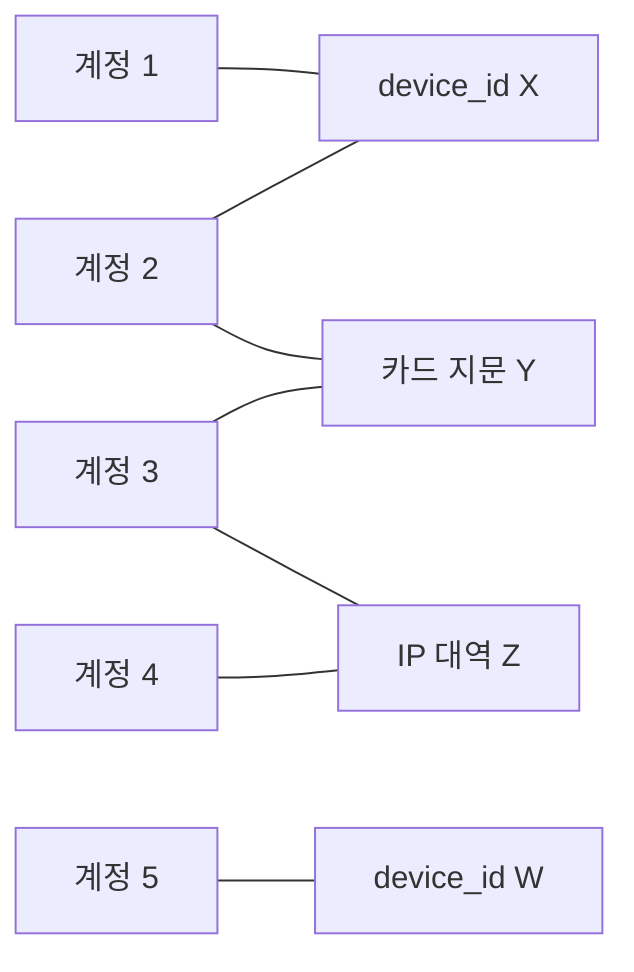
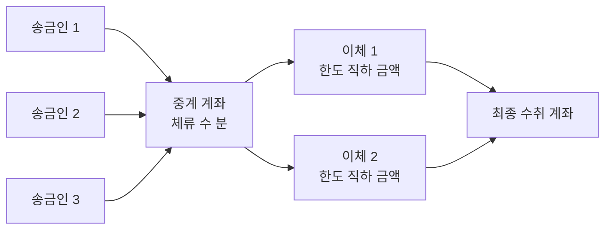
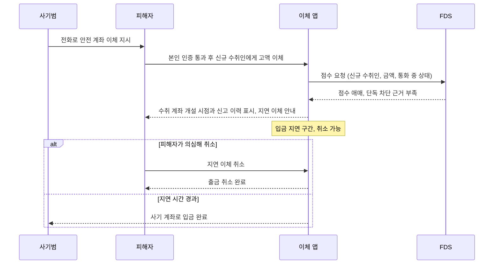
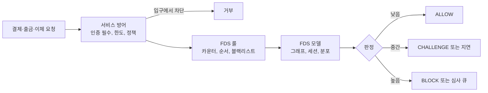

# 결제 사기 유형별 신호와 탐지 한계

FDS를 처음 붙이면 대개 "이상 점수 하나"로 모든 사기를 보려 한다. 점수가 높으면 막고 낮으면 통과시킨다. 이 구조는 카드 테스팅 같은 기계적인 공격에는 그럭저럭 맞는다. 계정 탈취나 보이스피싱 이체처럼 정상 사용자의 행동과 닮은 사기 앞에서는 점수가 낮게 나오고, 막으면 오탐이 쏟아진다. 사기 유형마다 요청 로그에 남는 흔적이 다르고, 룰이 잘 잡는 유형과 모델이 잡는 유형이 갈리고, 인증으로 막을 수 있는 유형과 없는 유형이 갈린다.

이 문서는 서비스 로그에서 실제로 보이는 사기 7종을 유형별로 정리한다. 각 유형마다 로그에 남는 신호, 룰과 모델 중 어느 쪽이 맞는지, 공격자가 어떻게 빠져나가는지, FDS까지 가기 전에 서비스 코드에서 막을 수 있는 지점을 적는다. FDS 자체의 호출 구조는 [FDS 이상거래탐지 시스템 구조](FDS_Architecture.md), 룰 작성은 [FDS 룰 엔진 설계와 운영](FDS_Rule_Engine.md), 카운터 구현은 [FDS 속도 카운터와 피처 저장소](FDS_Velocity_Counters_and_Feature_Store.md)에서 다뤘으므로 여기서는 반복하지 않는다.

## 유형별 비교표

세부 설명에 들어가기 전에 전체 지도를 먼저 본다. 이후 절은 이 표의 각 행을 풀어 쓴 것이다.

| 유형 | 요청 로그에 남는 신호 | 잡기 쉬운 쪽 | 놓치기 쉬운 우회 |
|---|---|---|---|
| 카드 테스팅 | 한 단말·세션에서 서로 다른 카드 다수, 소액·0원, 거절 비율 60% 이상, CVC 불일치 거절 반복 | 룰 (카드 지문 distinct 카운터) | IP·단말 분산, 속도를 늦춘 low-and-slow, 성공 결제와 섞기 |
| 계정 탈취 후 출금 | 실패 후 성공 로그인, 새 단말, 직후 이메일·전화·출금계좌 변경, 포인트 소진 | 룰 (변경 후 출금 순서) + 모델 (세션 행동) | 정보 변경 없이 기존 수단만 사용, 피해자 지역 프록시, 출금 아닌 선물하기로 우회 |
| 신규 가입 어뷰징 | 같은 단말·IP 대역·번호 대역에서 가입, 가입 직후 쿠폰 사용, 이메일 패턴 유사 | 모델 (그래프 군집) + 룰 (단말 중복) | 단말 초기화 농장, 가상번호, 이메일 변형 |
| 대포통장·중계 분산 이체 | 입금 직후 수 분 내 전액 이체, 다수 송금인에서 한 계좌로 집중, 한도 직하 쪼개기 | 모델 (거래 그래프), 룰 (체류 시간) | 체류 시간 늘리기, 정상 거래 섞기, 임계값 바로 아래 금액 |
| 승인 사기 (보이스피싱·메신저피싱) | 본인 단말·본인 인증 통과, 신규 수취인, 평소 대비 큰 금액, 직전 대출 실행, 통화 중 앱 조작 | 수취 계좌 블랙리스트 룰, 사용자 이체 분포 모델 (둘 다 약함) | 피해자가 직접 입력해서 단말 신호가 정상 |
| 가맹점 공모 | 소수 카드가 한 가맹점에 반복 결제, 가맹점 대표와 단말·IP 공유, 고정 금액 | 가맹점 단위 프로파일 룰 | 지인 카드 돌려막기, 건당 금액 분산 |
| 환불 악용 | 계정별 환불 비율, 수령 후 미수령 주장, 포인트 사용 후 결제 취소 | 룰 (환불 비율, 원 수단 불일치) | 계정 교체, 임계 아래로 비율 유지 |

표에서 눈에 띄는 건 "잡기 쉬운 쪽" 칸이다. 기계적인 유형(카드 테스팅, 가입 어뷰징)은 카운터 룰이 먼저 걸리고, 사람이 직접 하는 유형(승인 사기)은 어느 쪽도 약하다. 승인 사기에서 FDS가 약한 이유는 뒤에서 따로 다룬다.

## 카드 테스팅

유출된 카드 번호 목록은 사고파는 시점에 살아 있는지 알 수 없다. 공격자는 소액이나 0원 결제를 자동으로 돌려 살아 있는 카드만 추린다. 걸러진 카드는 다른 범죄자에게 팔리거나 큰 금액 구매에 쓰인다. 피해는 공격 대상 가맹점이 입는다. 승인 요청 한 건마다 카드 네트워크 수수료가 나가고, 나중에 도용이 확인된 카드의 분쟁이 몰려오며, 거절·분쟁 비율이 올라가면 카드사 감시 프로그램에 올라간다.

규모는 작지 않다. Stripe는 2022년 2월부터 8월까지 하루 최대 2,000만 건이 넘는 카드 테스팅 시도를 막았고, 2019년 대비 시도가 100배 늘었다고 밝혔다. 새로 넣은 속도 제한기만으로 약 4,000만 건을 막았다는 대목은, 이 유형의 1차 방어선이 모델이 아니라 속도 제한이라는 점을 보여 준다. [Stripe, How Stripe responded to a wave of card testing attacks](https://stripe.com/newsroom/news/card-testing-surge)

### 요청 흐름과 차단 시점

아래 시퀀스에서 볼 곳은 차단이 일어나는 위치다. FDS 점수는 처음 몇 건에서는 낮게 나와 PG까지 요청이 나간다. 카드 지문이 5종을 넘는 시점에 챌린지가 붙고, 그 뒤에도 계속되면 PG를 호출하기 전에 끊는다.



PG 호출이 나간 시도는 이미 승인 요청 수수료가 발생한 뒤다. 5건까지 열어 두는 값은 정상 사용자가 카드 번호를 잘못 쳐서 두세 번 다시 입력하는 경우를 감안한 것이다. 이 숫자를 낮추면 오탐이 늘고 높이면 공격자에게 테스트 기회를 더 준다.

### 로그에서 집계하기

신호는 단일 요청에 없고 집계에 있다. 거절 한 건은 평범하지만, 같은 단말에서 10분 안에 서로 다른 카드 6종이 거절되면 사람의 행동이 아니다. 카드 번호 원문 대신 해시(지문)를 로그에 남겨 두면 이 집계가 가능하다.

```sql
-- payment_attempts: 결제 시도마다 1행 (PG 호출 여부와 무관하게 적재)
SELECT
    device_id,
    to_timestamp(floor(extract(epoch FROM created_at) / 600) * 600) AS bucket,
    count(*)                                    AS attempts,
    count(DISTINCT card_fingerprint)            AS distinct_cards,
    count(DISTINCT card_bin)                    AS distinct_bins,
    avg((result = 'DECLINED')::int)             AS decline_ratio,
    avg((amount <= 1000)::int)                  AS small_amount_ratio,
    count(*) FILTER (WHERE decline_code = 'INVALID_CVC') AS cvc_mismatch
FROM payment_attempts
WHERE created_at >= now() - interval '1 hour'
GROUP BY device_id, bucket
HAVING count(DISTINCT card_fingerprint) >= 5
   AND avg((result = 'DECLINED')::int) >= 0.6
ORDER BY distinct_cards DESC;
```

같은 쿼리에서 `device_id`를 `ip_hash`나 `session_id`로 바꿔 돌리면 차원별 결과를 따로 얻는다. 실시간 판정에는 이 쿼리를 쓰지 않는다. 배치로 돌려 임계값을 정하고, 실시간 경로는 Redis의 HyperLogLog나 세트로 같은 카운터를 유지한다. 구현은 [FDS 속도 카운터와 피처 저장소](FDS_Velocity_Counters_and_Feature_Store.md)에 있다.

`cvc_mismatch` 컬럼을 따로 두는 이유가 있다. 카드 번호는 맞고 CVC만 틀리는 거절은 공격자가 CVC를 무차별 대입하는 패턴일 때가 많다. 정상 사용자의 오타는 거절 사유가 뒤섞이는데, 공격자는 한 사유에 쏠린다.

### 룰이 먼저, 모델은 보조

카드 테스팅은 룰이 맞다. 임계값을 넘는 distinct 카운터 하나가 신호의 대부분을 담고, 배포한 룰이 바로 효과를 낸다. 모델은 룰을 피해 가는 분산 공격을 찾는 용도다. Stripe도 거래 단위 카드 테스팅 모델을 만들 때 카드 네트워크가 라벨을 주지 않아 새로 라벨링 방법을 고안해야 했다고 적었다. 라벨 없이 학습을 시작할 수 없는 영역이라, 룰로 먼저 막고 그 차단 이력을 모델 라벨로 쓰는 순서가 현실적이다.

### 우회하는 방식

- IP를 주거용 프록시 수천 개로 돌리고 단말 지문도 요청마다 바꾸면 `device_id` 집계는 비어 버린다. 이때 남는 공통점은 카드 BIN 분포(같은 발급 대량 목록에서 나와 BIN이 몰린다)와 결제 직전 행동이 없다는 점(상품 조회 없이 결제 엔드포인트만 호출)이다.
- 속도를 시간당 3~4건으로 늦추면 10분 창 룰을 통과한다. 창을 24시간으로 늘린 보조 룰이 필요하고, 그만큼 정상 사용자 오탐이 늘어 임계값을 따로 잡아야 한다.
- 성공하는 결제 사이에 테스트 시도를 섞으면 거절 비율이 희석된다.
- 가맹점이 운영하는 기부 결제나 0원 카드 등록 엔드포인트는 결제 엔드포인트보다 보호가 얇은 경우가 많아 공격자가 먼저 찾는다.

### FDS 이전에 서비스에서 막을 것

카드 테스팅은 인증 없이 호출 가능한 엔드포인트가 입구다. 결제와 카드 등록 API는 로그인한 세션만 받게 하고, 세션당·계정당·IP당 카드 등록 횟수에 한도를 둔다. 속도 제한 알고리즘과 키 설계는 [Rate Limiting](Rate_Limiting.md)에 정리했다. 결제 실패 응답에는 거절 사유를 세세히 돌려주지 않는다. "CVC가 틀렸다"와 "한도 초과"를 구분해 주는 순간 공격자에게는 카드가 살아 있는지 알려 주는 오라클이 된다. 클라이언트에는 "결제 실패" 하나만 보내고 상세 코드는 서버 로그에만 남긴다.

CAPTCHA는 단가를 올리는 장치이지 방어선이 아니다. 연구에서 봇이 왜곡 텍스트 CAPTCHA를 거의 100% 풀었다는 결과는 [딥페이크와 AI 사기](Deepfake_and_AI_Fraud.md)에서 정리했다. 챌린지를 통과해도 카운터가 계속 쌓이도록 설계해야 위 시퀀스의 마지막 `BLOCK`이 작동한다.

## 계정 탈취 후 즉시 출금

크리덴션 스터핑으로 계정을 열었다면 공격자는 오래 머물지 않는다. 피해자가 알아차리기 전에 돈이 될 만한 것을 빼고 나간다. 이 유형은 한 시점의 이상이 아니라 순서의 이상이다. 로그인만 이상하면 출장 중인 사용자일 수 있고, 고액 출금만 이상하면 목돈이 필요해진 사용자일 수 있다. 세 단계가 몇 시간 안에 이어질 때 비로소 사기로 확정된다.

### 신호가 나타나는 시점



세 개입 지점의 성격이 다르다. 개입 1은 점수 기반이라 오탐이 많고 막기보다 추가 인증으로 되돌리는 쪽이 맞다. 개입 2는 상태 저장이다. 민감 정보가 바뀐 시각을 계정에 기록해 두고, 출금 시점에 그 시각과 비교한다. 개입 3은 룰 한 줄로 끝난다. `출금 요청 시각 - 마지막 민감 정보 변경 시각 < 24시간 AND 출금 계좌가 변경 후 신규 등록` 조건은 오탐이 드물어서 바로 차단해도 된다.

### 룰과 모델의 역할

순서 룰은 룰이 맞다. 세션 행동은 모델이 보조한다. 공격자가 스크립트로 로그인한 뒤 곧장 출금 화면으로 가는 세션은 페이지 이동 순서와 입력 간격이 사람과 다르다. [UEBA 행위 기반 이상 탐지](UEBA.md)의 사용자 기준선과 결합하면 개입 1의 정확도가 올라간다.

### 놓치기 쉬운 우회

- 정보 변경을 하지 않고 이미 등록된 출금 계좌만 쓰는 경우가 있다. 출금 계좌가 피해자 본인 것이라 현금화가 안 되므로 공격자는 대신 포인트나 충전금으로 상품권을 사서 되판다. 이 경로는 출금 룰에 걸리지 않는다. 포인트로 살 수 있는 환금성 상품(상품권, 선물하기)도 출금과 같은 룰 대상에 넣어야 한다.
- 피해자의 평소 접속 지역 근처 프록시를 쓰고 평소 쓰던 시간대를 맞추면 개입 1이 통과된다. 로그인 이상 신호에만 기대지 않고 정보 변경 후 보류를 받쳐야 하는 이유다.
- 한 번에 큰 금액을 빼지 않고 한도 아래로 여러 번 나눠 뺀다. 출금 룰을 건당 금액이 아니라 누적 금액으로 건다.

### FDS 이전에 서비스에서 막을 것

입구는 [크리덴션 스터핑](Credential_Stuffing.md)에 정리한 대로 로그인 단계의 시도 제어, 유출 비밀번호 차단, MFA다. 서비스 코드에서 별도로 챙길 것은 민감 정보 변경 후 쿨다운이다. 이메일·전화번호·출금 계좌를 바꾸면 24~72시간 동안 출금 한도를 낮추고, 변경 사실을 변경 전 연락처로 알린다. 변경 전 연락처로 보내야 한다. 새 이메일로 알림을 보내면 공격자가 받는다.

## 신규 가입 어뷰징과 프로모션 악용

신규 가입 쿠폰, 추천인 보상, 첫 구매 할인이 대상이다. 손실 규모는 건당 작지만 자동화되면 크다. 신호는 결제 로그가 아니라 가입 로그에 있다.

| 가입 로그 필드 | 어뷰징일 때 보이는 모양 |
|---|---|
| device_id | 한 단말에서 다수 계정. 초기화 농장이면 단말은 달라도 하드웨어 속성(해상도, 폰트, WebGL)이 같다 |
| ip, asn | 같은 /24 대역이나 데이터센터·VPN ASN에서 연속 가입 |
| email | `user+1@`, `user.1@`, 임시 메일 도메인, 같은 접두어에 숫자만 증가 |
| phone | 연번 번호 대역, 가상번호 업체 대역 |
| 가입→첫 행동 간격 | 가입 후 수 초 안에 쿠폰 적용·결제. 정상 사용자는 둘러보는 시간이 있다 |
| 결제 수단 | 서로 다른 계정이 같은 카드 지문이나 같은 출금 계좌 |

단일 필드는 정상 사용자도 겹친다. 회사 NAT 뒤의 사용자 수십 명이 한 IP로 가입하는 건 흔하다. 개별 룰은 오탐이 높고, 계정을 노드로, 단말·IP·결제수단·전화번호를 엣지로 잇는 그래프에서 연결 요소의 크기를 보는 쪽이 정확하다. 한 연결 요소에 계정이 50개가 넘으면서 전부 가입 7일 이내이고 쿠폰 사용률이 높으면 군집으로 본다. 룰은 단말 중복 같은 단순 신호로 명백한 건만 막고 그래프 군집은 모델이 맡는 분담이 맞다.

아래 그래프는 계정 사이에 공유되는 속성이 어떻게 연결 요소를 만드는지 보여 준다. 계정 1~4는 단말, 카드 지문, IP 대역으로 이어져 한 군집이 되고, 계정 5는 무관하게 남는다.



우회는 단말 초기화와 가상번호다. 단말 지문을 가입마다 바꾸고 SMS 인증을 대행 서비스로 통과시키면 개별 필드는 모두 깨끗하다. 그래서 필드 하나가 아니라 필드 간 관계를 본다.

서비스 쪽에서 FDS 이전에 줄일 수 있는 건 보상의 단위다. 쿠폰을 계정당이 아니라 본인확인 정보(CI)당, 결제 수단당 1회로 묶는다. 가입 API와 SMS 발송 API에는 [Rate Limiting](Rate_Limiting.md)의 IP·번호 단위 제한을 건다. SMS 발송에 제한이 없으면 공격 자체가 비용을 받아 주는 구조가 된다.

## 대포통장과 중계 계좌 분산 이체

탈취한 돈이나 사기 피해금이 들어오는 계좌다. 서비스가 송금·충전금·가상계좌를 운영한다면 이 유형은 내 서비스의 계좌가 중계 계좌로 쓰이는 문제로 온다. 받는 쪽 FDS가 필요한 이유다.

로그에 남는 신호는 돈의 흐름이다. 입금이 들어오고 체류 시간이 매우 짧다. 한 계좌로 여러 송금인이 입금해 한 번에 다른 계좌로 나간다(fan-in 후 fan-out). 임계값 바로 아래 금액으로 쪼개 보낸다. 가입 직후 한동안 아무 활동이 없다가 어느 날부터 거래가 몰리는 휴면 후 급증 패턴도 있다.

아래 그림에서 볼 곳은 fan-in 후 fan-out 모양과 중계 계좌에 머무는 시간이다. 계좌 하나만 보면 평범한 입출금이지만 흐름 전체로 보면 돈이 통과만 한다.



다음 쿼리는 이 통과 비율을 계산한다.

```sql
-- 입금 후 60분 안에 입금액의 90% 이상이 빠져나간 계좌
WITH inflow AS (
    SELECT account_id, sum(amount) AS in_amt, min(created_at) AS first_in
    FROM ledger
    WHERE direction = 'IN' AND created_at >= now() - interval '1 day'
    GROUP BY account_id
), outflow AS (
    SELECT l.account_id, sum(l.amount) AS out_amt
    FROM ledger l
    JOIN inflow i ON i.account_id = l.account_id
    WHERE l.direction = 'OUT'
      AND l.created_at BETWEEN i.first_in AND i.first_in + interval '60 minutes'
    GROUP BY l.account_id
)
SELECT i.account_id, i.in_amt, o.out_amt, o.out_amt / i.in_amt AS pass_through
FROM inflow i JOIN outflow o USING (account_id)
WHERE o.out_amt / i.in_amt >= 0.9 AND i.in_amt >= 1000000
ORDER BY pass_through DESC;
```

체류 시간 룰은 가볍고 정확도가 괜찮지만 우회하기 쉽다. 사기단은 체류 시간을 하루 이틀 늘리고 정상 거래를 섞는다. 그래서 모델은 거래 그래프에서 같은 상대방 집합이 반복해서 나타나는지, 여러 홉 떨어진 계좌가 같은 최종 수취인으로 모이는지를 본다. 그래프 모델은 라벨이 문제다. 확정된 대포통장 목록은 사후에 신고된 건만 얻어서 라벨이 늦고 적다. [FDS ML 모델 운영](FDS_ML_Model_Operations.md)에서 다룬 라벨 지연 문제가 이 유형에서 가장 크게 나타난다.

서비스에서 FDS 이전에 걸 수 있는 장치는 단순하다. 충전금이나 입금액은 충전 수단과 같은 본인 명의 계좌로만 출금되게 한다. 입금 후 출금까지 최소 대기 시간을 두거나, 신규 계좌의 첫 출금은 한도를 낮춘다. 이 장치는 정상 사용자의 편의를 일부 깎는 비용이 있으므로 신규 계좌와 고위험 수취인에만 적용한다.

## 보이스피싱·메신저피싱 승인 사기

여기가 이 문서에서 가장 어려운 유형이다. 피해자가 속아서 자기 손으로, 자기 단말에서, 자기 인증을 통과해 돈을 보낸다. 영어권에서는 authorized push payment(APP) 사기라고 부른다. 규모는 숫자로 확인된다. 금융감독원 집계로 2023년 국내 보이스피싱 피해액은 1,965억 원이고 1인당 평균 약 1,710만 원이다. 전년 1,451억 원에서 35.4% 늘었는데, 피해자 수는 10.2% 줄었다. 사기 한 건의 금액이 커졌다는 뜻이다. [국가전략포털, 2023년 보이스피싱 피해현황 분석 (금융감독원 2024-03-07 발표 기준)](https://nsp.nanet.go.kr/plan/subject/detail.do?nationalPlanControlNo=PLAN0000045188) 영국도 비슷하다. UK Finance 집계로 2023년 APP 사기 손실은 4억 5,970만 파운드였다. [UK Finance, Annual Fraud Report 2024](https://www.ukfinance.org.uk/policy-and-guidance/reports-and-publications/annual-fraud-report-2024)

### 인증이 못 막는 이유

로그인 인증, OTP, 생체 인증이 증명하는 건 "이 요청을 보내는 사람이 계정 주인이다"이다. 승인 사기에서 이 명제는 참이다. 계정 주인이 맞다. 거짓인 건 "이 이체가 계정 주인의 자유의지로 이뤄졌다"인데, 이건 인증이 다루지 않는 영역이다.

| 구분 | 계정 탈취 | 승인 사기 |
|---|---|---|
| 요청하는 사람 | 공격자 | 계정 주인 |
| 로그인·단말 신호 | 이상 (새 단말, 새 지역) | 정상 (본인 단말, 본인 지역) |
| OTP·생체 인증 | 공격자가 못 넘으면 막힘 | 피해자가 직접 통과 |
| 남는 신호 | 접속 환경의 이상 | 거래 내용의 이상 (수취인, 금액, 시점) |

[Web Authn·Passkeys](Web_Authn_Passkeys.md)처럼 피싱 저항성이 있는 인증도 이 유형은 막지 못한다. 피싱 저항성은 가짜 사이트에서 자격 증명이 새는 걸 막지, 정상 앱에서 사용자가 시키는 대로 이체 버튼을 누르는 걸 막지 않는다.

### 로그에 남는 신호는 거래 내용에 있다

- 신규 수취인에게 평소 이체 금액 분포의 상위 1% 이상 금액을 보낸다.
- 이체 직전 대출이 실행됐거나 예금·적금을 해지했다. 대출빙자형에서 흔한 순서다.
- 수취 계좌가 신고된 대포통장 목록이나 최근 신규 개설 계좌다.
- 이체 직전 앱의 접속 환경이 평소와 다르다. 원격제어 앱이 설치·실행 중이거나 통화 중 상태에서 앱을 조작한다. 서버 로그만으로는 이 정보가 없다. 앱이 단말 상태를 요청에 실어 보내도록 만들어야 한다.
- 이체를 연달아 시도하다 한도 초과로 실패하고 한도 상향을 요청한 뒤 다시 시도한다.

### 룰과 모델이 모두 약한 이유

수취 계좌 블랙리스트 룰은 정밀도가 높지만 이미 신고된 계좌만 잡는다. 새로 만든 대포통장은 처음 며칠 동안 목록에 없다. 사용자별 이체 분포를 보는 모델은 "평소와 다른 큰 이체"를 잡는데, 정상 사용자의 목돈 이체(전세 보증금, 자동차 구매)가 같은 모양이라 오탐률이 높고 막을 때 고객 불만이 생긴다. 위험이 높은 이체를 막는 일과 정상 사용자를 방해하는 일이 정면으로 부딪힌다.

### 놓치기 쉬운 우회

- 원격제어 앱 없이 전화로 계좌번호를 불러 주고 피해자가 직접 입력하게 하면 단말 신호가 전부 정상이다.
- 한 번에 보내지 않고 며칠에 걸쳐 설득하며 나눠 보내면 단건 금액이 평소 분포 안에 들어간다.
- 안전 계좌라며 사기범이 지시하는 계좌는 대부분 신규 대포통장이라 블랙리스트에 없다.

### 서비스에서 할 수 있는 것

FDS 점수보다 마찰이 낫다. 위험한 이체에서는 막는 대신 지연시킨다. 신규 수취인에게 일정 금액 이상 보낼 때는 입금을 늦추는 지연 이체 제도를 두고, 지연 중 취소할 수 있는 화면을 준다. 사용자가 사기를 의심할 수 있도록 확인 화면에 수취 계좌의 개설 시점·신고 이력을 구체적으로 보여 준다. 일반적인 "주의하세요" 문구는 읽지 않고 넘긴다. 통화 중 이체는 [딥페이크와 AI 사기](Deepfake_and_AI_Fraud.md)에서 정리한 별도 채널 확인(콜백)과 같은 원리로, 승인 경로와 다른 경로로 한 번 더 묻는다.

아래 시퀀스에서 볼 곳은 FDS가 결론을 못 내리는 구간이다. 본인 인증은 정상으로 통과하고, 판정은 이체 앱의 지연과 확인 화면이 대신 맡는다.



영국은 이 문제를 피해 보상 의무로 풀었다. 결제 규제기관(PSR)은 2024년 10월 7일부터 Faster Payments와 CHAPS의 APP 사기 피해를 최대 85,000파운드까지 은행이 보상하도록 의무화했다. [PSR, PS24/7 최대 보상 한도 확정](https://www.psr.org.uk/publications/policy-statements/ps247-faster-payments-app-scams-reimbursement-requirement-confirming-the-maximum-level-of-reimbursement/) 비용을 송금 은행과 수취 은행이 나눠 지는 구조라서, 사기 계좌를 받아 준 쪽도 손실을 입는다. 이 제도로 수취 측 FDS에 투자할 이유가 생겼다는 점이 서비스 설계에도 적용된다. 입금을 받는 서비스는 송금 사고가 나기 전에 받는 계좌를 걸러야 한다.

## 가맹점 공모

가맹점이 사기단과 짜고 도난 카드나 본인 카드로 자기 가맹점에서 결제를 일으킨다. 승인이 나면 정산금이 가맹점으로 들어오고, 카드 소유자는 나중에 분쟁을 걸거나 카드 주인이 사라져 있다. 가맹점 입점 심사가 느슨한 플랫폼에서 일어난다.

신호는 거래 단위가 아니라 가맹점 단위 프로파일에 있다. 소수 카드가 한 가맹점에서 반복 결제하고, 매출의 대부분이 카드 5~10장에서 나온다. 결제 금액이 고정 금액이나 일정 간격 숫자로 몰린다. 가맹점 대표나 관련자의 단말·IP가 구매 계정의 것과 겹친다. 정산 직후 분쟁(chargeback)이 급증한다. 마켓플레이스라면 판매자 계정과 구매자 계정이 같은 단말을 쓰는 경우가 대표적이다.

가맹점 프로파일 룰이 맞다. 거래 단위로 보면 정상 카드의 정상 금액이라 룰이 아무것도 못 본다. 가맹점별로 "상위 카드 N장의 매출 비중", "카드당 평균 재결제 횟수", "분쟁률" 같은 일 단위 집계를 만든다. 이 값은 실시간 경로가 아니라 배치로 계산해 가맹점 위험 등급을 갱신하고, 실시간 경로는 그 등급을 읽기만 한다.

우회는 지인 카드를 돌려쓰는 방식이다. 카드 수를 늘리고 건당 금액을 흩뿌리면 집중도 지표가 내려간다. 완전히 막는 방법은 없고 정산 단계를 이용한다. 신규 가맹점이나 위험 등급이 높은 가맹점은 정산을 며칠 보류해서 분쟁이 도착할 시간을 번다. 마켓플레이스는 판매자와 구매자 계정을 단말·결제수단 기준으로 서로 연결해 자기 거래를 차단한다.

## 환불 악용

환불은 사기범에게 현금화 수단이 된다. 유형이 여럿이라 신호도 갈린다.

| 환불 악용 방식 | 로그 신호 |
|---|---|
| 수령 후 미수령 주장 | 계정별 환불 비율 상승, 같은 배송지로 반복 |
| 포인트·쿠폰으로 결제 후 현금 환불 | 결제 수단은 포인트인데 환불 계좌는 현금 |
| 도용 카드로 구매 후 환불은 다른 수단으로 | 환불 수단이 원 결제 수단과 불일치 |
| 부분 환불 반복 | 한 주문에 부분 환불 N회, 합계가 결제액 근처 |

계정별 환불 비율과 원 수단 불일치는 룰이 쉽게 잡는다. 문제는 모델이다. 분쟁 확정까지 몇 주가 걸려 라벨이 늦게 오고, 환불이 정당한 경우와 구분하기 어렵다. 룰 중심으로 가는 편이 낫다.

우회는 계정 교체와 비율 관리다. 환불 비율이 임계값에 걸리기 직전까지만 쓰고 계정을 바꾸면 계정 단위 룰은 영원히 안 걸린다. 단말·배송지·결제수단 단위로 비율을 보는 보조 룰이 필요하다.

서비스에서는 환불 정책 자체를 막는 장치로 쓴다. 환불은 원 결제 수단으로만 돌려준다. 포인트로 결제한 건은 포인트로 환불한다. 환불 처리 전 계정에 민감 정보 변경 이력이 있으면 앞의 계정 탈취 흐름과 같이 보류한다.

## 룰과 모델 배치, 서비스 방어의 위치

유형별로 방어가 놓이는 층이 다르다. FDS가 모든 층을 맡지 않는다.

| 유형 | FDS 이전 (서비스 코드) | FDS 룰 | FDS 모델 |
|---|---|---|---|
| 카드 테스팅 | 인증 필수, 카드 등록 한도, 거절 사유 은닉 ([Rate Limiting](Rate_Limiting.md)) | distinct 카드 카운터 | 분산 공격 탐지 |
| 계정 탈취 | 로그인 시도 제어, MFA ([크리덴션 스터핑](Credential_Stuffing.md)) | 정보 변경 후 출금 순서 | 세션 행동 |
| 가입 어뷰징 | 보상 단위를 CI·결제수단으로 묶기 | 단말 중복 | 가입 그래프 군집 |
| 대포통장·중계 | 본인 명의 출금, 신규 계좌 한도 | 체류 시간 | 거래 그래프 |
| 승인 사기 | 지연 이체, 수취 계좌 정보 노출 ([딥페이크와 AI 사기](Deepfake_and_AI_Fraud.md)) | 블랙리스트 | 이체 분포 (약함) |
| 가맹점 공모 | 정산 보류, 입점 심사 | 가맹점 프로파일 | 가맹점 이상 |
| 환불 악용 | 원 수단 환불, 포인트 환불 | 환불 비율 | (라벨 지연) |

아래 흐름은 요청 하나가 지나가는 층의 순서다. 서비스 방어에서 끊긴 요청은 FDS 로그에 도달하지 않는다.



표를 읽으면 서비스 코드 쪽 방어가 FDS보다 앞에 놓이는 유형이 절반이 넘는다. 카드 테스팅은 인증 없는 엔드포인트를 닫으면 공격 단가가 올라가고, 환불 악용은 정책을 바꾸면 경로가 사라진다. FDS는 이 방어를 통과한 나머지를 보는 층이다. FDS 임계값을 아무리 다듬어도 입구가 열려 있으면 로그가 공격 트래픽으로 차서 룰의 정밀도가 떨어진다.

승인 사기는 이 표에서 FDS 칸이 가장 빈약한 행이다. 그 유형만큼은 점수를 올리는 대신 사용자에게 마찰을 주고, 지연과 확인으로 피해자가 속임수에서 깨어날 시간을 번다. 룰을 작성하는 방법은 [FDS 룰 엔진 설계와 운영](FDS_Rule_Engine.md), 막은 건을 심사하는 방법은 [FDS 운영과 보류 거래 심사](FDS_Operations_and_Case_Management.md)에 이어진다.
