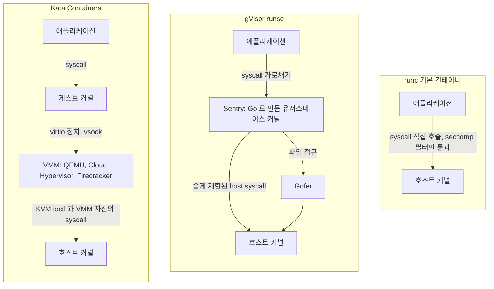
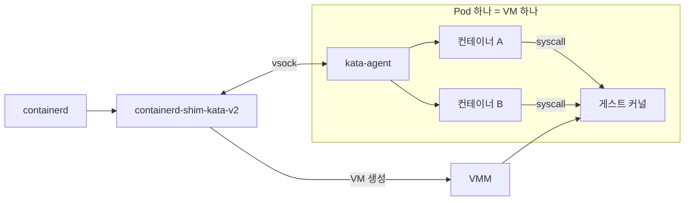
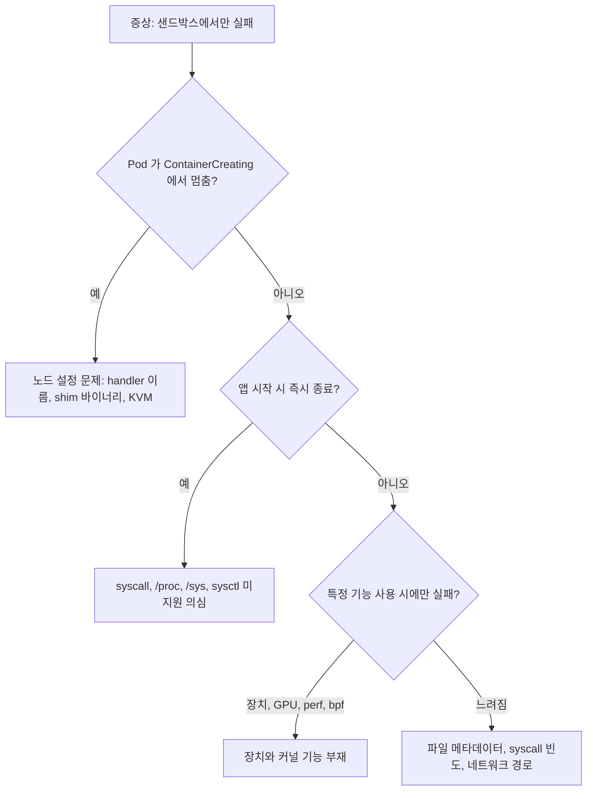
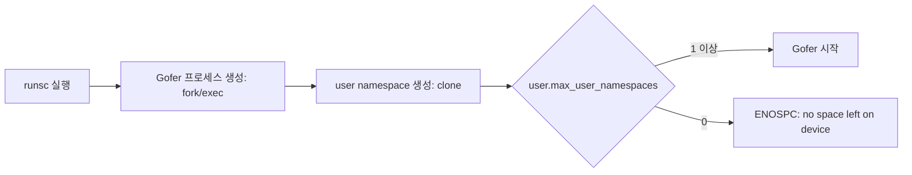
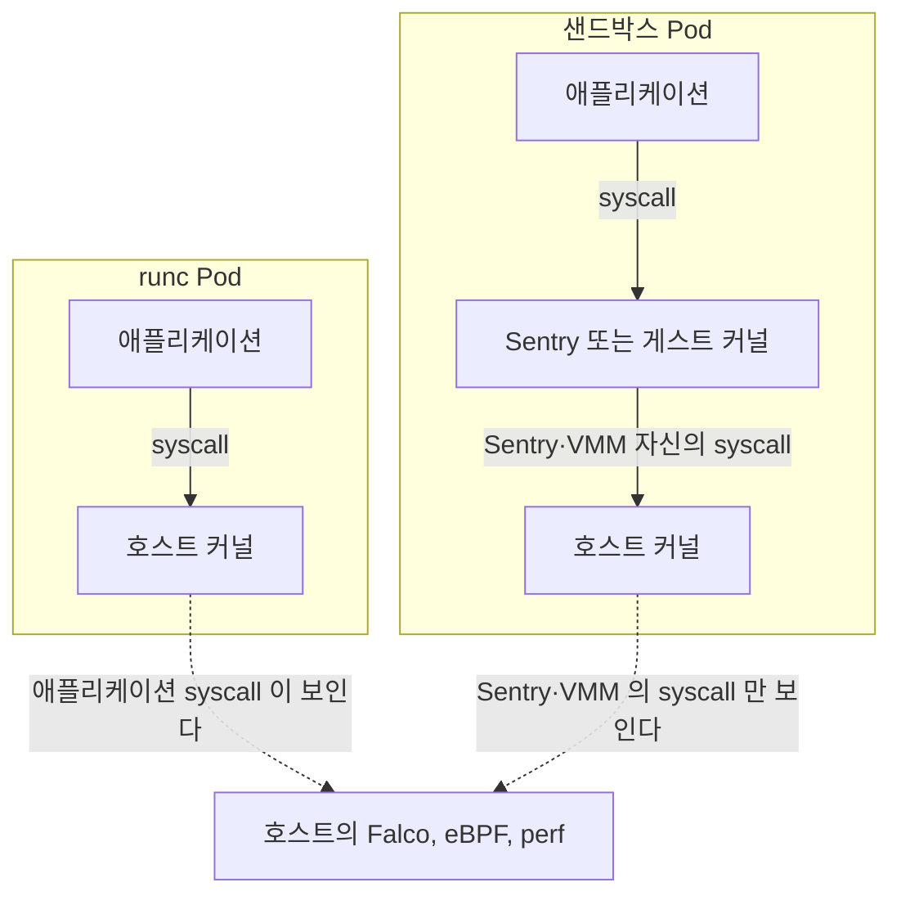
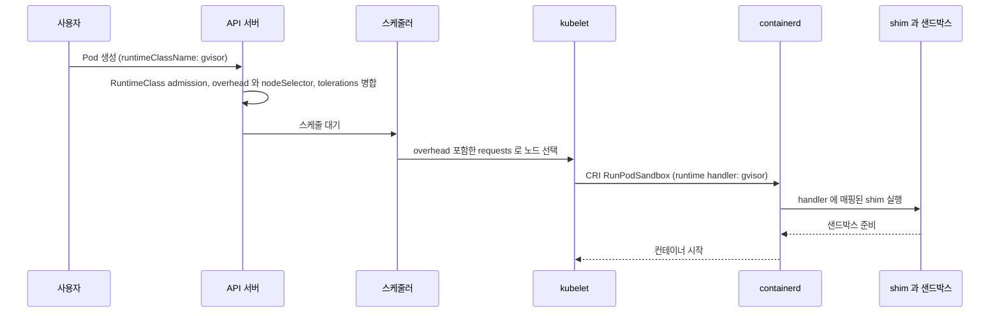
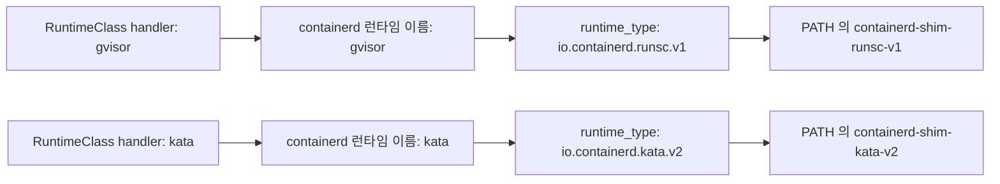
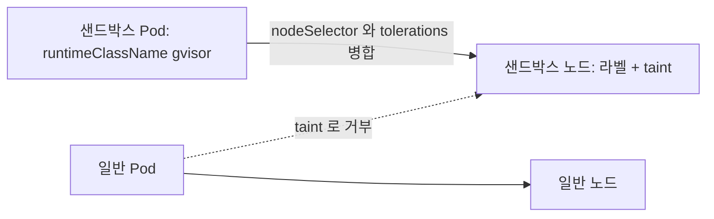
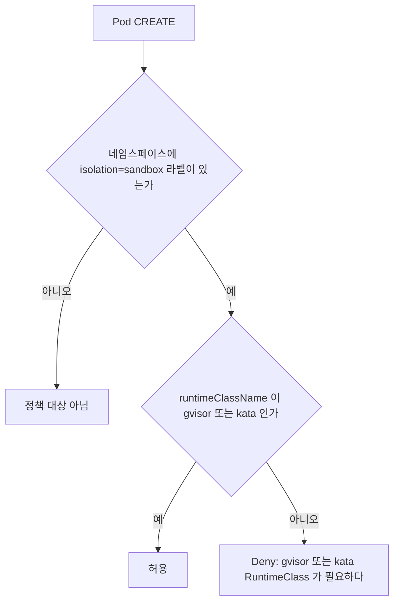
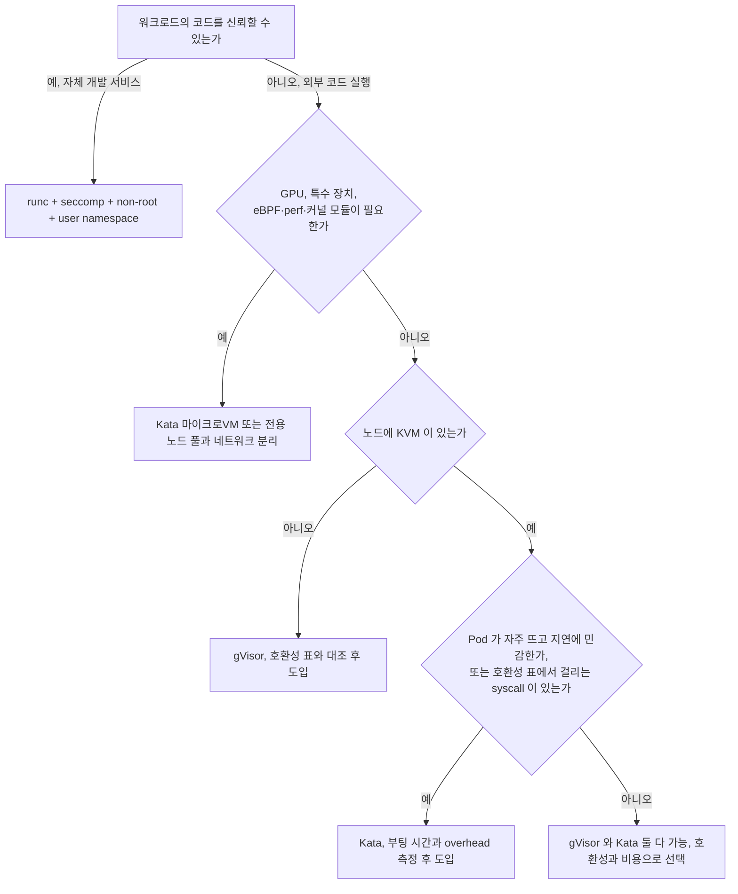

# 샌드박스 컨테이너 런타임 gVisor·Kata·Firecracker

## 설정으로 막을 수 없는 것이 남아 있다

[컨테이너 탈출 CVE 사례 분석](Container_Escape_CVE_Case_Studies.md)에서 Dirty Pipe(CVE-2022-0847)는 seccomp 기본 프로파일도, non-root 도, user namespace 도 막지 못했다. 컨테이너가 호스트와 같은 커널을 쓰고, 그 커널의 `splice` 구현에 버그가 있으면 컨테이너 안에서 읽기 권한만 가진 프로세스도 page cache 를 건드린다. 이 부류는 패치가 나올 때까지 컨테이너 설정으로 줄일 수 있는 위험이 아니다.

남은 선택지는 두 가지다. 패치 주기를 짧게 가져가거나, 애플리케이션이 호스트 커널에 직접 닿지 않게 구조를 바꾸는 것이다. 이 문서는 후자를 다룬다. gVisor, Kata Containers, Firecracker 기반 마이크로VM이 각각 호스트 커널과 애플리케이션 사이에 무엇을 끼우는지, 그 대가로 무엇이 깨지는지, 쿠버네티스에서 워크로드별로 어떻게 붙이는지, 어떤 워크로드에는 붙이면 안 되는지를 정리한다.

> 확인 범위. 이 문서를 쓰는 데 쓴 호스트는 `/dev/kvm` 이 없고 `user.max_user_namespaces` 가 0 이라 runsc 도 Kata 도 실제로 띄우지 못했다(상세는 "도입하면 깨지는 것들"과 "쿠버네티스에서 RuntimeClass 로 붙이기" 절에 적었다). 실제로 돌려 확인한 것은 containerd 2.2.1 의 설정 로딩, YAML 문법, runc 기준선 측정까지다. 샌드박스 쪽 성능 수치는 싣지 않고 공식 문서 링크로 대신한다.

## 같은 컨테이너 이미지가 지나가는 세 갈래 경로

runc 로 도는 컨테이너는 네임스페이스와 cgroup 만 다르고 호스트 커널을 그대로 쓴다. 직접 확인할 수 있다.

```bash
$ uname -r
5.15.0-52-generic
$ docker run --rm alpine:3.20 uname -r
5.15.0-52-generic
```

컨테이너 안에서 `uname -r` 이 호스트와 같은 값을 내는 것이 곧 격리 수준이다. 애플리케이션이 호출한 syscall 은 seccomp 필터 한 겹을 지나 호스트 커널 코드로 바로 들어간다. 필터가 허용한 syscall 수만큼, 그 syscall 이 닿는 커널 서브시스템 전체가 공격 표면이다.

샌드박스 런타임은 이 직선 경로 중간에 다른 구현을 끼운다.



그림에서 볼 것은 화살표가 호스트 커널로 들어가는 모양이다. runc 는 애플리케이션이 만든 syscall 이 그대로 들어간다. gVisor 는 애플리케이션 syscall 은 Sentry 에서 끝나고, 호스트 커널에는 Sentry 와 Gofer 가 자기 일을 하려고 내는 syscall 만 간다. Kata 는 애플리케이션 syscall 이 게스트 커널에서 끝나고, 호스트 커널에는 VMM 프로세스가 내는 syscall 과 KVM ioctl 만 간다. 애플리케이션이 직접 건드리는 커널 코드가 호스트에서 떨어져 나간다는 점이 세 구조의 공통점이고, 떨어져 나간 자리에 새 구현(Sentry, 게스트 커널 + VMM)이 들어와 새 버그 후보가 된다는 점도 공통이다.

### gVisor

OCI 런타임 바이너리는 `runsc` 다. 컨테이너를 만들면 Sentry 프로세스와 Gofer 프로세스가 뜬다. Sentry 는 리눅스 syscall 인터페이스를 Go 로 다시 구현한 것이다. 파이프, 소켓, 파일시스템, 메모리 관리, 시그널, `/proc` 일부를 전부 Sentry 가 자기 메모리 안에서 관리한다. 네트워크도 기본값은 Sentry 안의 자체 TCP/IP 스택(netstack)을 쓴다. 파일은 Sentry 가 직접 열지 않고 Gofer 를 거치거나(버전과 설정에 따라 호스트 fd 를 직접 받는 방식도 있다), 그 결과가 Sentry 의 가상 파일시스템에 올라간다.

애플리케이션의 syscall 을 가로채는 방식을 platform 이라 부른다. 최근 기본값인 systrap 은 seccomp 의 trap 동작으로 syscall 을 시그널로 바꿔 Sentry 로 넘기고, KVM platform 도 있다. systrap 은 KVM 이 필요 없어서 가상화가 막힌 일반 클라우드 VM 에서도 돈다. 이 점이 아래에서 다룰 중첩 가상화 제약에서 gVisor 만 비켜가는 이유다. platform 목록과 기본값은 버전마다 바뀌어 왔으니 [공식 platform 문서](https://gvisor.dev/docs/user_guide/platforms/)에서 설치한 버전을 확인한다.

Sentry 자신은 호스트에서 강한 seccomp 필터 아래 돈다. 애플리케이션이 Sentry 를 뚫어도 얻는 것은 "필터가 걸린 Sentry 프로세스의 권한"이다. 설계 근거는 [공식 보안 모델 문서](https://gvisor.dev/docs/architecture_guide/security/)에 있다.

### Kata Containers

Pod 하나가 경량 VM 하나가 된다. containerd 는 `containerd-shim-kata-v2` 를 띄우고, shim 이 VMM(QEMU, Cloud Hypervisor, Firecracker, Dragonball 중 설정된 것)으로 VM 을 만든다. VM 안에서는 Kata 가 제공한 게스트 커널이 돌고, `kata-agent` 가 vsock 으로 shim 과 통신하며 컨테이너 프로세스를 띄운다. 이미지 레이어와 볼륨은 virtio-fs 같은 공유 파일시스템이나 블록 장치로 VM 에 들어간다.

게스트 커널이 따로 있으므로 Dirty Pipe 같은 커널 버그가 게스트에서 터져도 영향 범위는 그 VM 이다. 같은 Pod 의 컨테이너들은 VM 하나를 같이 쓰니 서로를 지켜주지는 못한다. 다른 Pod 와 호스트로 가려면 VMM 이나 KVM 의 버그를 한 번 더 넘어야 한다. 게스트 커널 자체는 패치 대상이다. 게스트 커널이 오래돼서 호스트는 패치했는데 VM 안은 취약한 상태가 되는 일이 생기니, 커널 이미지를 누가 갱신하는지 정해 둔다.

아래 그림은 Pod 하나가 VM 하나로 바뀌는 모양이다. 같은 Pod 의 컨테이너 A, B 는 하나의 게스트 커널을 공유하고, 호스트와는 VMM 을 사이에 두고 만난다.



### Firecracker

Firecracker 는 컨테이너 런타임이 아니라 VMM 이다. Rust 로 쓰였고 KVM 위에서 동작하며, 에뮬레이션하는 장치를 virtio-net, virtio-block, vsock, 시리얼 정도로 줄여서 QEMU 보다 공격 표면이 훨씬 작다. USB, GPU, 대부분의 PCI 장치는 아예 없다. 설계 목표로 공개된 부팅 시간과 VM 당 메모리 오버헤드는 [Firecracker 프로젝트 페이지](https://firecracker-microvm.github.io/)와 [NSDI '20 논문](https://www.usenix.org/conference/nsdi20/presentation/agache)에 있다. 직접 재지 않은 수치라 여기에는 옮기지 않는다.

컨테이너 오케스트레이션과 붙이는 방법은 세 가지다. Kata 의 VMM 으로 Firecracker 를 고르거나, firecracker-containerd 를 쓰거나, AWS 의 Lambda·Fargate 처럼 관리형 서비스가 이미 그렇게 해 둔 것을 쓴다. 직접 운영한다면 첫 번째가 가장 현실적이다. VM 단위로 격리하되 쿠버네티스 쪽 인터페이스는 RuntimeClass 그대로다.

### 세 구조를 한 표로

| 항목 | runc | gVisor | Kata (+ Firecracker 등) |
|---|---|---|---|
| 애플리케이션 syscall 처리 | 호스트 커널 | Sentry (Go 구현) | 게스트 커널 |
| 호스트 커널이 받는 것 | 애플리케이션 syscall 전부(seccomp 허용분) | Sentry·Gofer 가 내는 제한된 syscall | VMM 의 syscall + KVM ioctl |
| 격리 단위 | 컨테이너 | 컨테이너(Pod 는 Sentry 하나를 공유) | Pod 단위 VM |
| KVM 필요 | 아니오 | 아니오(systrap 기준) | 예 |
| 리눅스 호환성 | 호스트 커널 그대로 | Sentry 가 구현한 만큼 | 게스트 커널이 구현한 만큼 (거의 전체) |
| 새로 생기는 공격 대상 | 없음 | Sentry·Gofer 의 구현 버그 | VMM·KVM·virtio 장치·게스트-호스트 공유 파일시스템 |
| 주된 비용 | 없음 | syscall·파일 I/O·네트워크 경로 | VM 부팅과 Pod 당 고정 메모리 |

호환성 칸의 방향이 두 샌드박스에서 다르다는 것을 기억해 둔다. gVisor 는 호스트 커널의 부분집합을 직접 구현하니 빠진 기능이 있다. Kata 는 진짜 리눅스 커널이 돌아서 호환성이 높은 대신 VM 이 갖는 비용을 낸다. 공격 표면을 가장 크게 줄이는 쪽(VM)이 호환성에서는 가장 부담이 적다는 점이 도입 결정에서 자주 헷갈리는 부분이다. 호환성이 문제라면 Kata 로, 비용·KVM 부재가 문제라면 gVisor 로 가는 것이 보통의 흐름이다.

## 도입하면 깨지는 것들

보안 팀이 RuntimeClass 를 켜 달라고 하고, 앱 팀이 켰더니 Pod 가 안 뜨거나 뜬 뒤 특정 요청에서만 죽는 경우가 대부분이다. 깨지는 지점은 원인 계층으로 나누면 찾기 쉽다.



위쪽 가지(노드 설정)는 한 번 고치면 끝나고, 아래쪽 가지는 워크로드마다 다시 평가해야 한다.

### 노드 설정 때문에 Pod 가 안 뜨는 경우

Pod 가 `ContainerCreating` 에서 멈추고 `kubectl describe pod` 의 이벤트에 `no runtime for "gvisor" is configured` 같은 메시지가 보이면 containerd 에 그 이름의 런타임이 등록되지 않은 것이다. RuntimeClass 의 `handler` 값과 containerd 설정의 런타임 이름이 한 글자라도 다르면 이렇게 된다. shim 바이너리(`containerd-shim-runsc-v1`, `containerd-shim-kata-v2`)가 containerd 의 `PATH` 에 없어도 비슷하게 실패한다.

Kata 와 Firecracker 계열은 노드에 `/dev/kvm` 이 있어야 한다. 쓰는 호스트에 `/dev/kvm` 이 없다면 VM 이 안 뜬다. 이 문서를 쓴 호스트가 바로 그런 경우여서 Kata 는 시도조차 못 했다.

gVisor 에서는 오해하기 쉬운 오류를 만났다. 공식 릴리스(`release-20261005.0`)의 runsc 를 받아 OCI 번들로 직접 실행했더니 디스크 여유가 9GB 인데도 이렇게 실패했다.

```text
running container: creating container: cannot create gofer process: gofer: fork/exec /proc/self/exe: no space left on device
```

메시지만 보면 디스크 문제처럼 보이지만, 이 호스트는 `user.max_user_namespaces` 가 0 이었다.

```bash
$ cat /proc/sys/user/max_user_namespaces
0
```

`clone(2)` 는 user namespace 생성 한도를 넘으면 ENOSPC 를 돌려준다. runsc 가 Gofer 를 띄우면서 user namespace 를 만들려다 막힌 것으로 추정한다. 이 sysctl 을 올려서 재현을 확인하지는 않았다. 호스트 전체의 user namespace 정책을 문서 작성을 위해 바꾸는 것이 맞지 않다고 판단했다. 일부 보안 하드닝 설정이 이 값을 0 으로 두므로, 노드 이미지가 하드닝된 경우 "디스크는 남는데 no space left" 가 나오면 이 값부터 본다. 반대로 말하면 user namespace 를 막아 둔 노드에서는 gVisor 도 쓸 수 없다는 뜻이다. [Rootless 컨테이너와 User Namespace](Rootless_Containers_User_Namespaces.md)에서 다룬 "user namespace 를 켜는 쪽이 낫다"는 판단과 이 제약이 같은 방향이다.

추정한 실패 경로를 그림으로 옮기면 아래와 같다. 갈림길은 `max_user_namespaces` 값 하나이고, 0 이면 디스크와 무관하게 ENOSPC 가 올라온다.



### syscall 과 커널 기능

gVisor 의 Sentry 는 리눅스 syscall 을 전부 구현하지 않았다. 지원하지 않는 syscall 은 `ENOSYS` 를 돌려주고, 앱이 이를 예외 없이 처리하면 조용히 기능 하나가 사라진다. 현재 지원 범위는 버전별 [syscall 호환성 표](https://gvisor.dev/docs/user_guide/compatibility/linux/amd64/)에 있다. 앱이 쓰는 syscall 목록을 호환성 표와 대조하는 작업을 도입 전에 한 번 한다.

```bash
# runc 컨테이너 안에서 앱이 호출하는 syscall 종류를 뽑는다 (스테이징에서)
strace -f -c -o /tmp/syscalls.txt -p "$(pidof myapp)"
# 종료 후 /tmp/syscalls.txt 의 syscall 이름을 호환성 표와 대조
```

실제로 문제를 일으키는 쪽은 앱 코드보다 런타임·라이브러리인 경우가 많다. 호환성 표에서 미구현이거나 부분 구현으로 표시된 항목 중 눈여겨볼 것은 `bpf`, `perf_event_open`, `io_uring`, `userfaultfd`, `fanotify` 류다. 예를 들어 `io_uring` 을 기본으로 켜는 런타임이나 라이브러리가 있는데, 이쪽은 실패했을 때 폴백 경로가 있는지 앱 문서를 확인한다.

Kata 는 게스트에 진짜 리눅스 커널이 있어서 syscall 호환성 문제가 거의 없다. 대신 게스트 커널 빌드 옵션이 문제가 된다. Kata 가 제공하는 게스트 커널은 최소 설정으로 빌드되므로 특정 netfilter 모듈, 파일시스템, 보안 모듈이 빠져 있을 수 있다. 앱이 `modprobe` 로 모듈을 올리는 방식이라면 호스트가 아니라 게스트 커널에 그 모듈이 있어야 한다.

### /proc, /sys, sysctl

gVisor 안의 `/proc` 과 `/sys` 는 Sentry 가 만들어 보여주는 가짜 파일이다. 호스트 `/proc` 과 내용이 같다고 가정하면 안 된다. 일부 파일은 없고, 있어도 값이 의미가 다르다. 실제로 영향이 나는 것은 아래 경우다.

- 노드 상태를 `/proc`·`/sys` 에서 읽는 에이전트(CPU 토폴로지, NUMA, 커널 심볼). 샌드박스 안에서 읽으면 호스트 값이 아니라 Sentry 가 정한 값이 나온다.
- `sysctl` 로 커널 파라미터를 바꾸는 시작 스크립트. Elasticsearch 처럼 `vm.max_map_count` 를 요구하는 소프트웨어는 샌드박스 안에서 그 값을 설정할 수 있는지부터 확인한다. gVisor 에서는 Sentry 가 해당 파일을 어떻게 다루는지에 따라, Kata 에서는 게스트 커널 설정이므로 Pod 의 sysctl 이 게스트에 적용되는지에 따라 달라진다.
- cgroup 파일(`/sys/fs/cgroup`)로 메모리·CPU 한도를 읽는 JVM, Go 런타임. 한도를 못 읽으면 호스트 전체 메모리를 기준으로 힙을 잡아 OOM 이 난다.

세 번째는 증상이 미묘해서 오래 걸린다. 샌드박스 안에서 `cat /sys/fs/cgroup/memory.max` 값이 Pod limit 과 같은지 도입 직후 한 번 확인한다.

### 관측·보안 도구

호스트 커널 후킹으로 동작하는 도구는 샌드박스 안의 애플리케이션 syscall 을 보지 못한다. 애플리케이션 syscall 이 호스트 커널에 도달하지 않기 때문이다. 이건 샌드박스가 일을 제대로 하고 있다는 증거이기도 한데, 운영 입장에서는 [Falco](Container_Runtime_Security_Falco.md) 같은 런타임 탐지, eBPF 기반 프로파일러, `perf` 가 해당 Pod 에서 눈이 먼다는 뜻이다. 호스트에서 보이는 것은 Sentry 또는 VMM 프로세스가 내는 syscall 뿐이다. gVisor 는 Sentry 에서 이벤트를 내보내는 별도 기능이 있고 Falco 도 그쪽 연동을 지원하는 것으로 알고 있으나 이 환경에서 확인하지 못했다. 샌드박스를 쓰는 워크로드의 탐지는 샌드박스 쪽 기능을 따로 설계한다.

호스트 쪽 도구가 어디까지 보는지를 비교한 그림이다. runc Pod 는 애플리케이션 syscall 이 호스트 커널에 도달하지만, 샌드박스 Pod 는 Sentry 또는 VMM 이 낸 syscall 만 도달한다.



서비스 메시 사이드카, `tcpdump` 를 띄우는 디버깅용 ephemeral container 도 확인 대상이다. 디버깅 컨테이너가 같은 Pod 에 들어가면 같은 샌드박스에 들어가므로 동작은 하지만, 호스트에서 `nsenter` 로 컨테이너 네트워크 네임스페이스에 들어가 `tcpdump` 를 하던 습관은 gVisor 에서 통하지 않는다. 패킷 처리가 호스트 커널 스택이 아니라 netstack 안에서 일어나기 때문이다.

### GPU와 특수 장치

Firecracker 는 장치 모델에 GPU 가 없다. Kata 는 VFIO 패스스루로 장치를 VM 에 넘길 수 있지만 설정이 복잡하고 노드마다 IOMMU 설정이 필요하다. gVisor 는 NVIDIA GPU 를 위한 `nvproxy` 를 제공한다. 다만 지원하는 드라이버 버전과 ioctl 이 제한돼 있어서 [GPU 지원 문서](https://gvisor.dev/docs/user_guide/gpu/)에 있는 버전 표를 먼저 본다. 장치 플러그인으로 `/dev/nvidia*` 를 컨테이너에 넣는 일반 방식을 그대로 기대하면 안 된다.

`hostPath` 로 `/dev/xxx` 를 마운트해 쓰는 워크로드, `privileged: true` 로 호스트 장치를 만지는 워크로드도 마찬가지다. Kata 의 `privileged` 는 게스트 안의 권한이라 호스트 장치가 보이지 않는다. 장치를 넘겨야 한다면 containerd 설정의 `privileged_without_host_devices` 같은 옵션의 의미를 읽어야 한다.

### 성능

체감 성능은 워크로드의 syscall 빈도, 파일 메타데이터 접근량, 네트워크 경로에 좌우된다. gVisor 는 시스템콜 하나하나가 Sentry 를 거치므로 syscall 이 잦은 워크로드가 느려지고, 파일 열기·`stat` 이 많은 빌드·패키지 설치 같은 작업이 특히 영향을 받는다고 [공식 성능 문서](https://gvisor.dev/docs/architecture_guide/performance/)에 설명돼 있다. Kata 는 VM 부팅 시간과 Pod 당 고정 메모리, 공유 파일시스템(virtio-fs) 경유 I/O 가 비용이다. 같은 숫자를 다른 환경에서 재현하기 어렵고 버전마다 바뀌는 값이라 이 문서에는 수치를 쓰지 않는다.

직접 재는 방법을 적는다. 우리 워크로드와 닮은 두 가지 극단을 같은 이미지·같은 스크립트로 runc 와 샌드박스에서 각각 돌린다. 아래 스크립트는 syscall 빈도가 극단적인 경우(바이트 단위 read/write 200만 번)와 파일 메타데이터 접근이 극단적인 경우(5,000개 파일 `find` 20회)를 잰다.

```bash
#!/bin/sh
now() { cut -d' ' -f1 /proc/uptime; }
ms() { awk -v a="$1" -v b="$2" 'BEGIN { printf "%d", (b - a) * 1000 }'; }

t0=$(now)
dd if=/dev/zero of=/dev/null bs=1 count=2000000 2>/dev/null
t1=$(now)
echo "syscall  : 2M read+write       $(ms $t0 $t1) ms"

mkdir -p /t && cd /t
i=0; while [ $i -lt 5000 ]; do : > f$i; i=$((i+1)); done
t2=$(now)
r=0; while [ $r -lt 20 ]; do find /t -type f | wc -l > /dev/null; r=$((r+1)); done
t3=$(now)
echo "metadata : find 5000 files x20  $(ms $t2 $t3) ms"
```

이 호스트에서 `docker run --rm -v ...:/b.sh:ro alpine:3.20 sh /b.sh` 를 두 번 돌린 runc 기준선은 syscall 구간이 5,799ms 와 6,329ms, 메타데이터 구간이 두 번 다 1,210ms 였다. 샌드박스 값은 못 구했다. 같은 스크립트를 `runtimeClassName` 만 바꾼 Pod 로 돌려 비율을 보면 된다. 비율이 중요하지 절대값은 노드 사양에 따라 달라진다. 이 스크립트가 맞는 대리 지표인지는 실제 워크로드의 `strace -c` 결과(syscall 빈도)와 파일 접근 패턴을 보고 판단한다.

### 중첩 가상화

Kata 와 Firecracker 는 노드에 KVM 이 있어야 하므로 클라우드에서는 두 가지 중 하나여야 한다. 베어메탈 인스턴스를 쓰거나, 일반 VM 인스턴스에서 중첩 가상화를 켜는 것이다. 일반 VM 인스턴스에는 `/dev/kvm` 이 없는 경우가 많고, 중첩 가상화를 지원하는지는 클라우드·인스턴스 계열·CPU 세대에 따라 다르며 지원하더라도 성능 손실이 있다. 예를 들어 GCP 는 인스턴스 생성 시 중첩 가상화를 켜는 옵션이 있고 CPU 플랫폼 제약이 문서화돼 있다([GCP 문서](https://cloud.google.com/compute/docs/instances/nested-virtualization/overview)). AWS 는 오래 `.metal` 인스턴스에서만 KVM 을 쓸 수 있었고, 비 metal 인스턴스의 중첩 가상화 지원 여부는 인스턴스 계열별로 공식 문서를 확인해야 한다. 노드 풀 비용 계산에서 이 차이가 가장 크게 나온다.

gVisor(systrap)는 KVM 이 필요 없어서 일반 VM 노드에서 바로 돈다. 그래서 클라우드에서 처음 샌드박스를 도입하는 팀이 gVisor 로 시작하는 경우가 많다.

## 쿠버네티스에서 RuntimeClass 로 붙이기

샌드박스는 클러스터 전체에 거는 것이 아니라 워크로드 단위로 고른다. 쿠버네티스는 `RuntimeClass` 로 이 선택을 Pod 스펙에 노출한다. 기본 구조는 [쿠버네티스 보안](Kubernetes_Security.md)의 RuntimeClass 절에 있으니 여기서는 거기서 다루지 않은 부분, 즉 containerd 설정 버전 차이, 노드 분리, 두 런타임 병행, 강제 방법을 다룬다.

### Pod 생성 흐름



흐름에서 실패가 갈리는 곳이 두 곳이다. API 서버 단계에서 `RuntimeClass` 객체가 없으면 Pod 생성이 거부된다. 객체는 있는데 노드의 containerd 에 handler 가 등록돼 있지 않으면 kubelet 단계에서 `ContainerCreating` 에 멈춘다. 후자를 막는 것이 `scheduling.nodeSelector` 다. 샌드박스가 설치된 노드에만 라벨을 달고, 그 라벨을 RuntimeClass 에 적어 두면 설치 안 된 노드로 스케줄되지 않는다.

### containerd 설정

containerd 2.x 는 설정 파일 버전 3을 쓰고 CRI 플러그인 ID 가 바뀌었다. containerd 1.x 와 설정 버전 2 에서는 `io.containerd.grpc.v1.cri`, 버전 3 에서는 `io.containerd.cri.v1.runtime` 이다. 이 문서의 호스트(containerd 2.2.1)에서 두 형식을 `containerd --config 파일 config dump` 로 로딩해 확인했다. 설정 버전 2 형식도 읽히고 덤프하면 버전 3 키로 변환돼 나온다. 즉 기존 노드를 올리면서 설정을 안 고쳐도 동작하지만, 새로 쓰는 설정은 버전에 맞는 키를 쓴다.

```toml
# containerd 2.x, 설정 버전 3
version = 3

[plugins.'io.containerd.cri.v1.runtime'.containerd.runtimes.gvisor]
  runtime_type = 'io.containerd.runsc.v1'

[plugins.'io.containerd.cri.v1.runtime'.containerd.runtimes.gvisor.options]
  TypeUrl = 'io.containerd.runsc.v1.options'
  ConfigPath = '/etc/containerd/runsc.toml'

[plugins.'io.containerd.cri.v1.runtime'.containerd.runtimes.kata]
  runtime_type = 'io.containerd.kata.v2'
  privileged_without_host_devices = true
```

```toml
# containerd 1.x, 설정 버전 2
version = 2

[plugins."io.containerd.grpc.v1.cri".containerd.runtimes.gvisor]
  runtime_type = "io.containerd.runsc.v1"

[plugins."io.containerd.grpc.v1.cri".containerd.runtimes.kata]
  runtime_type = "io.containerd.kata.v2"
```

`runtime_type` 의 `io.containerd.runsc.v1` 은 `PATH` 에서 `containerd-shim-runsc-v1` 을 찾는다는 규칙이다. 받은 gVisor 릴리스 아카이브에 그 이름의 바이너리가 `runsc` 와 함께 들어 있는 것을 목록으로 확인했다. `io.containerd.kata.v2` 도 같은 규칙으로 `containerd-shim-kata-v2` 를 찾는다. 키 이름 뒤쪽의 `gvisor`, `kata` 가 RuntimeClass 의 `handler` 와 같아야 한다.

이름이 이어지는 사슬을 그림으로 보면 아래와 같다. 화살표 한 곳이라도 글자가 다르면 앞서 본 `no runtime for ... is configured` 에서 멈춘다.



`ConfigPath` 가 가리키는 `runsc.toml` 에는 runsc 플래그를 넣는다. 디버깅할 때는 공식 문서의 containerd 예시 형태로 `[runsc_config]` 아래에 `debug`, `debug-log`, `strace` 키를 둬서 지원하지 않는 syscall 이 로그에 남게 한다. 키 이름은 버전별로 [containerd 설정 문서](https://gvisor.dev/docs/user_guide/containerd/quick_start/)에서 확인한다. 로그에 `Unsupported syscall` 이 남는 항목이 앞에서 말한 조용히 사라지는 기능을 찾는 단서다.

Kata 는 직접 설치하기보다 `kata-deploy` DaemonSet 으로 노드에 바이너리와 containerd 설정, RuntimeClass 를 한꺼번에 설치하는 경우가 많다. 이 경우 `kata-qemu`, `kata-clh`, `kata-fc` 처럼 VMM 별로 RuntimeClass 이름이 나뉜다. 설치 시 생성되는 이름은 버전마다 다르므로 `kubectl get runtimeclass` 로 확인하고 쓴다.

### RuntimeClass 와 노드 분리

```yaml
apiVersion: node.k8s.io/v1
kind: RuntimeClass
metadata:
  name: gvisor
handler: gvisor
overhead:
  podFixed:
    cpu: 100m
    memory: 64Mi
scheduling:
  nodeSelector:
    sandbox.runtime: gvisor
  tolerations:
  - key: sandbox.runtime
    operator: Equal
    value: gvisor
    effect: NoSchedule
---
apiVersion: node.k8s.io/v1
kind: RuntimeClass
metadata:
  name: kata
handler: kata
overhead:
  podFixed:
    cpu: 250m
    memory: 160Mi
scheduling:
  nodeSelector:
    sandbox.runtime: kata
  tolerations:
  - key: sandbox.runtime
    operator: Equal
    value: kata
    effect: NoSchedule
```

이 YAML 은 파서로 구조를 확인했지만 클러스터에 적용해 보지는 못했다(이 환경에 `kubectl` 과 클러스터가 없다). `overhead` 값은 측정한 값이 아니다. Kata 쪽 숫자는 kata-deploy 가 만드는 RuntimeClass 에서 흔히 보이는 값이고, gVisor 쪽은 시작점일 뿐이다. 실제로는 샌드박스 Pod 를 띄운 뒤 노드에서 Sentry 또는 VMM 프로세스의 RSS 를 보고 조정한다. 너무 작게 잡으면 스케줄러가 노드에 여유가 있다고 믿고 Pod 를 더 올려 노드 메모리가 부족해지고, 너무 크게 잡으면 노드 풀 비용이 늘어난다.

노드 쪽은 라벨과 taint 를 같이 건다.

```bash
kubectl label node sandbox-node-1 sandbox.runtime=gvisor
kubectl taint node sandbox-node-1 sandbox.runtime=gvisor:NoSchedule
```

taint 를 걸지 않으면 RuntimeClass 를 안 쓰는 일반 Pod 가 샌드박스 노드에 올라와 비싼 노드를 차지한다. RuntimeClass 의 tolerations 는 샌드박스 Pod 에 자동으로 병합되므로 앱 쪽 YAML 에서 따로 적지 않는다. 다만 nodeSelector 가 앱 YAML 의 값과 충돌하면 Pod 가 거부된다.

라벨과 taint 가 Pod 를 가르는 모양이다. 샌드박스 Pod 는 RuntimeClass 가 병합한 nodeSelector·tolerations 로 샌드박스 노드에 가고, 일반 Pod 는 taint 에 막혀 일반 노드로 간다.



Pod 쪽은 이 한 줄이면 된다.

```yaml
spec:
  runtimeClassName: gvisor
```

### 선택이 아니라 강제로 만들기

`runtimeClassName` 은 선택 필드라서 개발자가 지우는 것만으로 샌드박스가 사라진다. 사용자 코드를 실행하는 네임스페이스는 필드를 요구하는 정책을 건다. Kyverno 예시는 [쿠버네티스 보안](Kubernetes_Security.md)에 있으니, 여기서는 별도 도구 없이 쓰는 `ValidatingAdmissionPolicy`(쿠버네티스 1.30 GA)로 같은 걸 쓴다.

```yaml
apiVersion: admissionregistration.k8s.io/v1
kind: ValidatingAdmissionPolicy
metadata:
  name: require-sandbox-runtime
spec:
  failurePolicy: Fail
  matchConstraints:
    resourceRules:
    - apiGroups: [""]
      apiVersions: ["v1"]
      operations: ["CREATE"]
      resources: ["pods"]
  validations:
  - expression: "has(object.spec.runtimeClassName) && object.spec.runtimeClassName in ['gvisor', 'kata']"
    message: "이 네임스페이스의 Pod 는 gvisor 또는 kata RuntimeClass 가 필요하다"
---
apiVersion: admissionregistration.k8s.io/v1
kind: ValidatingAdmissionPolicyBinding
metadata:
  name: require-sandbox-runtime-untrusted
spec:
  policyName: require-sandbox-runtime
  validationActions: ["Deny"]
  matchResources:
    namespaceSelector:
      matchLabels:
        isolation: sandbox
```

이 정책도 클러스터에 적용해 검증하지는 못했고 YAML 문법만 확인했다. 적용 전에 스테이징 네임스페이스에서 `validationActions: ["Warn", "Audit"]` 로 시작해서 막히는 Pod 를 본 뒤 `Deny` 로 바꾼다. 시스템 Pod(CNI, 로그 수집기)가 같은 네임스페이스에 있으면 같이 막히니 라벨 대상 네임스페이스는 사용자 워크로드 전용으로 분리한다.

정책이 Pod 를 판정하는 순서다. 네임스페이스 라벨이 먼저 대상을 거르고, 그 안에서만 `runtimeClassName` 을 검사한다.



### 로컬에서 확인하는 방법과 이 문서의 한계

kind 노드 이미지에는 runsc 와 Kata 가 없어서, 노드 컨테이너에 바이너리와 containerd 설정을 직접 넣어야 한다. minikube 는 containerd 런타임으로 시작(`--container-runtime=containerd`)하고 `minikube addons enable gvisor` 로 gVisor 를 붙이는 방법이 공식으로 있는 것으로 알고 있다. 두 방법 모두 이 환경에서는 실행하지 못했다. `kind`, `minikube`, `kubectl` 이 설치돼 있지 않았고, 설치하더라도 앞서 본 `user.max_user_namespaces=0` 때문에 gVisor 가 뜨지 않으며 `/dev/kvm` 이 없어 Kata 도 뜨지 않는다. 로컬에서 시험하려면 user namespace 가 열려 있고(gVisor), KVM 이 노출된(Kata) 머신이 필요하다.

### 클라우드에서 어디까지 되는가

관리형 서비스는 노드 설치와 handler 등록을 대신해 주는 대신 쓸 수 있는 조건이 붙는다. 아래는 공식 문서를 근거로 한 개요이고, 제약은 계속 바뀌므로 도입 전에 링크의 현재 문서를 확인한다.

| 서비스 | 격리 방식 | 조건과 확인할 점 |
|---|---|---|
| GKE Sandbox | gVisor | 노드 풀을 샌드박스로 만들어야 하고, 샌드박스가 아닌 노드 풀이 따로 있어야 한다. Pod 는 `runtimeClassName: gvisor` 로 지정한다. 지원하지 않는 기능과 머신 타입·모드(Standard/Autopilot) 제약은 [GKE Sandbox 문서](https://cloud.google.com/kubernetes-engine/docs/concepts/sandbox-pods)에 정리돼 있다 |
| EKS Fargate, ECS Fargate | Firecracker 기반 마이크로VM | 태스크·Pod 마다 격리 경계가 따로 있다고 AWS 가 설명한다. 대신 privileged 컨테이너, DaemonSet 이 지원되지 않고 노드 접근이 없다. [EKS Fargate 문서](https://docs.aws.amazon.com/eks/latest/userguide/fargate.html)의 고려사항을 확인한다 |
| EKS·GKE·AKS 자체 노드에 Kata | 마이크로VM | KVM 이 노출된 노드가 필요하다. 베어메탈 또는 중첩 가상화를 지원하는 인스턴스 계열을 골라야 한다. AKS 는 Kata 기반 Pod Sandboxing 기능을 제공하는 것으로 알고 있으나 지원 노드 이미지와 지역 제약을 문서에서 확인한다 |

Fargate 에서는 RuntimeClass 를 고르는 것이 아니라 Fargate 프로필에 맞는 Pod 가 마이크로VM 에서 돈다. 격리 수준을 올리는 것이 목적이면 "모든 Pod 가 Fargate" 와 "일부 Pod 만 샌드박스 노드" 사이에서 고르는 문제가 된다. 노드 단위 DaemonSet 으로 런타임 탐지나 로그 수집을 하는 구성은 Fargate 에서 그대로 쓸 수 없으므로, 로깅·모니터링 에이전트를 사이드카나 플랫폼 기능으로 바꿀 수 있는지가 선결 조건이다.

## 어떤 워크로드에 붙이고 어떤 워크로드에는 붙이지 않는가

기준은 하나다. 컨테이너 안에서 도는 코드를 신뢰할 수 없고, 그 코드가 호스트 커널 취약점으로 이웃에게 갈 수 있을 때 쓴다. 신뢰할 수 있는 코드를 자주 배포하는 평범한 서비스에는 비용만 든다.

붙이는 쪽의 전형은 이렇다.

- 멀티테넌트 코드 실행. 고객이 올린 함수, 플러그인, 스크립트를 같은 노드에서 돌리는 서비스. 한 테넌트의 탈출이 다른 테넌트로 번지는 것이 가장 큰 위험이다. [크로스 테넌트 유출](Cross_Tenant_Leak.md)과 같은 맥락이다.
- CI 러너. 외부 기여자의 PR 이 러너에서 임의 코드를 실행한다. 러너가 도커 소켓이나 privileged 를 요구하면 샌드박스로는 해결되지 않고, 그 경우 VM 단위 격리(Kata 또는 일회용 VM)를 쓴다. [CI/CD 파이프라인 공격](CI_CD_Pipeline_Attacks.md)에서 다룬 공격 경로와 연결된다.
- 사용자 업로드 코드 실행. 코딩 테스트 채점, 노트북 서비스, 이미지·문서 변환기처럼 신뢰할 수 없는 입력을 파싱하는 변환 워커. 파서 취약점으로 RCE 가 나는 것을 전제로 설계한다.

붙이지 않는 쪽도 정해 둔다.

- 성능에 민감한 데이터베이스. 디스크 I/O 경로가 길어지고 syscall 비용이 늘어나는 것을 DB 는 그대로 받는다. 신뢰할 수 있는 코드이므로 이득도 작다.
- GPU 나 특수 장치에 의존하는 워크로드. 위에서 본 것처럼 지원이 제한적이다.
- eBPF·perf·커널 모듈에 의존하는 워크로드. 네트워크 데이터플레인, 프로파일러, 보안 에이전트 같은 인프라 구성요소.
- 호스트 자원을 쓰는 시스템 컴포넌트. CNI 에이전트, 노드 로그 수집기, CSI 노드 플러그인.
- 지연에 민감하고 Pod 가 짧게 자주 뜨는 워크로드. Kata 의 VM 부팅은 시작 지연에 직접 영향을 준다.



이 의사결정에는 암묵적 전제가 몇 개 있다. 신뢰할 수 없는 코드를 돌리면서 GPU 가 필요한 워크로드(외부 사용자의 모델 실행 등)는 결국 VM 단위의 격리가 현실적인 선택이고 gVisor 의 `nvproxy` 는 지원 드라이버 조건을 만족할 때만 대안이 된다. 사내 서비스지만 서드파티 SDK·플러그인을 많이 로드하는 경우는 "신뢰할 수 있는가"를 보수적으로 읽는다.

### 샌드박스가 막지 못하는 것

샌드박스 런타임은 호스트 커널 쪽 경계를 올린다. 컨테이너가 받은 권한과 네트워크 도달 범위는 그대로다. 샌드박스 Pod 안의 코드가 서비스 계정 토큰으로 API 서버를 호출하는 것, 클라우드 메타데이터 엔드포인트에서 노드 자격증명을 가져오는 것, 같은 네임스페이스의 다른 서비스로 요청을 보내는 것은 막히지 않는다. NetworkPolicy, `automountServiceAccountToken: false`, 메타데이터 접근 차단을 따로 건다.

샌드박스 자체도 뚫린 적이 있다. gVisor 의 Sentry, QEMU 같은 VMM, KVM 에는 각각 보안 공지가 존재하고 앞으로도 나온다. 호스트 커널 취약점은 그 표면이 줄었을 뿐 사라진 것이 아니다. 그래서 샌드박스를 쓴다고 [컨테이너 보안](Container_Security.md)의 기본 설정(non-root, capability 제거, seccomp, read-only 루트)을 빼도 되는 것이 아니다. 샌드박스 안에서도 그 설정은 공격자가 필요한 권한을 줄이는 일을 한다.

## 방어 계층 안에서의 위치

이 문서의 런타임은 [Container Escape](Container_Escape.md)의 방어 계층에서 맨 위, 커널 공유 자체를 줄이는 층이다. 설정 점검(capability, seccomp, hostPath 금지), user namespace, 패치가 아래에 깔리고 그 위에 샌드박스가 얹힌다. 층 하나가 다른 층을 대신하지 않는다.

[컨테이너 탈출 CVE 사례 분석](Container_Escape_CVE_Case_Studies.md)의 "어떤 방어가 어느 사례를 막는가" 표에서 샌드박스 런타임은 Dirty Pipe 한 줄에만 "구조적 완화"로 나온다. 이 문서를 읽고 나면 그 이유를 구조로 설명할 수 있다. gVisor 에서는 애플리케이션의 `splice` 가 Sentry 의 자체 구현에서 끝나 호스트 page cache 에 닿지 않고, Kata 에서는 게스트 커널의 page cache 라서 호스트가 아닌 VM 이 영향 범위다. 같은 표의 runc 취약점(CVE-2019-5736, CVE-2024-21626)은 호스트에서 runc 를 실행하는 경로 자체를 노린 것이라 샌드박스 런타임이 그 경로를 안 타면 해당이 없다. 대신 그 자리를 shim, runsc, VMM 의 버그가 차지하므로 "취약점 없음"이 아니라 "노려야 할 대상이 바뀜"이다. 어느 방어가 어느 사례를 막고 못 막는지 나머지 줄은 그 표에서 이어서 본다.

## 참고

- [gVisor 보안 모델](https://gvisor.dev/docs/architecture_guide/security/)
- [gVisor 성능 설명](https://gvisor.dev/docs/architecture_guide/performance/)
- [gVisor syscall 호환성 표 (amd64)](https://gvisor.dev/docs/user_guide/compatibility/linux/amd64/)
- [gVisor platform](https://gvisor.dev/docs/user_guide/platforms/)
- [gVisor GPU 지원](https://gvisor.dev/docs/user_guide/gpu/)
- [gVisor containerd 설정](https://gvisor.dev/docs/user_guide/containerd/quick_start/)
- [Firecracker](https://firecracker-microvm.github.io/)
- [Firecracker NSDI '20 논문](https://www.usenix.org/conference/nsdi20/presentation/agache)
- [Kubernetes RuntimeClass](https://kubernetes.io/docs/concepts/containers/runtime-class/)
- [GKE Sandbox](https://cloud.google.com/kubernetes-engine/docs/concepts/sandbox-pods)
- [EKS Fargate](https://docs.aws.amazon.com/eks/latest/userguide/fargate.html)
- [GCP 중첩 가상화](https://cloud.google.com/compute/docs/instances/nested-virtualization/overview)
