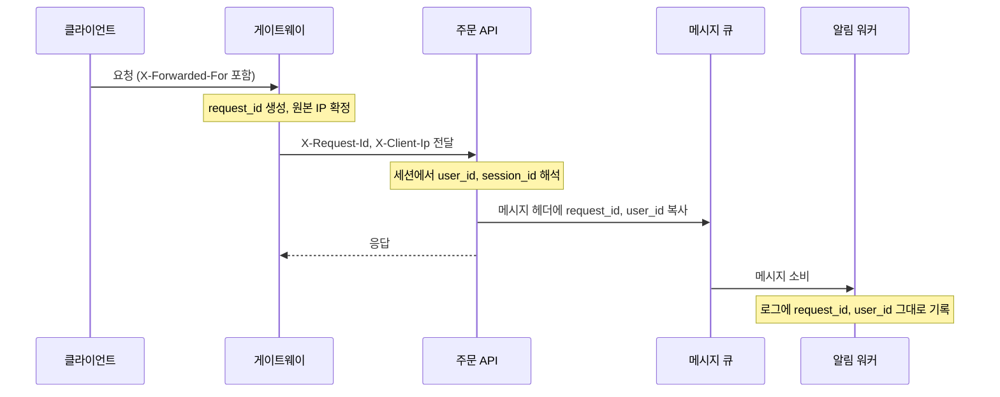
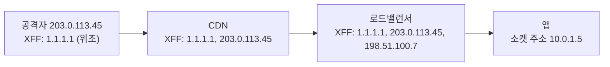
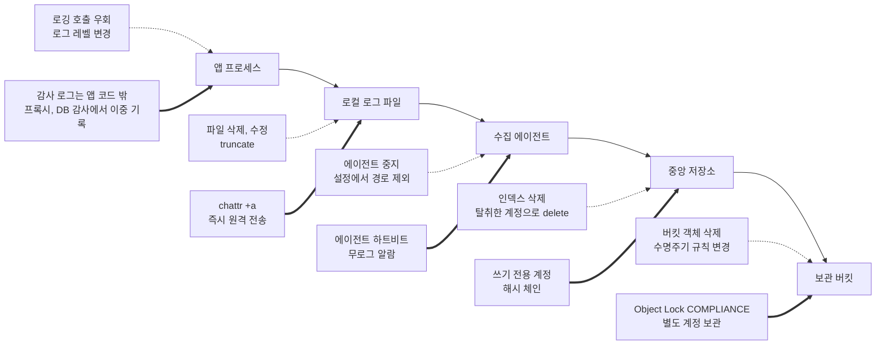
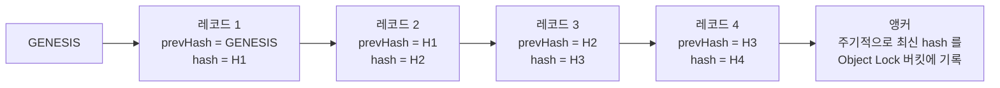
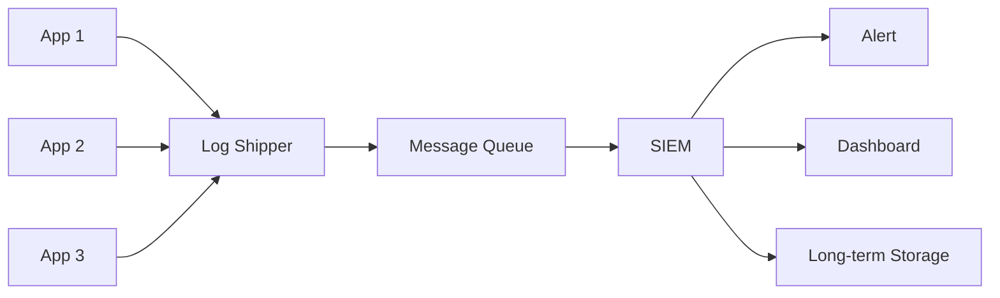

# 보안 로깅과 감사

사고가 터지고 나서 가장 먼저 듣는 질문은 정해져 있다. "언제부터 들어왔냐", "어떤 계정으로 뭘 만졌냐", "데이터 얼마나 빠져나갔냐". 답을 못 하면 추측이 되고 추측은 과대 신고로 이어진다. 개인정보 1000건 유출인지 100만 건 유출인지를 로그가 가른다.

보안 로그는 디버깅용 로그와 목적이 다르다. 누가 무엇을 했는지 사후에 증명하는 증거라서, 남길 항목이 법과 규정으로 정해져 있고, 위변조를 막아야 하고, 일정 기간 보존해야 한다. 한 파이프라인으로 둘 다 처리하면 둘 다 망가진다. 이 문서는 무엇을 남기고, 어떻게 지켜내고, 공격자를 추적할 때 쓸 수 있는 상태로 이어 붙이는 방법까지 다룬다. 로그를 받아서 실제로 추적하는 절차는 [공격자 추적과 포렌식](Attacker_Tracing_and_Forensics.md)에서 이어진다.

## 일반 로그와 감사 로그의 분리

`application.log`에 디버그, 에러, 인증 실패, 결제 처리, 관리자 권한 변경이 섞여 들어가면 사고 때 grep으로 뒤져도 노이즈가 너무 많아 신호를 못 찾는다. 디스크가 차서 일반 로그를 지우다가 감사 로그까지 같이 날아가는 사고도 이 구성에서 나온다.

| 구분 | 일반 로그 | 감사 로그 |
| --- | --- | --- |
| 저장 위치 | application.log, stdout | 별도 인덱스 또는 별도 버킷 |
| 포맷 | 자유 텍스트 | JSON 구조화 필수 |
| 보존 | 7~30일 | 1~5년 |
| 접근 | 개발자 전원 | 보안팀, 감사팀 |
| 전송 실패 시 | 버려도 됨 | 디스크 큐에 쌓고 재전송 |

## 이벤트별로 남길 것

ISMS-P, PCI DSS, SOX, GDPR이 공통으로 요구하는 카테고리를 필수 필드와 보존 기간으로 묶으면 아래 표가 된다. 모든 이벤트에 공통으로 `timestamp`(UTC), `request_id`, `service`, `user_id`, `source_ip`가 들어간다는 전제다. 표에는 공통 필드를 뺀 나머지만 적었다.

| 이벤트 | 추가 필수 필드 | 남기지 않는 것 | 보존 기간 |
| --- | --- | --- | --- |
| 로그인, 로그아웃 | User-Agent, 인증 방식, 결과, 실패 사유, session_id | 비밀번호, OTP 값 | 접속기록 기준 1년 (5만명 이상이거나 민감정보 처리 시 2년) |
| 권한 변경 | 대상 user_id, 변경 전/후 역할, 요청자, 승인자 | 발급된 API 키 원문 | 최소 3년 (권한 부여, 변경, 말소 내역) |
| 민감 데이터 조회 | 조회 대상자 ID, 조회 항목, 조회 사유 | 조회된 값 자체 | 접속기록 기준 1년~2년 |
| 대량 조회, 다운로드 | 건수, 필터 조건, 파일명, 반출 경로 | 파일 내용 | 접속기록 기준 1년~2년 |
| 데이터 변경 | 테이블, 컬럼, 변경 전 값, 변경 후 값 | 암호화 키, 비밀번호 해시 | 접속기록 기준 1년~2년, 금융 거래는 5년 |
| 시스템, 설정 변경 | 변경 대상, diff, 배포 ID, 보안 모듈 on/off | 시크릿 값 | 법정 기간 없음, 내부 기준 1년 이상 |
| 로그 조회 (메타 감사) | 조회자, 조회 범위, 조회 사유 | 조회된 로그 내용 | 감사 로그 본체와 같은 기간 |

실패 사유는 "비밀번호 불일치", "계정 잠금", "MFA 실패"를 구분해서 남겨야 한다. 같은 IP에서 여러 계정으로 불일치가 반복되면 크리덴셜 스터핑이고, 한 계정에 여러 비밀번호가 오면 무차별 대입이다. 결과만 있는 로그로는 둘이 구분되지 않는다.

대량 조회는 자주 빠진다. 관리자가 엑셀로 내려받으려고 1만 명을 조회하면 한 트랜잭션 안에서 처리되어 로그가 한 줄만 남는다. 다운로드 이벤트를 별도 타입으로 만들어 건수와 필터 조건을 같이 남겨야, 사고 뒤에 어디까지 빠져나갔는지 셀 수 있다. 로그 시스템이 죽었다는 사실도 다른 곳에 남긴다. 공격자가 로그부터 끄고 작업하면 그 구간은 흔적이 없다.

보존 기간은 법령에 따라 갈린다. 나머지 근거는 뒤의 [보존 기간](#보존-기간) 절에 있다.

## 로그에 들어가면 안 되는 것

로그에 한 번 들어간 값은 CloudWatch, S3 백업, Elasticsearch 인덱스, 개발자 노트북의 덤프까지 전부 복사된다. 회수는 사실상 불가능하다. `logger.info("login request: {}", requestBody)` 한 줄로 비밀번호가 평문으로 6개월치 쌓인 경우를 본 적이 있다. 전수 재설정과 사고 보고로 끝나지 않고 신뢰까지 흔들린다.

| 분류 | 대상 | 허용 형태 |
| --- | --- | --- |
| 인증 정보 | 비밀번호, 세션 토큰, JWT, API 키, refresh token, OTP, 재설정 토큰 | 전부 금지. 필요하면 토큰 해시 앞 8자리 |
| 결제 정보 | 카드번호(PAN), CVC, 카드·계좌 비밀번호 | PAN은 앞 6 뒤 4만 (`4532-12**-****-9012`), CVC는 저장 자체 금지 |
| 고유식별정보 | 주민등록번호, 여권번호, 운전면허번호, 외국인등록번호 | 평문 금지. 법령 근거 없는 수집은 그 자체로 위반 |
| 민감정보 | 의료, 생체 | 별도 동의와 별도 보호 조치 |
| 일반 PII | 이메일, 휴대폰, 이름 | 마스킹 (`hong****@example.com`, `010-****-1234`, `홍*동`) |

JWT는 디코드하면 페이로드가 그대로 보이니 토큰 원문도, 디코드 결과도 남기면 안 된다. 메일이나 SMS로 보낸 인증 코드를 발송 로그에 같이 남기는 실수도 흔하다. 만료 전에 로그에서 가로챌 수 있다.

감사 로그에서는 마스킹 없이 원본 ID를 남겨야 할 때가 있다. 누가 누구의 데이터를 봤는지가 핵심인데 마스킹된 ID로는 추적이 안 된다. 이 경우는 일반 로그와 감사 로그를 분리하고 감사 로그의 접근 권한을 강하게 거는 쪽으로 푼다.

## 로깅 라이브러리에서 자동으로 막기

"비밀번호 로그에 남기지 말자"는 약속은 지켜지지 않는다. 라이브러리 레벨에서 자동으로 마스킹해야 한다.

```javascript
const pino = require('pino');

const SENSITIVE_KEYS = [
  'password', 'passwd', 'pwd',
  'token', 'accessToken', 'refreshToken', 'authorization',
  'cardNumber', 'pan', 'cvc', 'cvv',
  'ssn', 'rrn', 'jumin',
  'apiKey', 'secret', 'privateKey'
];

const logger = pino({
  redact: {
    paths: [
      ...SENSITIVE_KEYS,
      ...SENSITIVE_KEYS.map(k => `*.${k}`),
      ...SENSITIVE_KEYS.map(k => `*.*.${k}`),
      'req.headers.authorization',
      'req.headers.cookie',
      'req.body.password',
      'res.headers["set-cookie"]'
    ],
    censor: '[REDACTED]'
  }
});

logger.info({ user: { email: 'hong@example.com', password: 'secret123' } }, 'login attempt');
// {"user":{"email":"hong@example.com","password":"[REDACTED]"}}
```

pino의 `redact`는 직렬화 단계에서 키를 검사한다. 깊은 중첩은 경로를 일일이 등록해야 해서, 객체를 로거에 넘기기 전에 sanitize 함수를 한 번 거치는 쪽이 확실하다.

```javascript
function sanitize(obj, depth = 0) {
  if (depth > 5 || obj === null || typeof obj !== 'object') return obj;

  if (Array.isArray(obj)) {
    return obj.map(item => sanitize(item, depth + 1));
  }

  const result = {};
  for (const [key, value] of Object.entries(obj)) {
    const lowerKey = key.toLowerCase();
    const isSensitive = SENSITIVE_KEYS.some(k => lowerKey.includes(k.toLowerCase()));

    if (isSensitive) {
      result[key] = '[REDACTED]';
    } else if (typeof value === 'string' && /^Bearer\s+/i.test(value)) {
      result[key] = '[REDACTED-TOKEN]';
    } else {
      result[key] = sanitize(value, depth + 1);
    }
  }
  return result;
}
```

depth 제한은 순환 참조에서 무한 루프를 막는다. 키 이름으로 못 잡는 값(Bearer 토큰, 카드번호 형식)은 정규식이 맡는다. Winston은 커스텀 포맷으로 메시지 문자열을 검사한다.

```typescript
import winston, { format } from 'winston';

const CARD_PATTERN = /\b(\d{4})[- ]?(\d{4})[- ]?(\d{4})[- ]?(\d{4})\b/g;
const RRN_PATTERN  = /\b(\d{6})[- ]?([1-4]\d{6})\b/g;
const JWT_PATTERN  = /eyJ[A-Za-z0-9_-]+\.eyJ[A-Za-z0-9_-]+\.[A-Za-z0-9_-]+/g;

function maskMessage(message: string): string {
  return message
    .replace(CARD_PATTERN, '$1-****-****-$4')
    .replace(RRN_PATTERN,  '$1-*******')
    .replace(JWT_PATTERN,  '[REDACTED-JWT]');
}

const maskingFormat = format((info) => {
  if (typeof info.message === 'string') {
    info.message = maskMessage(info.message);
  }
  return info;
});

const logger = winston.createLogger({
  format: format.combine(maskingFormat(), format.timestamp(), format.json()),
  transports: [new winston.transports.Console()],
});
```

어떤 형태로 들어와도 전부 검사하는 게 장점이고, 정규식 비용이 모든 로그에 붙는 게 단점이다. 트래픽이 큰 서비스는 측정하고 도입해야 한다.

NestJS 감사 미들웨어에서는 감사 대상 경로만 골라 메타데이터만 남기고 request body는 남기지 않는다. body가 필요하면 별도 토글로 켜고 필요한 동안만 활성화한다.

```typescript
import { Injectable, NestMiddleware, Logger } from '@nestjs/common';
import { Request, Response, NextFunction } from 'express';

const AUDIT_PATHS = ['/api/admin', '/api/users', '/login', '/payment'];

@Injectable()
export class AuditLoggingMiddleware implements NestMiddleware {
  private readonly auditLog = new Logger('AUDIT');

  use(req: Request, res: Response, next: NextFunction): void {
    const start = Date.now();
    const shouldAudit = AUDIT_PATHS.some((p) => req.path.startsWith(p));

    res.on('finish', () => {
      if (!shouldAudit) return;

      this.auditLog.log(JSON.stringify({
        timestamp:  new Date().toISOString(),
        requestId:  req.headers['x-request-id'],
        userId:     (req as any).user?.id ?? 'anonymous',
        method:     req.method,
        path:       req.path,
        ip:         req.ip,
        userAgent:  req.headers['user-agent'],
        status:     res.statusCode,
        durationMs: Date.now() - start,
      }));
    });

    next();
  }
}
```

## 추적에 쓸 수 있는 로그인가

로그가 남아 있는 것과 공격자를 따라갈 수 있는 것은 다른 문제다. 사고 분석에서 막히는 지점은 대개 로그가 없어서가 아니라 로그끼리 이어 붙지 않아서다. 게이트웨이 로그에는 IP만 있고, API 로그에는 user_id만 있고, 워커 로그에는 둘 다 없으면 세 줄은 같은 사건인데 연결 고리가 없다.

### 서비스를 건너도 끊기지 않는 식별자

공격자 한 명의 행동은 게이트웨이, API, 큐, 워커를 지나며 로그 여러 줄로 흩어진다. 이 줄들을 하나로 꿰는 것이 `request_id`이고, 사람을 가리키는 것이 `user_id`와 `session_id`다.



그림에서 볼 곳은 큐 구간이다. HTTP 헤더는 요청이 끝나면 사라지기 때문에, 메시지 헤더에 `request_id`와 `user_id`를 직접 복사해 넣지 않으면 워커 로그는 여기서 끊긴다. 실제로 가장 자주 끊기는 지점이 이 구간과 스케줄러가 던지는 배치 작업이다.

Node에서는 `AsyncLocalStorage`에 컨텍스트를 담아 두면 로거 호출마다 필드를 넘기지 않아도 된다.

```typescript
import { AsyncLocalStorage } from 'node:async_hooks';
import { randomUUID } from 'node:crypto';

type Ctx = { requestId: string; userId?: string; sessionId?: string; clientIp: string };
export const als = new AsyncLocalStorage<Ctx>();

export function auditLog(event: string, fields: Record<string, unknown>) {
  const ctx = als.getStore();
  console.log(JSON.stringify({
    '@timestamp': new Date().toISOString(),
    event, ...fields,
    request_id: ctx?.requestId,
    user_id: ctx?.userId,
    session_id: ctx?.sessionId,
    source_ip: ctx?.clientIp,
  }));
}

// 외부에서 온 X-Request-Id 는 쓰지 않고 내부 ID 를 새로 만든다
export function contextMiddleware(req: any, _res: any, next: () => void) {
  als.run({ requestId: randomUUID(), clientIp: req.ip }, next);
}
```

외부에서 들어온 `X-Request-Id`를 그대로 신뢰하면 공격자가 다른 사용자의 요청 ID를 흉내 내서 로그 검색 결과를 오염시킬 수 있다. 내부 ID는 게이트웨이에서 새로 만들고, 외부 값은 `client_request_id` 같은 별도 필드에 둔다.

`user_id`가 비는 구간도 문제다. 로그인 전 요청은 user_id가 없다. 이 구간은 `session_id`나 디바이스 ID로 추적 단위를 만들고, 로그인 성공 이벤트에 로그인 전 `session_id`와 로그인 후 `user_id`를 한 줄에 같이 남겨 둘을 이어 준다. 세션 고정 공격이 있었다면 이 한 줄이 연결 고리가 된다.

### 원본 IP는 X-Forwarded-For의 어디에 있는가

공격자의 출발지를 찾으려면 앞단 프록시가 몇 개든 진짜 클라이언트 IP를 뽑아야 한다. `X-Forwarded-For`의 맨 왼쪽 값을 쓰면 안 된다. 클라이언트가 헤더를 직접 넣어 보낼 수 있고, 프록시는 거기에 자기가 본 주소를 오른쪽에 덧붙일 뿐이기 때문이다.



맨 왼쪽의 `1.1.1.1`은 공격자가 넣은 값이고, 신뢰할 수 있는 값은 내가 통제하는 프록시가 오른쪽에 붙인 것들뿐이다. 신뢰하는 프록시 수만큼 오른쪽에서부터 건너뛰고 그다음 값을 클라이언트로 본다. Express에서는 `trust proxy`에 홉 수를 넣는다. 아래는 같은 헤더를 넣고 값을 바꿔 가며 직접 돌려 본 결과다.

```javascript
// XFF: 1.1.1.1, 203.0.113.45, 198.51.100.7 로 요청
app.set('trust proxy', 0); // req.ip = ::ffff:127.0.0.1   (소켓 주소)
app.set('trust proxy', 1); // req.ip = 198.51.100.7        (CDN 주소, 클라이언트가 아님)
app.set('trust proxy', 2); // req.ip = 203.0.113.45        (CDN + LB 두 홉을 신뢰한 경우)
```

홉 수를 하나 적게 잡으면 CDN 주소가 클라이언트 IP로 기록되어, 감사 로그의 모든 요청이 같은 IP 몇 개에서 온 것처럼 보인다. 홉 수를 하나 많이 잡으면 공격자가 넣은 값이 클라이언트 IP가 된다. 인프라에 프록시 단을 추가하거나 빼면 앱의 홉 수도 같이 바꿔야 하고, 이걸 놓치는 일이 많다. 그래서 가공한 값 하나만 남기지 말고 `xff_raw`(헤더 원문)와 `peer_ip`(소켓 주소)도 같이 기록해 둔다. 홉 수를 잘못 잡았더라도 원문에서 사후 재계산할 수 있다.

### 시각이 어긋나면 순서가 뒤집힌다

서버 A의 11:00:23 이벤트와 서버 B의 11:00:21 이벤트를 비교해서 선후를 따져야 하는데, 두 시계가 5초 어긋나 있으면 공격자의 이동 경로가 거꾸로 읽힌다. 잘못된 순서는 잘못된 결론으로 이어진다.

| 문제 | 증상 | 처리 |
| --- | --- | --- |
| NTP 미동기, 드리프트 | 서버 간 수 초 오차로 선후 역전 | chrony 로 동기화하고 `chronyc tracking` 의 offset 을 모니터링 |
| 로컬 타임존 혼용 | 서버 한 대만 KST 라 9시간 차이로 보임 | 로그 시각은 전부 UTC, ISO 8601, `Z` 접미사 |
| 초 단위 기록 | 같은 초 안의 이벤트 순서를 못 가림 | 밀리초 이상, 가능하면 마이크로초 |
| 수집 지연 | 로그가 5분 늦게 도착해 도착 시각으로 정렬하면 틀림 | 발생 시각 `@timestamp` 와 수집 시각 `event.ingested` 를 분리 |
| 컨테이너, VM 일시정지 | 마이그레이션 직후 시계가 점프 | 점프 감지 알람, 이벤트에 단조 증가 시퀀스 번호 병행 |

수집 시각과 발생 시각을 섞는 경우가 의외로 많다. SIEM이 도착한 순서대로 정렬하면, 네트워크가 막혔다가 풀린 뒤 한꺼번에 들어온 로그가 실제 순서와 다르게 보인다. 정렬 기준은 항상 발생 시각이어야 한다.

## 로그가 사라지거나 바뀌는 지점

공격자는 서버에 침투하면 바로 흔적 정리를 시도한다. 로그 한 줄이 앱에서 보관 버킷까지 가는 경로의 구간마다 지울 수 있는 위치가 다르고, 구간마다 막는 장치도 다르다.



점선은 공격자가 할 수 있는 일이고 굵은 선은 그 구간을 막는 장치다. 앞쪽 구간일수록 공격자와 같은 권한 안에 있어서 막기 어렵고, 그래서 로컬에 남은 로그는 신뢰하지 않고 원격에 이미 사본이 있는 상태를 전제로 설계한다.

| 구간 | 남는 틈 |
| --- | --- |
| 앱 → 로컬 파일 | 앱이 장악되면 앱이 쓰는 로그는 신뢰할 수 없다. 앱 밖(리버스 프록시 액세스 로그, DB 감사 플러그인)의 로그를 대조용으로 둔다 |
| 로컬 파일 → 에이전트 | 에이전트가 읽기 전에 파일이 지워지면 유실된다. 전송 지연이 짧을수록 틈이 작다 |
| 에이전트 → 중앙 | 에이전트를 멈추면 조용히 끊긴다. 로그가 안 오는 것 자체를 알람으로 잡아야 한다 |
| 중앙 → 보관 버킷 | 중앙 저장소 관리자 계정이 탈취되면 인덱스는 지워진다. 보관 버킷은 다른 계정, 다른 권한 경계에 둔다 |
| 보관 버킷 | COMPLIANCE 모드면 계정 소유자도 못 지운다. 남는 위험은 보존 기간이 지난 뒤의 만료뿐이다 |

에이전트 구간의 "로그가 안 오는 것"은 의외로 놓친다. 평소 초당 수백 줄 들어오던 호스트에서 5분간 한 줄도 안 오면 장애이거나 침해다. 침묵 알람 하나가 `rm` 한 번보다 일찍 신호를 준다.

## 로그 무결성

사고를 친 본인이 자기 흔적을 지울 수 있으면 증거 가치가 없다. 앞 절의 구간별 장치를 구체적으로 보면 네 가지다.

### Append-Only

로그 파일에 추가만 허용한다. Linux에서는 `chattr`로 속성을 준다.

```bash
chattr +a /var/log/audit/audit.log
# root 도 추가만 가능, 수정과 삭제는 불가. 해제는 chattr -a (root 만)
```

켜 두면 logrotate 같은 도구가 동작하지 않아서 운영 정책과 같이 설계해야 한다. 보통 활성 로그는 일반 파일로 두고 rotate가 끝난 아카이브 파일에만 `+a`를 건다. 공격자가 root를 얻으면 `chattr -a`로 풀 수 있어서 이건 시간을 버는 장치일 뿐이고, 진짜 방어는 원격 전송이다.

### WORM 스토리지

Write Once Read Many. S3 Object Lock이나 Azure Immutable Blob Storage가 대표적이다. 보존 기간이 끝나기 전까지 누구도 삭제와 수정을 못 한다.

```bash
# Object Lock 은 버킷 생성 시점에만 켤 수 있다
aws s3api create-bucket \
  --bucket audit-logs-prod \
  --object-lock-enabled-for-bucket

aws s3api put-object-retention \
  --bucket audit-logs-prod \
  --key 2026/05/04/audit.log \
  --retention 'Mode=COMPLIANCE,RetainUntilDate=2031-05-04T00:00:00Z'
```

GOVERNANCE는 특정 권한을 가진 사용자가 우회할 수 있고 COMPLIANCE는 누구도 우회할 수 없다. 감사용이면 COMPLIANCE를 쓴다. 대신 5년으로 걸어 두고 비용 때문에 지우고 싶어져도 5년간 못 지운다. 보존 기간은 법무와 확인한 값으로 정한다.

### 해시 체인

각 로그 줄에 직전 줄의 해시를 넣는다. 중간 한 줄을 고치거나 지우면 그 줄부터 뒤의 체인이 전부 어긋난다.



`hash`는 `prevHash`와 레코드 본문을 합쳐 계산한다. 레코드 2의 본문을 바꾸면 H2가 달라지고, 레코드 3의 `prevHash`는 원래 H2를 가리키고 있으니 검증이 레코드 2에서 실패한다. 마지막 줄의 앵커가 필요한 이유는 아래 실행 결과에 있다.

```javascript
const { createHmac } = require('node:crypto');
const KEY = process.env.AUDIT_HMAC_KEY; // 앱 호스트가 아니라 별도 시크릿 저장소에서 주입

function seal(prevHash, entry) {
  const hash = createHmac('sha256', KEY).update(prevHash + JSON.stringify(entry)).digest('hex');
  return { entry, prevHash, hash };
}

function verify(chain) {
  let prev = 'GENESIS';
  for (let i = 0; i < chain.length; i++) {
    const r = chain[i];
    const expect = createHmac('sha256', KEY).update(prev + JSON.stringify(r.entry)).digest('hex');
    if (r.prevHash !== prev || r.hash !== expect) return i; // 처음 깨진 위치
    prev = r.hash;
  }
  return -1;
}
```

4건짜리 체인으로 돌려 본 결과는 이렇다.

| 조작 | verify 결과 |
| --- | --- |
| 변조 없음 | -1 (통과) |
| 2번째 레코드 본문 수정 | 1 (2번째에서 실패) |
| 2번째 레코드 삭제 | 1 (3번째 prevHash 가 어긋남) |
| 마지막 레코드 삭제 | -1 (통과, 잡지 못함) |

끝부분을 잘라내면 체인은 그대로 유효해 보인다. 뒤에 이어지는 레코드가 없으니 비교할 대상이 없다. 그래서 최신 해시와 레코드 수를 주기적으로 외부(Object Lock 버킷)에 앵커로 박아 두어야 한다. 또 하나는 키다. 해시에 일반 SHA-256만 쓰면 쓰기 권한을 가진 공격자가 수정한 지점부터 체인 전체를 다시 계산해서 맞출 수 있다. HMAC 키를 앱 호스트 밖에 두면 그걸 막을 수 있다. CloudTrail의 log file integrity validation은 이 구조를 디지털 서명과 함께 제공한다.

### 외부로 즉시 전송

가장 실용적인 방어다. 로컬 디스크에 남기를 기다리지 않고 생성 즉시 SIEM이나 수집 시스템으로 보낸다. 공격자가 로컬 로그를 지워도 이미 외부에 사본이 있다. 네트워크가 끊겼다고 로그를 버리면 안 되므로 디스크 큐에 쌓았다가 복구되면 보내는 구성으로 간다. Fluent Bit, Vector, Filebeat이 이걸 처리한다.

## SIEM 연동

SIEM은 여러 소스의 로그를 모아 상관관계 분석과 알람을 처리한다. 상용으로 Splunk, QRadar, ArcSight, 오픈소스로 Elastic SIEM, Wazuh, Graylog, 클라우드로 AWS Security Hub, Azure Sentinel, Google Chronicle이 있다. 포맷이 제각각이면 룰마다 파싱부터 다시 짜야 해서, 로그를 보낼 때 ECS, CEF, LEEF 같은 공통 스키마를 따른다.

```json
{
  "@timestamp": "2026-05-04T10:23:45.123Z",
  "event": {
    "category": ["authentication"],
    "type": ["start"],
    "outcome": "failure",
    "action": "user-login",
    "reason": "invalid-password"
  },
  "user": { "id": "user-12345", "email": "hong@example.com" },
  "source": {
    "ip": "203.0.113.45",
    "geo": { "country_iso_code": "KR", "city_name": "Seoul" }
  },
  "user_agent": { "original": "Mozilla/5.0 ..." },
  "service": { "name": "auth-api", "version": "1.4.2" }
}
```

이 형태면 "최근 5분간 같은 IP에서 다섯 계정 이상 인증 실패" 같은 룰을 바로 만든다. 아래 도식에서 볼 곳은 가운데 메시지 큐다.



SIEM이 잠깐 죽거나 처리량을 못 따라잡아도 큐가 로그를 잡아 준다. 같은 로그를 데이터 레이크나 컴플라이언스 아카이브로 분기하기도 쉽다.

## 보존 기간

한국 기준 법적 요구는 이렇다.

| 종류 | 근거 | 보존 기간 |
| --- | --- | --- |
| 개인정보처리시스템 접근 기록 | 개인정보보호법 안전성 확보조치 기준 | 1년 (5만명 이상 또는 민감정보 처리 시 2년) |
| 정보통신서비스 접속 기록 | 통신비밀보호법 시행령 | 3개월 (위치정보 30일) |
| 전자금융거래 기록 | 전자금융거래법 | 5년 |
| 신용정보 처리내역 | 신용정보법 | 3년 |
| 의료정보 접근 기록 | 의료법 시행규칙 | 의무기록은 종류별로 5~10년 |

GDPR은 기간을 명시하지 않고 "처리 목적에 필요한 최소 기간"을 요구한다. 실무에서는 보안 사고 분석에 필요한 기간으로 6개월에서 2년을 잡는다. 더 오래 두려면 정당한 사유가 있어야 하고, 사유 없는 영구 보관은 위반이다.

놓치기 쉬운 쪽은 만료 뒤의 삭제 의무다. 한국 개인정보보호법은 보유 기간이 지나면 지체 없이 파기하라고 한다. WORM으로 잠근 로그도 보존 기간이 끝나면 자동 만료되도록 라이프사이클 정책을 같이 건다.

```bash
aws s3api put-bucket-lifecycle-configuration \
  --bucket audit-logs-prod \
  --lifecycle-configuration '{
    "Rules": [{
      "Id": "expire-after-2y",
      "Status": "Enabled",
      "Filter": { "Prefix": "audit/" },
      "Expiration": { "Days": 730 }
    }]
  }'
```

## IP와 User-Agent는 마스킹할 것인가

GDPR은 IP 주소를 개인정보로 본다. 한국 개인정보보호법도 다른 정보와 쉽게 결합해 알아볼 수 있으면 개인정보다. 답은 용도에 따라 갈린다.

| 용도 | 처리 | 접근 | 보존 |
| --- | --- | --- | --- |
| 보안, 감사 | 원본 IP, User-Agent 그대로 | 보안팀만 | 법적 최소 기간 후 즉시 삭제 |
| 분석, 통계 | IP 마스킹, UA 는 OS 와 브라우저 메이저 버전만 | 분석팀 | 긴 기간 가능 |

보안 목적에서 IP를 마스킹하면 공격 출발지 추적과 수사기관 대응이 불가능해진다. 분석 목적에서는 개별 IP가 필요 없어서 IPv4 마지막 옥텟을 0으로 바꾸는 정도로 충분하다.

```javascript
function maskIp(ip) {
  if (ip.includes(':')) {
    // IPv6: 앞 48비트만 남김
    return ip.split(':').slice(0, 3).join(':') + '::';
  }
  const parts = ip.split('.');
  parts[3] = '0';
  return parts.join('.');
}
// 203.0.113.45 → 203.0.113.0
// 2001:db8:abcd:1234:5678::1 → 2001:db8:abcd::
```

User-Agent도 희귀한 조합이면 디바이스 핑거프린팅으로 개인을 식별할 수 있다. 같은 이벤트를 두 형태로 나눠 저장하는 것이 정석이다. 한 곳에 다 넣고 "필요할 때만 보안팀이 본다"로 운영하면 접근 통제가 느슨해진 순간 분석가가 원본 IP를 보게 되고, 그게 위반이다.

## 운영하면서 드러나는 것들

로그 시스템 자체에 대한 감사가 빠지는 경우가 많다. "관리자 김아무개가 2026-05-04 14:30에 사용자 홍길동의 로그를 조회함" 같은 메타 감사 로그가 없으면 내부자가 남의 활동을 몰래 들여다봐도 흔적이 없다.

알람은 횟수가 아니라 패턴으로 건다. 모든 인증 실패에 알람을 걸면 며칠 안에 무시 모드가 된다. "한 IP에서 다섯 계정 이상 실패", "정상 시간대 밖 관리자 로그인", "평소 안 보던 데이터의 대량 조회"처럼 울리면 사람이 봐야 하는 조건으로 좁힌다.

운영 DB dump를 개발 환경에서 테스트하다 실 사용자 정보가 개발 환경 로그에 찍히는 경우가 있다. 비운영 환경으로 가져갈 때는 마스킹이나 합성 데이터를 거치는 절차가 필요하다.

비용 절감 회의에서 디버그 로그와 함께 감사 로그가 잘려 나가는 일도 있다. 감사 로그는 별도 인덱스, 버킷으로 분리하고 "법적 의무 보존 대상" 표시를 붙여 두어야 한다. 압축, 콜드 스토리지, 라이프사이클로 비용은 낮추되 보존 기간은 줄이지 않는다.

## 관련 문서

- [공격자 추적과 포렌식](Attacker_Tracing_and_Forensics.md): 이 문서의 로그를 받아서 침입 경로를 재구성하는 절차
- [보안 사고 대응 절차](Incident_Response.md): 사고 발생 시 로그 보존과 증거 확보 단계
- [PII 데이터 보호](PII_Data_Protection.md): 마스킹과 가명처리 기준
- [GDPR과 개인정보 컴플라이언스](GDPR_and_Privacy_Compliance.md): 보존 기간과 IP 처리 원칙
- [ISMS](ISMS.md): 접근 기록 점검 항목
