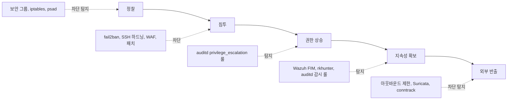
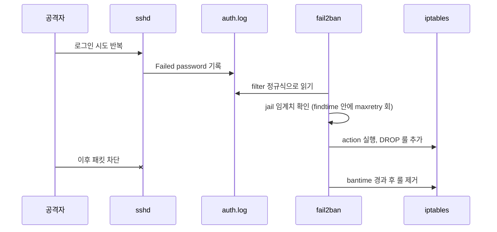
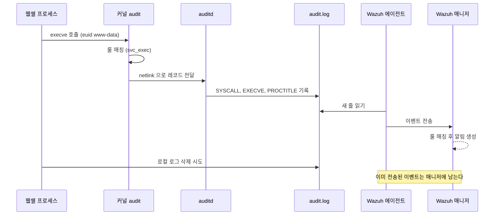
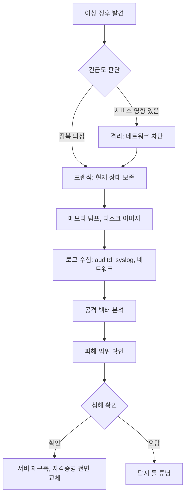
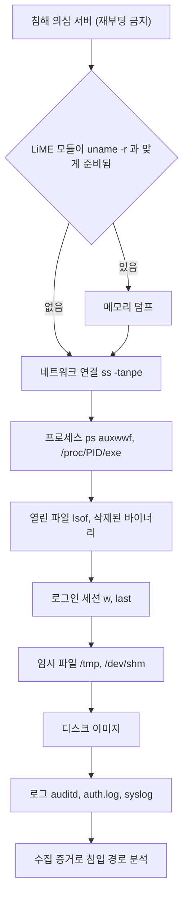
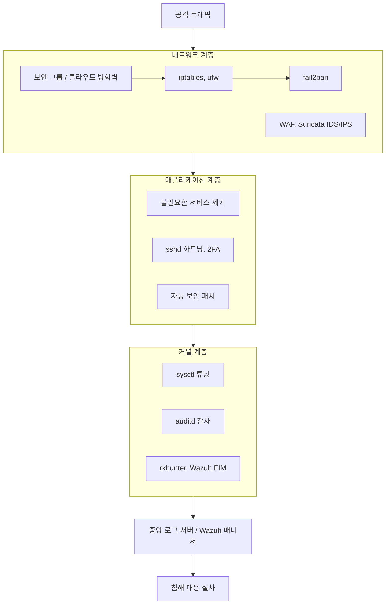

# 서버 취약점 공격 방어

퍼블릭 IP 하나만 열려 있으면 공격은 자동으로 들어온다. AWS나 GCP에 인스턴스를 띄우고 10분만 놔둬도 SSH 22번 포트로 초당 수십 건의 브루트포스가 쌓인다. 봇넷이 IP 대역을 통째로 스캔하면서 취약한 호스트를 찾기 때문이다. 대부분은 특정 회사를 노린 자동화된 대량 공격이라서 방어도 자동화된 기본기가 깔려 있어야 막힌다.

이 문서는 웹 애플리케이션 레벨(XSS, SQL Injection)이나 컨테이너가 아니라 서버 인프라 자체의 공격과 방어를 다룬다. OS, 네트워크, 프로세스, 로그 레벨의 하드닝이 주제다.

---

## 공격 유형별 실무 사례

### 포트 스캔

`nmap`, `masscan`으로 열린 포트를 조사해서 3306, 6379, 9200처럼 인증 없이 열린 서비스를 찾는다. 스캔 자체는 막을 수 없으니 노출 포트를 줄이고 시도를 로깅한다.

사례: 디버깅하려고 Redis를 0.0.0.0으로 열어둔 다음 날 `flushall`로 데이터가 날아가고 채굴기가 설치돼 있었다. 인증 없는 Redis는 `config set dir /root/.ssh/`와 `config set dbfilename authorized_keys`로 공격자 공개키를 써넣을 수 있다.

```bash
# 현재 열린 포트 확인
ss -tlnp

# 외부에서 보이는 포트 확인 (nmap 역할)
nmap -sT -p- localhost

# 포트 스캔 탐지 룰 (psad 사용)
apt install psad
# /etc/psad/psad.conf에서 DANGER_LEVEL과 EMAIL_ALERT 설정
```

1차 방어는 보안 그룹(AWS SG, GCP 방화벽 규칙)의 화이트리스트 인바운드고, 호스트 iptables는 2차 방어선이다.

### SSH 브루트포스

22번을 열어두면 `root/123456`, `ubuntu/ubuntu` 같은 사전 공격이 바로 들어온다. `/var/log/auth.log`에 `Failed password`가 초당 수십 건 쌓이고, 계정 잠금 정책이 없으면 언젠가 뚫린다.

```bash
# 브루트포스 시도 로그 확인
grep "Failed password" /var/log/auth.log | awk '{print $(NF-3)}' | sort | uniq -c | sort -rn | head

# 결과 예시 — 특정 IP에서 수천 번 시도
#   3421 61.177.173.45
#   2156 222.186.180.17
#   1893 45.227.255.4
```

사례: 스테이징 서버가 `dev123` 패스워드로 뚫렸고, 공격자가 환경변수의 AWS 자격증명으로 EC2 100대를 채굴용으로 띄워 청구서 2,000달러가 나왔다. 패스워드 인증을 끄지 않는 한 시도는 끝나지 않는다.

### DDoS와 SYN Flood

L3/L4 볼륨 공격은 ISP나 클라우드 레벨에서 막아야 하고, 서버에서 막을 수 있는 건 L7 공격과 SYN flood 정도다. SYN flood는 SYN만 보내고 ACK를 보내지 않아 서버가 half-open 연결로 메모리와 연결 테이블을 쓰게 만든다. 기본 설정에서는 수천 개의 SYN만으로 정상 접속이 막힌다.

```bash
# 현재 SYN_RECV 상태 연결 수 확인 — SYN flood 의심
ss -tan state syn-recv | wc -l

# conntrack 테이블 사용률 확인
cat /proc/sys/net/netfilter/nf_conntrack_count
cat /proc/sys/net/netfilter/nf_conntrack_max
```

사례: 이벤트 페이지가 화제가 된 직후 Cloudflare 뒤에 있지 않던 API 서버가 SYN flood에 가까운 연결을 받아 conntrack 테이블이 차고 신규 연결이 전부 거부됐다. 커널 파라미터 조정으로 복구했다.

### 서비스 배너 노출

응답 헤더나 초기 배너에 버전이 드러나면 공격자가 그 버전의 CVE를 바로 찾는다.

```bash
# nginx 버전 노출 확인
curl -I http://example.com
# Server: nginx/1.18.0  ← 이런 식으로 버전이 드러나면 위험

# SSH 배너 확인
nc example.com 22
# SSH-2.0-OpenSSH_7.6p1 Ubuntu-4ubuntu0.3  ← Ubuntu 18.04 쓰는 거 다 보임
```

OpenSSH 7.6p1에는 CVE-2018-15473 사용자 열거 취약점이 있다. nginx는 `server_tokens off;`, SSH는 `DebianBanner no`로 노출을 줄이지만 근본 해결은 최신 버전 유지다.

### 알려진 CVE 익스플로잇

새 CVE가 공개되면 대량 스캔이 바로 시작된다. log4shell(CVE-2021-44228)은 공개 24시간 안에 인터넷 전체가 스캔됐고 패치 안 된 서버는 거의 예외 없이 뚫렸다. 방어는 패치 속도와 페이로드 차단(WAF/IPS) 두 갈래다. 커널이나 시스템 라이브러리 패치는 재부팅이 필요해서 적용까지 며칠에서 몇 주 걸리고, 그 사이를 WAF/IPS가 메운다.

---

## 공격 단계별 흔적과 방어 장치

공격은 정찰, 침투, 권한 상승, 지속성 확보, 외부 반출 순서로 진행된다. 각 단계는 서버에 서로 다른 흔적을 남기고, 이 문서의 방어 장치는 단계마다 막는 것과 보는 것이 갈린다. 점선은 해당 단계를 탐지하거나 차단하는 장치다.



| 단계 | MITRE ATT&CK 전술 | 서버에 남는 흔적 | 막거나 보는 장치 |
|---|---|---|---|
| 정찰 | Reconnaissance (TA0043) | 방화벽 DROP 로그, psad 알림, 404가 연달아 찍힌 nginx access.log | 보안 그룹 화이트리스트, iptables `recent`, psad |
| 침투 | Initial Access (TA0001) | `auth.log`에서 `Failed password` 뒤에 나온 `Accepted`, 로그에 박힌 익스플로잇 페이로드 | fail2ban, `PasswordAuthentication no`, WAF, 패치 |
| 쉘 실행 | Execution (TA0002) | 웹서버 프로세스의 자식으로 뜬 `sh`, `bash`, `curl`, `wget` | auditd `svc_exec` 룰, `ps auxf` 트리 |
| 권한 상승 | Privilege Escalation (TA0004) | `sudo` 로그, `setuid` 호출, 새로 생긴 SUID 바이너리 | auditd `privilege_escalation` 룰, Wazuh FIM |
| 지속성 확보 | Persistence (TA0003) | `authorized_keys` 변경, cron, systemd 유닛, 커널 모듈 | auditd `-w` 감시, Wazuh FIM, rkhunter |
| 흔적 제거 | Defense Evasion (TA0005) | 로그 삭제, `history` 비움, `ps` 출력에서 사라진 프로세스 | 중앙 로그 전송, rkhunter, 오프라인 이미지 검사 |
| 외부 반출 | Exfiltration (TA0010), Command and Control (TA0011) | 낯선 IP로 나가는 아웃바운드 연결, 대용량 전송 | 아웃바운드 제한, Suricata, `ss -tanp` |

흔적 제거 단계는 5단계 순서 중 어디에나 끼어든다. 로그가 로컬에만 있으면 공격자가 가장 먼저 지우므로 중앙 서버 전송이 앞의 모든 단계를 받치는 전제가 된다.

---

## 방화벽 구성

### iptables와 ufw

iptables는 커널 netfilter를 제어하는 툴이고 ufw는 그 래퍼다. 내부 동작은 같다.

```bash
# ufw 기본 정책 — 인바운드 차단, 아웃바운드 허용
ufw default deny incoming
ufw default allow outgoing

# 필요한 포트만 허용
ufw allow 22/tcp     # SSH
ufw allow 80/tcp     # HTTP
ufw allow 443/tcp    # HTTPS

# 특정 IP만 SSH 허용 — 사무실 IP 대역으로 제한
ufw allow from 203.0.113.0/24 to any port 22

# rate limiting — 분당 6회 이상 연결 시도 시 차단
ufw limit 22/tcp

ufw enable
```

`ufw limit`은 iptables `recent` 모듈로 30초 안에 같은 IP에서 6회 이상 접속하면 차단한다. 단순 브루트포스 대부분이 걸러지지만 여러 IP에 분산된 공격에는 소용없다.

컨테이너 환경이나 스크립트로 룰을 자동화할 때는 ufw보다 세밀한 iptables를 직접 쓴다.

```bash
# SYN flood 완화 — SYN 패킷 초당 1개로 제한, 버스트 3까지 허용
iptables -A INPUT -p tcp --syn -m limit --limit 1/s --limit-burst 3 -j ACCEPT

# 비정상 패킷 드롭 — 잘못된 플래그 조합
iptables -A INPUT -p tcp ! --syn -m state --state NEW -j DROP
iptables -A INPUT -p tcp --tcp-flags ALL NONE -j DROP
iptables -A INPUT -p tcp --tcp-flags ALL ALL -j DROP

# 포트 스캔 탐지 — 같은 IP가 여러 포트에 연결 시도
iptables -A INPUT -m recent --name portscan --rcheck --seconds 86400 -j DROP
iptables -A INPUT -p tcp -m multiport --dports 23,25,135,139,445,1433,3306,3389 -m recent --name portscan --set -j DROP
```

먼저 매칭된 룰이 적용되므로 특정 IP 허용 같은 세부 룰을 위에, 전체 차단 룰을 아래에 둔다. 룰이 100개를 넘으면 조회 성능이 나은 nftables로 옮긴다.

### 상태 추적(stateful) 방화벽

conntrack은 커널의 연결 상태 추적 모듈이다. `ESTABLISHED,RELATED` 패킷을 허용하면 내부에서 시작한 연결의 응답이 별도 룰 없이 통과한다.

```bash
# 응답 트래픽 허용
iptables -A INPUT -m state --state ESTABLISHED,RELATED -j ACCEPT

# 이후 신규 인바운드는 명시적으로 허용된 포트만
```

conntrack 테이블이 차면 신규 연결이 모두 거부된다. 트래픽 많은 서버는 기본값 65,536으로 부족하다.

```bash
# conntrack 테이블 크기 확인
sysctl net.netfilter.nf_conntrack_max

# 부족하면 증가
sysctl -w net.netfilter.nf_conntrack_max=524288

# /etc/sysctl.conf에 영구 반영
echo "net.netfilter.nf_conntrack_max = 524288" >> /etc/sysctl.conf
```

---

## fail2ban

fail2ban은 로그를 감시하다가 공격 패턴이 보이면 해당 IP를 iptables로 차단한다. SSH뿐 아니라 nginx, postfix, vsftpd처럼 로그가 남는 서비스면 대부분 붙는다.

### 기본 동작 원리

구성 요소는 filter(로그 패턴 매칭), jail(감시 대상과 임계치), action(조치) 셋이다. 기본 action은 iptables에 DROP 룰을 추가하는 것이다.



fail2ban은 로그를 사후에 읽기 때문에 임계치에 닿기 전의 시도 몇 번은 막지 못한다. 도는 동안 로그 파싱 지연이 있어 초당 수백 건이 들어오는 분산 공격에는 반응이 늦다.

```ini
# /etc/fail2ban/jail.d/sshd.conf
[sshd]
enabled = true
port = 22
filter = sshd
logpath = /var/log/auth.log
maxretry = 3        # 3회 실패 시
findtime = 600      # 10분 이내에
bantime = 3600      # 1시간 차단
ignoreip = 127.0.0.1/8 203.0.113.0/24  # 사무실 IP는 제외
```

`maxretry=3`, `findtime=600`은 10분 안에 3번 실패한 IP를 차단한다는 설정이고, `bantime=-1`은 영구 차단이다.

### recidive jail — 반복 차단자

기본 jail은 일시 차단이라 시간이 풀리면 같은 IP가 돌아와 차단과 재시도가 반복된다. recidive jail은 fail2ban 자신의 로그를 감시해서 여러 번 차단된 IP를 더 오래 막는다.

```ini
# /etc/fail2ban/jail.d/recidive.conf
[recidive]
enabled = true
filter = recidive
logpath = /var/log/fail2ban.log
bantime = 604800    # 1주일
findtime = 86400    # 하루 동안
maxretry = 3        # 3번 차단된 IP는
action = iptables-allports[name=recidive]
```

차단 IP가 수천 개로 늘면 iptables 룰이 성능을 갉아먹는다. ipset action을 쓰면 해시 기반이라 룰이 10만 개여도 O(1)로 조회된다.

```bash
# ipset 기반 action 사용 — fail2ban.conf
banaction = iptables-ipset-proto6-allports
```

### 오탐 이슈

가장 흔한 오탐은 회사 전체가 NAT 뒤에서 같은 외부 IP로 나오는 경우다. 누가 SSH 비밀번호를 몇 번 틀리면 회사 전체가 차단된다.

| 대응 | 내용 |
|---|---|
| `ignoreip` | 회사 IP 대역을 추가한다 |
| `maxretry` 조정 | 공개 서비스는 엄격하게, 내부용은 느슨하게 |
| 경고 단계 | 첫 감지는 알림만, 두 번째부터 차단한다 |
| 해제 명령 공유 | `fail2ban-client set sshd unbanip 1.2.3.4` 를 팀이 알아둔다 |

---

## SSH 하드닝

서버 측 sshd 설정만 다룬다. SSH 키 관리는 별도 문서에 있다.

### 핵심 sshd_config 설정

```
# /etc/ssh/sshd_config
Port 2222                       # 기본 22 대신 임의 포트 사용
PermitRootLogin no              # root 직접 로그인 금지
PasswordAuthentication no       # 패스워드 인증 비활성화
PubkeyAuthentication yes        # 공개키 인증만 허용
PermitEmptyPasswords no         # 빈 패스워드 금지
ChallengeResponseAuthentication no
UsePAM yes

# 접속 가능한 사용자/그룹 화이트리스트
AllowUsers deploy admin
AllowGroups sshusers

# 동시 연결 제한
MaxAuthTries 3
MaxSessions 5
LoginGraceTime 30

# 유휴 세션 종료
ClientAliveInterval 300
ClientAliveCountMax 2

# 호스트키 알고리즘 — 오래된 알고리즘 제외
HostKeyAlgorithms ssh-ed25519,rsa-sha2-512,rsa-sha2-256
KexAlgorithms curve25519-sha256,curve25519-sha256@libssh.org
Ciphers chacha20-poly1305@openssh.com,aes256-gcm@openssh.com
MACs hmac-sha2-512-etm@openssh.com,hmac-sha2-256-etm@openssh.com

# 배너 최소화
DebianBanner no
```

### Port 변경에 대한 오해

포트를 2222로 바꿔도 `masscan` 전체 포트 스캔에 금방 찾아진다. 보안이 올라가는 게 아니라 22번에 쏟아지던 무차별 로그가 줄어 `auth.log`에서 의미 있는 시도를 찾기 쉬워지는 효과다.

핵심은 패스워드 인증 차단이다. `PasswordAuthentication no`와 `ChallengeResponseAuthentication no`를 둘 다 설정한다. 하나만 끄면 다른 쪽으로 우회될 수 있다.

### PermitRootLogin

OpenSSH 기본값은 `prohibit-password`다. 키 인증으로는 root 로그인을 허용하는 값이라, 설정을 비워둔 서버는 root 키 로그인이 열려 있다. 자동화 스크립트 때문에 쓰기도 하지만 일반 사용자로 접속해 sudo로 전환해야 누가 root로 무엇을 했는지 감사 로그에 남는다.

### 2FA 추가

TOTP 2FA는 `libpam-google-authenticator`로 붙인다. 키 파일이 유출돼도 추가 방어선이 된다.

```bash
apt install libpam-google-authenticator
google-authenticator  # 사용자별로 실행, QR 코드로 앱에 등록

# /etc/pam.d/sshd 맨 위에 추가
# auth required pam_google_authenticator.so

# /etc/ssh/sshd_config
# ChallengeResponseAuthentication yes
# AuthenticationMethods publickey,keyboard-interactive
```

`AuthenticationMethods publickey,keyboard-interactive`는 키와 OTP를 모두 통과해야 접속되는 설정이다. 한쪽만 뚫려서는 들어올 수 없다.

---

## sysctl 커널 파라미터 튜닝

커널 레벨에서 네트워크 공격 방어선을 건다. `/etc/sysctl.conf`나 `/etc/sysctl.d/`에 파일을 만들어 반영한다.

### SYN flood 대응

```
# SYN cookies 활성화 — SYN flood 공격 완화
net.ipv4.tcp_syncookies = 1

# SYN backlog 크기 증가
net.ipv4.tcp_max_syn_backlog = 4096

# SYN-ACK 재전송 횟수 감소 — 기본 5, half-open 연결을 빨리 정리
net.ipv4.tcp_synack_retries = 2

# TIME_WAIT 재사용
net.ipv4.tcp_tw_reuse = 1
```

SYN cookies는 SYN backlog가 가득 찼을 때만 켜진다. 커널이 상태를 저장하지 않고 쿠키를 응답하며, 쿠키가 돌아오면 그때 실제 연결을 만든다. 평소에는 일반 3-way handshake가 동작한다.

### ICMP 관련

```
# ICMP redirect 무시 — MITM 공격 벡터
net.ipv4.conf.all.accept_redirects = 0
net.ipv4.conf.default.accept_redirects = 0

# Source routing 비활성화
net.ipv4.conf.all.accept_source_route = 0
net.ipv4.conf.default.accept_source_route = 0

# ICMP broadcast 응답 차단 — Smurf 공격 방어
net.ipv4.icmp_echo_ignore_broadcasts = 1

# 잘못된 ICMP 응답 무시
net.ipv4.icmp_ignore_bogus_error_responses = 1

# Reverse path filtering — 스푸핑된 패킷 드롭
net.ipv4.conf.all.rp_filter = 1
net.ipv4.conf.default.rp_filter = 1
```

### IP spoofing과 로깅

```
# 스푸핑된 패킷 로그 기록
net.ipv4.conf.all.log_martians = 1

# IP forwarding 비활성화 — 라우터/게이트웨이가 아니라면
net.ipv4.ip_forward = 0

# 커널 포인터 노출 제한
kernel.kptr_restrict = 2
kernel.dmesg_restrict = 1
```

### 적용과 검증

```bash
# 설정 반영
sysctl -p /etc/sysctl.d/99-hardening.conf

# 현재 값 확인
sysctl net.ipv4.tcp_syncookies
```

`tcp_tw_recycle`은 커널 4.12에서 제거됐다. 오래된 문서가 권하면 무시한다. NAT 환경에서 연결이 끊기는 문제를 일으켰다.

---

## 불필요한 서비스 비활성화

쓰지 않는 서비스를 없애는 것이 공격 표면을 줄이는 가장 확실한 방법이다. Ubuntu 서버 기본 설치에도 `cups-browsed`, `avahi-daemon`, `snapd` 같은 데스크톱용 서비스가 켜져 있는 경우가 있다.

```bash
# 현재 돌아가는 서비스 목록
systemctl list-unit-files --type=service --state=enabled

# 리스닝 중인 프로세스 확인
ss -tlnp

# 불필요한 서비스 비활성화
systemctl disable --now cups
systemctl disable --now avahi-daemon
systemctl disable --now bluetooth
```

`ss -tlnp`에서 의도하지 않은 포트가 보이면 그 프로세스가 왜 도는지 파악한다. 의존성으로 딸려온 서비스일 수도, 침해 흔적일 수도 있다.

사례: Elasticsearch 설치 때 x-pack이 기본 포함돼 9300 transport 포트가 외부에 열려 있었다. HTTP 9200에만 인증을 걸어둔 상태에서 transport 포트로 클러스터 조인이 시도됐다. 리스닝 포트를 전수조사하지 않으면 발견하기 어렵다.

---

## 자동 패키지 업데이트

패치가 느려지는 이유는 "언젠가 해야지"가 미뤄지기 때문이다. 보안 패치만이라도 자동 적용하면 CVE 노출 시간이 줄어든다. Debian/Ubuntu 계열은 `unattended-upgrades`를 쓴다.

```bash
apt install unattended-upgrades
dpkg-reconfigure --priority=low unattended-upgrades
```

설정 파일 `/etc/apt/apt.conf.d/50unattended-upgrades`:

```
Unattended-Upgrade::Allowed-Origins {
    "${distro_id}:${distro_codename}-security";
    // "${distro_id}:${distro_codename}-updates";  // 일반 업데이트도 원하면 주석 해제
};

Unattended-Upgrade::Package-Blacklist {
    "mysql-server";  // DB처럼 재시작 민감한 것은 제외
    "nginx";
};

Unattended-Upgrade::Automatic-Reboot "true";
Unattended-Upgrade::Automatic-Reboot-Time "04:00";
Unattended-Upgrade::Mail "ops@example.com";
Unattended-Upgrade::MailReport "on-change";
```

`Allowed-Origins`에 security 저장소만 두면 보안 패치만 받는다. DB나 웹서버처럼 재시작 시 중단이 생기는 패키지는 블랙리스트에 넣고 수동으로 관리한다.

자동 재부팅은 새벽에만 돌리고, 클러스터는 노드마다 시간을 분산한다. Ansible로 같은 설정을 배포했다가 전 노드가 새벽 4시에 동시 재부팅돼 5분간 서비스가 내려간 적이 있다. RHEL/CentOS 계열은 `dnf-automatic`을 쓴다.

---

## 루트킷 탐지

루트킷은 침투 뒤 장기간 숨어있으려고 설치하는 악성 소프트웨어다. 커널 모듈로 시스템 콜을 후킹해서 `ps`, `ls`, `netstat` 출력에서 자기 프로세스와 파일을 지운다. 일반 모니터링으로는 보이지 않는다.

### rkhunter

알려진 루트킷 시그니처와 시스템 파일 변조를 검사한다.

```bash
apt install rkhunter

# 시스템 파일 기준선 생성 — 최초 1회
rkhunter --propupd

# 검사 실행
rkhunter --check --skip-keypress

# cron으로 일 1회 실행, 이상 시 메일
# /etc/cron.daily/rkhunter
```

### chkrootkit

rkhunter와 검사 방식이 달라서 같이 쓰면 상호 검증이 된다.

```bash
apt install chkrootkit
chkrootkit -q    # quiet 모드, 문제 있는 것만 출력
```

### 오탐과 한계

오탐이 많다. 정상 설치된 패키지 파일을 의심 파일로 마킹하거나 SSH 설정 경고를 계속 띄운다. 처음 한 번 전체를 훑어 화이트리스트를 정리해야 운영 가능한 수준이 된다.

사후 탐지 성격이 강해서 침투를 막는 것이 먼저다. 커널에 심은 루트킷은 그 커널로 부팅한 상태에서는 사실상 탐지가 안 된다. 의심되면 라이브 USB로 부팅해 오프라인 분석하거나 디스크 이미지를 다른 시스템에서 검사한다.

---

## auditd 로그 감사

auditd는 리눅스 커널 감사 서브시스템의 프론트엔드다. 시스템 콜 단위로 누가 어떤 파일에 접근하고 어떤 명령을 실행했는지 기록한다. 침해 분석과 규제 대응(PCI-DSS, HIPAA)의 핵심 도구다.

```bash
apt install auditd

# 규칙 파일: /etc/audit/rules.d/audit.rules

# 민감한 파일 변경 감시
-w /etc/passwd -p wa -k identity
-w /etc/shadow -p wa -k identity
-w /etc/sudoers -p wa -k identity
-w /etc/sudoers.d/ -p wa -k identity

# SSH 설정 변경
-w /etc/ssh/sshd_config -p wa -k sshd

# 사용자별 명령 실행 추적
-a always,exit -F arch=b64 -S execve -F uid>=1000 -F auid!=unset -k user_commands

# 권한 상승 추적
-a always,exit -F arch=b64 -S setuid -S setgid -k privilege_escalation

# 규칙 적용
augenrules --load
```

로그 조회:

```bash
# sshd_config 변경 기록
ausearch -k sshd

# 특정 사용자 활동
ausearch -ua deploy | aureport -x

# 특정 IP에서의 활동
ausearch -hn 61.177.173.45 -i
```

### 공격자 행동을 잡는 룰

위 `user_commands` 룰은 `auid!=unset` 조건 때문에 서비스 계정이 띄운 프로세스를 놓친다. 웹서버나 cron이 실행한 프로세스에는 로그인 세션이 없어서 `auid`가 unset이다. 웹쉘로 `bash`를 띄우는 공격이 정확히 이 경우라서 서비스 계정은 `euid`로 따로 잡아야 한다.

| 공격자 행동 | 룰 키 | 정상 작업과 구분하는 법 |
|---|---|---|
| 새 사용자·그룹 생성 | `user_create`, `user_modify` | 배포 자동화(Ansible 등)의 실행 시각과 대조한다 |
| 파일 권한·소유자 변경 | `perm_mod` | `chmod u+s`, `/tmp` 아래 `chmod +x`를 우선 본다 |
| 서비스 계정의 쉘·도구 실행 | `svc_exec` | 부모가 웹서버인데 자식이 `sh`, `curl`, `nc`면 웹쉘이다 |
| SSH 키·cron·systemd 등록 | `persist` | 이 경로는 평소 변경이 거의 없어서 한 건도 의심한다 |

```bash
# /etc/audit/rules.d/attacker.rules

# 새 사용자·그룹 생성
-w /usr/sbin/useradd -p x -k user_create
-w /usr/sbin/adduser -p x -k user_create
-w /usr/sbin/groupadd -p x -k user_create
-w /usr/sbin/usermod -p x -k user_modify

# 파일 권한·소유자 변경 (로그인한 사용자 기준)
-a always,exit -F arch=b64 -S chmod,fchmod,fchmodat,chown,fchown,fchownat,lchown -F auid>=1000 -F auid!=unset -k perm_mod

# 웹서버 계정이 실행하는 모든 프로그램 — 쉘이 보이면 웹쉘 의심
-a always,exit -F arch=b64 -S execve -F euid=www-data -k svc_exec

# 지속성 확보 경로
-w /root/.ssh/ -p wa -k persist
-w /home/deploy/.ssh/ -p wa -k persist
-w /etc/cron.d/ -p wa -k persist
-w /etc/systemd/system/ -p wa -k persist
```

웹서버 계정이 `www-data`가 아니면 실제 계정명으로 바꾼다. `svc_exec` 결과는 자식 프로세스 이름으로 거른다.

```bash
ausearch -k svc_exec -i | grep -E 'exe=/(usr/)?bin/(ba|da)?sh|curl|wget|nc'
```

커널이 이벤트를 만들고 중앙 서버까지 가는 흐름은 아래와 같다. 로컬 `audit.log`에 쓰는 것과 밖으로 내보내는 것이 별개 경로라서, 공격자가 로컬 파일을 지워도 이미 나간 이벤트는 남는다.



### 운영상 주의사항

`execve`를 전부 기록하면 하루에 수 GB가 쌓이는 서버도 있다. 디스크가 찼을 때의 동작은 `auditd.conf`의 `disk_full_action`이 정한다. `halt`면 서버가 멈추고 `suspend`면 그 시점부터 감사가 끊긴다. `max_log_file_action = rotate`와 보존 설정은 필수다.

로그를 로컬에만 두면 공격자가 지운다. 침해 사고에서 가장 먼저 지우는 것이 로그라서 syslog나 Wazuh/Graylog로 실시간 전송해야 의미가 있다.

---

## HIDS — OSSEC과 Wazuh

HIDS(Host-based Intrusion Detection System)는 호스트 내부의 로그, 파일 무결성, 프로세스를 감시한다. 네트워크 IDS가 외부 트래픽을 본다면 HIDS는 호스트 안의 상태 변화를 본다.

### OSSEC과 Wazuh 관계

OSSEC은 오픈소스 HIDS의 원조고 Wazuh는 OSSEC에서 포크된 프로젝트다. ELK 스택과 통합된 대시보드와 활발한 커뮤니티가 있어서 요즘 실무에서는 Wazuh가 더 많이 쓰인다.

### Wazuh 주요 기능

| 기능 | 동작 |
|---|---|
| 로그 분석 | 여러 로그를 파싱해서 공격 시그니처와 매칭 |
| 파일 무결성 모니터링(FIM) | `/etc`, `/bin` 등의 파일 해시를 주기적으로 계산해 변조 탐지 |
| 루트킷 탐지 | rkhunter와 비슷한 기능 내장 |
| 취약한 패키지 탐지 | 설치된 패키지 버전을 NVD와 비교 |
| MITRE ATT&CK 매핑 | 탐지 이벤트를 ATT&CK 전술·기법에 연결 |

```yaml
# Wazuh 에이전트 설정 예시 — /var/ossec/etc/ossec.conf 일부
<syscheck>
  <frequency>43200</frequency>
  <directories check_all="yes" realtime="yes">/etc,/usr/bin,/usr/sbin</directories>
  <directories check_all="yes" realtime="yes">/bin,/sbin</directories>
  <nodiff>/etc/ssl/private</nodiff>
  <ignore>/etc/mtab</ignore>
  <ignore>/etc/hosts.deny</ignore>
  <ignore>/etc/mail/statistics</ignore>
</syscheck>
```

### 실무 배치 구조

에이전트는 모든 서버에 깔고 중앙 매니저가 이벤트를 모은다. 매니저는 전용 서버에 두고 보안팀이 Kibana 대시보드로 본다. 1,000대 이상이면 매니저 클러스터링이 필요하고, 에이전트 설정에서 중요한 이벤트만 올리도록 걸러야 한다. 모든 로그 라인을 올리면 매니저가 먼저 죽는다.

---

## 취약점 스캐너

서버를 외부에서 스캔해 알려진 CVE에 해당하는 서비스가 노출돼 있는지 점검한다. 주기적으로 돌려 패치 누락과 설정 오류를 찾는다.

### Nessus vs OpenVAS

| 항목 | Nessus | OpenVAS (Greenbone) |
|---|---|---|
| 라이선스 | Tenable 상용, Professional 연 3,000달러 정도 | 오픈소스 |
| 탐지 | 정확도와 리포트 품질이 업계 표준 | 자체 플러그인 NVT를 쓰고 범위는 Nessus보다 좁다 |
| 컴플라이언스 | PCI-DSS, CIS 벤치마크 템플릿이 잘 갖춰짐 | 제한적 |

### 스캔 유형

| 유형 | 관점 | 점검 내용 |
|---|---|---|
| 외부 스캔 | 인터넷에서 보이는 모습 | 방화벽, 노출 서비스, SSL 설정 |
| 인증 스캔(credentialed scan) | SSH나 WinRM으로 로그인해 내부까지 | 패키지 버전, 설정 파일, 커널 버전. 외부 스캔보다 정확도가 훨씬 높다 |

### 오탐과 운영

Apache 2.4.41에 CVE가 있다고 뜨지만 Ubuntu가 백포트 패치를 적용해서 이미 수정된 경우가 있다. 배포판 패키지는 버전 문자열만 보면 취약해 보여도 내부는 패치된 경우가 많다.

스캔 결과는 CVSS 점수와 실제 exploitability(이 서버가 공격자에게 노출되는지)를 같이 보고 우선순위를 매긴다. 모든 high 항목을 잡으려 들면 운영이 마비된다. 인증 스캔은 서버에서 수백 개 명령을 실행하므로 피크 타임을 피해 저녁에 돌린다.

---

## WAF / IDS / IPS 배치

### 각 도구의 역할

| 도구 | 계층 | 동작 | 대표 제품 |
|---|---|---|---|
| WAF (Web Application Firewall) | L7 | HTTP/HTTPS에서 SQL injection, XSS, path traversal 패턴 차단 | ModSecurity, Cloudflare WAF, AWS WAF |
| IDS (Intrusion Detection System) | 네트워크 또는 호스트 | 시그니처 탐지만 하고 차단은 안 함 | Snort, Suricata |
| IPS (Intrusion Prevention System) | 네트워크 | IDS에 실시간 드롭 기능 추가 | Suricata IPS 모드 |

### 배치 전략

계층마다 막는 대상이 다르다. CDN은 L3/L4 볼륨 공격, WAF는 L7 애플리케이션 공격, IDS/IPS는 광범위한 네트워크 공격을 맡고, HIDS는 호스트 내부 이상 행위를 본다.


### ModSecurity — 오픈소스 WAF

nginx나 Apache에 모듈로 얹는다. OWASP Core Rule Set(CRS)을 적용하면 일반적인 웹 공격 패턴 대부분이 커버된다.

```nginx
# nginx with ModSecurity
load_module modules/ngx_http_modsecurity_module.so;

http {
    modsecurity on;
    modsecurity_rules_file /etc/nginx/modsec/main.conf;
}
```

CRS에는 paranoia level 1~4가 있다. 1은 확실한 공격만 차단하고 4는 의심만 돼도 차단한다. 보통 1 또는 2에서 시작해 오탐을 화이트리스트로 정리하며 올린다. 처음부터 4를 켜면 정상 요청까지 막혀 서비스가 망가진다.

### Suricata — IDS/IPS

멀티스레드 오픈소스 NIDS/NIPS고 Snort 룰 포맷과 호환된다.

```
# /etc/suricata/suricata.yaml 일부
af-packet:
  - interface: eth0
    threads: 4
    cluster-id: 99
    cluster-type: cluster_flow
    defrag: yes
```

룰셋은 Emerging Threats(ET Open)가 무료로 제공하고 `suricata-update`로 주간 갱신을 자동화한다.

### 오탐과 성능 저하

| 이슈 | 내용 |
|---|---|
| 오탐 폭풍 | 처음 켜면 수천 건의 알림이 쏟아진다. 일주일 이상 로그를 보며 룰을 튜닝해야 하고, 이 기간 없이 바로 IPS 차단 모드로 돌리면 서비스 장애가 난다 |
| 성능 저하 | L7 검사는 CPU를 많이 쓴다. ModSecurity를 켜면 응답 시간이 10~30% 늘 수 있다. Suricata도 10Gbps 이상에서는 튜닝이 필요하다 |
| SSL 검사 | 암호화 트래픽은 검사할 수 없다. WAF 앞에서 SSL termination을 하거나 복호화를 지원하는 솔루션이 필요한데 비용과 복잡도가 올라간다 |

"detection only" 모드로 먼저 운영해 오탐을 정리한 뒤 블로킹으로 전환한다. 급하면 차단 대상을 상위 N개 공격 패턴으로 좁히고 점진적으로 넓힌다.

---

## 침해 의심 시 초기 대응

하드닝과 탐지를 잘 해도 결국 뚫릴 수 있다. 의심 정황이 생겼을 때 초기 대응 절차를 정리해둔다.



가장 중요한 두 가지가 있다.

1. **즉시 재부팅하지 않는다**: 메모리의 악성 프로세스와 네트워크 연결 정보가 다 날아간다.
2. **침해된 서버는 수리하지 않는다**: 루트킷이나 백도어가 어디 심어졌는지 완벽히 추적하기 어렵다. 공격자가 남긴 SSH 키, cron 작업, systemd 유닛, 커널 모듈이 한두 개가 아닐 수 있어서 데이터만 건지고 새로 구축한다.

해당 서버에서 접근 가능했던 자격증명(AWS 키, DB 패스워드, API 토큰)은 모두 폐기하고 재발급한다. 공격자가 환경변수를 덤프했다고 가정해야 한다.

### 휘발성 순서로 수집하기

증거는 사라지는 속도가 빠른 것부터 뜬다. 메모리, 네트워크 연결, 프로세스, 임시 파일시스템, 디스크, 원격 로그 순이다. LiME 모듈이 현재 커널(`uname -r`)에 맞게 미리 빌드돼 있으면 메모리 덤프를 맨 앞에 두고, 없으면 `ss`, `ps` 스냅샷으로 시작한다. 모듈을 사고 중에 빌드하면 컴파일 도구가 서버 상태를 바꾸고 시간도 잡아먹는다.



출력 위치는 침해 서버의 로컬 디스크가 아니라 외부 볼륨이나 네트워크 마운트로 잡는다. 로컬에 쓰면 증거를 덮어쓰고 공격자가 지울 수도 있다.

```bash
EV=/mnt/evidence/$(hostname)-$(date -u +%Y%m%dT%H%M%SZ)
mkdir -p "$EV" && cd "$EV"

date -u > time.txt; uptime >> time.txt
w > sessions.txt; last -aiF | head -100 >> sessions.txt
ss -tanpe > net_tcp.txt; ss -uanp > net_udp.txt
ps auxwwf > ps_tree.txt

# 디스크에서 지워졌는데 아직 도는 바이너리, /tmp·/dev/shm 에서 실행 중인 프로세스
ls -l /proc/[0-9]*/exe 2>/dev/null | grep -E 'deleted|/tmp/|/dev/shm/' > suspicious_exe.txt

# 의심 PID 를 잡았다면 바이너리가 지워졌어도 /proc 에서 그대로 복사된다
PID=4182
cp /proc/$PID/exe ./pid_${PID}.bin
tr '\0' ' ' < /proc/$PID/cmdline > pid_${PID}_cmdline.txt
tr '\0' '\n' < /proc/$PID/environ > pid_${PID}_environ.txt
ls -l /proc/$PID/cwd > pid_${PID}_cwd.txt
ls -l /proc/$PID/fd/ > pid_${PID}_fd.txt

# 삭제된 파일을 잡고 있는 프로세스, 네트워크 소켓을 쥔 프로세스
lsof -nP +L1 > lsof_deleted.txt
lsof -nPi > lsof_net.txt

# 메모리 덤프 — uname -r 에 맞춰 미리 빌드해 둔 LiME 모듈
insmod /opt/forensics/lime-$(uname -r).ko "path=$EV/mem.lime format=lime"

sha256sum * > SHA256SUMS
```

`lsof +L1`은 침해 서버가 아니어도 걸린다. 패키지 업그레이드 뒤 재시작하지 않은 데몬의 옛 바이너리가 `(deleted)`로 나온다. 이 목록에서 경로가 `/tmp`, `/dev/shm`이거나 패키지에 없는 이름만 추린다. `ps`와 `ss` 출력은 루트킷에 속을 수 있으니 `/proc/<PID>`를 직접 열어 대조한다. `LD_PRELOAD` 수준 후킹은 이 대조로 드러나지만 커널 모듈 루트킷은 `/proc` 조회까지 가린다.

---

## 정리

서버 방어는 은탄환 하나가 아니라 여러 방어선을 겹치는 일이다. 한 계층이 뚫려도 다음 계층이 잡도록 네트워크, 애플리케이션, 커널로 나눠서 쌓는다. 화살표는 공격 트래픽이 지나는 순서다.



| 계층 | 예방 | 탐지 |
|---|---|---|
| 네트워크 | 보안 그룹, iptables, fail2ban | psad, Suricata |
| 애플리케이션 | 서비스 제거, SSH 2FA, 패치 | 취약점 스캐너, WAF 로그 |
| 커널 | sysctl | auditd, rkhunter(사후) |

완벽한 하드닝을 한 번에 하려고 하면 실패한다. 리스크가 큰 것(SSH 브루트포스, 공개된 관리 포트, 오래된 패키지)부터 하나씩 처리하고, 탐지 체계를 붙이고, 자동화로 넓히는 순서가 현실적이다.
