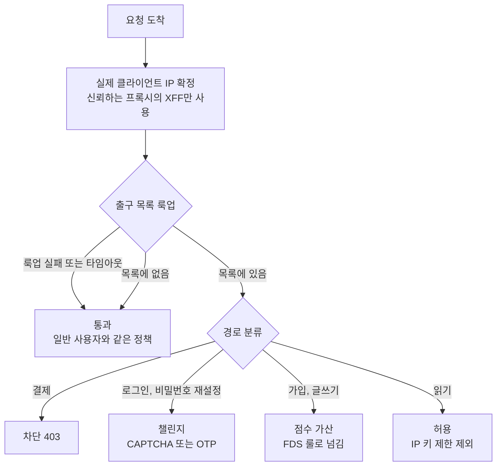
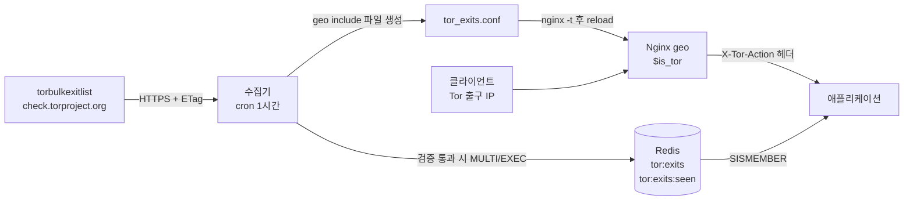
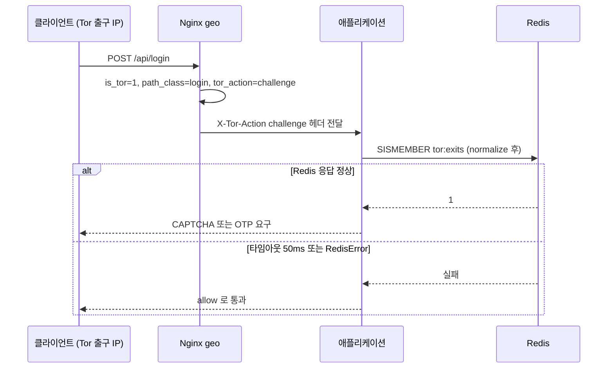
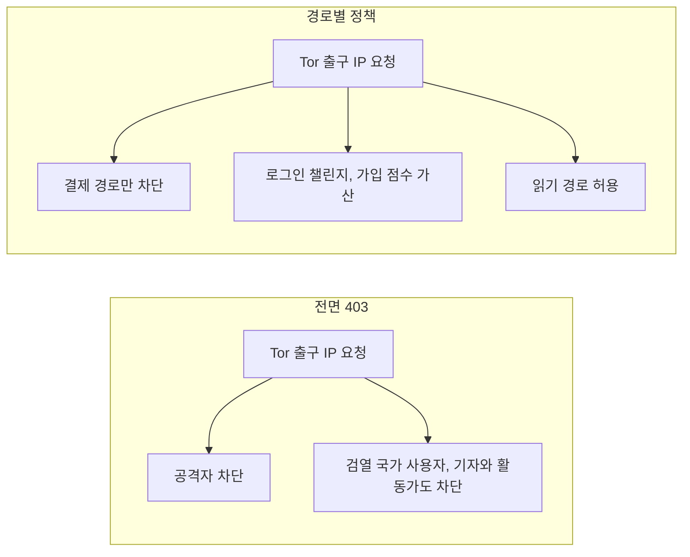
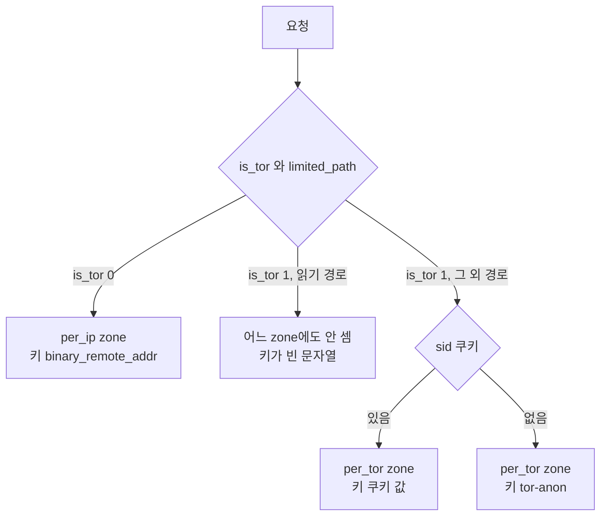
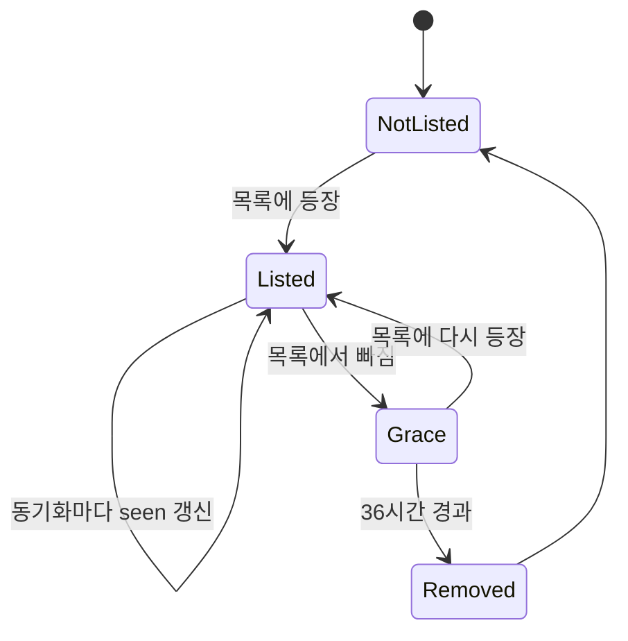

# Tor 유입 트래픽 대응 - 출구 목록 동기화와 경로별 정책

[크리덴션 스터핑](Credential_Stuffing.md), [Rate Limiting](Rate_Limiting.md), [FDS 속도 카운터](FDS_Velocity_Counters_and_Feature_Store.md) 문서에 Tor가 이름으로는 나온다. "Tor·VPN·데이터센터 IP는 따로 본다" 정도에서 끝나고, 실제로 어떻게 알아내서 무엇을 하는지는 어디에도 없다. 이 문서는 서비스 운영자 쪽에서 그 빈칸을 채운다. Tor 네트워크가 어떻게 돌아가는지는 [Tor 동작 원리](../Network/Security/Tor_Onion_Routing.md)에 있고, 여기서는 서비스 앞에 도착한 요청만 다룬다.

서비스가 보는 Tor 트래픽은 단순하다. 클라이언트 IP가 전부 출구 릴레이의 IP로 찍힌다. 사용자가 누구인지, 어느 나라에 있는지, 같은 사람이 보낸 요청인지 알 방법이 없다. 같은 출구를 여러 사용자가 동시에 쓰지만 그 수를 서비스에서 셀 방법도 없다. 이 두 가지 조건이 이후의 모든 설계를 정한다. 출구 IP 목록이 공개되어 있어서 "Tor인지 아닌지"는 알 수 있다. 알 수 없는 것은 "그 Tor 사용자가 누구인지"다.

## 요청 하나가 어떻게 갈리는가

목록에 있으면 403으로 막는 것이 가장 먼저 떠오르는 방법이다. 이 방식은 검열이 있는 나라에서 Tor로만 접속하는 사용자를 아무 설명 없이 내쫓고, 그쪽에서 문의가 들어오기 시작한다(뒤에서 다시 다룬다). 그래서 Tor 여부는 차단 조건이 아니라 판정 입력 하나로 쓴다. 입력이 하나 더 붙는 것이 요청 경로다.

도식은 요청이 출구 목록 룩업을 거쳐 네 갈래로 나뉘는 흐름이다. 룩업 자체가 실패하면 일반 사용자와 같게 통과시키는 갈래가 따로 있다는 점을 봐야 한다.



차단, 챌린지, 점수 가산, 허용 중 어느 쪽으로 보낼지는 서비스마다 다르다. 이 문서의 예제는 결제는 막고 로그인은 챌린지를 요구하는 쪽으로 잡았는데, 어디까지나 예시다.

## 출구 목록을 받는 스크립트

Tor 프로젝트가 출구 IP를 평문 한 줄 한 개로 공개한다. `https://check.torproject.org/torbulkexitlist` 다. 2026-10-29에 직접 받아 보니 세 가지가 보였다.

- 1,229줄이고 전부 IPv4다. 콜론이 들어간 줄이 0개였다. IPv6 출구는 이 목록에 없다.
- 응답에 `ETag`와 `Last-Modified`가 붙는다. 받은 시점에 `Last-Modified`가 약 55분 전이었다. 한 번 본 값이라 갱신 주기를 단정할 수는 없다.
- `If-None-Match`를 보내면 변경이 없을 때 304가 돌아온다. 스크립트를 두 번 연달아 돌려 확인했다.

그냥 `curl`로 받아 통째로 덮어쓰는 방식은 위험하다. 받다 만 파일, 프록시가 끼워 넣은 HTML 오류 페이지, 빈 응답이 그대로 목록이 되기 때문이다. 목록이 비면 그 순간 Tor 방어가 통째로 사라지고, 아무 에러도 나지 않는다. 그래서 수집기는 받은 내용을 검증하고 거부하는 쪽에 코드의 절반을 쓴다.

```python
#!/usr/bin/env python3
import argparse
import ipaddress
import os
import sys
import time
import urllib.error
import urllib.request

import redis

URL = os.environ.get("TOR_EXIT_URL", "https://check.torproject.org/torbulkexitlist")
SET_KEY = "tor:exits"
SEEN_KEY = "tor:exits:seen"
META_KEY = "tor:exits:meta"

MIN_COUNT = 500          # 이보다 적으면 받다 만 파일로 본다
MAX_DROP = 0.5           # 직전 대비 절반 아래로 줄면 반영하지 않는다
GRACE_SEC = 36 * 3600    # 목록에서 빠진 IP 를 이만큼 더 차단한다


def fetch(meta):
    req = urllib.request.Request(URL, headers={"User-Agent": "yg-tor-sync/1.0"})
    if meta.get("etag"):
        req.add_header("If-None-Match", meta["etag"])
    if meta.get("last_modified"):
        req.add_header("If-Modified-Since", meta["last_modified"])
    try:
        with urllib.request.urlopen(req, timeout=20) as resp:
            body = resp.read().decode("utf-8")
            return body, resp.headers.get("ETag"), resp.headers.get("Last-Modified")
    except urllib.error.HTTPError as e:
        if e.code == 304:
            return None, meta.get("etag"), meta.get("last_modified")
        raise


def parse(body):
    ips, bad = set(), 0
    for line in body.splitlines():
        line = line.strip()
        if not line or line.startswith("#"):
            continue
        try:
            ips.add(str(ipaddress.ip_address(line)))
        except ValueError:
            bad += 1
    return ips, bad


def apply(r, new, now):
    last_count = int(r.hget(META_KEY, "count") or 0)
    if len(new) < MIN_COUNT:
        raise SystemExit(f"목록이 너무 작다: {len(new)}건. 반영하지 않는다")
    if last_count and len(new) < last_count * MAX_DROP:
        raise SystemExit(f"직전 {last_count}건에서 {len(new)}건으로 급감. 반영하지 않는다")

    stale = [ip for ip in r.zrangebyscore(SEEN_KEY, "-inf", now - GRACE_SEC) if ip not in new]

    tx = r.pipeline(transaction=True)
    tx.sadd(SET_KEY, *new)
    tx.zadd(SEEN_KEY, {ip: now for ip in new})
    if stale:
        tx.srem(SET_KEY, *stale)
        tx.zrem(SEEN_KEY, *stale)
    tx.execute()
    return len(stale)


def write_geo(r, path):
    lines = "".join(f"{ip} 1;\n" for ip in sorted(r.smembers(SET_KEY)) if ":" not in ip)
    tmp = path + ".tmp"
    with open(tmp, "w") as f:
        f.write(lines)
    os.replace(tmp, path)


def main():
    ap = argparse.ArgumentParser()
    ap.add_argument("--redis", default=os.environ.get("REDIS_URL", "redis://127.0.0.1:6379/0"))
    ap.add_argument("--geo", help="nginx geo include 파일 경로")
    args = ap.parse_args()

    r = redis.Redis.from_url(args.redis, decode_responses=True)
    meta = r.hgetall(META_KEY)
    now = int(time.time())

    body, etag, last_modified = fetch(meta)
    if body is None:
        r.hset(META_KEY, "checked_at", now)
        print("변경 없음(304)")
        return

    new, bad = parse(body)
    if bad > max(3, len(new) // 100):
        raise SystemExit(f"파싱 못 한 줄이 {bad}건. 형식이 바뀐 것 같다")

    removed = apply(r, new, now)
    r.hset(META_KEY, mapping={
        "etag": etag or "", "last_modified": last_modified or "",
        "count": len(new), "synced_at": now, "checked_at": now,
    })
    if args.geo:
        write_geo(r, args.geo)
    print(f"반영 {len(new)}건, 유예 만료로 제거 {removed}건, 현재 집합 {r.scard(SET_KEY)}건")


if __name__ == "__main__":
    sys.exit(main())
```

`/tmp`에서 Redis 6.0.16(포트 6399)과 실제 목록으로 돌린 결과는 이렇다.

| 입력 | 결과 |
|---|---|
| 실서버 첫 수집 | `반영 1229건, 유예 만료로 제거 0건, 현재 집합 1229건` |
| 바로 다시 실행 | `변경 없음(304)` |
| 100줄로 잘린 파일 | `목록이 너무 작다: 100건. 반영하지 않는다`, 종료 코드 1, 집합 1,229건 유지 |
| 600줄(직전의 절반 미만) | `직전 1229건에서 600건으로 급감. 반영하지 않는다` |
| HTML 오류 페이지가 200으로 옴 | `목록이 너무 작다: 0건`, 반영 안 됨 |

HTML 오류 페이지는 파싱 실패 줄이 1건뿐이라 `bad` 검사는 통과하고 크기 검사에서 걸렸다. 두 검사가 서로 빈틈을 메운다. 종료 코드가 0이 아니므로 cron 래퍼나 모니터링에서 실패를 잡을 수 있다.

운영 시에는 한 시간에 한 번 돌린다. 304가 대부분이라 부하는 없다. 수집이 실패해도 Redis의 기존 집합은 그대로 남아 계속 방어한다. 대신 `tor:exits:meta`의 `synced_at`이 오래되면 알려야 하는데, 지표를 내보내는 부분은 스크립트에 넣지 않았다.

## 배치 구조

수집기는 한 곳에서만 돌고, 판정은 요청이 지나가는 모든 곳에서 일어난다. 그래서 수집기가 쓰고 나머지가 읽는 구조로 나눈다. 아래 도식에서 화살표 방향이 쓰기와 읽기를 가른다. Nginx는 Redis를 직접 조회하지 않고 수집기가 만든 파일을 읽는다.



Nginx가 Redis를 직접 보지 않게 한 데는 이유가 있다. `geo` 블록은 워커 메모리 안의 룩업이라 요청마다 네트워크 왕복이 없다. 모든 요청이 Redis에 의존하면 Redis가 느려질 때 정적 파일 요청까지 같이 느려진다. 애플리케이션은 이미 Redis를 쓰고 있으니 그쪽에서는 `SISMEMBER`로 확인한다. 로컬 루프백에서 1만 번 돌려 보니 호출당 약 380µs였고, 실제 네트워크에서는 왕복 시간이 더해진다.

## 판정 코드

### Nginx geo와 경로별 map

```nginx
set_real_ip_from 10.0.0.0/8;           # 신뢰하는 LB 대역만
real_ip_header X-Forwarded-For;
real_ip_recursive on;

geo $is_tor {
    default 0;
    include /etc/nginx/tor_exits.conf;   # "1.2.3.4 1;" 형식, 수집기가 생성
}

map $uri $path_class {
    default                              read;
    ~^/api/payments                      payment;
    ~^/api/(login|auth|password-reset)   login;
    ~^/api/(signup|posts|comments)       write;
}

map "$is_tor:$path_class" $tor_action {
    default         allow;
    "1:payment"     block;
    "1:login"       challenge;
    "1:write"       score;
}

server {
    location / {
        if ($tor_action = block) { return 403; }
        proxy_set_header X-Tor-Action $tor_action;
        proxy_pass http://app;
    }
}
```

`set_real_ip_from`을 빼먹으면 `$remote_addr`가 LB의 IP로 남아서 모든 요청의 `$is_tor`가 0이 된다. 반대로 신뢰 범위를 `0.0.0.0/0`으로 열면 일반 사용자가 `X-Forwarded-For`에 출구 IP를 적어 보내는 것으로 자기를 Tor로 만들 수 있다. 이쪽은 피해가 작다. 문제는 반대 방향이다. Tor 사용자가 XFF에 일반 IP를 적어 보내면 판정을 피한다. 테스트에서는 `127.0.0.1`만 신뢰하게 해 두고 XFF 값을 바꿔 가며 다음을 확인했다.

| 요청 | `X-Is-Tor` | `X-Tor-Action` |
|---|---|---|
| 출구 IP, `/api/payments/confirm` | 1 | block (403) |
| 출구 IP, `/api/login` | 1 | challenge |
| 출구 IP, `/api/posts` | 1 | score |
| 출구 IP, `/articles/1` | 1 | allow |
| 일반 IP, `/api/payments/confirm` | 0 | allow |

`challenge`와 `score`는 Nginx가 직접 처리하지 않는다. 헤더를 달아 백엔드로 넘기고, CAPTCHA를 띄울지 FDS 점수를 얼마나 올릴지는 애플리케이션이 정한다. Nginx 안에서 끝나는 것은 `block`뿐이다.

아래 시퀀스는 `challenge`로 분류된 로그인 요청이 Nginx에서 애플리케이션과 Redis까지 가는 순서다. Redis 조회가 실패하면 차단이 아니라 통과로 끝나는 갈래를 봐야 한다.



geo 파일을 새로 쓴 뒤에는 `nginx -t`를 거쳐서 reload 해야 한다. 파일에 `garbage line` 한 줄을 넣고 테스트하면 `unexpected end of file, expecting ";" or "}"`로 거부된다. 수집기가 IP를 `ipaddress`로 검증해서 쓰기 때문에 이런 줄이 들어갈 일은 거의 없지만, 사람이 파일을 손으로 고치다 틀리는 경우는 있다. 1,229줄짜리 geo를 포함한 설정 검사는 7ms 정도였다.

### 애플리케이션에서 Redis로

```python
import ipaddress
import os

import redis

r = redis.Redis.from_url(
    os.environ.get("REDIS_URL", "redis://127.0.0.1:6379/0"),
    socket_connect_timeout=0.05,
    socket_timeout=0.05,
)

POLICY = {"payment": "block", "login": "challenge", "write": "score", "read": "allow"}


def normalize(ip):
    addr = ipaddress.ip_address(ip)
    if addr.version == 6 and addr.ipv4_mapped:
        addr = addr.ipv4_mapped
    return str(addr)


def is_tor_exit(ip):
    try:
        return bool(r.sismember("tor:exits", normalize(ip)))
    except (redis.RedisError, ValueError):
        return False


def decide(ip, path_class):
    if not is_tor_exit(ip):
        return "allow"
    return POLICY.get(path_class, "allow")
```

`normalize`가 필요한 이유는 듀얼스택 소켓이다. IPv4 클라이언트가 `::ffff:192.42.116.44` 형태로 올라오는 환경이 있고, 그대로 `SISMEMBER`에 넣으면 영영 맞지 않는다. 실행해 보면 `::ffff:` 붙은 주소도 `True`가 나오고, `not-an-ip` 같은 쓰레기 입력은 예외 없이 `False`가 된다. Redis가 죽었을 때(포트를 닫고 확인)는 4ms 만에 `allow`를 돌려준다. 타임아웃을 50ms로 짧게 잡은 것도, 예외를 삼켜 통과시키는 것도 같은 판단이다. Tor 방어가 결제 서비스 전체의 가용성보다 중요하지는 않다. 대신 이 `False`가 몇 번 났는지는 지표로 남겨야 한다. 안 그러면 Redis 연결이 끊긴 채 몇 주를 보내고도 모른다.

## 전면 차단이 만드는 오탐

크리덴션 스터핑 로그를 보면 Tor 출구 IP에서 로그인 실패가 몰려 있는 것이 보인다. 그 장면에서 "목록 전체를 403으로 막자"는 결론으로 가기 쉽다. 막으면 공격은 줄지만 같이 막히는 사람들이 있다.

**검열 국가 사용자.** 서비스에 접속하려면 Tor를 거쳐야 하는 사용자가 있다. 이들에게 403은 "이 서비스는 나를 받지 않는다"로 읽힌다. 문의 채널이 같은 사이트에 있다면 그 채널에도 들어갈 수 없다.

**기자와 활동가.** 신원 노출이 위험한 사람들이 일부러 Tor를 쓴다. 제보 접수, 계정 복구, 뉴스 열람 같은 서비스라면 이들이 핵심 사용자일 수 있다.

**서비스 성격에 따라 다르다.** 일반 커머스에서 Tor 사용자는 극소수이고 그 대부분이 사기성 거래라면 결제만 막고 나머지는 열어 두는 판단이 맞다. 반대로 계정 유지에 개인정보가 필요 없는 커뮤니티라면 Tor 사용자를 막을 이유가 약하다. 이 비율을 숫자로 알려면 서비스의 로그에서 Tor 출구 IP의 로그인 성공률과 일반 IP의 성공률을 비교해야 한다. 이 문서는 그 수치를 갖고 있지 않다.

전면 차단과 경로별 정책이 같은 Tor 출구 IP 요청을 어떻게 다르게 다루는지 나란히 놓으면 아래와 같다. 전면 차단은 공격자와 함께 정상 사용자까지 막고, 경로별 정책은 위험이 큰 경로에만 제한을 건다.



차단하기로 했다면 응답에 이유와 대안을 적어 둔다. 빈 403 대신 "Tor 연결에서는 결제를 지원하지 않는다, 일반 연결로 다시 시도하거나 고객센터로 문의"라고 보여주는 것만으로 문의 대응이 쉬워진다. 검열 환경의 사용자에게 서비스를 열어 두고 싶다면 Tor 사용자만을 위한 [Onion 주소](../Network/Security/Tor_Hidden_Service_Operation.md)를 별도로 운영하는 방법도 있다. 이 경우 Onion 쪽 요청은 출구를 거치지 않아서 이 문서의 목록 판정이 적용되지 않으므로, 가입과 로그인에 대한 방어를 그 주소에서 따로 설계해야 한다.

## 경로별 정책

경로가 판정의 두 번째 입력이다. 같은 Tor 사용자라도 글을 읽는 것과 결제하는 것은 위험이 다르다.

| 경로 | 처리 | 이유 |
|---|---|---|
| 읽기 API, 정적 자원 | 허용 | 계정이 없어도 가능한 요청이고, 막아서 얻는 게 적다 |
| 가입, 글쓰기 | 점수 가산 | 일괄 계정 생성과 스팸의 통로이지만 정상 사용자도 있다 |
| 로그인, 비밀번호 재설정 | 챌린지 | 스터핑의 주 경로다. 챌린지를 통과한 사용자는 들여보낸다 |
| 결제 | 차단 | 카드 테스트가 몰리는 경로다. 정상 구매자가 같이 막히는 것을 감수한다 |

점수 가산은 [FDS 룰 엔진](FDS_Rule_Engine.md)의 피처로 `is_tor`를 하나 추가하는 것이다. 점수 하나만으로 거래를 막지 않고 속도 카운터나 디바이스 신호와 겹칠 때 의미를 갖게 두는 쪽이 오탐이 적다.

한 가지 함정이 있다. `map $uri`의 정규식은 대소문자를 구분한다. 출구 IP로 요청 경로만 바꿔 보내 확인한 결과다.

| 요청 경로 | 응답 |
|---|---|
| `/api/payments/confirm` | 403 block |
| `/api//payments/confirm` | 403 block |
| `/api/%70ayments/confirm` | 403 block |
| `/api/payments/../payments/confirm` | 403 block |
| `/API/payments/confirm` | 200 allow |

슬래시 중복, 퍼센트 인코딩, `..`은 Nginx가 `$uri`를 정규화해서 걸렸다. `/API/payments`만 빠져나갔다. 앱 프레임워크가 경로를 대소문자 구분 없이 라우팅하면 Nginx는 읽기로 보고 앱은 결제로 처리한다. `map`의 `~`를 `~*`로 바꾸면 `/API/payments`도 403이 된다. 다만 프레임워크마다 라우팅 규칙이 달라서 Nginx 한 곳만 믿을 수는 없다. 결제처럼 중요한 경로는 앱 안에서 `decide()`를 한 번 더 호출한다.

## 출구 IP 공유와 IP 단위 Rate Limit

출구 하나를 여러 사용자가 쓴다는 점이 Rate Limit에서 가장 크게 드러난다. 일반적인 `limit_req_zone $binary_remote_addr`를 그대로 두면 Tor 사용자들이 한 명으로 묶여 서로의 한도를 깎아 먹는다. 같은 출구 IP로 서로 다른 사용자 4명이 각각 한 번씩 요청한 결과다. 한도는 시연용으로 분당 2회로 낮췄다.

| 설정 | 4명의 응답 코드 |
|---|---|
| IP 키 그대로 | 200, 429, 429, 429 |
| 세션 쿠키별 키(쿠키가 서로 다름) | 200, 200, 200, 200 |

첫 사용자만 통과하고 나머지는 자기가 아무것도 하지 않았는데 429를 받는다. 이 상태는 공격 방어가 아니라 서비스 장애에 가깝다.

그래서 Tor 요청은 IP 키 제한에서 빼고 별도 키로 센다. 쿠키가 있으면 쿠키 값으로, 없으면 "tor-anon" 하나로 묶는다.

아래 도식은 요청이 어느 zone의 어떤 키로 세어지는지를 가르는 분기다. 한 요청이 `per_ip`와 `per_tor` 중 하나에만 걸리고, 읽기 경로는 어느 쪽에도 세어지지 않는다는 점을 보면 된다.



```nginx
map $is_tor $ip_key { 0 $binary_remote_addr; 1 ""; }

map $path_class $limited_path { read 0; default 1; }
map "$is_tor:$limited_path:$cookie_sid" $tor_key {
    default            "";
    "~^1:1:(?<s>.+)$"  $s;
    "1:1:"             "tor-anon";
}

limit_req_zone $ip_key  zone=per_ip:10m  rate=60r/m;
limit_req_zone $tor_key zone=per_tor:10m rate=10r/m;
limit_req_status 429;

server {
    limit_req zone=per_ip;
    limit_req zone=per_tor;
}
```

키가 빈 문자열이면 Nginx는 그 zone에서 해당 요청을 세지 않는다. 이 동작에 기대서 한 요청이 두 zone 중 하나에만 걸리게 했다. 읽기 경로는 `$limited_path`가 0이라 `per_tor`에서도 빠진다. 처음에는 이 map 없이 썼는데, 쿠키 없는 Tor 사용자가 글 읽기만 해도 "tor-anon" 버킷을 같이 써서 `/articles/1`에서 429가 났다. 위 설정으로 바꾼 뒤 읽기 5번은 모두 200이었다.

검증하다 겪은 일이 하나 더 있다. 테스트용으로 `location / { return 200 "ok"; }`를 쓰면 `limit_req`가 전혀 동작하지 않는다. `return`은 rewrite 단계에서 응답을 끝내서 `limit_req`가 도는 접근 제한 단계까지 오지 않는다. 설정 문법은 멀쩡하고 응답도 200이니 한도가 안 걸리는 이유를 찾느라 시간을 썼다. 테스트 응답은 정적 파일이나 `proxy_pass`로 내야 한다.

이 설계에는 구멍이 뚜렷하다. 쿠키를 매번 바꿔 보내는 요청 10개를 같은 출구로 보냈더니 10개 모두 200이었다. 쿠키 값은 클라이언트가 정하므로 `per_tor`는 정상 사용자끼리의 공정성만 지킬 뿐, 공격자를 멈추지 못한다. 스터핑을 막는 것은 쿠키나 IP가 아니라 로그인 시도 대상인 계정이다. 계정별 실패 횟수와 챌린지를 앱에서 세야 하고, IP 쪽은 보조 신호로만 남긴다. 그 구조는 [크리덴션 스터핑](Credential_Stuffing.md)과 [Rate Limiting](Rate_Limiting.md)에서 다룬다.

## 목록이 늦게 바뀔 때

목록은 한 번 받으면 다음 갱신까지 고정이다. 이 지연은 양쪽으로 샌다. 새로 생긴 출구는 다음 갱신 전까지 목록에 없어서 통과하고, 사라진 출구는 계속 막힌다. 앞의 것은 어쩔 수 없다. 공격자가 새 출구를 골라 쓰는지는 서비스 로그로 확인할 수 없다. 방어가 목록 갱신 시점에 의존한다는 사실만 남는다. 뒤의 것은 선택지가 있다.

사라진 출구의 IP는 일반 호스팅 고객에게 재할당될 수 있다. 목록에서 빠지는 즉시 풀면 릴레이가 잠깐 목록을 벗어났다 돌아올 때 판정이 흔들릴 수 있고, 너무 오래 쥐면 정상 사용자가 막힌다. 수집기는 "마지막으로 목록에서 본 시각"을 `tor:exits:seen`에 두고 36시간이 지난 IP만 지운다. 36시간은 정해진 값이 아니라 내가 고른 값이고, 이 값이 맞는지 알려 줄 실측은 없다. 서비스의 오탐 문의를 보면서 조정한다.



Grace 상태의 IP는 여전히 `SISMEMBER`에서 참이 된다. 도식에서 봐야 할 것은 Grace에서 Listed로 돌아가는 화살표다. 릴레이가 잠깐 내려갔다 올라와도 판정이 끊기지 않는다.

테스트로 확인했다. 기준 목록 1,229건을 넣은 뒤, 10개를 뺀 목록에 임의의 3개(`198.51.100.1` 등)를 더해 서버에 올려서 다시 수집했다. 목록에서 빠진 `171.25.193.25`와 새로 추가된 `198.51.100.1`이 둘 다 `SISMEMBER`에서 1이 나왔고, 집합 크기는 1,232건(새 목록 1,222 + 유예 10)이었다. 이어서 빠진 10개의 `seen` 점수를 40시간 전으로 돌려놓고 재수집하자 `유예 만료로 제거 10건`이 찍혔고 `171.25.193.25`는 0이 되었다.

## 이 문서 코드의 한계

실제로 돌려 보면서 찾았거나, 돌려 보지 못해서 모르는 부분이다.

| 한계 | 증상 | 대응 |
|---|---|---|
| 304 응답일 때 유예 만료를 처리하지 않는다 | 목록이 36시간 넘게 그대로면 빠진 IP가 계속 남는다. 목록은 자주 바뀌므로 드물게 생기는 일이지만 코드상 가능하다 | 304일 때도 만료만 따로 돌리려면 `seen` 갱신 규칙을 바꿔야 한다. 현재 코드에는 없다 |
| IPv6 출구를 못 잡는다 | 목록에 IPv6 항목이 0건이다. 서비스가 IPv6로 열려 있고 출구가 v6를 쓰면 판정을 피한다 | 다른 출처가 필요하다. 이 문서는 검증하지 못했다 |
| Tor 이외의 익명화 수단은 대상이 아니다 | VPN이나 상용 프록시를 거친 요청은 이 목록에 없다 | 데이터센터 IP 대역 DB 같은 다른 신호와 병행한다 |
| geo 파일을 쓴 뒤에 `nginx -t`를 한다 | 파일이 먼저 교체되므로 검사 실패 시 다음 reload에서 같은 오류가 난다. IP를 `ipaddress`로 검증해서 쓰기 때문에 스크립트가 만든 파일에서는 안 일어난다 | 임시 경로에 쓰고 `nginx -t -c`를 통과한 뒤 `mv` 한다 |
| 수집기가 단일 인스턴스다 | 두 곳에서 동시에 돌면 `checked_at`, `count`가 서로 덮인다. 집합 자체는 합집합이라 깨지지 않는다 | cron 한 곳에서만 돌리거나 `SET NX` 락을 건다 |
| 수집 실패를 알려 주지 않는다 | 종료 코드 1을 뱉을 뿐이다. 알림은 cron 래퍼나 모니터링에서 붙여야 한다 | `synced_at`이 6시간 이상 지나면 경보를 건다 |
| 테스트는 한 대 환경이다 | Redis 6.0.16, nginx 1.18, Python 3.10 단일 노드에서 확인했다. 클러스터나 복제 지연 환경은 확인하지 않았다 | 복제본에서 읽는 구성이면 갱신 직후 짧은 불일치를 감안한다 |

가장 큰 한계는 이 방어가 "Tor를 쓰는 사람"의 일부만 식별한다는 점이다. 목록 판정이 붙으면 공격자는 다른 경로로 옮겨 간다. Tor 방어는 단독 장치가 아니라 다른 신호에 얹는 입력 하나로 두는 것이 맞다.
