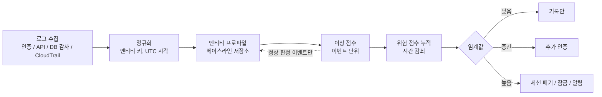
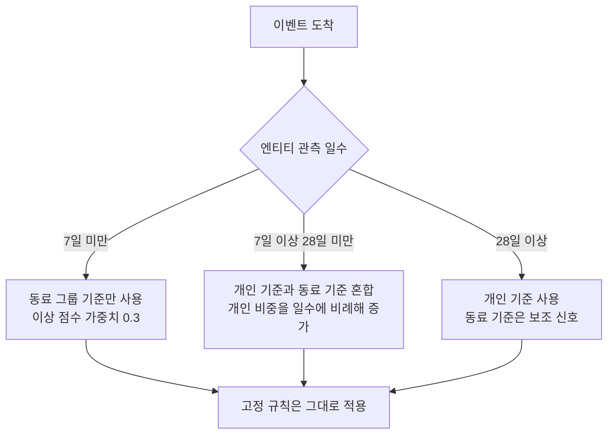
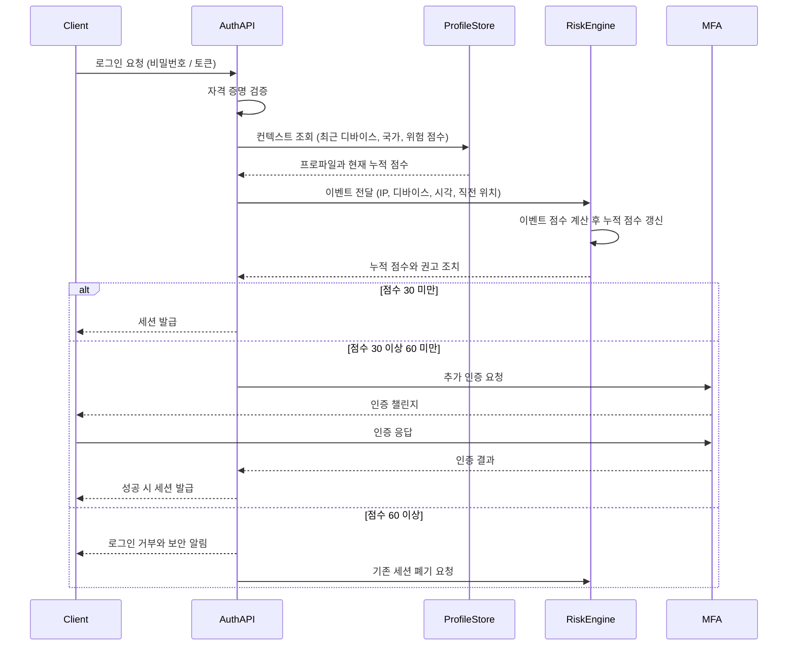
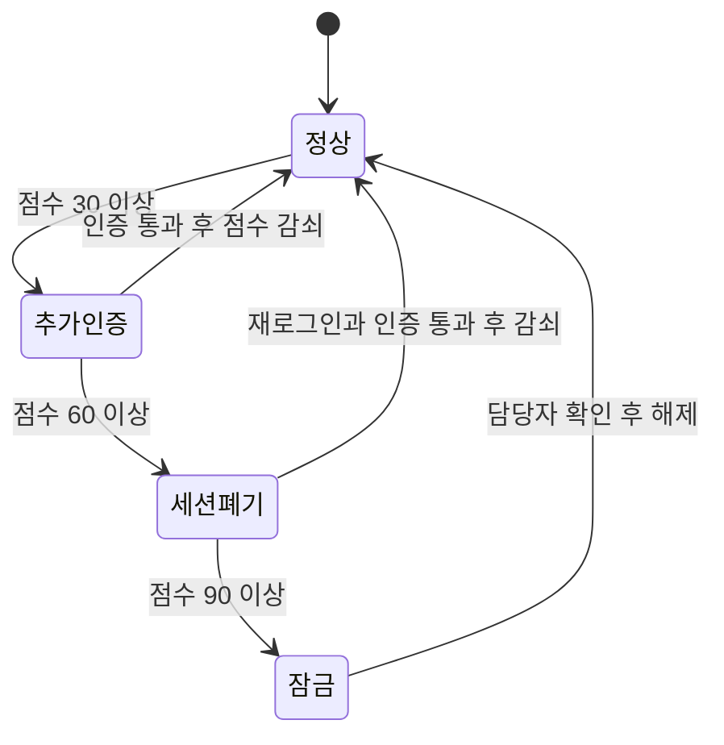

# UEBA 행위 기반 이상 탐지

퇴사를 앞둔 운영팀 직원의 계정이 어느 날 고객 조회 API를 하루에 2,400번 호출했다. 평소 그 계정은 하루 120건 안팎이었다. 우리가 걸어 둔 규칙은 "계정당 일 5,000건 초과"였고, 이 규칙은 한 번도 울리지 않았다. 5,000이라는 숫자는 배치 계정이 정상적으로 만드는 호출량을 기준으로 잡은 것이라, 사람 계정에게는 너무 헐거웠다. 임계값을 사람 계정 기준으로 낮추면 배치 계정이 매일 울린다. 계정마다 다른 임계값을 손으로 관리하는 일은 계정이 수백 개를 넘으면 끝까지 유지되지 않는다.

UEBA(User and Entity Behavior Analytics)는 이 문제를 "각 엔티티의 평소 모습"을 데이터에서 계산해서 푸는 방식이다. 엔티티는 사용자뿐 아니라 서비스 계정, 호스트, API 키까지 포함한다. 이 문서는 상용 UEBA 제품을 고르는 이야기가 아니라, 백엔드 개발자가 로그인·API·DB 감사 로그를 받아서 베이스라인을 만들고, 위험 점수를 쌓고, 로그인 흐름에 연결하는 데까지 직접 구현할 때 부딪히는 문제를 다룬다. 본문의 수치는 전부 합성 데이터로 직접 돌려서 얻은 값이다. 실제 서비스 데이터에서는 분포가 달라지므로 방향만 참고하면 된다.

## 규칙이 놓치는 사고

고정 임계값 규칙은 "무엇이 나쁜지"를 사람이 미리 안다는 전제로 동작한다. [크리덴션 스터핑](Credential_Stuffing.md), [로그인 무차별 대입 방어](../Backend/Authentication/Login_Brute_Force_Protection.md), [Falco](Container_Runtime_Security_Falco.md), [GuardDuty](../Cloud/AWS/Security/Guard_Duty.md)가 이 계열이다. 알려진 공격 패턴에는 잘 맞는다. 문제는 공격자가 정상 자격 증명으로 들어와서 정상 API만 호출하는 경우다. 규칙에 걸리는 행동이 하나도 없다.

UEBA가 필요해지는 사고는 대체로 세 가지로 모인다.

| 사고 유형 | 규칙이 놓치는 이유 | 행위 기반으로 보이는 신호 |
|---|---|---|
| 탈취된 정상 계정 | 비밀번호·토큰이 유효하고 실패 로그가 없다 | 새 국가·새 디바이스, 평소 안 쓰던 API, 업무 시간 밖 접속 |
| 내부자 대량 조회 | 권한 안의 호출이라 인가 오류가 없다 | 본인 평소 대비 조회량 급증, 동료 그룹 대비 이탈 |
| 서비스 계정 오남용 | 사람이 안 보는 계정이라 임계값이 느슨하다 | 호출하던 엔드포인트 집합 밖의 호출, 평소 없던 호스트에서 접근 |

두 방식은 대체 관계가 아니다. 규칙은 확실한 것을 빠르게 막고, 행위 기반은 규칙 밖의 애매한 것을 점수로 올려서 사람이 볼 후보를 만든다.

| 구분 | 규칙 기반 | 행위 기반(UEBA) |
|---|---|---|
| 기준 | 사람이 정한 고정값 | 엔티티별로 계산한 평소 분포 |
| 설명 | "일 5,000건 초과" 한 줄 | "본인 평소의 수십 배", 해석에 통계 지식이 필요하다 |
| 새 계정 | 즉시 적용 | 기준이 쌓일 때까지 판단이 부정확하다 |
| 오탐 원인 | 임계값이 계정 특성과 안 맞음 | 정상적인 행동 변화(출장, 배포, 시즌) |
| 운영 비용 | 규칙 수가 늘면 관리가 어렵다 | 데이터 파이프라인과 베이스라인 갱신을 돌려야 한다 |
| 공격자 대응 | 임계값 아래로 천천히 움직이면 통과 | 천천히 바꾸면 베이스라인이 따라간다(뒤에서 측정) |

## 파이프라인 전체 그림

구현하기 전에 단계를 나눠 두면 어디가 깨졌는지 찾기 쉽다. 로그 수집부터 대응까지 한 방향으로 흐르고, 베이스라인 저장소만 읽기·쓰기가 양쪽으로 오간다.



점선은 베이스라인 갱신 경로다. 이상으로 판정된 이벤트를 그대로 베이스라인에 되먹이면 공격이 곧 정상이 된다. 이 부분은 운영 문제 절에서 다시 다룬다.

## 입력 데이터와 엔티티 정규화

### 소스별로 뽑는 필드

로그를 전부 쌓는다고 UEBA가 되지 않는다. 베이스라인 계산에 쓰는 필드는 소스마다 몇 개 안 된다.

| 소스 | 뽑는 필드 | 만들 수 있는 특징 |
|---|---|---|
| 인증 로그 | 엔티티, 결과, IP, ASN, 국가, user-agent, 디바이스 ID, MFA 여부 | 접속 시간대 분포, 새 디바이스·새 국가, 직전 로그인과의 이동 속도 |
| API 접근 로그 | 엔티티, 엔드포인트(경로 템플릿), 메서드, 상태 코드, 응답 바이트, 대상 리소스 ID | 시간당 호출 수, 고유 엔드포인트 수, 응답 바이트 합, 고유 리소스 수 |
| DB 쿼리 감사 로그 | DB 계정, 테이블, 조회 행 수, 쿼리 유형 | 평소 안 보던 테이블 접근, 조회 행 수 합 |
| CloudTrail | principal ARN, eventName, sourceIPAddress, userAgent, 리전 | 평소 안 쓰던 API(IAM, S3 GetObject 폭증), 새 리전 |

경로는 `/orders/8841`이 아니라 `/orders/{id}`로 템플릿화해서 저장한다. 템플릿화하지 않으면 엔드포인트 종류가 수백만 개가 돼서 "고유 엔드포인트 수"가 의미를 잃는다. 대신 "고유 리소스 수"를 따로 센다. 한 계정이 하루에 서로 다른 고객 ID 2,000개를 조회했다면 엔드포인트 종류는 1개여도 대량 조회다.

### 엔티티 키 정규화

같은 주체가 소스마다 다른 이름으로 나온다. 인증 로그는 이메일, API 로그는 API 키 ID, CloudTrail은 assumed-role ARN 끝에 인스턴스 ID가 붙는다. 정규화를 안 하면 한 사람의 행동이 세 엔티티로 쪼개져서 각각 데이터가 모자란다. 반대로 인스턴스 ID까지 키에 넣으면 오토스케일링으로 인스턴스가 바뀔 때마다 새 엔티티가 생겨서 항상 콜드 스타트 상태가 된다.

```python
import re
from datetime import datetime, timezone

ARN_ROLE = re.compile(r"arn:aws:sts::(\d+):assumed-role/([^/]+)/(.+)")


def entity_key(event: dict) -> str:
    if event.get("api_key_id"):
        return f"key:{event['api_key_id']}"
    m = ARN_ROLE.match(event.get("principal_arn", ""))
    if m:
        return f"role:{m.group(1)}:{m.group(2)}"   # 세션 이름(인스턴스 ID)은 버린다
    if event.get("service_account"):
        return f"svc:{event['service_account'].lower()}"
    email = event.get("email", "").strip().lower()
    return f"user:{email}" if email else "unknown"


def to_utc(ts: str) -> datetime:
    return datetime.fromisoformat(ts.replace("Z", "+00:00")).astimezone(timezone.utc)
```

돌려 보면 ` Kim@Corp.com `과 `kim@corp.com`이 같은 `user:kim@corp.com`으로 묶이고, 인스턴스 ID가 다른 assumed-role 두 건이 `role:123456789012:batch-etl` 하나로 묶인다. API 키는 사람 이메일이 같이 찍혀 있어도 `key:ak_91`로 따로 본다. 키 하나가 유출됐을 때 사용자 본인의 평소 행동에 섞여 들어가면 안 되기 때문이다. 사용자와 그 사용자가 발급한 키는 별개 엔티티로 두고, 위험 점수를 합칠 때만 사용자 ID로 연결한다.

### 지연과 순서 뒤바뀜

로그는 발생한 순서대로 도착하지 않는다. 앱 서버 로그는 수집 에이전트를 거치고, CloudTrail은 수 분 늦게 나오며, 모바일 클라이언트 이벤트는 오프라인 큐에 쌓였다가 한꺼번에 올라온다. 이벤트에는 발생 시각(event time)과 수집 시각(ingest time)이 따로 있고 점수 계산은 발생 시각 기준이어야 한다.

이동 속도 검사가 이 문제를 가장 먼저 드러낸다. 직전 로그인과의 거리를 시간 차로 나누는 계산인데, 도착 순서가 뒤바뀌면 시간 차가 음수가 된다.

```python
import math
from dataclasses import dataclass
from datetime import datetime

R = 6371.0


def haversine_km(lat1, lon1, lat2, lon2):
    p1, p2 = math.radians(lat1), math.radians(lat2)
    dl = math.radians(lon2 - lon1)
    a = math.sin((p2 - p1) / 2) ** 2 + math.cos(p1) * math.cos(p2) * math.sin(dl / 2) ** 2
    return 2 * R * math.asin(math.sqrt(a))


@dataclass
class Login:
    ts: datetime
    lat: float
    lon: float
    vpn: bool = False


def travel_speed_kmh(prev: Login, cur: Login) -> float:
    hours = (cur.ts - prev.ts).total_seconds() / 3600
    km = haversine_km(prev.lat, prev.lon, cur.lat, cur.lon)
    if hours <= 0:
        return float("inf") if km > 50 else 0.0
    return km / hours
```

서울에서 프랑크푸르트까지 8,550km, 90분 간격이면 시속 5,700km로 계산된다. 서울에서 부산(325km)을 3시간 뒤에 접속하면 시속 108km로 정상이다. 문제는 사내 VPN이다. 서울에서 로그인한 30초 뒤에 VPN 출구가 프랑크푸르트인 요청이 오면 시속 1,025,958km가 나온다. 이 값은 이동 불가능이라기보다 "IP 위치가 의미 없는 구간"이다. VPN·프록시 ASN은 이동 속도 계산에서 빼고 별도 신호(새 VPN 출구 사용)로 취급해야 한다. 순서가 뒤바뀐 이벤트는 `hours <= 0` 분기로 걸러지지만, 이 분기가 항상 무한대를 돌려주면 늦게 도착한 정상 이벤트가 전부 점수를 받는다. 실무에서는 워터마크(수집 시각 기준 5분 같은 유예)를 두고 그 안에 도착한 이벤트는 발생 시각으로 정렬해서 처리하고, 워터마크를 넘겨 도착한 이벤트는 점수 계산에서 빼되 기록은 남긴다.

## 베이스라인 만들기

### 개인 기준과 동료 그룹 기준

개인 베이스라인은 "이 사람의 평소"다. 정확하지만 데이터가 쌓일 때까지 쓸 수 없다. 동료 그룹(peer group) 베이스라인은 같은 부서나 같은 역할 사람들의 분포다. 새 계정에도 바로 쓸 수 있지만 사람마다 편차가 크면 느슨해진다. 둘을 같이 쓰고, 개인 데이터가 모자란 동안은 동료 쪽에 비중을 둔다.

동료 그룹 분포는 평균 대신 중앙값과 MAD(중앙값 절대 편차)로 잡는다. 사용자 40명의 평소 볼륨이 로그정규 분포를 따른다고 가정한 합성 데이터에서 30일치 일일 조회 건수를 한 풀로 모으면 중앙값 114, MAD 60.8이 나왔다. 이 기준에서 점수는 다음과 같다.

| 대상 | 일일 조회 | 동료 대비 robust z |
|---|---|---|
| 정상 상위 1% 사용자 | 252 | 2.3 |
| 입사 첫 주 신규 사용자 | 480 | 6.0 |
| 대량 조회 | 2,400 | 37.6 |

신규 사용자가 첫 주에 480건을 조회해서 6.0이 나온 것은 오탐이다. 동료 그룹 기준은 새 계정을 판정해 주지만 온보딩 기간의 정상 급증까지 이상으로 본다. 그래서 신규 계정은 점수 자체보다 점수 가중치를 낮추는 쪽으로 처리한다.

### 콜드 스타트

신규 엔티티는 관측 일수에 따라 어느 기준을 쓸지 갈린다.



일수 기준은 서비스 특성에 맞춰 바꾼다. 중요한 점은 콜드 스타트 구간에도 고정 규칙은 계속 돈다는 것이다. UEBA가 아직 판단하지 못하는 구간을 규칙이 맡는다.

### 윈도우와 정상 변동

윈도우는 두 개를 같이 쓰는 편이 낫다. 짧은 윈도우(최근 7일 EWMA)는 정상적인 변화를 따라가고, 긴 윈도우(90일 중앙값)는 서서히 변하는 공격을 잡는 닻 역할을 한다. 요일 효과도 있다. 월요일 조회량이 금요일의 두 배인 팀이라면 요일별로 분리하거나 최소한 평일과 주말을 나눠야 한다.

출장, 휴가, 배포 시즌, 분기 마감은 베이스라인을 흔드는 정상 변동이다. 이 정보를 로그에서 추론하려 하지 말고 외부 신호로 받는 편이 단순하다. 인사 시스템의 출장·휴가 일정, 배포 파이프라인의 배포 이벤트를 엔티티 컨텍스트로 조회해서 해당 기간에는 이동 속도·새 국가 신호의 가중치를 낮춘다. 일정 데이터가 없다면 "출장 중일 가능성이 있다"는 사용자 확인 단계(추가 인증)를 거치게 하는 편이 낫다.

## 탐지 기법과 한계

### z-score와 EWMA

가장 먼저 쓰게 되는 기법이다. 30일치 일일 조회 건수의 평균 120.9, 표준편차 8.7을 기준으로 하면 2,400건은 z가 262.9로 어느 임계값에서든 잡힌다. 구현은 EWMA(지수 가중 이동 평균)와 EWMA 분산으로 한다. 상태가 평균, 분산, 관측 수 세 개뿐이라 엔티티당 저장 비용이 거의 없다.

```python
import math
from dataclasses import dataclass
import numpy as np


@dataclass
class Ewma:
    alpha: float = 0.1
    mean: float = 0.0
    var: float = 0.0
    n: int = 0

    def score(self, x: float) -> float:
        if self.n < 5:
            return 0.0
        sd = math.sqrt(self.var) or 1.0
        return (x - self.mean) / sd

    def update(self, x: float) -> None:
        if self.n == 0:
            self.mean, self.var = x, 0.0
        else:
            d = x - self.mean
            self.mean += self.alpha * d
            self.var = (1 - self.alpha) * (self.var + self.alpha * d * d)
        self.n += 1


def robust_z(history: np.ndarray, x: float) -> float:
    med = np.median(history)
    mad = np.median(np.abs(history - med)) * 1.4826 or 1.0
    return (x - med) / mad
```

평균과 표준편차 기반 z-score는 이상치 하나에 약하다. 학습 구간에 3,000건짜리 날이 하루 섞여 있으면 평균 216.5, 표준편차 525.8로 부풀고, 같은 2,400건의 z-score가 262.9에서 4.2로 떨어진다. 임계값이 5였다면 놓친다. 같은 데이터에 중앙값과 MAD를 쓴 robust z는 236.4를 유지한다. 학습 데이터를 깨끗하게 유지할 수 없다면 평균 대신 중앙값을 써야 한다.

더 큰 한계는 천천히 올리는 공격이다. 120건에서 시작해 하루 8%씩 늘리면 60일 뒤에는 12,368건이 된다. 이 구간 동안 EWMA(alpha 0.1)의 z는 10일차 1.58, 30일차 1.76, 60일차 1.77로 계속 2 아래에 머물렀다. z가 3을 넘은 날은 3일차와 6일차뿐이다. 학습 구간의 분산이 작아서 초반에만 울렸고, 이후에는 평균과 분산이 같이 올라가서 다시 울리지 않았다. 처음 30일 기준으로 고정한 베이스라인은 3일차에 바로 잡는다. 적응형 베이스라인은 정상 변화를 따라가는 대신 공격도 따라간다는 뜻이다. 그래서 짧은 윈도우 점수와 긴 윈도우(고정 기준) 대비 증가율을 함께 본다.

### Isolation Forest

특징이 여러 개이고 서로 얽혀 있을 때 쓴다. 시간대, 시간당 요청 수, 고유 엔드포인트 수, 응답 바이트, 새 IP 여부 다섯 개로 정상 2,000행을 학습시킨 결과다.

```python
import numpy as np
from sklearn.ensemble import IsolationForest

rng = np.random.default_rng(7)

def normal_rows(n):
    hour = np.clip(rng.normal(14, 3, n), 8, 21).round()
    req = rng.poisson(40, n)
    ep = np.clip(rng.poisson(6, n), 1, None)
    kb = rng.gamma(2.0, 30, n)
    newip = (rng.random(n) < 0.03).astype(float)
    return np.column_stack([hour, req, ep, kb, newip])

train = normal_rows(2000)
clf = IsolationForest(n_estimators=200, contamination="auto", random_state=0).fit(train)
score = lambda x: -clf.score_samples(np.array([x]))[0]   # 클수록 이상

thr = np.percentile(-clf.score_samples(train), 99)
```

| 케이스 | 이상 점수 | 임계값 0.644 판정 |
|---|---|---|
| 정상 | 0.374 | 통과 |
| 새벽 3시 대량 내보내기 | 0.690 | 탐지 |
| 엔드포인트 열거(고유 80개) | 0.702 | 탐지 |
| 같은 토큰을 새 IP에서 재사용 | 0.607 | 놓침 |
| 평소보다 조금 바쁜 날 | 0.586 | 통과 |

새 정상 행 5,000개에 대한 오탐률은 0.84%였다. 하루 이벤트가 수십만 건이면 그 0.84%가 수천 건이다. 이벤트 단위로 알림을 보내는 설계가 불가능한 이유다. 한 가지 더, 다른 특징은 평범하고 새 IP 하나만 다른 경우는 놓쳤다. 이진 특징 하나가 바뀐 것은 숲이 보기에 이상치가 아니다. 이런 신호는 모델에 넣지 말고 규칙으로 점수를 직접 부여한다.

학습 데이터 오염의 영향은 더 크다. 대량 내보내기 행 100개(약 5%)를 학습에 섞었더니 99번째 백분위 임계값이 0.644에서 0.702로 올라갔고, 위 표에서 탐지됐던 대량 내보내기와 엔드포인트 열거 케이스도 탐지되지 않았다. 같은 대량 내보내기 행 100개를 깨끗하게 학습한 모델은 100개 모두, 오염된 모델은 21개만 잡았다.

### 시퀀스 기반

한 번의 호출은 정상이어도 호출 순서가 이상할 수 있다. 로그인 없이 `list_users`부터 부르거나, 평소 안 쓰는 `export_all_users → download_export` 순서가 그렇다. 엔드포인트 전이 확률을 1차 마르코프 체인으로 세고, 새 시퀀스의 평균 놀람량(bits/step)을 본다.

```python
import math
from collections import defaultdict

def fit(flows, k=0.5):
    trans, vocab = defaultdict(lambda: defaultdict(int)), set()
    for f in flows:
        seq = ["<s>"] + f
        vocab.update(seq)
        for a, b in zip(seq, seq[1:]):
            trans[a][b] += 1
    return trans, vocab, k

def surprisal(model, flow):
    trans, vocab, k = model
    seq, total = ["<s>"] + flow, 0.0
    for a, b in zip(seq, seq[1:]):
        row = trans.get(a, {})
        total += -math.log2((row.get(b, 0) + k) / (sum(row.values()) + k * (len(vocab) + 1)))
    return total / (len(seq) - 1)
```

정상 흐름 4종류를 200번 학습시킨 뒤 측정했다. 정상 시퀀스는 0.58, `export_all_users` 경로는 3.67, 로그인 없는 `list_users` 시작은 4.42였다. 그런데 `get_order`를 40번 반복하는 스크래핑은 1.39밖에 나오지 않았다. `get_order → get_order` 전이 자체는 정상 흐름에서도 나오기 때문이다. 평균을 내는 방식은 길이에 희석된다. 시퀀스 점수는 반복 횟수·길이 특징과 같이 써야 한다.

### 한계 정리

| 기법 | 잡는 것 | 놓치는 것 | 운영 비용 |
|---|---|---|---|
| z-score·EWMA | 단일 지표의 급증 | 서서히 올리는 공격, 학습 구간 이상치에 취약 | 낮다. 엔티티당 숫자 3개 |
| 중앙값·MAD | 오염에 둔감한 급증 | 분포가 다봉이면(업무 시간 vs 야간 배치) 기준이 모호 | 낮다. 윈도우 값을 보관해야 한다 |
| Isolation Forest | 여러 특징의 조합 이상 | 이진 특징 하나만 바뀐 경우, 오염된 학습 데이터 | 중간. 주기적 재학습, 임계값 관리 |
| 시퀀스 | 호출 순서·경로 이상 | 길이에 희석되는 반복 호출 | 중간. 어휘 사전 관리 |
| 이동 속도 | 위치 비약 | VPN·프록시·모바일 망 | 낮다. IP 위치 DB 품질이 좌우한다 |

## 위험 점수 누적

이벤트 하나를 알림으로 보내면 오탐이 감당이 안 된다. 점수를 엔티티별로 쌓고 시간이 지나면 줄이는 구조로 바꾸면 "30분 안에 새 디바이스, 새벽 접속, 대량 조회가 연달아 나왔다"가 하나의 신호가 된다. 이벤트 점수에 반감기를 적용해서 합산한다.

점수 갱신은 읽고 감쇠시키고 더하고 쓰는 네 단계라 동시에 들어오면 값이 깨진다. Redis Lua 스크립트로 묶으면 원자적이다.

```python
import fakeredis   # 운영에서는 redis.Redis(...)

LUA = """
local key = KEYS[1]
local now = tonumber(ARGV[1])
local add = tonumber(ARGV[2])
local half_life = tonumber(ARGV[3])
local cap = tonumber(ARGV[4])
local cur = tonumber(redis.call('HGET', key, 'score') or '0')
local ts = tonumber(redis.call('HGET', key, 'ts') or tostring(now))
local dt = math.max(0, now - ts)
cur = cur * math.pow(0.5, dt / half_life)
cur = math.min(cap, cur + add)
redis.call('HSET', key, 'score', cur, 'ts', now)
redis.call('EXPIRE', key, half_life * 8)
return tostring(cur)
"""

r = fakeredis.FakeRedis(decode_responses=True)
add_risk = r.register_script(LUA)
HALF_LIFE, CAP = 3600, 100
STEP_UP, REVOKE, LOCK = 30, 60, 90

def push(entity, now, pts):
    return float(add_risk(keys=[f"risk:{entity}"], args=[now, pts, HALF_LIFE, CAP]))

def action(score):
    if score >= LOCK: return "lock"
    if score >= REVOKE: return "revoke_session"
    if score >= STEP_UP: return "step_up"
    return "allow"
```

반감기 1시간, 상한 100으로 한 사용자에게 이벤트를 넣은 결과다.

| 경과 | 이벤트 | 가산 | 누적 점수 | 조치 |
|---|---|---|---|---|
| 0초 | 새 디바이스 | 15 | 15.0 | 허용 |
| 600초 | 업무 시간 외 로그인 | 10 | 23.4 | 허용 |
| 1,200초 | 대량 조회 | 25 | 45.8 | 추가 인증 |
| 1,500초 | 새 국가 | 30 | 73.2 | 세션 폐기 |
| 7,200초 | 대량 조회 | 25 | 49.4 | 추가 인증 |
| 7,260초 | 새 IP의 API 키 사용 | 30 | 78.9 | 세션 폐기 |

개별 이벤트는 모두 단독으로는 임계값 아래였다. 연달아 나왔을 때 합산돼서 넘는다. 1,500초 이후 5,700초가 지나면 73.2는 24.4로 줄고, 거기에 25가 더해져 49.4가 된다. 반대로 하루 25점씩 5일 동안 들어온 다른 사용자는 감쇠 때문에 25.0에 머물러 아무 조치도 받지 않았다. 스레드 8개로 같은 키에 +1을 50번 동시에 넣었을 때 결과는 정확히 50이었다. `EXPIRE`는 반감기의 8배로 걸어서 조용한 엔티티의 키가 저절로 사라지게 한다.

가산 점수는 이상 점수를 그대로 쓰지 말고 구간으로 나눠서 매핑한다. 신뢰도가 높은 신호(새 국가, 이동 속도 위반)는 20~30점, 약한 신호(조금 늘어난 조회량)는 3~5점 정도로 시작하고, 알림 결과를 보면서 조정한다. 임계값과 반감기는 실제 알림 처리 인력으로 감당 가능한 건수에서 거꾸로 정하는 경우가 많았다.

스트림 처리로 옮길 때는 Kafka 파티션 키를 엔티티 키로 잡으면 한 엔티티의 이벤트가 한 소비자에서 순서대로 처리된다. 이 경우 Redis 없이 소비자 메모리와 changelog 토픽으로 상태를 들고 가는 구성도 가능하다. 다만 로그인 흐름에서 동기로 점수를 읽어야 하면 Redis 같은 저지연 저장소가 필요하다.

## 로그인 요청 흐름과 단계적 대응

점수를 로그인 경로에 연결할 때 지켜야 할 것은 점수 조회 때문에 로그인이 느려지거나 막히지 않는 것이다. 점수 저장소가 죽으면 로그인이 전부 실패하는 구조는 보안 시스템이 장애 원인이 되는 가장 흔한 패턴이다. 조회에 타임아웃(수십 ms)을 걸고, 초과하면 점수 0으로 보되 그 사실을 지표로 남긴다.



점수 구간별 조치는 되돌리기 쉬운 것부터 순서를 둔다. 추가 인증은 정상 사용자에게 잠깐의 불편을 주는 정도라 오탐이어도 비용이 작다. 세션 폐기는 재로그인이 필요하고, 계정 잠금은 헬프데스크 개입이 필요하다.



추가 인증 단계에서는 실제 사용자가 통과하면 점수를 일부 깎아 주는 피드백을 넣는다. 통과한 인증은 "이 기기·위치가 사용자 본인이다"라는 증거이므로 해당 디바이스를 신뢰 목록에 올리고, 같은 신호가 반복해서 점수를 올리지 않게 한다. 이 피드백이 없으면 출장 간 사용자가 매 로그인마다 추가 인증을 받는다. 세션 폐기는 [세션 관리](Session_Management.md)에서 다루는 서버 측 세션 저장소를 직접 지우거나, JWT라면 토큰 ID 차단 목록을 갱신하는 식으로 한다. 이 경로가 이미 있어야 UEBA가 호출할 수 있다.

잠금 이후의 절차는 [보안 사고 대응 절차](Incident_Response.md)의 탐지·분석·격리 단계로 넘긴다. 알림에는 점수 합계만 쓰지 말고 점수를 만든 이벤트 목록, 각 이벤트의 베이스라인 대비 값, 엔티티가 가진 권한을 같이 넣어야 당직자가 5분 안에 판단할 수 있다. 점수 근거가 없는 알림은 당직자가 신뢰하지 않게 된다. 대응 결과(오탐, 실제 사고)는 점수 가중치를 조정하는 데이터로 다시 쓴다.

## 운영하면서 부딪히는 문제

### 오탐 폭주와 알림 피로

도입 첫 주에 알림이 하루 수백 건 나오는 것은 거의 정해진 수순이다. 상위 알림 20건을 직접 열어 보면 대부분 배포 직후의 서비스 계정 변화, 분기 마감 때의 정상 급증, 신규 입사자다. 이 원인들을 컨텍스트 신호(배포 이벤트, 일정, 계정 나이)로 하나씩 억제한다. 알림이 하루에 사람이 처리할 수 있는 양을 넘으면 임계값을 올리는 대신 엔티티 유형별로 임계값을 따로 둔다. 사람 계정과 서비스 계정을 같은 기준으로 비교하면 한쪽이 항상 시끄럽다.

### 학습 데이터에 이미 공격이 섞여 있다

앞에서 측정한 대로 학습 데이터에 공격 행이 5% 섞이면 임계값이 올라가 공격 대부분이 정상으로 학습된다. UEBA를 도입하는 시점에 이미 침해된 계정이 있었다면 그 행동이 베이스라인이 된다. 처음 학습 전에 규칙 기반 탐지로 확정된 사고 구간을 제외하고, 이상 판정 이벤트는 베이스라인 갱신에서 빼야 한다. 앞 절 파이프라인 그림의 점선이 이 용도다. 모델은 오염에 둔감한 통계(중앙값, MAD)를 먼저 쓰고, Isolation Forest의 임계값은 학습 데이터 백분위가 아니라 별도 검증 구간에서 정한다.

### 베이스라인 오염

공격자가 행동을 천천히 바꾸면 적응형 베이스라인이 같이 올라간다. 앞의 실험에서 하루 8%씩 올린 경우 60일차에 기준 대비 100배 넘는 값이 나와도 z는 1.77이었다. 완화책은 두 가지다. 갱신 속도에 상한을 두고(EWMA alpha를 작게, 하루 변화량 제한), 90일 전 기준과의 장기 비교를 별도 신호로 둔다. 장기 비교는 정상적인 업무 변화에도 울리므로 점수는 낮게 주고 누적에만 기여시킨다.

### 로그 누락

탐지가 안 되는 이유가 모델이 아니라 로그가 안 들어와서인 경우가 많다. 수집 에이전트가 죽은 서버, 샘플링한 API 로그, 보존 기간이 짧은 DB 감사 로그가 흔하다. 엔티티별 이벤트 수가 갑자기 0이 되는 것도 신호로 본다. 소스별 수신량 지표를 따로 모니터링하고, 평소 대비 일정 비율 이하로 떨어지면 UEBA 알림과 별도로 수집 장애 알림을 낸다. 로그를 어떻게 남기고 보관할지는 [보안 로깅과 감사](Security_Logging_and_Auditing.md)에서 다룬다.

### 직원 모니터링의 범위

행위 분석은 곧 개인의 업무 행동 기록이다. 어떤 사이트에 접속했는지, 몇 시에 일했는지가 평가 자료로 쓰이면 보안 목적을 벗어난다. 구현 단계에서 지켜야 할 선이 있다.

| 항목 | 정리 |
|---|---|
| 수집 범위 | 시스템 접근 기록(로그인, API, DB 접근)에 한정한다. 메시지 내용, 화면, 키 입력은 수집하지 않는다 |
| 목적 제한 | 보안 탐지 목적으로만 쓴다. 인사 평가나 근태 관리에 연결하지 않는다 |
| 식별자 | 점수 계산은 가명 식별자로 하고, 실명 매핑은 사고 조사 시에만 풀 수 있게 접근 통제한다 |
| 고지 | 직원에게 모니터링 범위와 목적을 사전에 알린다. 근로자 대표 협의나 동의가 필요한 법적 요건은 국가마다 다르므로 법무 확인이 필요하다 |
| 보존 | 베이스라인과 점수 이력의 보존 기간을 정하고, 퇴사자 데이터는 기간 후 삭제한다 |

고객 이용자를 대상으로 한 UEBA에도 같은 문제가 있다. 위치와 디바이스 정보는 개인정보이고, 점수에 따른 자동 차단은 이용자에게 영향을 주는 자동화된 결정이다. 수집 항목과 보존 기간, 자동화된 결정에 대한 이의 제기 경로는 [GDPR 컴플라이언스](GDPR_and_Privacy_Compliance.md)와 [PII 데이터 보호](PII_Data_Protection.md)에서 확인한다. 위치 정보는 IP에서 국가·도시 수준으로만 변환해서 저장하고 원본 IP는 짧게 보관하는 방식이 가장 흔한 타협이다.
