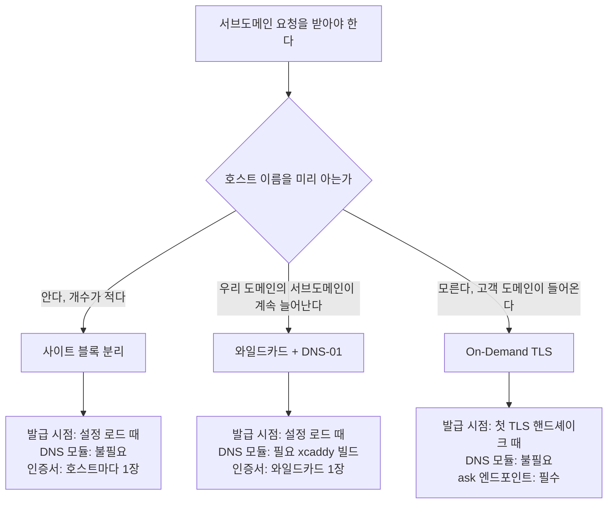
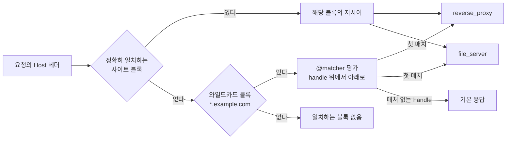
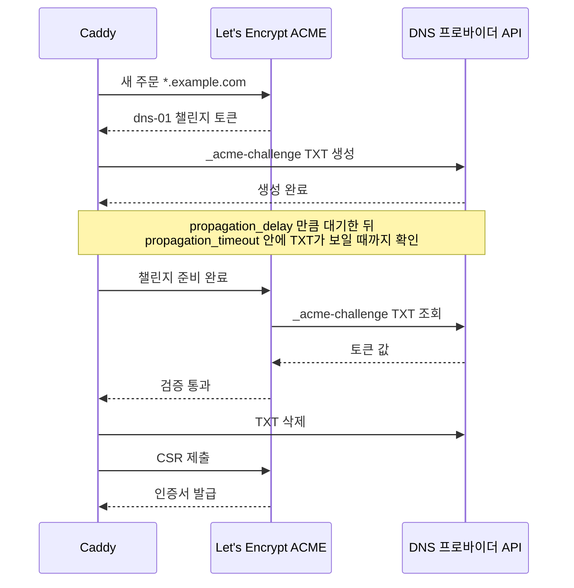
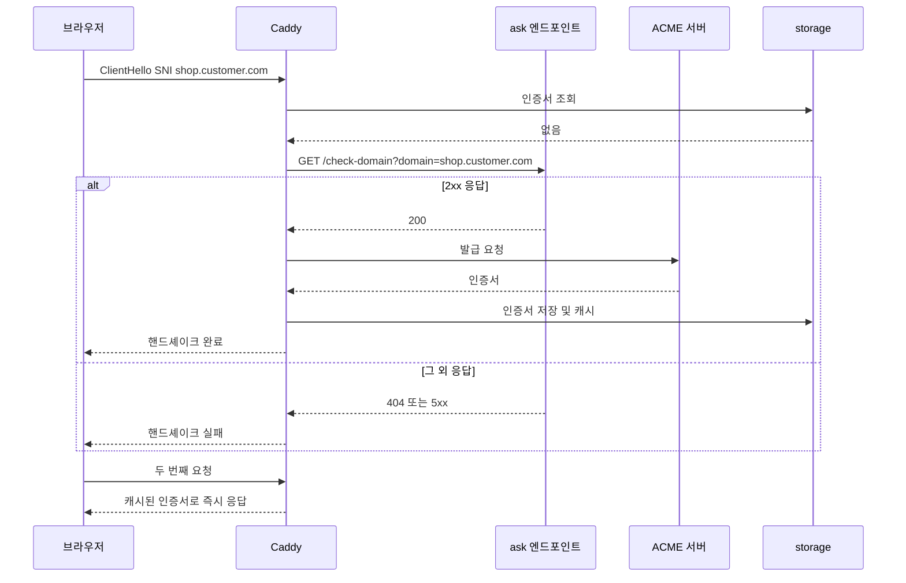
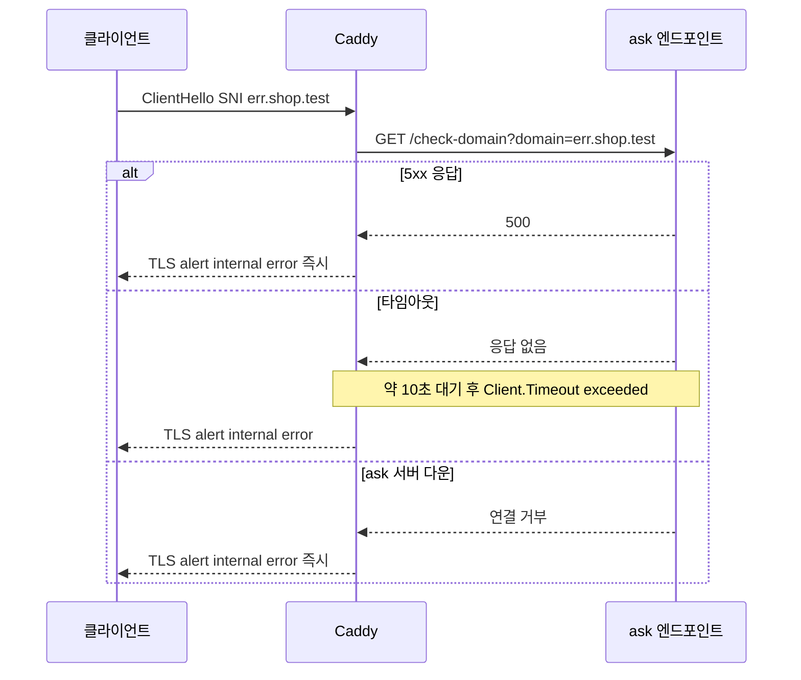
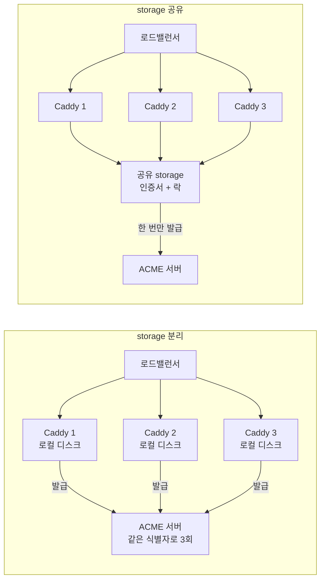
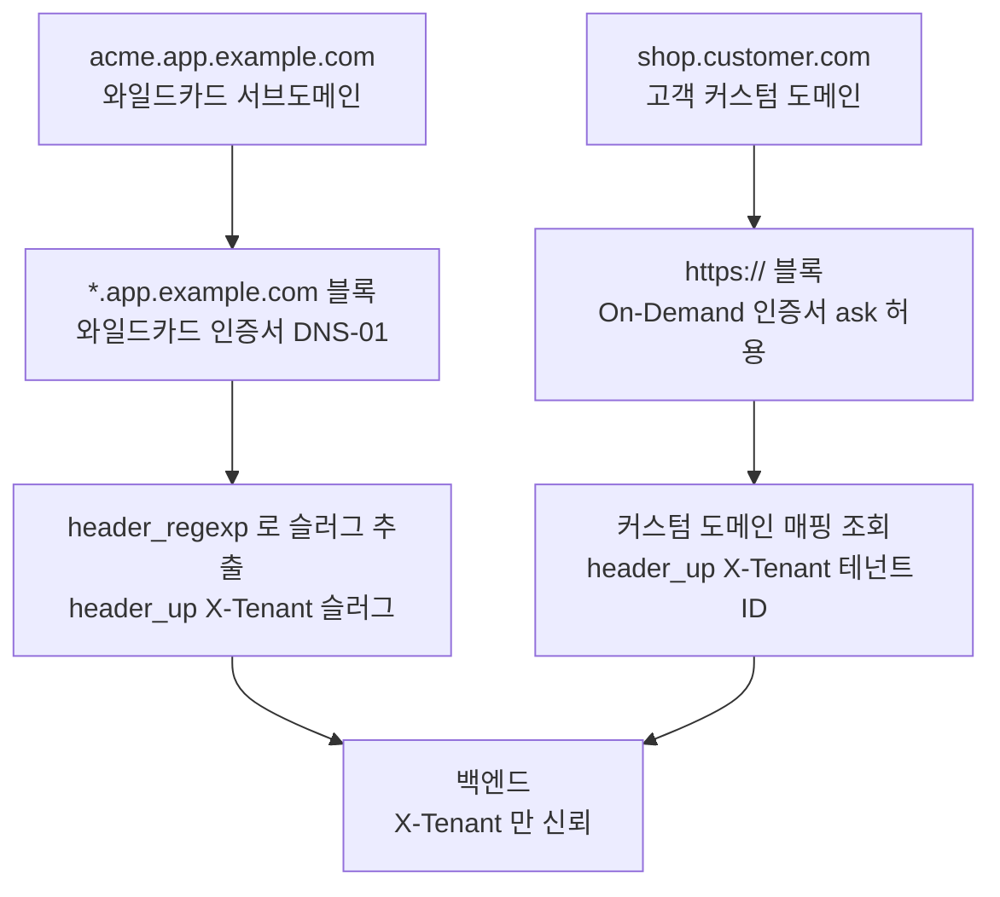
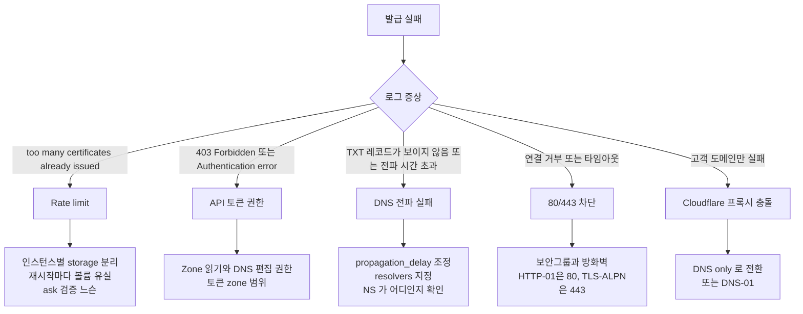

# Caddy 서브도메인 라우팅과 와일드카드 인증서 실무
## 왜 Caddy에서 서브도메인이 까다로운가

Nginx에서 서브도메인은 그냥 `server_name`만 바꿔주면 끝나는 작업이다. Caddy는 HTTPS가 자동이라는 점이 오히려 서브도메인 운영에서 발목을 잡는다. 사이트 블록 하나당 인증서가 자동으로 붙는데, 와일드카드를 쓰려는 순간 갑자기 DNS 프로바이더 모듈을 직접 빌드해야 하고, 멀티테넌트 SaaS에서 고객이 자기 도메인을 붙여오면 그건 또 다른 메커니즘(On-Demand TLS)을 써야 한다. 이 세 갈래(서브도메인 정적 분기 / 와일드카드 / On-Demand)를 헷갈리면 인증서 발급이 무한 루프를 돌거나 Let's Encrypt rate limit에 걸려서 한참을 기다려야 한다.

이 문서는 Caddyfile에서 서브도메인을 다루는 패턴을 정적인 것부터 동적 SaaS 호스팅까지 순서대로 다룬다. 서브도메인과 와일드카드 인증서 자체의 원리(DNS 레코드, SAN, 와일드카드가 한 라벨만 덮는 규칙)는 [서브도메인](../../Network/Domain/Subdomain.md) 문서에 있고, 여기서는 Caddy가 그 위에서 어떻게 동작하는지만 적는다. Caddy의 ACME 전반은 [Caddy SSL/TLS 심화](SSL_TLS.md)를 같이 보면 된다.

세 갈래는 인증서를 언제 받는지, DNS 모듈이 필요한지에서 갈린다. 아래 그림은 요구 조건에서 방식을 고르는 순서다.



| 구분 | 사이트 블록 분리 | 와일드카드 + DNS-01 | On-Demand TLS |
|---|---|---|---|
| 인증서 발급 시점 | 설정 로드(reload 포함) | 설정 로드 | 첫 핸드셰이크 |
| DNS 프로바이더 모듈 | 필요 없음 | 필요 | 필요 없음 |
| 새 호스트 추가 | Caddyfile 수정과 reload | 수정 없음 | 수정 없음 |
| 발급 실패 영향 | 해당 호스트만 | 와일드카드 전체 | 해당 도메인의 첫 접속 |
| 가장 흔한 사고 | 호스트 수만큼 발급이 늘어 한도에 접근 | API 토큰 권한, 전파 | ask 느슨함, ask 장애 |

## 사이트 블록 분리와 호스트 매처

가장 단순한 패턴은 서브도메인마다 사이트 블록을 따로 만드는 것이다. 각 블록의 첫 줄에 호스트명을 적으면 그게 곧 매처가 되고, Caddy가 그 호스트로 들어온 요청만 해당 블록에서 처리한다.

```caddy
api.example.com {
    reverse_proxy localhost:3000
}

admin.example.com {
    basic_auth {
        admin $2a$14$7ZyZ9Q0sBq1pV8m3b0Qy5eHq9G5R1t4mX3Wc2oN6vYk8uJ1aD2fLe
    }
    reverse_proxy localhost:8080
}

static.example.com {
    root * /var/www/static
    file_server
    encode gzip
}
```

`basicauth`는 v2.11 기준으로 deprecated 경고가 뜨는 이름이고 `basic_auth`가 현재 이름이다. 이 예제는 `caddy adapt`로 확인했다. 해시값은 자리표시용이고 실제로는 `caddy hash-password`로 만든다.

요청이 들어왔을 때 Caddy가 무엇을 어떤 순서로 보는지가 이 절의 핵심이다. 아래 그림은 Host 헤더가 사이트 블록, 와일드카드, `@matcher`를 차례로 거쳐 핸들러로 가는 흐름이다.



정확히 일치하는 호스트가 와일드카드보다 먼저 선택된다. `api.example.com`과 `*.example.com` 블록을 같이 두고 `caddy adapt`를 돌리면 JSON의 route 순서가 `api.example.com`, `*.example.com` 순으로 나온다.

한 가지는 직접 확인하고 나서야 알았다. 와일드카드는 한 라벨만 덮기 때문에 `a.b.example.test`로 들어온 요청은 `*.example.test` 블록에 걸리지 않는다. 이때 Caddy는 에러를 내지 않고 빈 본문의 200을 돌려준다. HTTP로 시험했을 때의 결과이고, HTTPS에서는 인증서가 없어 핸드셰이크 단계에서 먼저 실패한다. 이 방식의 장점은 사이트별로 인증서가 자동 발급되고, 설정이 깔끔하게 분리된다는 점이다. 단점은 서브도메인이 10개, 20개 늘어나면 Caddyfile이 길어지고, 새 서브도메인을 추가할 때마다 reload가 필요하다는 것이다.

서브도메인 개수가 5~10개 수준이고 자주 바뀌지 않으면 이 패턴이 가장 안전하다. 인증서도 도메인별로 따로 관리되므로 한 도메인 발급이 실패해도 다른 도메인은 영향을 받지 않는다.

## 한 블록에서 여러 호스트 동시 처리

같은 백엔드를 가리키는 서브도메인이 여러 개라면 콤마로 묶어서 한 블록에 넣을 수 있다.

```caddy
api.example.com, api-v2.example.com, internal-api.example.com {
    reverse_proxy localhost:3000
}
```

라우팅은 한 블록이 처리하지만 인증서는 하나로 합쳐지지 않는다. `tls internal`을 붙여 같은 구성을 실제로 기동해 보면 호스트마다 인증서가 한 장씩, 모두 세 장이 만들어지고 각 인증서의 SAN에는 자기 이름 하나만 들어 있다. "SAN에 세 도메인이 모두 들어간 인증서 한 장"으로 알려진 경우가 많은데 이 확인 결과와 다르다. 발급자가 ACME일 때의 로그는 이 환경에서 재현하지 못했으니, 운영에서 처음 적용할 때는 발급 로그에서 `identifier`가 몇 개 찍히는지 한 번 센다.

호스트 이름마다 한 번씩 발급이 일어난다는 사실은 rate limit 계산에 직접 들어간다. 호스트가 많아질수록 와일드카드로 가는 이유가 여기에 있다.

apex 도메인과 와일드카드를 동시에 받고 싶으면 이렇게 쓴다.

```caddy
example.com, *.example.com {
    @api host api.example.com
    handle @api {
        reverse_proxy localhost:3000
    }

    @admin host admin.example.com
    handle @admin {
        reverse_proxy localhost:8080
    }

    handle {
        root * /var/www/landing
        file_server
    }
}
```

블록 내부에서 host 매처로 분기한다. `handle`은 첫 매치만 실행되므로 위에서 아래로 우선순위가 정해진다. 매처가 없는 `handle`을 마지막에 두면 매치되지 않은 모든 요청을 받는다.

`example.com`과 `*.example.com`을 한 블록에 적어도 인증서는 두 장이다. `tls internal`로 기동해서 확인하면 `example.com` 한 장과 `*.example.com` 한 장이 따로 나온다. 한 장짜리 SAN 인증서가 아니라는 점을 기억해야 뒤에 나오는 DNS-01 실패 사례가 이해된다.

## 와일드카드 호스트 매처와 placeholder

서브도메인 슬러그를 동적으로 추출해서 백엔드에 넘기고 싶을 때 placeholder를 쓴다. Caddy는 호스트의 각 라벨을 `{labels.N}`으로 노출하는데, 인덱스는 오른쪽부터 0이다. `tenant1.example.com`이라면 `{labels.0}`은 `com`, `{labels.1}`은 `example`, `{labels.2}`는 `tenant1`이 된다.

처음 이걸 쓸 때 인덱스 방향을 거꾸로 알고 `{labels.0}`을 썼다가 한참 디버깅한 경험이 있다. 헷갈리면 응답으로 찍어보고 확인하는 게 빠르다. 아래는 로컬에서 `Host` 헤더를 바꿔 가며 실제로 돌려본 설정이다.

```caddy
http://*.api.example.test:8081 {
    respond "l0={labels.0} l1={labels.1} l2={labels.2} l3={labels.3}"
}
```

`Host: t.api.example.test`로 요청하면 `l0=test l1=example l2=api l3=t`가 나온다. `*.api.example.com`처럼 라벨이 4개인 구조에서는 와일드카드 위치가 `{labels.3}`이다.

실수하기 쉬운 부분이 있다. 정규식으로 호스트를 잡는 매처는 `host_regexp`가 아니다. 이 이름의 매처는 없고, `caddy adapt`는 `module not registered: http.matchers.host_regexp`로 죽는다. Host 헤더를 정규식으로 잡으려면 `header_regexp`를 쓴다. 캡처 그룹은 `{re.<이름>.<그룹>}` 형태로 꺼낸다. 또 `header_up`은 `reverse_proxy` 블록 안의 서브지시어라서 `handle` 바로 아래에 쓰면 안 된다.

```caddy
*.example.com {
    @valid header_regexp tenant Host ^(?P<slug>[a-z][a-z0-9-]{2,30})\.example\.com$

    handle @valid {
        reverse_proxy localhost:3000 {
            header_up X-Tenant {re.tenant.slug}
        }
    }

    handle {
        respond "Invalid subdomain" 400
    }
}
```

슬러그 형식 검증이 필요 없으면 `{labels.2}`로 충분하고, 형식을 강제하려면 정규식이 낫다. 로컬에서 같은 구조로 `Host`를 바꿔 보내면 `acme`는 통과하고, 대문자가 섞인 `A`와 두 글자짜리 `ab`는 400이 나왔다. 정규식이 `{2,30}`으로 3글자 이상을 요구하기 때문이다. 포트가 붙은 Host(`:8081`)로 시험할 때는 정규식 끝에 `(:\d+)?`를 넣어야 하는데, 운영의 443에서는 Host에 포트가 붙지 않으니 필요 없다.

## DNS-01 챌린지와 와일드카드 인증서

`*.example.com` 같은 와일드카드는 Let's Encrypt에서 HTTP-01 챌린지로 받을 수 없다. 와일드카드는 무조건 DNS-01이다. 챌린지와 와일드카드 SAN의 원리는 [서브도메인](../../Network/Domain/Subdomain.md)의 와일드카드 인증서 절에 있다. Caddy에서 달라지는 것은 DNS API를 부르는 주체가 Caddy라는 점이다. Caddy가 `_acme-challenge.example.com` TXT 레코드를 DNS 프로바이더 API로 만들고, ACME 서버가 그걸 조회해서 소유권을 확인한다.



그림에서 볼 것은 Caddy가 ACME 서버에 "준비됐다"고 알리기 전에 스스로 TXT가 보이는지 확인하는 구간이다. 이 구간이 실패하면 ACME 서버는 아예 호출되지 않는다.

문제는 Caddy 기본 빌드에 DNS 프로바이더 모듈이 없다는 점이다. 이 환경의 `caddy list-modules`에는 `caddy.storage.file_system` 같은 기본 모듈만 있고 `dns.providers.*`는 하나도 없다. xcaddy로 직접 빌드해야 한다.

```bash
# Cloudflare 사용 시
xcaddy build \
    --with github.com/caddy-dns/cloudflare

# Route53
xcaddy build \
    --with github.com/caddy-dns/route53

# 여러 개 동시에
xcaddy build \
    --with github.com/caddy-dns/cloudflare \
    --with github.com/caddy-dns/route53
```

빌드한 바이너리로 교체한 뒤 Caddyfile에 DNS 프로바이더 설정을 넣는다.

```caddy
*.example.com {
    tls {
        dns cloudflare {env.CLOUDFLARE_API_TOKEN}
        propagation_delay 30s
        propagation_timeout 2m
    }
    reverse_proxy localhost:3000
}
```

모듈 없는 빌드에서 이 파일을 `caddy adapt`하면 `module not registered: dns.providers.cloudflare`에서 멈춘다. `dns` 줄을 빼고 `propagation_*`만 남기면 `requires a DNS provider`라는 에러가 나는데, 두 옵션이 DNS 챌린지 전용이라는 뜻이다. 즉 이 블록의 구문은 모듈이 있는 빌드에서만 끝까지 검증된다. 검증 못 한 부분은 Caddy 공식 문서의 `tls` 지시어 설명과 대조했다.

두 옵션의 의미는 이름과 달리 헷갈리기 쉽다. 공식 문서 기준으로 `propagation_delay`는 TXT 전파 확인을 시작하기 전에 기다리는 시간이고 기본값은 0이다. `propagation_timeout`은 TXT가 보일 때까지 기다리는 상한이고 기본값은 2분이며, `-1`이면 전파 확인 자체를 건너뛴다. `propagation_delay`를 "ACME 서버가 조회하기 전의 대기"로 읽기 쉬운데, 정확히는 Caddy 자신의 확인 시작 전 대기다. Caddy가 확인을 하므로 대부분은 기본값으로 충분하다. 사내 DNS를 쓰거나 split-horizon 구성이라 Caddy가 보는 리졸버와 ACME 서버가 보는 값이 다를 때는 `resolvers 1.1.1.1`처럼 확인용 리졸버를 지정한다.

API 토큰 권한 설정도 까다롭다. `caddy-dns/cloudflare` README는 `Zone.Zone:Read`와 `Zone.DNS:Edit`를 요구한다. 이걸 빼먹으면 발급은 시도하는데 TXT 레코드를 못 만들어서 재시도만 반복한다. 로그에 `403 Forbidden`이 찍히면 토큰 권한부터 확인한다.

## 와일드카드 SAN을 여러 사이트 블록에서 공유

Caddy는 사이트 블록마다 따로 인증서를 받는 게 기본이다. 와일드카드 한 장을 발급해서 여러 서브도메인이 쓰게 하려면 호스트 목록에 와일드카드를 명시한다.

```caddy
*.example.com {
    tls {
        dns cloudflare {env.CLOUDFLARE_API_TOKEN}
    }

    @api host api.example.com
    handle @api {
        reverse_proxy localhost:3000
    }

    @admin host admin.example.com
    handle @admin {
        reverse_proxy localhost:8080
    }

    handle {
        respond "Unknown subdomain" 404
    }
}
```

한 블록 안에서 와일드카드로 받은 인증서를 모든 서브도메인이 공유한다. 발급이 1회로 끝나서 호스트 수에 비례하던 rate limit 부담이 사라진다. 단점은 블록 하나가 거대해지고, 한 서브도메인에만 특수한 설정(별도 미들웨어, 다른 timeout)을 넣기 어렵다는 점이다.

서브도메인별로 블록을 나누면서도 와일드카드 한 장을 쓰고 싶으면 같은 `tls` 설정을 가진 블록을 나란히 둔다. `*.example.test`와 `api.example.test`를 둘 다 `tls internal`로 두고 기동하면 인증서 디렉토리에 `wildcard_.example.test` 한 장만 생기고 `api.example.test` 전용 인증서는 생기지 않는다. `caddy adapt` 결과에서도 두 호스트가 automation policy 하나의 `subjects`에 같이 들어간다. 이 확인은 `tls internal`로 한 것이고, 각 블록의 `tls` 설정이 다르면 policy가 갈라진다. 그래서 DNS 설정을 넣을 때는 블록마다 같은 `tls { dns ... }`를 반복해야 한다.

## On-Demand TLS — 고객 커스텀 도메인

SaaS를 운영하다 보면 고객이 자기 도메인(`shop.customer.com`)을 우리 서비스에 연결하고 싶다는 요구가 들어온다. 어떤 도메인이 들어올지 미리 알 수 없고 Caddyfile에 박아둘 수도 없다. 이때 쓰는 게 On-Demand TLS다.

```caddy
{
    on_demand_tls {
        ask http://localhost:9000/check-domain
    }
}

https:// {
    tls {
        on_demand
    }
    reverse_proxy localhost:3000
}
```

예전 글에는 `ask` 아래에 `interval 2m`, `burst 5`를 같이 쓰는 예가 많다. v2.11.2에서는 `the on_demand_tls 'interval' option is no longer supported, remove it from your config`로 adapt가 실패한다. 공식 문서도 두 옵션을 쓰지 말라고 안내한다. 지금 `on_demand_tls`에 남은 서브지시어는 `ask`와 `permission`(자체 모듈로 허용 여부를 판단하는 확장 지점)이다. 발급 빈도 제어는 `ask` 쪽 로직에서 해야 한다.

첫 TLS 핸드셰이크가 들어온 뒤의 순서는 이렇다. 핸드셰이크가 발급 완료까지 대기한다는 점을 보면 된다.



Caddy는 이 SNI에 맞는 인증서가 storage에 없으면 먼저 `ask` 엔드포인트에 `GET /check-domain?domain=shop.customer.com`을 보낸다. 2xx를 받으면 발급을 시도하고, 그 외에는 핸드셰이크를 에러로 끝낸다. 공식 문서도 같은 설명이다.

`ask` 엔드포인트는 우리 백엔드에서 직접 구현해야 한다. 보통은 DB에 등록된 고객 도메인 목록을 조회해서 매치되면 200, 아니면 404를 반환한다.

```javascript
// Express 예시
app.get('/check-domain', async (req, res) => {
    const domain = req.query.domain;
    if (!domain) return res.status(400).send('missing domain');

    const exists = await db.customerDomains.exists({ domain });
    if (!exists) return res.status(404).send('not registered');

    res.status(200).send('ok');
});
```

`ask`를 절대 빼면 안 된다. 빼면 누구나 임의의 도메인으로 핸드셰이크를 시도해서 우리 Caddy가 그 도메인으로 발급을 시도하게 만들 수 있다. 공격자가 무작위 도메인 수천 개로 핸드셰이크를 던지면 계정 단위 한도(주문 수, 검증 실패 수)가 소진되고 정상 고객 도메인의 발급도 같이 막힌다. 한도 수치는 트러블슈팅 절에 출처와 함께 적었다.

첫 핸드셰이크는 발급이 끝날 때까지 기다린다. 로컬 `tls internal` 발급자로 재면 수십 ms이지만 ACME는 CA 왕복과 챌린지 검증이 들어가서 이보다 훨씬 길다. 사용자 입장에서는 "사이트가 멈췄다"로 느껴진다. 운영에서는 고객이 도메인을 등록하는 시점에 백엔드에서 먼저 핸드셰이크를 시뮬레이션해서 인증서를 미리 받아두는 워밍업 작업을 하는 게 좋다. 백엔드에서 `curl https://shop.customer.com -k`를 한 번 쳐도 Caddy가 발급을 시작한다.

## ask 엔드포인트가 죽으면 어떻게 되는가

운영하다가 한 번씩 마주치는 상황인데, `ask`가 5xx를 뱉거나 응답이 없으면 Caddy는 발급을 거부한다. 새 도메인의 첫 핸드셰이크가 모두 실패한다. 이미 발급받은 인증서로 들어오는 기존 트래픽은 영향이 없다.

세 가지 경우를 로컬에서 각각 재현했다. `ask`를 404로 응답하게 한 도메인, 500으로 응답하게 한 도메인, 60초 동안 응답하지 않게 한 도메인, 그리고 `ask` 서버 자체를 내린 상태다.



어느 경우든 클라이언트는 같은 `tlsv1 alert internal error`를 받고, 구분은 서버 로그로만 된다.

| ask 상태 | 핸드셰이크 결과 | 걸린 시간 | 기본 로그 레벨에서의 흔적 |
|---|---|---|---|
| 2xx | 인증서 발급 후 완료 | 수십 ms (internal 발급자) | `obtaining new certificate` |
| 404 | 실패 | 즉시 | 없음 |
| 500 | 실패 | 즉시 | 없음 |
| 서버 다운 | 실패 | 즉시 | `failed to get permission for on-demand certificate`, `connection refused` |
| 무응답 | 실패 | 약 10초 | `failed to get permission for on-demand certificate`, `Client.Timeout exceeded while awaiting headers` |

404와 500은 기본 로그 레벨에서 아무것도 남지 않았다. `debug` 전역 옵션을 켜면 `on-demand certificate issuance denied`와 함께 `non-2xx status code 500`이 찍힌다. 신규 고객이 "접속이 안 된다"고 할 때 Caddy 로그가 조용하면 `ask`가 거절하고 있을 가능성부터 본다.

"`ask`에 짧은 timeout(2~3초)을 걸어두면 백엔드가 느려도 발급 흐름이 멈추지 않는다"는 설명은 사실과 다르다. Caddy 쪽에 `ask` timeout을 조정하는 옵션은 없고, 측정으로는 10초에서 끊겼다. 느린 `ask`는 핸드셰이크를 10초 붙잡다가 실패한다. 공식 문서도 `ask`는 가능하면 몇 ms 안에 응답해야 한다고 적는다.

이게 무서운 이유는 `ask` 백엔드가 단일 장애점이 된다는 것이다. 백엔드 하나가 죽으면 신규 고객 온보딩이 막힌다. 그래서 `ask` 엔드포인트는 별도의 가벼운 서비스로 빼거나, 메인 백엔드와 분리된 읽기 전용 DB 복제본을 보게 만든다. 캐시도 적극적으로 쓴다.

```javascript
const NodeCache = require('node-cache');
const cache = new NodeCache({ stdTTL: 300 });

app.get('/check-domain', async (req, res) => {
    const domain = req.query.domain;
    const cached = cache.get(domain);
    if (cached !== undefined) {
        return res.status(cached ? 200 : 404).send();
    }

    const exists = await db.customerDomains.exists({ domain });
    cache.set(domain, exists);
    res.status(exists ? 200 : 404).send();
});
```

5분 캐시면 DB 부하와 반영 지연이 적당히 균형이 맞는다. 캐시된 값이 `false`일 때 고객이 방금 도메인을 등록했다면 최대 5분 동안 거절이 이어지므로, 등록 시점에 해당 키를 지우는 처리를 같이 둔다. 이 Express 코드는 직접 실행해 보지 않았다. 시험에는 같은 응답 규약(2xx 허용, 그 외 거절)을 따르는 Python 서버를 썼다.

## On-Demand 무한 발급 사고 사례

`ask` 엔드포인트의 검증 로직이 잘못 짜여서 모든 도메인에 200을 돌려주게 된 경우를 생각해 보면 구조가 잘 보인다. 그 상태에서 봇이 임의 도메인으로 핸드셰이크를 던지면 Caddy는 요청이 오는 대로 발급을 시도한다. 도메인 소유권을 증명하지 못하니 챌린지는 실패하고, 그 실패가 계정 단위로 쌓여서 Let's Encrypt 한도에 걸린다. 정상 고객이 새로 도메인을 등록해도 발급이 안 된다.

한도에 걸리면 "일주일 가까이 풀리지 않는다"고들 하지만 정확하지 않다. Let's Encrypt 공식 문서 기준으로 검증 실패 한도는 12분마다 1건씩 회복되고, 등록 도메인당 인증서 한도는 202분마다 1건씩 회복된다. 한 번에 막히는 것이 아니라 한도를 다 쓴 만큼 천천히 풀리는 구조다. 반면 같은 식별자 조합의 중복 발급 한도는 34시간에 1건씩 회복되고 예외 신청도 받지 않는다. 수치의 출처는 [Let's Encrypt Rate Limits](https://letsencrypt.org/docs/rate-limits/)다.

이걸 방지하려면 `ask`에서 허용 목록 검증을 엄격하게 해야 한다. 글로벌 옵션의 `interval`과 `burst`를 보수적으로 잡으라는 조언이 있지만 지금 버전에는 그 옵션이 없다. 대신 `ask` 안에서 같은 도메인에 대한 요청 빈도를 세거나, 등록 후 일정 시간이 지나지 않은 도메인은 거절하는 식으로 직접 제한한다. Caddy 자체의 보호 장치로는 계정당 10초에 10회라는 내부 속도 제한이 있다고 공식 문서가 적는데, 이건 폭주를 늦출 뿐 허용 목록을 대신하지 못한다.

한 CA가 막혀도 다른 CA로 넘어가는 폴백은 기본으로 들어 있다. Caddy는 Let's Encrypt와 ZeroSSL을 순서대로 시도한다. 다만 ZeroSSL에도 자체 한도가 있어서 근본 대책은 못 된다.

## 여러 Caddy 인스턴스와 storage 공유

Caddy를 두세 대로 늘려 로드밸런서 뒤에 두면 새로 생기는 문제다. 인증서는 Caddy의 storage에 저장되고, 기본값은 각 인스턴스의 로컬 디스크(`file_system`)다. 인스턴스마다 storage가 따로면 같은 호스트의 인증서를 인스턴스마다 따로 발급받는다. 같은 ACME 계정 단위로 동일한 식별자 조합이 반복되므로 중복 발급 한도에 걸린다.



계산을 해 보면 위험이 바로 보인다. 같은 호스트 `shop.example.com` 하나에 대해 Caddy가 3대이고 storage가 따로면 배포 한 번에 최대 3장이 나온다. 컨테이너를 볼륨 없이 띄우면 재시작할 때마다 로컬 인증서가 사라지니, 롤링 배포를 두 번만 해도 6장이다. 같은 식별자 조합의 한도가 7일에 5장이고 회복이 34시간에 1장이므로(출처: [Let's Encrypt Rate Limits](https://letsencrypt.org/docs/rate-limits/)), 그 시점부터 해당 호스트는 새 인증서를 받지 못한다. 이전 인증서가 만료 전이면 증상이 안 나타나고, 갱신 시기에 한꺼번에 터지기 때문에 원인을 찾기 어렵다.

공식 문서는 같은 storage를 쓰는 Caddy 인스턴스들이 자동으로 자원을 공유하고 클러스터로서 인증서 관리를 조율한다고 설명한다. 이 동작은 `tls internal` 발급자로 직접 확인했다. 같은 Caddyfile로 인스턴스 두 개를 서로 다른 포트에 띄웠다.

| 구성 | 인스턴스 A 인증서 시리얼 | 인스턴스 B 인증서 시리얼 | 발급 로그 횟수 (A / B) |
|---|---|---|---|
| storage 분리 | `2448E52C...` | `96790299...` | 1 / 1 |
| storage 공유 | `9903E3BE...` | `9903E3BE...` | 1 / 0 |

분리하면 시리얼이 다르고 둘 다 발급했다. 공유하면 B는 발급 로그가 0회였고 A가 만든 인증서를 그대로 내보냈다. 이 시험은 발급자가 ACME가 아니라 internal이고, A를 먼저 띄운 뒤 B를 띄웠기 때문에 두 인스턴스가 동시에 발급을 시도할 때의 경합은 보지 않았다. 동시 발급은 로그에서 `acquiring lock`, `lock acquired`, `releasing lock`이 식별자마다 찍히는 것까지만 확인했고, 락이 인스턴스 사이에서 충돌을 막는지는 공식 문서의 설명을 따른다.

공유 방법은 글로벌 옵션의 `storage`다.

```caddy
{
    storage file_system /mnt/caddy-shared
}

shop.example.com {
    reverse_proxy localhost:3000
}
```

`caddy adapt` 결과에서 `storage`가 `{"module": "file_system", "root": "/mnt/caddy-shared"}`로 나오는 것까지 확인했다. 기본 빌드에는 `file_system` 모듈만 있다. 이 경로를 NFS 같은 공유 볼륨으로 잡으면 되지만, 락을 파일로 구현하므로 파일 락이 제대로 동작하는 볼륨인지 먼저 따져야 한다. Redis, Consul, S3 같은 외부 저장소를 쓰려면 해당 storage 모듈을 xcaddy로 같이 빌드한다.

공유 storage가 있어도 HTTP-01 검증 요청이 로드밸런서에서 어느 인스턴스로 가는지는 따로 확인해야 하는 문제인데, 이 환경에서는 재현하지 못해서 다루지 않는다.

## 멀티테넌트 라우팅과 X-Tenant 헤더

서브도메인으로 테넌트를 식별하는 SaaS 패턴에서는 보통 백엔드가 같고, 호스트만 보고 어느 테넌트의 데이터를 가져올지 정한다. 와일드카드 서브도메인(우리 도메인)과 고객 커스텀 도메인은 입구에서 인증서 발급 방식이 다르지만, Caddy를 통과한 뒤에는 같은 `X-Tenant` 헤더로 합쳐진다.



그림에서 짚을 곳은 두 경로가 `X-Tenant`로 합쳐지는 지점이다. 백엔드는 호스트 이름이 어떤 형태로 들어왔는지 몰라도 되고, 신뢰하는 입력이 Caddy가 넣은 헤더 하나로 줄어든다.

```caddy
*.app.example.com {
    tls {
        dns cloudflare {env.CLOUDFLARE_API_TOKEN}
    }

    @valid header_regexp tenant Host ^(?P<slug>[a-z][a-z0-9-]{2,30})\.app\.example\.com$

    handle @valid {
        reverse_proxy localhost:3000 {
            header_up X-Tenant {re.tenant.slug}
            header_up X-Original-Host {host}
        }
    }

    handle {
        respond "Invalid tenant slug" 400
    }
}
```

`header_up`은 Caddy가 백엔드로 요청을 보낼 때 헤더를 설정하는 지시어다. 클라이언트가 `X-Tenant: admin`을 직접 보내도 되는지 직접 확인했다. `Host: acme.example.test`에 `X-Tenant: admin`을 같이 보내고 백엔드가 받은 헤더를 찍어 보니, `request_header -X-Tenant` 없이 `header_up X-Tenant {re.tenant.slug}`만 써도 값이 `["acme"]` 하나로 덮어써져 있었다. 클라이언트가 보낸 값이 따로 남지 않는다.

그래도 `request_header -X-Tenant`를 먼저 두는 편이 의도가 분명하다. 나중에 `header_up`을 `header_up +X-Tenant`처럼 추가형으로 바꾸는 사람이 생기면 덮어쓰기가 사라지고 클라이언트 값이 같이 전달되기 때문이다. 백엔드는 항상 `X-Tenant`를 Caddy에서만 받는다고 가정해야 하고, Caddy를 거치지 않고 백엔드에 직접 닿는 경로가 열려 있으면 이 헤더 전체를 믿을 수 없다.

```caddy
handle @valid {
    request_header -X-Tenant
    reverse_proxy localhost:3000 {
        header_up X-Tenant {re.tenant.slug}
    }
}
```

## Apex와 서브도메인 동시 처리

apex 도메인(`example.com`)은 와일드카드 `*.example.com`에 매칭되지 않는다. 와일드카드는 정확히 한 라벨만 매치한다. 두 패턴을 모두 다루려면 명시적으로 둘 다 적어야 한다.

```caddy
example.com {
    redir https://www.example.com{uri} permanent
}

www.example.com, *.example.com {
    tls {
        dns cloudflare {env.CLOUDFLARE_API_TOKEN}
    }

    @www host www.example.com
    handle @www {
        root * /var/www/landing
        file_server
    }

    @app header_regexp tenant Host ^(?P<slug>[a-z][a-z0-9-]+)\.example\.com$
    handle @app {
        reverse_proxy localhost:3000 {
            header_up X-Tenant {re.tenant.slug}
        }
    }
}
```

apex는 따로 처리해서 www로 리다이렉트하고, www와 와일드카드를 한 블록에 묶는다. 이 패턴이 SaaS에서 가장 흔하다. 위 설정에서 `tls { dns ... }` 줄만 빼고 `caddy adapt`한 결과는 정상이었다. 단, `@app` 정규식은 `www`도 슬러그 `www`로 잡으므로 `@www` 핸들이 반드시 위에 있어야 한다. `handle`이 첫 매치만 실행하기 때문에 순서가 바뀌면 `www`가 테넌트로 넘어간다.

반대로 www를 apex로 합치고 싶으면 방향만 바꾼다.

```caddy
www.example.com {
    redir https://example.com{uri} permanent
}

example.com, *.example.com {
    # ...
}
```

이때 함정이 있다. 앞에서 확인했듯 `example.com, *.example.com`은 인증서가 두 장이고, DNS-01 챌린지가 두 이름 각각에 대해 통과해야 한다. apex만 다른 DNS 운영사에 맡기고 서브도메인은 자체 운영하는 식으로 분리되어 있으면 한쪽만 발급에 실패한다. 한쪽이 실패해도 다른 쪽은 발급될 수 있으니, 발급 로그에서 어느 `identifier`가 막혔는지 확인한다.

## 로컬 개발에서 와일드카드 자체 서명 인증서

운영에서 `*.example.com`을 쓰면 로컬에서 테스트할 때도 비슷한 환경을 만들고 싶다. `*.localhost`는 대부분의 OS에서 127.0.0.1로 해석되므로 hosts 파일 수정 없이 와일드카드 도메인을 흉내낼 수 있다.

```caddy
*.localhost {
    tls internal

    @tenant header_regexp slug Host ^(?P<slug>[a-z0-9-]+)\.localhost$
    handle @tenant {
        reverse_proxy localhost:3000 {
            header_up X-Tenant {re.slug.slug}
        }
    }
}
```

`tls internal`은 Caddy가 자체 CA를 만들어서 사인한다는 뜻이다. 첫 실행 시 운영체제 신뢰 저장소에 Caddy CA를 등록하라고 sudo 권한을 요청한다. 한 번 등록해두면 브라우저에서 `https://tenant1.localhost`로 접속해도 인증서 경고가 안 뜬다.

curl이나 다른 클라이언트는 시스템 신뢰 저장소를 안 보는 경우가 있어서 별도로 CA를 신뢰시키거나 `-k` 옵션으로 검증을 끄고 써야 한다. Caddy CA 위치는 `caddy environ` 명령으로 확인할 수 있다.

이 패턴으로 로컬에서 멀티테넌트 라우팅을 그대로 테스트할 수 있다. 운영 Caddyfile에서 호스트 부분만 `*.example.com`에서 `*.localhost`로 바꾸면 같은 라우팅 로직이 동작한다.

## www ↔ apex 리다이렉트

검색엔진과 일관성 측면에서 한쪽으로 정리하는 게 일반적이다. Caddy는 `redir`로 간단히 처리한다.

```caddy
# www → apex
www.example.com {
    redir https://example.com{uri} permanent
}

example.com {
    reverse_proxy localhost:3000
}
```

`{uri}`는 path와 query string을 모두 포함한다. `permanent`는 301로 응답하라는 뜻이고, 임시 리다이렉트는 `temporary`(302)다. 처음에는 `temporary`로 시작해서 동작 확인 후 `permanent`로 바꾸는 게 안전하다. 301은 브라우저가 캐시해서 잘못 설정하면 한참 동안 안 풀린다.

서브도메인 통째로 다른 도메인으로 옮길 때도 같은 패턴이다.

```caddy
old-api.example.com {
    redir https://api.example.com{uri} permanent
}
```

## Cloudflare 프록시 모드와 챌린지 충돌

Cloudflare를 DNS 프로바이더로 쓰면서 동시에 프록시 모드(주황색 구름)를 켜둔 도메인에서 자주 막힌다.

**HTTP-01 챌린지의 경우**: 프록시를 켜면 ACME 서버의 검증 요청이 Cloudflare를 거쳐서 origin으로 온다. 이때 성공 여부는 Cloudflare의 SSL 모드, HTTPS 강제 리다이렉트 규칙 같은 계정 설정에 따라 갈린다. 이 환경에서는 재현하지 못했으므로 어떤 조합이 되고 안 되는지는 적지 않는다. 프록시 뒤에서 막히면 DNS-01로 바꾸는 쪽이 원인을 줄인다.

**DNS-01 챌린지의 경우**: 프록시 모드와 무관하게 동작한다. Caddy가 Cloudflare API로 TXT 레코드를 만들고 ACME 서버가 그걸 조회하는 방식이라 트래픽 경로와 상관없다.

**On-Demand TLS와 프록시 모드**: 고객 커스텀 도메인을 받는 SaaS에서, 고객이 자기 도메인을 프록시 모드로 우리 origin에 연결하면 ACME 서버의 검증이 우리 서버가 아닌 Cloudflare 쪽으로 간다. 우리 Caddy가 발급을 시도하는 도메인이 우리 IP를 직접 가리키지 않는 셈이다. 이 경우 발급이 실패를 반복하고, 그 실패가 계정 단위 검증 실패 한도(식별자당 시간당 5회)에 쌓인다. 고객에게는 DNS only(회색 구름)로 우리 origin을 가리키도록 요청하는 쪽이 안전하다. 검증 실패 한도 수치의 출처는 [Let's Encrypt Rate Limits](https://letsencrypt.org/docs/rate-limits/)다.

## 트러블슈팅 — 발급 실패 진단

발급이 안 될 때는 로그의 증상에서 원인으로 가는 순서를 정해 두면 시간이 줄어든다. 문서를 고치거나 설정을 바꾸기 전에 아래 순서대로 어느 가지인지 먼저 정한다.



**ACME 서버가 TXT 레코드를 못 봄**: `propagation_delay`와 `propagation_timeout`이 원인일 수 있다. 앞에서 정리했듯 `propagation_timeout`은 기본 2분이고 그 안에 TXT가 보이지 않으면 실패한다. 확인용 리졸버가 ACME 서버가 보는 값과 다른 경우에는 `resolvers`를 지정한다. 최근에 zone 설정을 바꿨으면 NS가 실제로 어느 공급자를 가리키는지부터 본다.

**API 토큰 권한 부족**: 로그에 `403 Forbidden` 또는 `Authentication error`가 찍힌다. Cloudflare는 `Zone.Zone:Read`와 `Zone.DNS:Edit` 두 권한이 필요하다. "All zones"에 부여하든 특정 zone에만 부여하든 둘 다 있어야 한다.

**Rate limit**: `too many certificates already issued`가 찍히면 한도에 걸린 것이다. [Let's Encrypt Rate Limits](https://letsencrypt.org/docs/rate-limits/) 기준으로 한도는 다음과 같다.

| 한도 | 수치 | 회복 |
|---|---|---|
| 등록 도메인당 인증서 | 7일에 50장 | 202분마다 1장 |
| 같은 식별자 조합의 중복 인증서 | 7일에 5장 | 34시간마다 1장 (예외 신청 불가) |
| 식별자당 검증 실패 (계정별) | 1시간에 5회 | 12분마다 1회 (예외 신청 불가) |
| 계정당 새 주문 | 3시간에 300건 | 36초마다 1건 |
| IP당 새 계정 | 3시간에 10개 | 18분마다 1개 |

On-Demand에서 `ask` 검증이 느슨해서 무한 발급이 일어났거나, 컨테이너가 볼륨 없이 재시작을 반복했거나, 인스턴스마다 storage가 따로여서 같은 호스트를 여러 번 받았을 때 걸린다. 테스트 중이라면 staging endpoint를 써야 한다.

```caddy
{
    acme_ca https://acme-staging-v02.api.letsencrypt.org/directory
}
```

staging은 한도가 훨씬 느슨하다. 인증서는 브라우저가 신뢰하지 않아서 경고가 뜨지만 발급 흐름이 동작하는지 확인하는 용도로는 충분하다. 운영 전환 시 옵션을 빼면 된다. 이 설정은 `caddy adapt`로 구문을 확인했다.

**On-Demand 발급이 즉시 실패**: 앞의 표대로 `ask`가 404나 5xx를 돌려도 같은 증상이다. 기본 로그 레벨에서는 조용하니 `debug` 전역 옵션을 잠깐 켜서 `on-demand certificate issuance denied` 줄이 있는지 본다. `ask`가 느려서 10초를 넘기면 `Client.Timeout exceeded while awaiting headers`가 error 레벨로 남는다.

**80/443 차단**: HTTP-01은 80, TLS-ALPN-01은 443으로 ACME 서버가 들어오므로 보안그룹이나 방화벽에서 막혀 있으면 연결 거부나 타임아웃이 난다. 와일드카드 + DNS-01 구성은 이 경로를 쓰지 않으니 DNS-01 호스트만 안 되는 게 아니라면 이 가지가 아니다.

## 정리

서브도메인 처리 방식은 세 가지로 나뉜다. 호스트를 미리 알고 개수가 적으면 사이트 블록 분리가 가장 단순하고, 호스트마다 인증서를 한 장씩 받는다는 점만 기억하면 된다. 우리 도메인 아래에서 서브도메인이 늘어나면 와일드카드와 DNS-01이고, 이때는 DNS 모듈을 넣은 xcaddy 빌드와 API 토큰 권한, 전파 확인이 일을 좌우한다. 고객이 자기 도메인을 들고 오면 On-Demand TLS이고, 설계의 중심은 `ask` 엔드포인트다.

세 방식을 섞어 쓸 수 있다. 메인 SaaS 도메인은 와일드카드와 DNS-01로 처리하고, 고객 커스텀 도메인은 별도 사이트 블록에서 On-Demand로 처리하는 식이다. 어느 방식이든 인스턴스가 둘 이상이면 storage를 공유해야 같은 호스트를 인스턴스 수만큼 발급하다가 rate limit에 걸리는 일을 피한다. 인증서가 어디서 발급되고 누가 책임지는지를 방식마다 구분해 두면 발급이 실패했을 때 위 진단 순서에서 가지 하나로 좁혀진다.
