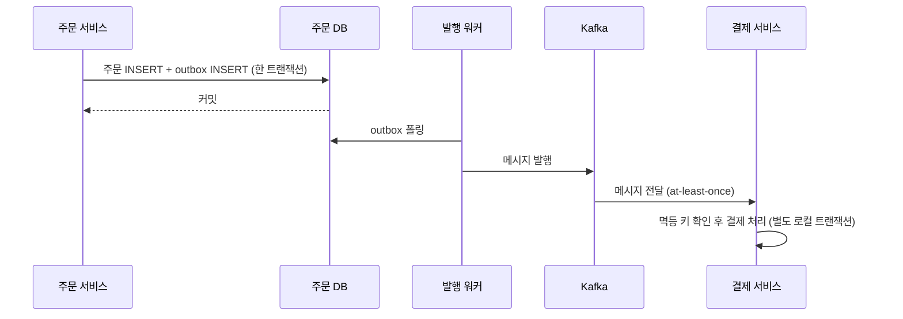
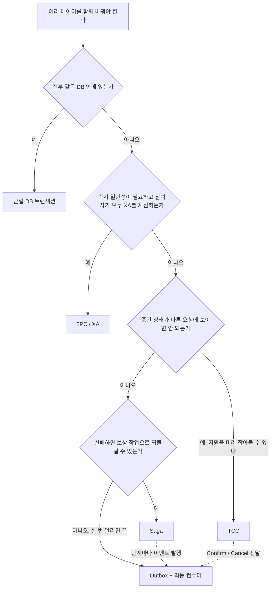
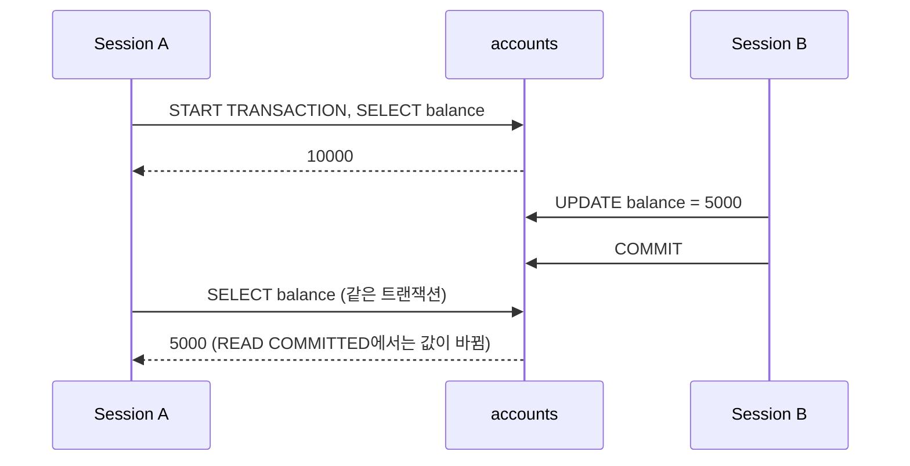

# 트랜잭션과 동시성

## 이 주제를 언제 찾게 되는가

- 결제/주문 처리에서 중복 실행 방지, 재고 음수 방지를 구현해야 할 때
- Deadlock이 발생했는데 원인과 해결 방법을 찾을 때
- MSA 환경에서 여러 서비스에 걸친 작업의 원자성을 보장해야 할 때 (2PC, TCC, Saga, Outbox 중 선택)
- `SELECT FOR UPDATE` vs 낙관적 락 중 어느 쪽을 써야 하는지 판단해야 할 때
- Kotlin 코루틴이나 Spring @Transactional과 함께 트랜잭션을 쓸 때 예상치 못한 동작이 발생할 때

## 격리 수준 선택 기준

격리 수준은 "높을수록 좋다"는 접근이 틀렸다. SERIALIZABLE은 모든 이상 현상을 막지만 그만큼 락 경합과 처리량 저하가 따른다.

| 격리 수준 | Dirty Read | Non-Repeatable Read | Phantom Read | 실무 사용 빈도 |
|---|---|---|---|---|
| READ UNCOMMITTED | 발생 | 발생 | 발생 | 거의 없음 |
| READ COMMITTED | 방지 | 발생 | 발생 | 높음 (PostgreSQL 기본값) |
| REPEATABLE READ | 방지 | 방지 | 발생* | 높음 (MySQL InnoDB 기본값) |
| SERIALIZABLE | 방지 | 방지 | 방지 | 낮음 (성능 비용 큼) |

\*InnoDB의 REPEATABLE READ는 MVCC로 Phantom Read 대부분을 방지한다. `SELECT FOR UPDATE`처럼 락을 거는 쿼리에서는 Phantom Read가 발생할 수 있다.

### 언제 어떤 격리 수준을 선택하는가

**READ COMMITTED** — 일반 웹 서비스의 기본값으로 적합하다. 트랜잭션 안에서 같은 행을 두 번 읽어도 값이 달라질 수 있는데, 이걸 허용해야 성능이 나온다. 단순 조회나 사용자 프로필 수정 등 대부분의 작업에서 충분하다.

이 수준을 피해야 할 때: 재고 차감처럼 "읽고 → 계산하고 → 쓰는" 과정 안에서 다른 트랜잭션이 끼어들면 안 되는 경우다. 이때는 `SELECT FOR UPDATE`로 락을 명시적으로 걸거나 격리 수준을 REPEATABLE READ로 올려야 한다.

**REPEATABLE READ** — MySQL InnoDB 기본값이다. 트랜잭션 시작 시점의 스냅샷을 읽으므로 Non-Repeatable Read가 발생하지 않는다. 금융, 재고 처리처럼 트랜잭션 안에서 일관된 데이터를 보장해야 할 때 적합하다.

주의점: MVCC 스냅샷은 일반 SELECT에만 적용된다. `SELECT FOR UPDATE`는 현재 커밋된 행을 읽기 때문에, REPEATABLE READ 안에서도 두 번의 `SELECT FOR UPDATE` 결과가 다를 수 있다.

```sql
-- REPEATABLE READ에서 일반 SELECT와 SELECT FOR UPDATE의 동작 차이
-- Session A
START TRANSACTION;
SELECT COUNT(*) FROM orders WHERE status = 'PENDING'; -- 결과: 5

-- Session B (별도 연결)
INSERT INTO orders(status) VALUES ('PENDING');
COMMIT;

-- Session A (계속)
SELECT COUNT(*) FROM orders WHERE status = 'PENDING';           -- 결과: 5 (MVCC 스냅샷)
SELECT COUNT(*) FROM orders WHERE status = 'PENDING' FOR UPDATE; -- 결과: 6 (현재 커밋된 데이터)
```

**SERIALIZABLE** — 트랜잭션이 직렬로 실행된 것처럼 보장한다. 금융 거래의 이중 출금 방지처럼 완전한 격리가 필요한 경우 외에는 사용하지 않는다. 처리량이 크게 줄고 데드락 발생 빈도가 올라간다.

PostgreSQL에서 SERIALIZABLE을 쓰면 SSI(Serializable Snapshot Isolation) 알고리즘이 동작하는데, 충돌 탐지 후 `ERROR: could not serialize access due to concurrent update`를 던진다. 이 예외를 반드시 재시도 로직으로 처리해야 한다.

## SELECT FOR UPDATE vs 낙관적 락 판단 기준

| 상황 | 권장 방식 | 이유 |
|---|---|---|
| 충돌 확률이 높다 (재고, 잔액 차감) | SELECT FOR UPDATE | 충돌 시 재시도 비용이 낙관적 락보다 낮음 |
| 충돌 확률이 낮다 (사용자 프로필 수정) | 낙관적 락 | 락 없이 진행하고 충돌 시에만 재시도 |
| 여러 테이블을 동시에 잠가야 한다 | SELECT FOR UPDATE | 낙관적 락은 복수 엔티티 충돌 감지가 복잡함 |
| 트랜잭션 중 외부 API 호출이 있다 | 낙관적 락 | 락을 오래 잡으면 다른 트랜잭션 전체가 블로킹됨 |

### SELECT FOR UPDATE (비관적 락)

```java
public interface AccountRepository extends JpaRepository<Account, Long> {
    @Lock(LockModeType.PESSIMISTIC_WRITE)
    @Query("SELECT a FROM Account a WHERE a.id = :id")
    Optional<Account> findByIdForUpdate(@Param("id") Long id);
}

@Transactional
public void withdraw(Long accountId, Long amount) {
    Account account = accountRepository.findByIdForUpdate(accountId)
        .orElseThrow(() -> new EntityNotFoundException("계좌 없음"));

    if (account.getBalance() < amount) {
        throw new IllegalStateException("잔액 부족");
    }
    account.setBalance(account.getBalance() - amount);
}
```

`FOR UPDATE`를 쓰면 해당 행에 X Lock이 걸리기 때문에 락 대기가 길어지면 `innodb_lock_wait_timeout`(기본 50초)이 지나면서 `Lock wait timeout exceeded` 오류가 발생한다. 트랜잭션 범위를 최소화해야 한다.

### 낙관적 락

```java
@Entity
public class Account {
    @Id
    private Long id;
    private Long balance;

    @Version
    private Long version;
}

@Transactional
@Retryable(
    retryFor = OptimisticLockingFailureException.class,
    maxAttempts = 3,
    backoff = @Backoff(delay = 100)
)
public void updateProfile(Long userId, String newName) {
    User user = userRepository.findById(userId).orElseThrow();
    user.setName(newName);
    // UPDATE users SET name=?, version=version+1 WHERE id=? AND version=?
    // version 불일치면 0 rows updated → OptimisticLockException 발생
}
```

낙관적 락은 `@Version` 필드의 값이 SELECT 시점과 UPDATE 시점에 달라지면 예외를 던진다. 재고처럼 동시 요청이 많은 경우 재시도가 계속 실패할 수 있어서 비관적 락이 더 적합하다.

## 로컬 트랜잭션 vs 분산 트랜잭션

로컬 트랜잭션은 단일 DB 커넥션 안에서 커밋/롤백이 결정된다. 분산 트랜잭션은 두 개 이상의 독립적인 리소스(다른 DB, 메시지 브로커 등)에 걸쳐 원자성을 보장해야 하는 경우다.

### 로컬 트랜잭션이 적합한 경우

단일 서비스 안에서 여러 테이블을 함께 업데이트하거나, 같은 DB 안에서 복잡한 비즈니스 로직을 처리할 때 적합하다. 롤백이 즉각적이고 완전하다.

```java
@Transactional
public void processOrder(Long orderId) {
    // 같은 DB, 같은 트랜잭션 안에서 두 테이블을 모두 업데이트
    Order order = orderRepository.findById(orderId).orElseThrow();
    order.setStatus(OrderStatus.CONFIRMED);

    Inventory inventory = inventoryRepository.findByProductId(order.getProductId())
        .orElseThrow();
    inventory.decrease(order.getQuantity()); // 예외 발생 시 order 변경도 함께 롤백
}
```

### 분산 트랜잭션이 필요한 경우

MSA에서 주문 서비스와 결제 서비스가 별도 DB를 쓴다면, 주문 INSERT와 결제 UPDATE를 하나의 트랜잭션으로 묶는 게 불가능하다. 2PC(2 Phase Commit)를 쓰면 원자성을 보장할 수 있지만 실무에서 거의 쓰지 않는다.

2PC를 피하는 이유는 세 가지다. 코디네이터 장애 시 참여자가 락을 무한히 잡는다. 네트워크 파티션 발생 시 일관성보다 가용성이 희생된다. MySQL XA 트랜잭션 구현은 성능 오버헤드가 크고 롤백이 부분적으로 실패할 수 있다.

대신 대부분의 MSA는 최종 일관성(Eventual Consistency)으로 설계한다. 주문 INSERT는 로컬 트랜잭션으로 처리하고, 결제 요청은 트랜잭셔널 아웃박스 패턴이나 Saga로 처리한다.

아웃박스 방식에서 원자성이 걸리는 지점은 주문 INSERT와 outbox INSERT 사이뿐이다. 둘은 같은 DB의 한 트랜잭션이라 같이 커밋되거나 같이 롤백된다. Kafka 발행은 커밋 뒤에 별도 워커가 맡는다.



워커가 발행에 성공하고 outbox 행을 처리 완료로 바꾸기 전에 죽으면 같은 메시지가 두 번 나간다. 그래서 컨슈머 쪽 멱등 처리가 짝으로 붙는다. "원자적으로 처리됐다"는 보장 대신 "결국에는 처리된다"는 설계로 바뀌고, 실패하면 재시도하고, 재시도를 안전하게 만드는 것이 멱등성이다.

### 2PC가 실제로 쓰이는 곳

XA 트랜잭션은 동일 네트워크 안에서 두 RDBMS를 함께 업데이트해야 하는 레거시 시스템이나 금융 배치 시스템에서 여전히 쓰인다. 단일 장애점인 코디네이터 문제는 보통 "in-doubt 트랜잭션 모니터링"으로 운용한다.

### 어떤 방식을 고를 것인가

위에서부터 질문에 답하면 된다. 앞쪽 질문에서 걸리면 뒤쪽 방식은 볼 필요가 없다. 뒤로 갈수록 DB가 해 주던 일을 애플리케이션이 떠맡는다.



점선은 선택지가 아니라 조합이다. Saga 단계 사이의 이벤트와 TCC의 Confirm/Cancel 메시지도 결국 "DB에 쓰고 메시지를 낸다"는 문제를 다시 만나서, 실제로는 Saga나 TCC 아래에 Outbox가 깔리는 경우가 많다.

| 방식 | 격리 | 장애 시 | 비용 |
|---|---|---|---|
| 단일 DB 트랜잭션 | DB가 보장 | 롤백 | 없음 |
| 2PC / XA | 커밋 전까지 락 유지 | 코디네이터 장애 시 in-doubt | 락 보유 시간, 참여자 제약 |
| TCC | Try에서 예약한 만큼만 | Cancel 호출, 빈 롤백·유령 Try 방어 필요 | 참여자마다 API 3개 |
| Saga | 중간 상태가 노출됨 | 보상 트랜잭션 | 보상 로직, 상태 추적 |
| Outbox + 멱등 컨슈머 | 없음, 최종 일관성 | 재발행 | outbox 테이블, 워커, 중복 처리 |

각 방식을 깊이 보려면 아래 문서로 간다. 어느 상황에서 펴야 하는지를 한 줄씩 적었다.

| 문서 | 이럴 때 읽는다 |
|---|---|
| [DB 분산 트랜잭션](../DataBase/RDBMS/Distributed_Transaction.md) | 2PC, TCC, Saga, Outbox를 한 문서에서 비교하고 싶을 때. 처음 보는 사람은 여기서 시작한다 |
| `XA_Two_Phase_Commit.md` (작성 예정) | `XA START`/`XA PREPARE` 이후 in-doubt 트랜잭션이 남아 락이 안 풀릴 때. 현재는 위 문서의 2PC 절을 본다 |
| `Seata_AT_TCC_Mode.md` (작성 예정) | Java 서비스에서 Seata의 AT 모드와 TCC 모드 중 무엇을 쓸지 정해야 할 때. 현재는 위 문서의 TCC 절을 본다 |
| [Saga 패턴 및 분산 트랜잭션](../Architecture/MSA/Saga_패턴_및_분산_트랜잭션.md) | 주문-결제-재고처럼 단계가 여러 개이고 실패 시 보상 순서를 설계해야 할 때 |
| [트랜잭셔널 아웃박스 패턴](../Architecture/MSA/트랜잭셔널_아웃박스_패턴.md) | DB는 커밋됐는데 메시지가 안 나갔거나, 반대로 메시지만 나가 데이터가 어긋난 장애를 겪었을 때 |
| [Kafka Exactly-Once Semantics](../Backend/Messaging/Kafka_Exactly_Once_Semantics.md) | 컨슈머가 중복 메시지를 받아 이중 처리가 생겼고, Kafka 설정으로 어디까지 막히는지 알아야 할 때 |
| [API 멱등성](../Backend/API/API_Idempotency.md) | 위 어느 방식을 쓰든 재시도가 들어오는 API에 멱등 키를 붙여야 할 때 |

Kafka의 exactly-once는 Kafka 안에서 읽고 쓰는 범위에 한정된다. Kafka에서 읽어 DB에 쓰는 구간은 범위 밖이라서, Outbox를 쓰는 서비스도 결국 컨슈머 쪽 멱등 처리를 직접 해야 한다.

## 언어별 동시성 접근법

동일한 "트랜잭션 안에서 비동기 처리" 문제가 Java, Kotlin 코루틴, Node.js에서 각각 다르게 나타난다.

### Java — 스레드 기반

Java는 요청마다 스레드가 할당되고, @Transactional은 ThreadLocal에 트랜잭션 컨텍스트를 저장한다. 같은 스레드라면 트랜잭션이 전파되고, 다른 스레드라면 전파되지 않는다.

```java
@Transactional
public void processOrder(Order order) {
    orderRepository.save(order);

    // 이 코드는 트랜잭션 밖에서 실행된다
    // 새 스레드는 ThreadLocal을 공유하지 않는다
    CompletableFuture.runAsync(() -> {
        inventoryService.decrease(order.getProductId()); // 별도 트랜잭션 또는 트랜잭션 없음
    });

    // orderRepository.save가 롤백돼도 inventoryService.decrease는 롤백되지 않는다
}
```

`@Async` 메서드에서 부모 트랜잭션에 참여하려면 처음부터 같은 스레드에서 처리하도록 설계해야 한다. `TransactionSynchronizationManager`로 현재 트랜잭션 상태를 확인하는 방법도 있지만, 그보다 트랜잭션 경계를 명확히 나누는 게 낫다.

### Kotlin 코루틴 — 중단 함수와 스레드 전환

코루틴은 중단(suspend)과 재개(resume)가 다른 스레드에서 일어날 수 있다. @Transactional의 ThreadLocal 기반 전파는 스레드가 전환되면 끊긴다.

```kotlin
@Transactional
suspend fun processOrder(order: Order) {
    orderRepository.save(order)

    // withContext로 Dispatcher 전환 시 트랜잭션 컨텍스트가 끊길 수 있다
    withContext(Dispatchers.IO) {
        // 이 블록은 다른 스레드에서 실행될 수 있다
        // TransactionSynchronizationManager가 이 스레드의 ThreadLocal을 모른다
        inventoryService.decrease(order.productId) // 트랜잭션 없이 실행될 수 있다
    }
}
```

해결 방법은 두 가지다. 하나는 코루틴을 @Transactional 비suspend 메서드 안으로 가두지 않고, 동기 트랜잭션 서비스를 `Dispatchers.IO` 컨텍스트에서 호출하는 것이다.

```kotlin
// 올바른 구조: @Transactional은 suspend가 아닌 동기 메서드에 붙인다
@Transactional
fun processOrderSync(order: Order) {
    orderRepository.save(order)
    inventoryService.decrease(order.productId) // 같은 스레드, 같은 트랜잭션
}

// 코루틴 진입점에서 IO 스레드 풀로 옮겨 동기 메서드를 호출한다
suspend fun processOrderAsync(order: Order) {
    withContext(Dispatchers.IO) {
        processOrderSync(order)
    }
}
```

다른 하나는 R2DBC 같은 리액티브 드라이버로 전환해 코루틴과 동일한 비동기 모델을 쓰는 것이다.

### Node.js — 이벤트 루프와 커넥션 유지

Node.js는 단일 스레드 이벤트 루프 기반이다. 트랜잭션을 유지하려면 같은 DB 커넥션을 콜백 체인 전체에서 물고 있어야 한다.

```javascript
// 잘못된 패턴 — 각 쿼리가 풀에서 다른 커넥션을 가져온다
async function processOrder(orderId, productId) {
    await db.query('UPDATE orders SET status = ? WHERE id = ?', ['CONFIRMED', orderId]);
    // 위 쿼리와 아래 쿼리는 다른 커넥션에서 실행될 수 있다
    await db.query('UPDATE inventory SET quantity = quantity - 1 WHERE product_id = ?', [productId]);
}

// 올바른 패턴 — 같은 커넥션을 명시적으로 유지한다
async function processOrder(orderId, productId) {
    const conn = await pool.getConnection();
    try {
        await conn.beginTransaction();
        await conn.query('UPDATE orders SET status = ? WHERE id = ?', ['CONFIRMED', orderId]);
        await conn.query('UPDATE inventory SET quantity = quantity - 1 WHERE product_id = ?', [productId]);
        await conn.commit();
    } catch (err) {
        await conn.rollback();
        throw err;
    } finally {
        conn.release();
    }
}
```

TypeORM에서는 `dataSource.transaction()`이 같은 EntityManager를 콜백에 넘겨줘서 커넥션을 자동으로 유지한다.

```typescript
await dataSource.transaction(async (manager) => {
    await manager.update(Order, orderId, { status: 'CONFIRMED' });
    await manager.decrement(Inventory, { productId }, 'quantity', 1);
    // manager가 같은 커넥션을 공유하므로 원자적으로 처리된다
});
```

## 이상 현상 재현

Session A의 두 번째 SELECT가 Session B의 커밋 뒤에 실행되는 순서가 핵심이다.



```sql
-- Non-Repeatable Read 재현 (READ COMMITTED 환경)
-- Session A
START TRANSACTION;
SELECT balance FROM accounts WHERE id = 1;  -- 결과: 10000

-- Session B (별도 연결)
UPDATE accounts SET balance = 5000 WHERE id = 1;
COMMIT;

-- Session A (계속)
SELECT balance FROM accounts WHERE id = 1;  -- 결과: 5000 (같은 트랜잭션인데 값이 바뀜)
COMMIT;
```

## 문서 지도

| 문서 | 이 문서가 답하는 것 | 깊이 |
|---|---|---|
| [트랜잭션과 Lock](../DataBase/RDBMS/Transaction_and_Lock.md) | ACID, 격리 수준, Lock 종류, MVCC, Deadlock, Savepoint, @Transactional 전반 | 입문 |
| [Deadlock](../OS/Process%20&%20Thread/Deadlock.md) | OS 레벨 Deadlock 이론 — 필요조건, 예방·회피·탐지·복구 전략 | 입문 |
| [MySQL InnoDB Locking Deep Dive](../DataBase/RDBMS/My_SQL_Inno_DB_Locking_Deep_Dive.md) | InnoDB Record Lock / Gap Lock / Next-Key Lock 동작 원리와 실측 | 심화 |
| [Optimistic Lock Retry Pattern](../Framework/Java/Spring/Optimistic_Lock_Retry_Pattern.md) | 낙관적 락 충돌 시 재시도 구현 — Spring @Retryable 패턴 | 실무 |
| [JPA @Lock 어노테이션 종류 비교](../Framework/Java/Spring/JPA_Lock_Annotations.md) | PESSIMISTIC/OPTIMISTIC 계열 5가지 락 모드, 실제 SQL, 데드락 위험도, @Version 조합 | 실무 |
| [AOP 트랜잭션](../Framework/Java/Spring/AOP_트랜잭션.md) | @Transactional 내부 동작, 프록시 한계, 자기 호출 문제 | 실무 |
| [Kotlin Coroutines Transaction](../Language/Kotlin/Kotlin_Coroutines_Transaction.md) | 코루틴과 @Transactional 조합 시 스레드 전환 문제 및 해결 | 실무 |
| [Saga 패턴 및 분산 트랜잭션](../Architecture/MSA/Saga_패턴_및_분산_트랜잭션.md) | 분산 환경에서 Saga(Choreography/Orchestration)로 원자성 보장 | 심화 |
| [트랜잭셔널 아웃박스 패턴](../Architecture/MSA/트랜잭셔널_아웃박스_패턴.md) | DB 쓰기와 메시지 발행의 원자성을 보장하는 아웃박스 패턴 | 심화 |
| [메시지 큐 및 분산 락](../Architecture/MSA/메시지_큐_및_분산_락.md) | Redis/DB 기반 분산 락, 메시지 큐와의 결합 패턴 | 실무 |
| [DB 분산 트랜잭션](../DataBase/RDBMS/Distributed_Transaction.md) | 2PC, XA 트랜잭션 동작 원리와 실제 적용 한계 | 심화 |
| [Kafka Exactly-Once Semantics](../Backend/Messaging/Kafka_Exactly_Once_Semantics.md) | 멱등 프로듀서, 트랜잭션 API, read_committed와 Kafka→DB 쓰기가 범위 밖인 이유 | 심화 |
| [API 멱등성](../Backend/API/API_Idempotency.md) | 재시도 시 중복 실행 방지 — 멱등 키 설계와 구현 | 실무 |
| [정합성 검증 시점](../Backend/API/Consistency_Validation_Timing.md) | 검증을 어느 레이어에서 언제 할지 결정 기준 | 실무 |
| [분산 트랜잭션 전략 (Node)](../Framework/Node/데이터베이스/분산_트랜잭션_전략.md) | Node.js 환경에서의 분산 트랜잭션 구현 전략 | 실무 |
| [Redisson 분산 락 심화](../DataBase/NoSQL/Redis/Redisson_Distributed_Lock.md) | RLock/RReadWriteLock/RSemaphore 비교, Redlock 논쟁, 워치독 동작, Redis 장애 폴백 | 심화 |
| [PostgreSQL Advisory Lock](../DataBase/RDBMS/Postgre_SQL_Advisory_Lock.md) | pg_try_advisory_lock vs pg_advisory_lock, 세션/트랜잭션 레벨 차이, 64bit 키 설계, Spring JdbcTemplate 패턴, MySQL GET_LOCK과의 차이 | 실무 |

## 읽는 순서

1. **트랜잭션과 Lock** — ACID·격리 수준·락 종류를 한 번에 정리할 수 있다
2. **Deadlock** — OS 이론으로 Deadlock 발생 조건과 시스템 수준 해결책을 이해한다
3. **MySQL InnoDB Locking Deep Dive** — 실제 InnoDB에서 어떤 Lock이 걸리는지 EXPLAIN으로 확인하는 방법을 익힌다
4. **AOP 트랜잭션** — @Transactional이 실제로 어떻게 동작하는지, 왜 자기 호출이 문제가 되는지 이해한다
5. **Optimistic Lock Retry Pattern** — 낙관적 락이 적합한 상황과 Spring에서의 구체적 구현을 적용한다
6. **DB 분산 트랜잭션** — 2PC, TCC, Saga, Outbox가 각각 무엇을 포기하는지 한 문서에서 비교한다
7. **트랜잭셔널 아웃박스 패턴** — 서비스 내에서 DB 쓰기와 메시지 발행을 원자적으로 처리하는 방법을 이해한다
8. **Saga 패턴 및 분산 트랜잭션** — 서비스 분리 이후 단계별 보상 흐름을 설계한다
9. **Kafka Exactly-Once Semantics** — 메시지를 Kafka로 옮길 때 중복이 어디까지 막히는지 확인한다
