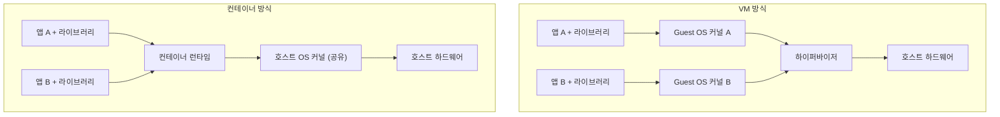
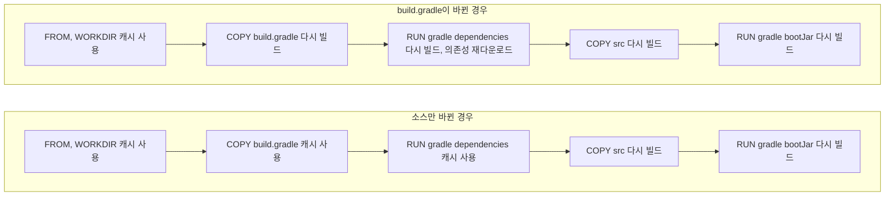
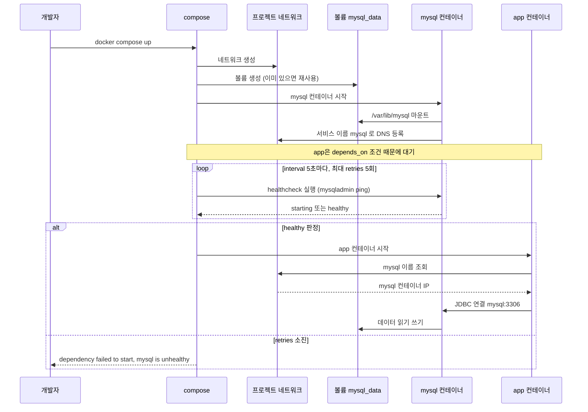
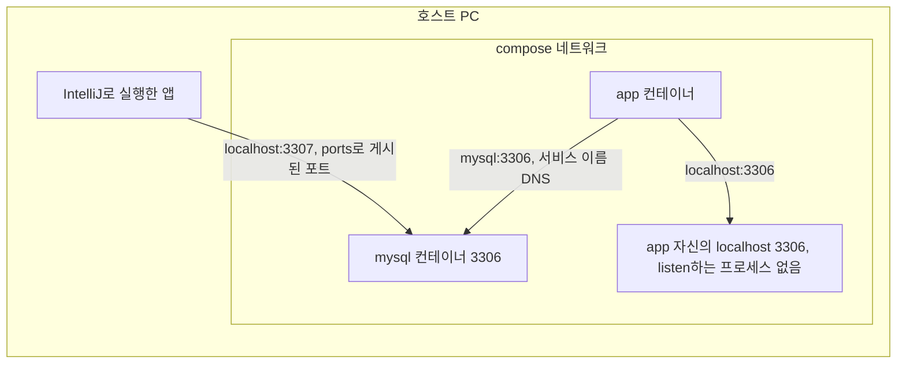

# 백엔드 신입 Docker 입문

20선 로드맵에서 ECS/Fargate로 바로 넘어가는데, 실제로 그 문서를 처음 읽으면 "Task Definition이 뭔지는 알겠는데 이미지는 어떻게 만들죠?"에서 막힌다. Docker 없이 ECS를 이해하려는 건 Jar 없이 EC2 배포를 이해하려는 것과 같다. 이 문서는 ECS 문서를 읽기 전에 반드시 쌓아야 하는 Docker 기초를 다룬다.

---

## 학습 순서

Docker를 처음 접할 때 어디서 시작할지 막막한 경우가 많다. 큰 틀에서 다섯 단계로 나뉜다.

**1단계 — 기초 개념과 CLI**

컨테이너가 뭔지, VM과 뭐가 다른지 파악하는 단계다. `docker run`, `docker ps`, `docker stop`, `docker images` 정도를 손에 익혀야 다음 단계로 넘어갈 수 있다. 세부 내용은 [Docker 기초](../DevOps/Kubernetes/Docker/Docker_Basic.md)에 있다.

**2단계 — Dockerfile 작성**

직접 이미지를 빌드하는 단계다. `FROM`, `COPY`, `RUN`, `ENTRYPOINT`, `CMD`의 차이를 이해하고, 레이어 캐시를 어떻게 쓰는지 익힌다. Multi-stage build까지 쓸 수 있으면 이 단계는 끝이다. [Dockerfile](../DevOps/Kubernetes/Docker/Dockerfile.md)에 세부 내용이 있고, BuildKit 관련 고급 기능은 [Docker BuildKit](../DevOps/Kubernetes/Docker/Docker_Build_Kit.md)을 본다.

**3단계 — Docker Compose**

로컬 개발 환경에서 앱 + DB + 캐시를 한 번에 올리는 단계다. 서비스 간 네트워크 통신, healthcheck, volume 마운트가 핵심이다. [Docker Compose](../DevOps/Kubernetes/Docker/Docker_Compose.md)와 [Docker 네트워크](../DevOps/Kubernetes/Docker/Docker_Network.md)를 같이 본다.

**4단계 — 이미지 레지스트리**

빌드한 이미지를 어디에 저장하고 어떻게 배포하는지 배우는 단계다. Docker Hub 기초부터 ECR 푸시 순서로 익힌다. 태그 컨벤션, `latest` 함정, digest 고정까지는 [Docker 이미지 레지스트리](../DevOps/Kubernetes/Docker/Docker_Image_Registry.md)를 본다.

**5단계 — 운영 주의사항**

환경변수 관리, 컨테이너 로그, 이미지 정리, 시크릿 주입 방법이 여기에 속한다. 실수하기 쉬운 ENV/ARG 혼동, `.env` 파일 동작 방식, 민감값이 레이어에 박히는 문제는 [컨테이너 환경변수 관리](../DevOps/Kubernetes/Docker/Docker_Env_Config.md)에서 다룬다.

이 문서는 위 다섯 단계를 얕게 훑는다. 각 단계의 세부 내용은 링크를 따라가면 된다.

---

## 컨테이너가 VM과 다른 이유

VM은 OS를 통째로 올린다. 하이퍼바이저 위에 Guest OS가 올라가고 그 위에 앱이 돈다. 컨테이너는 호스트 OS의 커널을 공유하고, 프로세스 격리(namespace)와 자원 제한(cgroups)으로 환경을 분리한다.

두 스택을 나란히 놓으면 차이는 커널이 몇 개 도는지로 정리된다. 왼쪽은 앱마다 Guest OS(커널 포함)가 하나씩 붙고, 오른쪽은 커널이 호스트에 하나뿐이다.



커널을 공유하기 때문에 생기는 제약도 있다. Linux 컨테이너는 Linux 커널 위에서만 돈다. Mac이나 Windows의 Docker Desktop은 내부에 작은 Linux VM을 하나 띄우고 그 안에서 컨테이너를 돌린다. Mac에서 `docker run`이 Linux 서버보다 느리고, 바인드 마운트 I/O가 유난히 느린 이유가 이 VM 경계다. 로컬 성능 수치를 서버 성능으로 그대로 가져오면 틀린다.

실무적으로 이 차이가 중요한 이유는 두 가지다.

첫째, 컨테이너는 올리는 데 1~2초면 충분하다. 내 Spring Boot 앱 이미지가 500MB더라도 `docker run` 후 앱 프로세스가 시작되기까지 JVM 기동 시간이 전부다. VM 스핀업 30초와 비교하면 ECS Fargate에서 오토스케일링이 의미 있는 수준으로 작동한다.

둘째, "내 로컬에서는 됐는데"라는 말이 사라진다. 컨테이너 이미지 안에 라이브러리 버전, 환경 변수, 파일 시스템 구조까지 전부 담겨있어서 로컬에서 빌드한 이미지가 프로덕션에서 동일하게 돈다.

---

## Dockerfile 작성

Dockerfile은 이미지를 만드는 명령어 목록이다. 각 명령어가 레이어 하나를 만들고, 레이어는 캐시된다.

### Spring Boot 앱 기본 Dockerfile

```dockerfile
FROM eclipse-temurin:17-jre-alpine

WORKDIR /app

COPY build/libs/app.jar app.jar

EXPOSE 8080

ENTRYPOINT ["java", "-jar", "app.jar"]
```

`eclipse-temurin:17-jre-alpine`을 쓰는 이유는 JRE만 있는 Alpine 베이스라 이미지 크기가 200MB 이하다. `openjdk:17`은 JDK 전체가 들어있어 400MB를 넘는다. 프로덕션에서 JDK가 필요한 경우는 거의 없으니 JRE 이미지로 시작하는 게 맞다.

### 레이어 캐시 문제

위 Dockerfile의 문제는 `app.jar` 하나가 변경되면 그 레이어 이후가 전부 무효화된다는 거다. Spring Boot 앱에서 의존성은 자주 안 바뀌지만 소스는 매번 바뀐다. 의존성과 소스를 레이어로 분리하면 의존성 레이어가 캐시에서 재사용된다.

```dockerfile
FROM eclipse-temurin:17-jre-alpine

WORKDIR /app

# 의존성 레이어 먼저
ARG DEPENDENCY=build/dependency
COPY ${DEPENDENCY}/BOOT-INF/lib /app/BOOT-INF/lib
COPY ${DEPENDENCY}/META-INF /app/META-INF
COPY ${DEPENDENCY}/BOOT-INF/classes /app/BOOT-INF/classes

EXPOSE 8080

ENTRYPOINT ["java", "org.springframework.boot.loader.JarLauncher"]
```

이 방식은 `bootJar` 태스크 실행 전에 `build/dependency`에 레이어를 언패킹해야 한다.

```bash
mkdir -p build/dependency
cd build/dependency && jar -xf ../libs/app.jar
```

더 간단하게는 Spring Boot 2.3 이상이면 `bootBuildImage` 태스크가 Buildpacks로 레이어를 자동 분리한 이미지를 만들어준다. 다만 Buildpacks 이미지는 크기가 크고 빌드가 느려서 CI 시간이 아깝다면 직접 분리하는 게 낫다.

실무에서 레이어 캐시 효과는 빌드 시간 기준으로 봤을 때 의존성 레이어가 캐시될 경우 2~3분 → 30초 수준으로 줄었다. CI 빌드 비용이 있는 환경에서 차이가 크다.

### 무엇이 바뀌면 어디서부터 다시 빌드되나

Docker는 Dockerfile 위에서 아래로 명령을 하나씩 보면서 캐시를 확인한다. 한 레이어가 무효화되면 그 아래 레이어는 내용이 같아도 전부 다시 만든다. 위쪽에 자주 안 바뀌는 것(`build.gradle`)을, 아래쪽에 자주 바뀌는 것(`src`)을 두는 이유가 이것이다.

Gradle 프로젝트를 컨테이너 안에서 직접 빌드하는 경우를 기준으로 하면 이런 순서가 된다.

```dockerfile
FROM gradle:8-jdk17-alpine AS build
WORKDIR /workspace

COPY build.gradle settings.gradle ./
RUN gradle dependencies --no-daemon > /dev/null

COPY src src
RUN gradle bootJar --no-daemon
```

같은 Dockerfile이라도 무엇이 바뀌었느냐에 따라 다시 빌드되는 범위가 갈린다. 위쪽 흐름은 `src`만 고친 경우, 아래쪽 흐름은 `build.gradle`에 의존성을 추가한 경우다.



소스만 바뀐 경우 의존성 다운로드(`gradle dependencies`)가 캐시에서 나오고, `build.gradle`이 바뀌면 그 지점부터 아래가 전부 새로 돈다. 두 번째 경우에 `src`는 한 글자도 안 바뀌었는데도 `COPY src`가 다시 실행된다는 점이 핵심이다. 캐시 판단은 "내 입력이 바뀌었나"와 "위 레이어가 바뀌었나" 두 조건을 모두 본다.

이 구조에서 자주 틀리는 것들이다.

- 이 문서 아래쪽 "이미지 크기가 예상보다 크다"의 multi-stage 예제는 `COPY . .`을 먼저 한다. 소스 한 줄만 바뀌어도 이 레이어가 무효화되고, 뒤의 `gradle bootJar`가 의존성부터 다시 받는다. 크기를 줄이는 예제이지 캐시를 살리는 예제가 아니다.
- `gradle dependencies`는 루트 프로젝트의 의존성 설정만 해석한다. 테스트 의존성이나 컴파일러 도구는 `bootJar` 단계에서 일부 다시 받는 경우가 있다. 완전히 막고 싶으면 BuildKit의 `RUN --mount=type=cache`로 Gradle 캐시 디렉토리를 레이어 밖에 두는 방법이 있고, 이 경우 `build.gradle`이 바뀌어도 이미 받은 jar는 재사용된다. 설정은 [Docker BuildKit](../DevOps/Kubernetes/Docker/Docker_Build_Kit.md)에 있다.
- 멀티 모듈 프로젝트는 `settings.gradle`과 모듈별 `build.gradle`을 전부 먼저 COPY해야 한다. 하나라도 빠지면 `gradle dependencies`가 실패하거나 의존성 레이어가 헐거워진다.
- CI 러너는 매번 깨끗한 환경이라 로컬 캐시가 없다. 로컬에서 30초 걸리던 빌드가 CI에서 3분 걸리는 건 캐시를 따로 저장하지 않아서다. `--cache-from`이나 CI의 레이어 캐시 기능을 켜야 한다.

### 빌드 컨텍스트 크기

`docker build .`을 실행하면 현재 디렉토리 전체를 Docker 데몬에 전송한다. Gradle 프로젝트 루트에서 실행하면 `build/` 폴더 전체가 딸려간다. `build/` 안에 generated sources, test results, intermediate jars가 있으면 컨텍스트가 1GB를 넘는 경우도 있다.

`.dockerignore` 파일로 제외한다.

```
.gradle
build
.git
*.md
out
.idea
```

`.dockerignore`가 없으면 첫 `docker build`가 유독 느린 이유가 여기 있다.

---

## docker-compose로 로컬 DB 띄우기

팀에서 MySQL이나 PostgreSQL을 로컬에 직접 설치하면 버전 충돌, 데이터 오염, OS마다 설정 경로가 달라지는 문제가 생긴다. docker-compose로 DB를 띄우면 `docker-compose down -v`로 완전 초기화가 가능하고, 프로젝트마다 격리된 DB를 유지할 수 있다.

```yaml
# docker-compose.yml
services:
  mysql:
    image: mysql:8.0
    environment:
      MYSQL_ROOT_PASSWORD: root
      MYSQL_DATABASE: myapp
      MYSQL_USER: myapp
      MYSQL_PASSWORD: myapp
    ports:
      - "3306:3306"
    volumes:
      - mysql_data:/var/lib/mysql

  redis:
    image: redis:7-alpine
    ports:
      - "6379:6379"

volumes:
  mysql_data:
```

```bash
docker-compose up -d         # 백그라운드로 실행
docker-compose logs -f mysql # mysql 로그 확인
docker-compose down          # 컨테이너 종료 (데이터 유지)
docker-compose down -v       # 컨테이너 + 볼륨 전부 삭제
```

포트 매핑 `"3306:3306"` 앞의 숫자가 호스트 포트다. 로컬에 MySQL이 이미 설치되어 있으면 3306이 이미 점유되어 있어 실패한다. 그때는 호스트 포트만 바꾼다.

```yaml
ports:
  - "3307:3306"  # 호스트의 3307로 접근
```

Spring Boot `application.yml`에서는 `spring.datasource.url: jdbc:mysql://localhost:3307/myapp`으로 맞춰준다.

### Spring Boot 앱도 compose에 넣을 때 주의점

앱 컨테이너가 DB 컨테이너보다 먼저 뜨면 DB 연결에 실패하고 앱이 죽는다. `depends_on`은 컨테이너 시작 순서만 보장하고 DB가 실제로 준비됐는지는 보장하지 않는다.

```yaml
services:
  app:
    build: .
    depends_on:
      mysql:
        condition: service_healthy
    environment:
      SPRING_DATASOURCE_URL: jdbc:mysql://mysql:3306/myapp
      SPRING_DATASOURCE_USERNAME: myapp
      SPRING_DATASOURCE_PASSWORD: myapp

  mysql:
    image: mysql:8.0
    healthcheck:
      test: ["CMD", "mysqladmin", "ping", "-h", "127.0.0.1"]
      interval: 5s
      timeout: 3s
      retries: 5
      start_period: 30s
    environment:
      MYSQL_ROOT_PASSWORD: root
      MYSQL_DATABASE: myapp
      MYSQL_USER: myapp
      MYSQL_PASSWORD: myapp
```

`condition: service_healthy`가 핵심이다. healthcheck가 통과해야 app 컨테이너가 시작된다.

`docker compose up`을 실행하면 네트워크, 볼륨, 컨테이너가 생기는 순서와 app이 기다리는 지점은 이렇다. mysql이 healthy가 되는 지점에서 app 시작이 풀리고, 끝내 healthy가 안 되면 app은 아예 시작하지 않는다.



healthcheck에서 `start_period`를 빼면 처음 `up`을 할 때 자주 실패한다. 볼륨이 비어 있으면 MySQL이 데이터 디렉토리 초기화와 `MYSQL_DATABASE`, 사용자 생성을 하느라 25초(5초 × 5회)보다 오래 걸리는 경우가 있다. 그러면 `retries`가 소진되어 `dependency failed to start: container mysql is unhealthy`로 끝나고 app은 뜨지도 못한다. 두 번째 `up`부터는 볼륨에 데이터가 있어 통과하니, 처음에만 실패하는 형태라 원인을 놓치기 쉽다. `start_period` 동안의 실패는 `retries`에 세지 않으므로 초기화에 걸리는 시간만큼 넉넉히 준다.

`-h`를 `127.0.0.1`로 둔 이유도 있다. mysql 공식 이미지는 초기화 중에 네트워크를 끈 임시 서버를 먼저 띄운다. `-h localhost`는 Unix 소켓으로 붙기 때문에 이 임시 서버에도 `ping`이 성공하고, healthy가 뜬 직후 서버가 재시작되면서 app의 첫 연결이 끊기는 경우가 있다. `127.0.0.1`은 TCP로 붙으므로 임시 서버에서는 실패한다.

### localhost로 DB에 접속이 안 되는 이유

앱에서 DB 호스트는 `localhost`가 아니라 서비스 이름 `mysql`이다. compose 네트워크 안에서 서비스 이름이 DNS로 해석된다.

신입이 가장 많이 겪는 함정이 이 부분이다. IntelliJ에서 앱을 실행할 때는 `jdbc:mysql://localhost:3307/myapp`으로 잘 붙던 설정을 그대로 app 컨테이너에 넣으면 연결이 안 된다. 컨테이너마다 네트워크 네임스페이스가 따로 있어서, 컨테이너 안의 `localhost`는 호스트 PC가 아니라 그 컨테이너 자신이다. app 컨테이너의 3306에는 아무도 listen하지 않으니 연결이 거부된다.



세 화살표가 서로 다른 주소를 쓴다는 점을 본다. 호스트에서 접근할 때만 `ports`로 게시한 포트를 쓰고, 컨테이너끼리는 서비스 이름과 컨테이너 내부 포트를 쓴다.

| 앱이 실행되는 곳 | 접속 주소 | 이유 |
|---|---|---|
| 호스트 PC (IDE, `./gradlew bootRun`) | `localhost:3307` | `ports: "3307:3306"`의 호스트 쪽 포트 |
| 같은 compose의 app 컨테이너 | `mysql:3306` | 서비스 이름 DNS, 내부 포트 그대로 |
| 컨테이너에서 호스트 PC의 DB | `host.docker.internal:3306` | Docker Desktop 기본 제공, Linux는 `extra_hosts`로 `host.docker.internal:host-gateway` 추가 |

증상은 JDBC 쪽에서 `Communications link failure`나 `Connection refused`로 보인다. 앱 로그에서 이 에러가 나면 비밀번호를 의심하기 전에 호스트 이름부터 본다. 컨테이너 안에서 직접 확인하는 방법이 가장 빠르다.

```bash
docker compose exec app sh
getent hosts mysql        # 172.x.x.x  mysql  -> 이름이 풀리면 네트워크는 정상
wget -qO- -T1 localhost:3306   # Connection refused -> localhost는 자기 자신
```

설정은 환경변수로 분리해서 두 환경이 같은 코드로 돌게 한다. `application.yml`은 기본값을 로컬 IDE 기준으로 두고, compose에서는 환경변수로 덮어쓴다.

```yaml
# application.yml
spring:
  datasource:
    url: ${SPRING_DATASOURCE_URL:jdbc:mysql://localhost:3307/myapp}
```

app에서 mysql로 가는 경로에는 `ports`가 필요 없다. `ports`는 호스트 PC에서 접근할 때만 쓴다. 운영 서버나 공용 개발 서버에서 `"3306:3306"`을 그대로 두면 DB가 호스트의 모든 인터페이스에 노출되니, 외부에서 접근할 필요가 없으면 `ports`를 빼거나 `"127.0.0.1:3307:3306"`으로 로컬에만 연다.

---

## 이미지 레지스트리

### Docker Hub 기초

Docker Hub는 Docker 공식 퍼블릭 레지스트리다. `docker pull nginx`처럼 태그 없이 이미지 이름만 쓰면 Docker Hub에서 가져온다. 무료 플랜에서 퍼블릭 리포지토리는 제한이 없고, 프라이빗 리포지토리는 1개다.

```bash
# Docker Hub 로그인
docker login
# Username: myaccount
# Password:

# 이미지 빌드 시 계정명/이미지명 형태로 태그
docker build -t myaccount/api-server:1.0.0 .

# push
docker push myaccount/api-server:1.0.0

# 다른 머신에서 pull (퍼블릭이면 로그인 불필요)
docker pull myaccount/api-server:1.0.0
```

이미 빌드된 이미지에 이름을 추가하려면 `docker tag`를 쓴다.

```bash
docker tag api-server:local myaccount/api-server:1.0.0
docker push myaccount/api-server:1.0.0
```

`docker tag`는 이미지를 복사하지 않는다. 동일한 이미지 레이어에 이름표만 하나 더 붙이는 동작이라 디스크 공간은 늘지 않는다.

`latest` 태그는 편해 보이지만 push마다 덮어써지기 때문에 배포 manifest에는 쓰지 않는다. 이전 버전으로 롤백할 방법이 사라진다. CI/CD에서는 커밋 해시나 버전을 태그로 쓴다.

```bash
# GitHub Actions에서 커밋 해시 태그
SHORT_SHA="${GITHUB_SHA::8}"
docker tag api-server:local myaccount/api-server:main-${SHORT_SHA}
docker push myaccount/api-server:main-${SHORT_SHA}
```

이미지 이름 구조와 태그 컨벤션, digest 고정, 프라이빗 레지스트리 인증 흐름은 [Docker 이미지 레지스트리](../DevOps/Kubernetes/Docker/Docker_Image_Registry.md)에서 자세히 다룬다.

### ECR 푸시

ECS에서 이미지를 가져오려면 이미지가 레지스트리에 올라가 있어야 한다. AWS 환경에서는 ECR(Elastic Container Registry)을 쓴다.

```bash
# 빌드
docker build -t myapp:latest .

# ECR 로그인 (AWS CLI 설정 필요)
aws ecr get-login-password --region ap-northeast-2 | \
  docker login --username AWS --password-stdin \
  123456789012.dkr.ecr.ap-northeast-2.amazonaws.com

# 태그
docker tag myapp:latest \
  123456789012.dkr.ecr.ap-northeast-2.amazonaws.com/myapp:latest

# 푸시
docker push 123456789012.dkr.ecr.ap-northeast-2.amazonaws.com/myapp:latest
```

Docker Hub와 달리 ECR은 리포지토리를 미리 만들어야 push가 된다. 없는 리포지토리에 push하면 에러가 난다.

```bash
aws ecr create-repository \
  --repository-name myapp \
  --region ap-northeast-2
```

CI/CD에서는 이 과정이 파이프라인으로 자동화된다. 직접 푸시하는 건 처음 흐름을 익힐 때 한 번이면 충분하다.

---

## 환경변수 관리

### ENV와 ARG 혼동

Dockerfile에서 환경변수를 다루는 키워드가 두 개 있다. `ENV`는 이미지에 구워진다. `ARG`는 빌드 시점에만 존재하고 이미지 환경변수 목록에 남지 않는다.

```dockerfile
ARG BUILD_ENV=production
ENV APP_ENV=$BUILD_ENV  # ARG 값을 ENV로 받으면 이미지에 박힌다
```

`docker image inspect myimage --format '{{range .Config.Env}}{{println .}}{{end}}'`를 실행하면 이미지에 ENV로 박힌 값이 전부 나온다. 이미지를 누군가에게 배포하면 그 값도 같이 나간다. 이미지에는 변수 이름만 두고 실제 값은 컨테이너 실행 시 주입하는 게 맞다.

```bash
# 실행 시 환경변수 주입
docker run -e DB_PASSWORD=secret myapp

# 또는 파일로
docker run --env-file .env.prod myapp
```

### Docker Compose의 .env 파일 함정

Docker Compose에서 `.env` 파일은 컨테이너 내부 환경변수가 아니라 `docker-compose.yml` 자체의 변수 보간에 쓰인다. `${DB_HOST}`를 치환하는 용도다.

```yaml
services:
  app:
    image: myapp
    environment:
      - DB_HOST=${DB_HOST}   # .env의 DB_HOST를 읽어서 컨테이너 환경변수로 전달
    # env_file: .env.app     # 파일 전체를 컨테이너에 넘길 때는 이 방법
```

`.env` 파일의 내용이 자동으로 컨테이너 내부로 전달되지는 않는다. 컨테이너에 파일 전체를 넘기려면 `env_file:` 키를 써야 한다. 이걸 혼동하면 "분명히 환경변수 설정했는데 컨테이너에서 왜 없지?" 상황이 생긴다.

### 민감값이 이미지 레이어에 박히는 문제

빌드 중에 API 키나 비밀번호가 필요한 경우가 있다. private npm registry 인증, Maven 리포지토리 자격증명 같은 것들이다. `ARG`로 받아서 `RUN`에서 쓰면 레이어에 흔적이 남는다.

```dockerfile
ARG NPM_TOKEN
RUN echo "//registry.npmjs.org/:_authToken=${NPM_TOKEN}" > ~/.npmrc && \
    npm install && \
    rm ~/.npmrc   # 삭제해도 이전 레이어에 이미 기록됨
```

`rm ~/.npmrc`로 지워도 Docker 레이어는 명령 단위로 스냅샷을 찍기 때문에, 이전 레이어에 `.npmrc` 파일이 그대로 남아있다.

```bash
# 이전 레이어를 직접 꺼내서 확인할 수 있다
docker save myimage | tar x -O '*/layer.tar' | tar t 2>/dev/null | grep npmrc
```

Multi-stage build를 쓰면 최종 이미지가 빌드 스테이지의 레이어 히스토리를 포함하지 않아 이 문제를 해결할 수 있다. Docker BuildKit을 쓰면 `--mount=type=secret`으로 더 깔끔하게 처리한다. 자세한 내용은 [컨테이너 환경변수 관리](../DevOps/Kubernetes/Docker/Docker_Env_Config.md)를 본다.

---

## 흔히 겪는 문제

### 포트 매핑이 됐는데 접근이 안 된다

`EXPOSE 8080`은 문서 역할이다. 실제 포트 바인딩은 `docker run -p 8080:8080`으로 한다. `EXPOSE`만 쓰고 `-p`를 빠뜨리면 컨테이너 외부에서 접근이 안 된다.

### 파일 권한 문제

Alpine 기반 이미지에서 non-root 유저로 실행하면 `/app/app.jar`에 실행 권한이 없어 `Permission denied`가 난다.

```dockerfile
RUN addgroup -S appgroup && adduser -S appuser -G appgroup
COPY --chown=appuser:appgroup build/libs/app.jar app.jar
USER appuser
```

프로덕션에서는 root로 돌리지 않는 게 기본이다. ECS Task Definition에도 `user` 필드로 지정할 수 있다.

### 컨테이너 안에서 로그가 안 보인다

`docker logs <container_id>`로 보이는 로그는 stdout/stderr다. Spring Boot는 기본으로 콘솔에 출력하니 바로 보인다. 로그를 파일로만 쓰도록 설정했다면 `docker logs`에서 아무것도 안 나온다. 컨테이너 환경에서는 로그를 파일에 쓰지 말고 stdout으로 내보내야 CloudWatch Logs 같은 외부 수집기가 가져간다.

### 이미지 크기가 예상보다 크다

`docker image ls`로 이미지 크기를 확인하고, `docker image history myapp:latest`로 레이어별 크기를 본다. 빌드 과정에서 생긴 임시 파일이 남아있는 레이어가 크기를 키우는 경우가 있다. Multi-stage build로 빌드 의존성을 최종 이미지에서 제거하면 줄어든다.

```dockerfile
# 빌드 스테이지
FROM gradle:8-jdk17-alpine AS build
WORKDIR /workspace
COPY . .
RUN gradle bootJar --no-daemon

# 실행 스테이지
FROM eclipse-temurin:17-jre-alpine
WORKDIR /app
COPY --from=build /workspace/build/libs/app.jar app.jar
EXPOSE 8080
ENTRYPOINT ["java", "-jar", "app.jar"]
```

`--from=build`로 빌드 스테이지의 결과물만 가져오고 Gradle, JDK, 소스 코드는 최종 이미지에 없다. 이미지 크기가 빌드용 이미지의 절반 이하로 줄어든다.

---

## ECS로 넘어가기 전

로컬에서 `docker build -t myapp .`이 성공하고 이미지가 생겨야 한다. `docker run -p 8080:8080 myapp`으로 앱이 뜨고 `curl localhost:8080/actuator/health`가 응답해야 한다. `docker-compose up`으로 MySQL과 앱이 같이 뜨고 앱이 DB에 연결되어야 한다. ECR에 이미지를 푸시하고 ECR 콘솔에서 이미지가 보여야 한다.

이 네 가지가 로컬에서 모두 동작하면 ECS 문서로 넘어갈 준비가 된 거다.

ECS에서 Task Definition을 만들 때 이미지 URI, 포트 매핑, 환경 변수 설정이 나온다. 로컬에서 `docker run`으로 했던 것과 구조가 같다. 그걸 AWS 콘솔에서 클릭으로 채우는 차이다.
