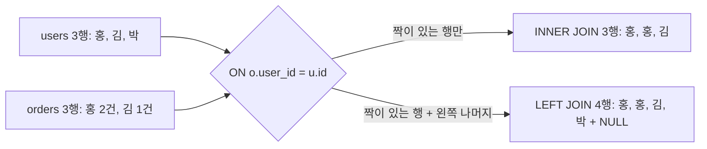
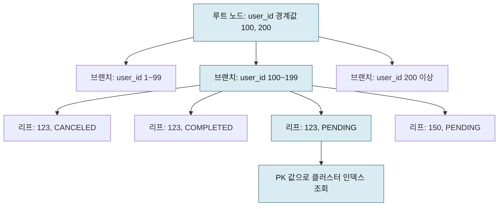
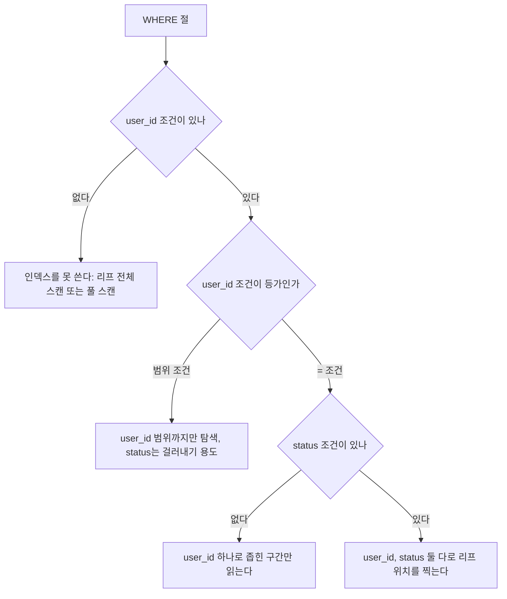
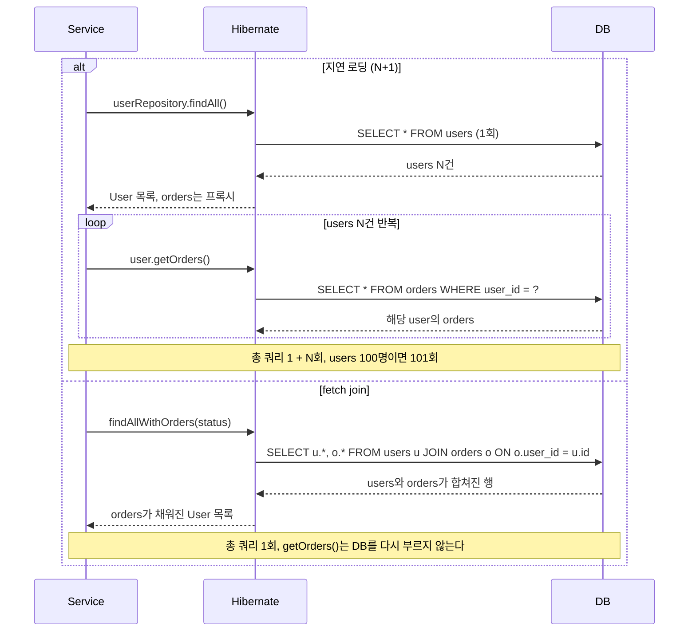
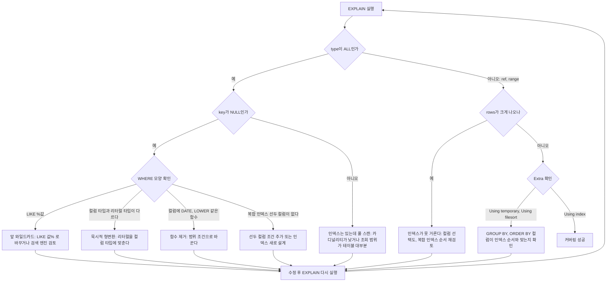

# 백엔드 신입 SQL 기초

20선 로드맵 3단계(RDS, Aurora DB, 인덱스 가능성)를 읽기 전에 봐야 하는 문서다. 쿼리는 어디선가 배워서 SELECT는 짤 줄 아는데 EXPLAIN 출력을 본 적이 없거나, 인덱스가 왜 안 타는지 모르겠는 상태라면 여기가 출발점이다.

실무에서 신입이 가장 자주 내는 쿼리 관련 문제는 세 가지다. LIKE 앞 와일드카드, 묵시적 형변환, N+1 쿼리. 이 세 가지 전부 "쿼리는 돌아가는데 프로덕션 트래픽 올라가면서 느려지는" 유형이다. 로컬이나 스테이징에서 데이터가 적을 땐 0.01초도 안 걸리다가 프로덕션에서 데이터 100만 건 넘어가면서 5초씩 걸리기 시작한다.

---

## SELECT/JOIN/GROUP BY 기본 패턴

SQL 자체는 간단하지만 실무 코드에서 자주 보이는 패턴이 몇 가지 있다. 처음 코드 리뷰에서 지적받지 않으려면 이 정도는 알고 들어가야 한다.

### SELECT *를 쓰면 안 되는 이유

`SELECT *`는 테이블 컬럼이 20개면 20개를 전부 네트워크로 전송한다. 실제 앱에서 필요한 건 5~6개인 경우가 대부분이다.

더 큰 문제는 인덱스 커버링이 안 된다는 거다. MySQL InnoDB에서 인덱스는 검색 조건에 걸린 컬럼 데이터를 인덱스 자체에서 바로 반환할 수 있다. `SELECT *`를 쓰면 인덱스를 탔더라도 실제 행을 가져오러 클러스터 인덱스까지 다시 들어가야 한다. 이걸 "인덱스 커버링 실패" 혹은 Extra 컬럼에서 `Using index`가 안 뜨는 상황이라고 한다.

```sql
-- users 테이블에 (status, created_at) 복합 인덱스가 있다고 가정
-- Extra: Using index (커버링 성공)
SELECT status, created_at FROM users WHERE status = 'ACTIVE';

-- Extra: NULL (커버링 실패, 클러스터 인덱스 재조회 발생)
SELECT * FROM users WHERE status = 'ACTIVE';
```

### JOIN 순서와 드리빙 테이블

MySQL 옵티마이저가 JOIN 순서를 알아서 결정하지만, 왜 그 순서를 선택했는지 이해하고 있어야 느린 쿼리를 볼 때 판단이 된다.

드리빙 테이블(먼저 스캔하는 쪽)이 작을수록 좋다. 드리빙 테이블의 행 하나마다 드리븐 테이블(다음에 조인되는 쪽)을 한 번씩 조회하기 때문이다.

```sql
-- orders: 1,000,000건 / users: 10,000건
-- users를 드리빙으로 쓰면 orders를 10,000번 조회
-- orders를 드리빙으로 쓰면 users를 1,000,000번 조회
-- 옵티마이저가 보통 users를 드리빙으로 잡는다

SELECT u.name, COUNT(o.id) AS order_count
FROM users u
JOIN orders o ON o.user_id = u.id
WHERE u.status = 'ACTIVE'
GROUP BY u.id;
```

EXPLAIN에서 첫 번째 줄이 드리빙 테이블이다. `rows` 컬럼을 보면 몇 건을 스캔했다고 추정하는지 알 수 있다.

### INNER JOIN과 LEFT JOIN은 결과 행이 다르다

신입 때 JOIN 종류를 문법으로만 외우면 집계 쿼리에서 숫자가 틀린다. 아래 데이터로 두 JOIN의 결과를 비교한다. users는 홍·김·박 3명이고, orders는 홍이 2건, 김이 1건, 박은 주문이 없다.



짝이 없는 박이 INNER에서는 사라지고 LEFT에서는 오른쪽 컬럼이 NULL인 채로 남는다는 점만 보면 된다.

| 구분 | INNER JOIN | LEFT JOIN |
|---|---|---|
| 짝 없는 왼쪽 행 | 버린다 | 오른쪽을 NULL로 채워 남긴다 |
| 결과 행 수 | 3 | 4 |
| `COUNT(*)` 결과 | 박이 아예 없다 | 박이 1로 나온다 |
| `COUNT(o.id)` 결과 | 박이 아예 없다 | 박이 0으로 나온다 |
| 주 용도 | 양쪽에 다 있는 것만 필요할 때 | "주문 0건인 회원도 포함해서" 세야 할 때 |

LEFT JOIN에서 실제로 자주 틀리는 것이 두 가지다.

첫째, `COUNT(*)`는 NULL로 채운 행도 한 줄로 센다. 주문 0건인 박이 1건으로 집계된다. 오른쪽 테이블 컬럼을 `COUNT(o.id)`처럼 지정해야 0이 나온다.

둘째, 오른쪽 테이블 조건을 WHERE에 쓰면 LEFT JOIN이 INNER JOIN으로 바뀐다.

```sql
-- 박이 사라진다. NULL 행은 o.status = 'COMPLETED'를 만족하지 못해 WHERE에서 걸러진다
SELECT u.name, o.id
FROM users u
LEFT JOIN orders o ON o.user_id = u.id
WHERE o.status = 'COMPLETED';

-- 박이 남는다. 조건을 ON으로 옮기면 JOIN 대상만 줄이고 왼쪽 행은 지키지 않는다
SELECT u.name, o.id
FROM users u
LEFT JOIN orders o ON o.user_id = u.id AND o.status = 'COMPLETED';
```

첫 쿼리 결과는 홍, 김 두 줄이고 둘째 쿼리 결과는 홍, 김, 박 세 줄이다. 코드 리뷰에서 "LEFT JOIN 썼는데 왜 주문 없는 회원이 안 나오죠"라는 질문의 원인은 대부분 이 WHERE다.

### GROUP BY 집계 실수

```sql
-- 이게 왜 느린지 모르는 경우가 많다
SELECT user_id, COUNT(*) 
FROM orders
WHERE status = 'COMPLETED'
  AND created_at >= '2024-01-01'
GROUP BY user_id;
```

`status`나 `created_at`에 인덱스가 있어도 GROUP BY user_id가 있으면 MySQL이 정렬/임시 테이블을 만든다. EXPLAIN의 Extra 컬럼에 `Using temporary; Using filesort`가 뜨면 이 상황이다. 결과 집합이 크지 않더라도 중간 처리 비용이 크다.

---

## EXPLAIN 출력 읽는 법

쿼리 앞에 `EXPLAIN`을 붙이면 옵티마이저가 어떻게 실행할지 계획을 보여준다. 처음엔 컬럼이 많아서 어디를 봐야 할지 모른다. 실무에서 가장 먼저 보는 컬럼 세 개만 집중한다.

```sql
EXPLAIN SELECT * FROM orders WHERE user_id = 123 AND status = 'PENDING';
```

| 컬럼 | 무엇을 보나 |
|---|---|
| `type` | 스캔 방식. `ALL`이면 풀 스캔, `ref`나 `range`면 인덱스 사용 |
| `key` | 실제로 선택된 인덱스 이름. NULL이면 인덱스 안 탔다는 뜻 |
| `rows` | 몇 건을 읽을 것으로 추정하는지. 실제 건수가 아니라 통계 기반 추정 |
| `Extra` | `Using index`(커버링), `Using temporary`(임시 테이블), `Using filesort`(정렬 필요) |

### type 값의 의미

`ALL` → `index` → `range` → `ref` → `eq_ref` → `const` 순서로 좋아진다.

- `ALL`: 테이블 전체를 처음부터 끝까지 읽는다. 건수가 많으면 느리다.
- `index`: 인덱스를 풀 스캔한다. ALL보다 낫지만 여전히 전체를 읽는다.
- `range`: 인덱스에서 범위 스캔. `BETWEEN`, `>`, `<`, `IN` 등이 여기 해당한다.
- `ref`: 인덱스의 특정 값으로 조회. 등가 조건(`=`)이 대부분 여기 해당한다.
- `const`: PK나 UNIQUE 인덱스에 등가 조건. 행이 정확히 하나다.

신입 때 처음 EXPLAIN을 보면 `type: ref`인데 느린 경우를 만난다. 이때 `rows`를 보면 100만이 넘는 경우가 있다. 인덱스를 탔지만 그 인덱스가 데이터를 많이 걸러내지 못하는 상황이다. 카디널리티가 낮은 컬럼(예: status가 'ACTIVE'/'INACTIVE' 두 가지뿐인데 90%가 'ACTIVE')에 인덱스를 걸어도 옵티마이저가 "그냥 풀스캔이 낫겠다"고 판단하거나, 탔다 하더라도 효과가 없다.

### EXPLAIN ANALYZE (MySQL 8.0+)

`EXPLAIN`은 추정치다. `EXPLAIN ANALYZE`는 실제로 쿼리를 실행해서 실측값을 보여준다.

```sql
EXPLAIN ANALYZE SELECT * FROM orders WHERE user_id = 123;

-- 출력 예시
-- -> Index lookup on orders using idx_user_id (user_id=123)
--    (cost=2.51 rows=8) (actual time=0.045..0.058 rows=7 loops=1)
```

`rows=8`(추정)과 `rows=7`(실측)이 비슷하면 옵티마이저 통계가 정확한 상태다. 추정과 실측이 크게 벌어진다면 통계가 오래됐거나 데이터 분포가 고르지 않다는 신호다.

---

## 인덱스가 안 타는 세 가지 패턴

신입이 가장 자주 내는 실수다. 전부 쿼리 자체는 문법적으로 맞고 결과도 올바른데, 인덱스를 못 타서 느리다.

### 1. LIKE 앞 와일드카드

```sql
-- name 컬럼에 인덱스가 있어도 이건 풀 스캔이다
SELECT * FROM users WHERE name LIKE '%김';

-- 이건 인덱스를 탄다
SELECT * FROM users WHERE name LIKE '김%';
```

B-Tree 인덱스는 문자열 앞쪽부터 정렬한다. `'김%'`는 인덱스에서 '김'으로 시작하는 범위를 찾을 수 있지만, `'%김'`은 끝이 '김'인 걸 찾으려면 전체를 다 봐야 한다.

중간 검색(`'%김%'`)도 마찬가지다. 이런 검색이 필요하면 Elasticsearch 같은 별도 검색 엔진을 쓰거나 MySQL의 Full-Text 인덱스를 써야 한다.

### 2. 묵시적 형변환

```sql
-- users.phone 컬럼이 VARCHAR인데 숫자로 조회하면
SELECT * FROM users WHERE phone = 01012345678;  -- 인덱스 안 탐

-- 문자열로 맞춰야 한다
SELECT * FROM users WHERE phone = '01012345678';  -- 인덱스 탐
```

MySQL은 타입이 다르면 암묵적으로 변환한다. `VARCHAR` 컬럼에 숫자를 넣으면 MySQL이 컬럼 전체를 숫자로 캐스팅해서 비교한다. 인덱스는 원래 타입으로 저장되어 있으니 변환된 값으로는 탐색 못 한다.

반대 방향도 문제다. 날짜 컬럼에 문자열로 조회하는 경우다.

```sql
-- created_at이 DATETIME인데
SELECT * FROM orders WHERE created_at = '2024-01-15';  -- 이건 보통 변환 처리됨

-- 하지만 함수를 컬럼에 씌우면 인덱스를 못 탄다
SELECT * FROM orders WHERE DATE(created_at) = '2024-01-15';  -- 풀 스캔

-- 범위 조건으로 바꿔야 한다
SELECT * FROM orders WHERE created_at >= '2024-01-15' AND created_at < '2024-01-16';
```

컬럼에 함수를 씌우면 옵티마이저가 인덱스를 포기한다. `DATE()`, `YEAR()`, `LOWER()`, `UPPER()` 전부 마찬가지다.

### 3. 복합 인덱스 컬럼 순서 무시

```sql
-- (user_id, status, created_at) 순서로 복합 인덱스가 걸려 있다면
CREATE INDEX idx_user_status_created ON orders (user_id, status, created_at);

-- 이건 인덱스를 탄다
SELECT * FROM orders WHERE user_id = 1 AND status = 'PENDING';

-- 이건 user_id까지만 인덱스를 탄다 (status를 건너뜀)
SELECT * FROM orders WHERE user_id = 1 AND created_at >= '2024-01-01';

-- 이건 인덱스를 전혀 못 탄다 (맨 앞 컬럼이 없음)
SELECT * FROM orders WHERE status = 'PENDING';
```

복합 인덱스는 왼쪽부터 순서대로 사용한다. 중간 컬럼을 건너뛰면 그 이후 컬럼은 인덱스를 못 탄다. 맨 앞 컬럼이 WHERE에 없으면 인덱스 자체를 못 탄다.

**복합 인덱스 컬럼 순서를 정하는 기준:**

1. 등가 조건(`=`)으로 쓰는 컬럼을 먼저 놓는다
2. 카디널리티가 높은 컬럼을 앞에 놓는다 (user_id가 status보다 카디널리티가 훨씬 높다)
3. 범위 조건(`>`, `<`, `BETWEEN`)으로 쓰는 컬럼은 마지막에 놓는다

`(user_id, status, created_at)` 순서가 좋은 이유는 user_id로 행을 많이 걸러내고, 그 안에서 status로 다시 좁히고, 마지막으로 created_at 범위로 자른다. 범위 조건이 중간에 오면 그 뒤 컬럼은 인덱스 탐색에 참여하지 못한다.

### B-Tree 안에서 어떻게 찾아가는가

"왼쪽부터 쓴다"는 규칙은 외우기보다 인덱스 안의 정렬 순서를 보면 이해된다. `(user_id, status)` 복합 인덱스는 user_id로 먼저 정렬하고, user_id가 같은 항목끼리 status로 다시 정렬해 둔 구조다.



`WHERE user_id = 123 AND status = 'PENDING'`은 루트에서 user_id 100~199 브랜치를 고르고, 그 안에서 `(123, PENDING)` 리프를 바로 찾는다. 색칠한 노드만 읽으므로 3~4번의 페이지 접근으로 끝난다.

선두 컬럼이 빠지면 이 경로를 쓸 수 없다. `WHERE status = 'PENDING'`만 있으면 PENDING 항목이 user_id 브랜치마다 흩어져 있어서 어느 브랜치로 내려갈지 정할 수 없다. 리프를 전부 훑어야 한다.



범위 조건이 선두에 오면 뒤 컬럼이 걸러내기로만 쓰이는 이유가 이것이다. user_id가 100~199 범위면 그 안의 status는 user_id마다 따로 정렬되어 있어서 연속된 구간이 아니다.

실무에서 이 규칙 때문에 인덱스를 새로 만드는 경우가 있다. `WHERE status = ?` 조회가 많은데 인덱스가 `(user_id, status)`뿐이라면, status를 앞에 둔 인덱스를 따로 만들거나 쿼리에 user_id 조건을 추가할 수 있는지 먼저 본다. MySQL 8.0.13부터는 선두 컬럼의 값 종류가 아주 적을 때 옵티마이저가 인덱스 스킵 스캔을 고르는 경우가 있지만, 선두 컬럼이 user_id처럼 값이 많으면 해당되지 않으므로 기대하지 않는다.

---

## N+1 쿼리 재현과 잡기

N+1은 신입이 처음 코드 리뷰에서 지적받는 단골 항목이다. 코드를 보면 이상해 보이지 않는데 쿼리 로그를 보면 같은 쿼리가 수십 번 반복되어 있다.

### N+1이 발생하는 상황

```java
// JPA 예시 - users 목록을 가져온 후 각각의 orders를 조회하면
List<User> users = userRepository.findAll();  // 쿼리 1번

for (User user : users) {
    List<Order> orders = user.getOrders();  // users 수만큼 쿼리 발생
    // users가 100명이면 여기서 100번의 SELECT가 나간다
}
```

쿼리 로그를 켜서 확인하는 게 가장 빠르다.

```properties
# application.properties (Spring Boot)
spring.jpa.show-sql=true
logging.level.org.hibernate.SQL=DEBUG
logging.level.org.hibernate.type.descriptor.sql.BasicBinder=TRACE
```

로그에 아래처럼 같은 패턴의 쿼리가 반복되면 N+1이다.

```
SELECT * FROM orders WHERE user_id = 1
SELECT * FROM orders WHERE user_id = 2
SELECT * FROM orders WHERE user_id = 3
...
```

지연 로딩일 때와 fetch join을 쓸 때의 쿼리 수를 한 도식에 놓고 비교한다. 위쪽 분기에서는 `findAll` 뒤에 `getOrders()`가 호출될 때마다 DB 왕복이 생기고, 아래쪽 분기에서는 처음 한 번으로 끝난다.



N이 커질수록 DB 왕복 횟수가 그대로 응답 시간에 더해진다. 쿼리 하나는 1ms여도 101번이면 왕복 지연만 100ms 단위가 된다. 로컬 DB는 왕복이 거의 0이라 안 보이다가, 앱과 DB가 다른 서브넷에 있는 운영 환경에서 처음 드러나는 경우가 많다.

### JPA에서 잡는 방법

```java
// JPQL fetch join으로 한 번에 가져온다
@Query("SELECT DISTINCT u FROM User u JOIN FETCH u.orders WHERE u.status = :status")
List<User> findAllWithOrders(@Param("status") String status);

// 또는 EntityGraph 어노테이션
@EntityGraph(attributePaths = {"orders"})
List<User> findByStatus(String status);
```

fetch join을 쓰면 쿼리 하나로 해결된다.

```sql
-- JOIN FETCH가 만드는 쿼리. 주문이 없는 회원은 결과에서 빠진다
SELECT DISTINCT u.*, o.* 
FROM users u 
JOIN orders o ON o.user_id = u.id 
WHERE u.status = 'ACTIVE';
```

`JOIN FETCH`는 INNER JOIN이다. 주문 0건인 회원까지 가져와야 하면 `LEFT JOIN FETCH u.orders`로 써야 한다. 위 JOIN 절에서 본 INNER와 LEFT의 차이가 여기서도 그대로 적용된다.

주의할 점이 있다. fetch join + pagination을 같이 쓰면 Hibernate가 경고를 낸다.

```
HHH90003004: firstResult/maxResults specified with collection fetch; applying in memory
```

메모리에서 페이징하는 경우인데, 이렇게 되면 전체 데이터를 다 가져온 뒤 메모리에서 자른다. 데이터가 많으면 OOM이 날 수 있다. 컬렉션 fetch join과 페이징은 같이 쓰지 않는 게 원칙이다.

### MyBatis에서 잡는 방법

MyBatis는 JPA처럼 자동으로 N+1이 발생하지 않는다. 대신 개발자가 직접 쿼리를 분리해 작성하다 보면 N+1 구조를 만드는 경우가 있다.

```java
// 서비스 레이어에서 직접 N+1을 만드는 경우
List<UserDto> users = userMapper.findAllUsers();
for (UserDto user : users) {
    List<OrderDto> orders = orderMapper.findByUserId(user.getId());  // N번 쿼리
    user.setOrders(orders);
}

// 대신 JOIN으로 한 번에 가져오거나
// IN절로 묶어서 처리한다
List<Long> userIds = users.stream().map(UserDto::getId).collect(Collectors.toList());
List<OrderDto> orders = orderMapper.findByUserIds(userIds);  // 쿼리 1번
```

```xml
<!-- MyBatis mapper -->
<select id="findByUserIds" resultType="OrderDto">
    SELECT * FROM orders 
    WHERE user_id IN 
    <foreach collection="list" item="id" open="(" separator="," close=")">
        #{id}
    </foreach>
</select>
```

IN절은 IDs 목록이 1,000개를 넘으면 MySQL이 느려지기 시작한다. 1,000개 단위로 끊어서 배치 처리하거나, 처음부터 JOIN 쿼리로 가져오는 게 낫다.

---

## 실수별 EXPLAIN 확인 흐름

위에서 다룬 실수들은 EXPLAIN 출력의 `type`, `key`, `rows`, `Extra` 네 컬럼으로 갈린다. 느린 쿼리를 받았을 때 보는 순서는 아래와 같다.



수정한 뒤에 같은 EXPLAIN을 다시 돌려서 `type`과 `key`가 바뀌었는지 확인하는 것까지가 한 사이클이다. 고쳤다고 생각하고 넘어갔는데 key가 여전히 NULL인 경우가 의외로 많다.

아래는 이 흐름을 직접 재현하는 순서다.

```sql
-- 테스트 환경 준비 (MySQL 8.0 기준)
CREATE TABLE users (
    id BIGINT PRIMARY KEY AUTO_INCREMENT,
    name VARCHAR(100),
    phone VARCHAR(20),
    status VARCHAR(20),
    created_at DATETIME DEFAULT NOW()
);

CREATE INDEX idx_name ON users (name);
CREATE INDEX idx_phone ON users (phone);
CREATE INDEX idx_status_created ON users (status, created_at);

-- 더미 데이터 10만 건 (프로시저 또는 generate_series 사용)
```

```sql
-- 1. LIKE 앞 와일드카드 확인
EXPLAIN SELECT * FROM users WHERE name LIKE '%김';
-- type: ALL, key: NULL → 풀 스캔 확인

EXPLAIN SELECT * FROM users WHERE name LIKE '김%';
-- type: range, key: idx_name → 인덱스 탐 확인

-- 2. 묵시적 형변환 확인
EXPLAIN SELECT * FROM users WHERE phone = 01012345678;
-- type: ALL → 형변환으로 인덱스 무력화

EXPLAIN SELECT * FROM users WHERE phone = '01012345678';
-- type: ref, key: idx_phone → 문자열로 맞추면 인덱스 탐

-- 3. 컬럼에 함수 씌우기 확인
EXPLAIN SELECT * FROM users WHERE DATE(created_at) = '2024-01-15';
-- type: ALL, Extra: Using where → 풀 스캔

EXPLAIN SELECT * FROM users WHERE created_at >= '2024-01-15' AND created_at < '2024-01-16';
-- type: range, key: idx_status_created → 하지만 status가 없으면 이것도 idx를 못 탈 수 있음
-- status까지 포함하면: WHERE status = 'ACTIVE' AND created_at >= '2024-01-15'
```

쿼리를 작성할 때마다 EXPLAIN을 확인하는 습관을 들이는 게 중요하다. 느려진 다음에 보는 게 아니라, 처음 쿼리를 짤 때 EXPLAIN을 먼저 본다. 로컬에서 데이터가 적어서 `type: ALL`이어도 빠른 경우가 있는데 프로덕션에서 그대로 터진다.

---

## 인덱스를 많이 걸면 생기는 문제

인덱스는 조회를 빠르게 하는 대신 쓰기를 느리게 한다. 한 테이블에 인덱스가 10개면 INSERT 하나가 인덱스 10개를 전부 업데이트해야 한다.

주문 데이터가 초당 1,000건씩 들어오는 서비스에서 orders 테이블에 인덱스를 7개 걸었다가 INSERT 속도가 문제된 경우가 있다. `EXPLAIN INSERT`는 없으니 직접 측정해야 한다.

```sql
-- 인덱스 없을 때와 있을 때 INSERT 속도 비교
DELIMITER $$
CREATE PROCEDURE insert_bench()
BEGIN
    DECLARE i INT DEFAULT 0;
    WHILE i < 10000 DO
        INSERT INTO orders (user_id, status, amount, created_at) 
        VALUES (FLOOR(RAND() * 10000), 'PENDING', FLOOR(RAND() * 100000), NOW());
        SET i = i + 1;
    END WHILE;
END$$
DELIMITER ;

-- 인덱스 추가 전 실행시간 기록
SET @start = NOW(6);
CALL insert_bench();
SELECT TIMESTAMPDIFF(MICROSECOND, @start, NOW(6)) / 1000000 AS seconds;

-- 인덱스 추가 후 같은 측정
```

실무에서 인덱스를 결정하는 기준은 단순하다. 조회 빈도가 높고 필터링 효과가 큰 컬럼에만 건다. WHERE 절에 자주 오는 컬럼, JOIN 조건에 오는 컬럼이 우선이다. 인덱스가 없어서 느린 쿼리를 slow query log로 잡아내고 그때 추가하는 방식이 낫다.

```ini
# MySQL slow query log 설정
slow_query_log = 1
slow_query_log_file = /var/log/mysql/slow.log
long_query_time = 1  # 1초 이상 걸리는 쿼리 기록
log_queries_not_using_indexes = 1  # 인덱스 안 타는 쿼리도 기록
```

---

## 이 문서에서 다루지 않는 것

페이지네이션에서 `OFFSET`이 커질수록 느려지는 문제와 트랜잭션 격리 수준은 입문 범위를 넘어서 여기서는 다루지 않는다. 트랜잭션이 어떤 단위로 묶이고 격리 수준에 따라 읽기 결과가 어떻게 달라지는지는 백엔드 신입 트랜잭션 입문 문서로 이어진다. 입문 문서가 나오기 전에 필요하면 [트랜잭션과 락](../DataBase/RDBMS/Transaction_and_Lock.md)을 먼저 본다.

---

## 3단계 문서를 읽기 전에

여기서 다룬 내용은 RDS, Aurora, 인덱스 가능성 문서를 읽을 때 계속 필요하다.

[인덱스 가능성](../DataBase/RDBMS/인덱스_가능성.md) 문서는 복합 인덱스 설계와 옵티마이저 동작 원리를 더 깊이 다룬다. 이 문서에서 EXPLAIN을 읽는 방법과 인덱스가 안 타는 패턴을 먼저 파악하고 가야 그 내용이 맥락으로 연결된다.

[RDS](../Cloud/AWS/Database/RDS.md)와 [Aurora DB](../Cloud/AWS/Database/Aurora_DB.md) 문서는 어떤 엔진을 선택하고 어떻게 구성할지를 다루는데, 그 판단의 근거가 결국 쿼리 패턴과 인덱스 전략이다. 복제본을 몇 개 두고 읽기를 어떻게 분산할지도 N+1 같은 쿼리 문제를 해결한 뒤에야 의미가 있다.
