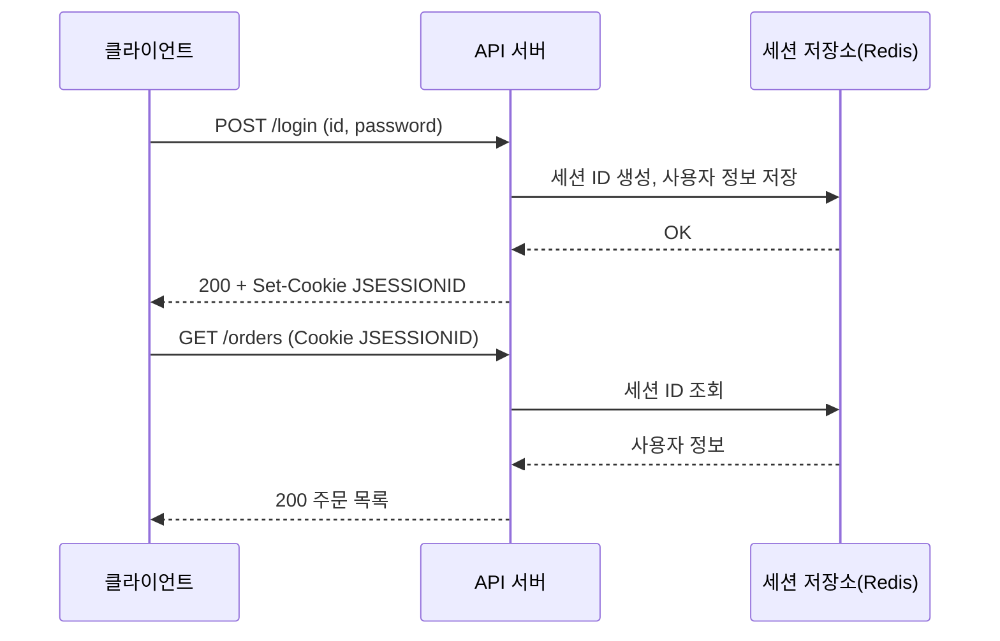
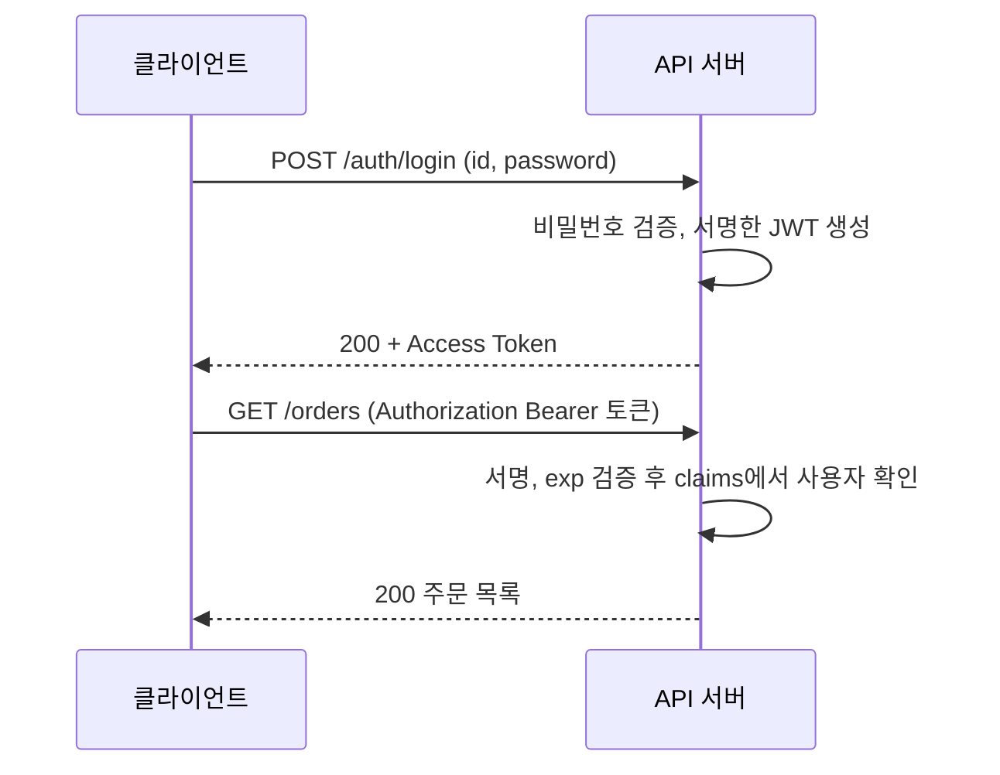
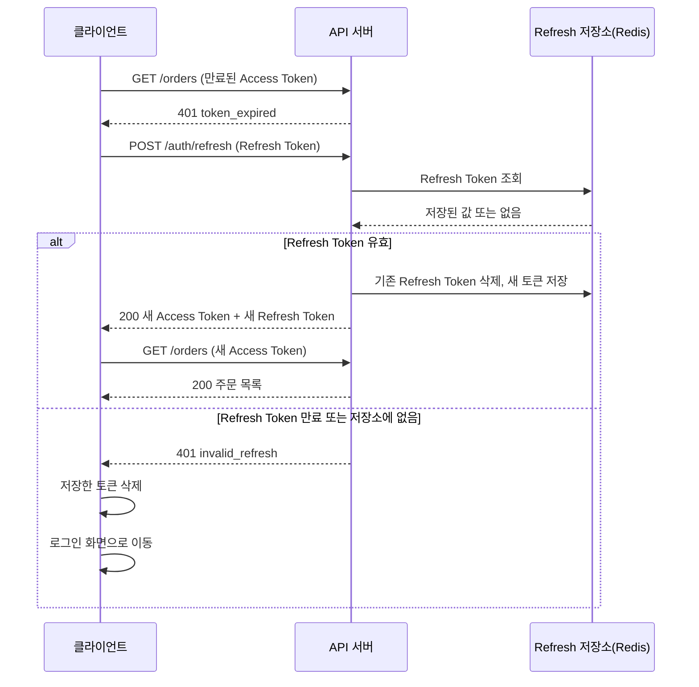
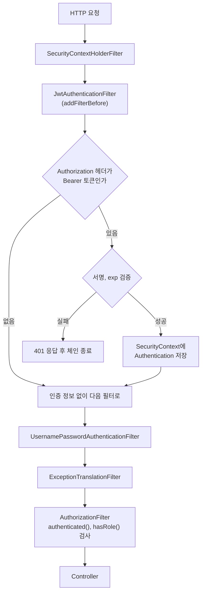
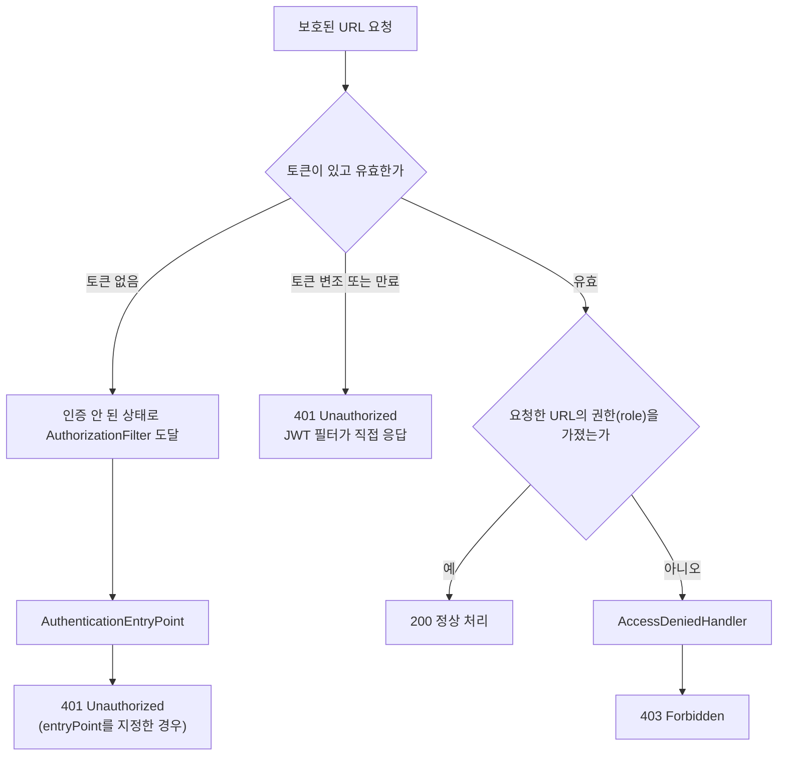

# 백엔드 신입 인증/인가 기초

첫 API 서버를 만들 때 반드시 부딪히는 게 인증이다. 로그인은 어떻게 처리하고, 이후 요청에서 "이 사람이 맞는지"를 어떻게 확인하느냐. Session이냐 JWT냐는 면접에서도 나오지만, JWT를 잘못 쓰면 실제로 보안 사고로 이어진다. 이 문서는 개념보다 "잘못 쓰면 어떻게 되는지"에 무게를 뒀다.

---

## Session과 JWT

세션 방식은 서버가 로그인 상태를 들고 있다. 사용자가 로그인하면 서버가 세션 ID를 생성해 메모리(또는 Redis)에 저장하고, 클라이언트는 쿠키로 그 ID만 받는다. 이후 요청마다 서버가 세션 ID를 보고 "이 ID가 내 저장소에 있나"를 확인한다.

JWT는 반대다. 서버가 상태를 저장하지 않는다. 로그인 시 토큰을 발급하고, 이후 요청은 클라이언트가 토큰을 가져오면 서버가 서명을 검증해 신뢰 여부를 판단한다.

먼저 세션 방식의 요청 흐름이다. 로그인 이후 모든 요청에서 서버가 세션 저장소를 한 번씩 조회한다는 점을 보면 된다.



JWT 방식은 로그인 이후 저장소 조회 단계가 없다. 서버는 받은 토큰의 서명과 `exp`만 계산해서 판단한다.



두 흐름의 차이는 `GET /orders` 구간에 있다. 세션은 요청마다 Redis 왕복이 한 번 생기고, 그 대신 저장소에서 지우면 바로 로그아웃이 된다. JWT는 왕복이 없는 대신 발급한 토큰을 서버가 회수할 방법이 없다.

세션이 유리한 상황이 있다. 관리자가 특정 사용자를 즉시 강제 로그아웃시켜야 하는 경우, 세션은 저장소에서 해당 세션 ID를 지우면 즉시 효과가 난다. JWT는 토큰 자체가 서명 유효기간 동안 살아있어서, 블랙리스트 같은 별도 장치 없이는 강제 무효화가 안 된다.

서버 인스턴스가 여러 개인 환경에서 세션을 공유하려면 Redis 같은 외부 저장소가 필요하다. JWT는 각 서버가 서명 검증만 할 수 있으면 되므로 스케일아웃이 단순하다.

---

## JWT 구조

JWT는 점(`.`)으로 구분된 세 부분이다.

```
eyJhbGciOiJIUzI1NiIsInR5cCI6IkpXVCJ9
.eyJzdWIiOiJ1c2VyMTIzIiwicm9sZSI6IlVTRVIiLCJpYXQiOjE3MjM2OTk2MDAsImV4cCI6MTcyMzcwMzIwMH0
.SflKxwRJSMeKKF2QT4fwpMeJf36POk6yJV_adQssw5c
```

- **Header**: 알고리즘(`alg`)과 토큰 타입(`typ`). Base64Url 인코딩.
- **Payload**: 클레임 집합. `sub`(사용자 식별자), `exp`(만료 시각 Unix timestamp), `iat`(발급 시각), 커스텀 필드.
- **Signature**: `HMACSHA256(base64UrlEncode(header) + "." + base64UrlEncode(payload), secret)`

Header와 Payload는 Base64 인코딩일 뿐, 암호화가 아니다. 누구나 디코딩해서 내용을 읽을 수 있다. 비밀번호, 주민등록번호 같은 민감 정보를 Payload에 넣으면 안 된다.

---

## 서명 검증 — 생략하면 생기는 일

서명 검증을 제대로 하지 않으면 공격자가 Payload를 임의로 조작해 다른 사용자 권한을 탈취할 수 있다.

실제로 있었던 취약점 패턴 중 하나가 `alg: none` 공격이다. 초기 JWT 라이브러리 일부가 `alg` 값에 `none`을 허용했다. 공격자가 Header의 `alg`를 `none`으로 바꾸고 Signature를 비워서 보내면, 검증 로직이 "서명 없음 = 검증 불필요"로 처리하는 버그였다.

```java
// 서명 검증 포함 — parseClaimsJws (s 끝)
Jwts.parserBuilder()
    .setSigningKey(Keys.hmacShaKeyFor(secret.getBytes(StandardCharsets.UTF_8)))
    .build()
    .parseClaimsJws(token)
    .getBody();
```

`parseClaimsJwt`(t 끝)는 서명 없는 JWT, `parseClaimsJws`(s 끝)는 서명 있는 JWT다. 메서드명 한 글자 차이인데, `parseClaimsJwt`로 서명 있는 토큰을 파싱하면 예외가 발생한다. 이걸 피하려고 try-catch로 삼키는 코드를 짜면 검증이 통째로 사라진다.

---

## secret은 어디에 두는가

JWT secret은 서비스 전체 토큰 신뢰를 결정하는 키다. 이게 노출되면 공격자가 임의의 토큰을 만들 수 있다.

소스코드에 하드코딩하거나 `application.yml`에 직접 적어서 git에 올리면 끝이다.

```yaml
# application.yml — 환경변수로 분리
jwt:
  secret: ${JWT_SECRET}
```

```bash
# 배포 환경에서 주입
export JWT_SECRET="랜덤하게_생성한_최소_32바이트_이상의_값"

# 생성 예시
openssl rand -hex 32
```

HS256 기준으로 256비트(32바이트) 이상을 써야 한다. secret이 짧으면 브루트포스로 뚫릴 수 있다.

---

## Refresh Token 패턴

Access Token 만료 시각을 짧게 가져가는 이유가 있다. 토큰이 탈취됐을 때 피해 시간을 줄이기 위해서다. 그런데 Access Token을 15분짜리로 만들면 사용자가 15분마다 다시 로그인해야 한다.

Refresh Token은 이 문제를 해결하기 위한 패턴이다. 로그인 시 두 가지 토큰을 발급한다.

- Access Token: 짧은 수명(15분~1시간). API 요청에 사용.
- Refresh Token: 긴 수명(7일~30일). Access Token 재발급에만 사용.

만료부터 재시도까지의 순서와, Refresh Token마저 만료됐을 때의 분기는 이렇게 흐른다. 마지막 `alt` 블록에서 재로그인으로 빠지는 경로를 클라이언트가 처리해야 한다.



클라이언트 구현에서 놓치기 쉬운 부분이 둘 있다. `/auth/refresh` 자체가 401을 받았을 때 다시 refresh를 호출하면 무한 루프가 된다. 그리고 화면 하나가 API를 동시에 5개 부르면 401도 5개가 오는데, 이때 refresh를 5번 호출하면 Rotation 때문에 두 번째 호출부터 이미 폐기된 Refresh Token을 쓰게 되어 전부 로그아웃된다. 재발급 요청은 하나만 보내고 나머지 요청은 그 결과를 기다리게 해야 한다.

Refresh Token은 서버 저장소(Redis 등)에 보관한다. 그래야 로그아웃 시 Refresh Token을 삭제해 무효화할 수 있다.

신입이 자주 빠지는 실수가 Refresh Token 재사용 허용이다. 하나의 Refresh Token을 계속 쓸 수 있으면, 탈취됐을 때 공격자가 무한정 Access Token을 발급받는다. Refresh Token Rotation으로 막는다. 재발급 시마다 Refresh Token도 교체하고, 구 Refresh Token은 즉시 무효화한다.

---

## Spring Security에 JWT 끼우기

Spring Security는 요청을 필터 체인으로 처리한다. JWT 인증은 `UsernamePasswordAuthenticationFilter` 앞에 커스텀 필터를 추가해서 구현한다.

아래 그림은 요청이 컨트롤러에 닿기까지 지나는 필터와 JWT 필터의 위치다. JWT 필터는 토큰이 잘못됐으면 체인 뒤쪽으로 넘기지 않고 그 자리에서 401을 쓴다는 점을 보면 된다. 필터 목록은 설정에 따라 달라지므로 핵심 필터만 그렸다.



필터 뒤쪽에서 나가는 상태 코드는 `ExceptionTranslationFilter`가 정한다. 인증 정보가 없는 상태에서 막히면 401 계열, 인증은 됐는데 권한이 모자라면 403이다. 필독 20선 6번 HTTP 항목에서 말한 "누구인지 모른다"와 "누구인지는 안다"의 분기가 코드로는 이 지점이다.



주의할 부분은 토큰이 아예 없는 요청이다. 위 필터 코드는 헤더가 없으면 그냥 다음 필터로 넘기는데, `AuthenticationEntryPoint`를 따로 등록하지 않으면 formLogin·httpBasic을 쓰지 않는 설정에서 기본 진입점이 403을 내려보내는 경우가 있다. 로그인 안 한 사용자에게 403이 나가면 클라이언트는 "권한 없음"으로 알고 refresh를 시도하지 않는다. 아래 Security 설정에 `exceptionHandling`을 넣은 이유다.

**의존성** (build.gradle):

```groovy
implementation 'io.jsonwebtoken:jjwt-api:0.11.5'
runtimeOnly 'io.jsonwebtoken:jjwt-impl:0.11.5'
runtimeOnly 'io.jsonwebtoken:jjwt-jackson:0.11.5'
```

**JWT 유틸리티**:

```java
@Component
public class JwtUtil {

    private final Key key;
    private final long accessTokenExpiry = 1000L * 60 * 60; // 1시간

    public JwtUtil(@Value("${jwt.secret}") String secret) {
        byte[] keyBytes = secret.getBytes(StandardCharsets.UTF_8);
        this.key = Keys.hmacShaKeyFor(keyBytes);
    }

    public String generateToken(String userId, String role) {
        return Jwts.builder()
                .setSubject(userId)
                .claim("role", role)
                .setIssuedAt(new Date())
                .setExpiration(new Date(System.currentTimeMillis() + accessTokenExpiry))
                .signWith(key, SignatureAlgorithm.HS256)
                .compact();
    }

    public Claims validateAndGetClaims(String token) {
        // 만료, 서명 불일치, 변조 시 JwtException 하위 예외 발생
        return Jwts.parserBuilder()
                .setSigningKey(key)
                .build()
                .parseClaimsJws(token)
                .getBody();
    }
}
```

**JWT 필터**:

```java
@Component
@RequiredArgsConstructor
public class JwtAuthenticationFilter extends OncePerRequestFilter {

    private final JwtUtil jwtUtil;

    @Override
    protected void doFilterInternal(HttpServletRequest request,
                                    HttpServletResponse response,
                                    FilterChain filterChain) throws ServletException, IOException {

        String header = request.getHeader("Authorization");

        if (header == null || !header.startsWith("Bearer ")) {
            filterChain.doFilter(request, response);
            return;
        }

        String token = header.substring(7);

        try {
            Claims claims = jwtUtil.validateAndGetClaims(token);
            String userId = claims.getSubject();
            String role = claims.get("role", String.class);

            UsernamePasswordAuthenticationToken authentication =
                new UsernamePasswordAuthenticationToken(
                    userId,
                    null,
                    List.of(new SimpleGrantedAuthority("ROLE_" + role))
                );

            SecurityContextHolder.getContext().setAuthentication(authentication);

        } catch (ExpiredJwtException e) {
            response.setStatus(HttpServletResponse.SC_UNAUTHORIZED);
            response.getWriter().write("{\"error\": \"token_expired\"}");
            return;
        } catch (JwtException e) {
            response.setStatus(HttpServletResponse.SC_UNAUTHORIZED);
            response.getWriter().write("{\"error\": \"invalid_token\"}");
            return;
        }

        filterChain.doFilter(request, response);
    }
}
```

**Security 설정**:

```java
@Configuration
@EnableWebSecurity
@RequiredArgsConstructor
public class SecurityConfig {

    private final JwtAuthenticationFilter jwtAuthFilter;

    @Bean
    public SecurityFilterChain filterChain(HttpSecurity http) throws Exception {
        http
            .csrf(AbstractHttpConfigurer::disable)
            .sessionManagement(session ->
                session.sessionCreationPolicy(SessionCreationPolicy.STATELESS))
            .exceptionHandling(ex -> ex
                .authenticationEntryPoint((req, res, e) ->
                    res.sendError(HttpServletResponse.SC_UNAUTHORIZED))
                .accessDeniedHandler((req, res, e) ->
                    res.sendError(HttpServletResponse.SC_FORBIDDEN)))
            .authorizeHttpRequests(auth -> auth
                .requestMatchers("/auth/**").permitAll()
                .anyRequest().authenticated()
            )
            .addFilterBefore(jwtAuthFilter, UsernamePasswordAuthenticationFilter.class);

        return http.build();
    }
}
```

`STATELESS`로 세션을 끊지 않으면 Spring Security가 세션 기반 인증을 병행 관리하는 이상한 상태가 된다. JWT 필터가 잘 동작해도 서버가 세션 쿠키를 내려보낸다.

---

## 실무에서 자주 터지는 사고들

### 만료 예외 핸들링 누락

`validateAndGetClaims` 호출부에서 예외 처리를 빠뜨리면, 만료된 토큰이 들어왔을 때 500 Internal Server Error가 난다. 클라이언트는 서버가 터진 줄 알고, 로그 보면 `ExpiredJwtException`이다. 필터에서 `JwtException` 계층 전체를 잡아야 한다.

### 클라이언트에서 만료 시각 계산 오차

JWT의 `exp`는 Unix timestamp로 초 단위다. 클라이언트가 JavaScript로 만료 여부를 사전에 체크하는 경우, `Date.now()`는 밀리초라 단위 변환을 빠뜨리면 계산이 1000배 어긋난다. 클라이언트 사전 체크와 무관하게 서버 검증이 필수다.

### 토큰을 localStorage에 저장

Access Token을 `localStorage`에 저장하면 XSS 공격으로 스크립트가 실행됐을 때 토큰을 탈취할 수 있다. `HttpOnly` 쿠키에 저장하면 JavaScript 접근이 차단된다. 단, 이 경우 CSRF 공격 방어는 별도로 처리해야 한다.

### Payload에 민감 정보 저장

실제로 봤던 코드다. 로그인 편의를 위해 Payload에 비밀번호나 개인정보를 담는 경우가 있다. Base64 디코딩으로 누구나 읽을 수 있다. Payload에는 사용자 ID, 권한 정보, 만료 시각만 담는다.

### 서버 재시작 시 시크릿 초기화

환경변수 대신 서버 기동 시 랜덤으로 시크릿을 생성하는 코드가 있었다. 서버가 재시작되면 기존에 발급한 토큰이 전부 무효화된다. 시크릿은 서버 생명주기와 무관하게 외부에서 주입해야 한다.

### `exp` 클레임 없는 토큰 발급

만료 시각을 지정하지 않으면 토큰이 영구적으로 유효하다. 탈취 시 무한 사용 가능하다. 토큰 발급 시 반드시 `setExpiration`을 지정한다.
