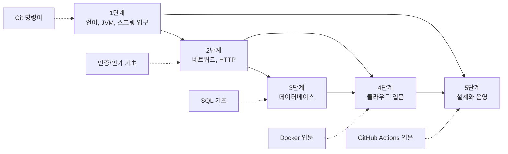
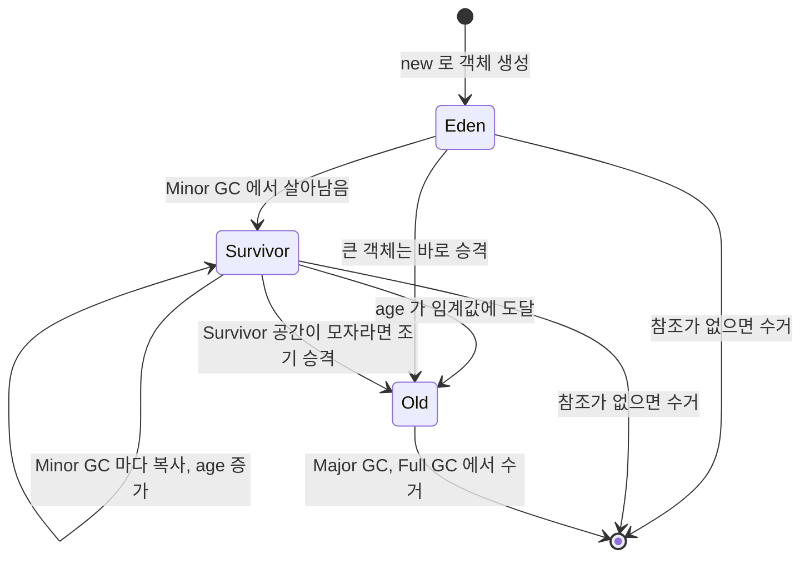
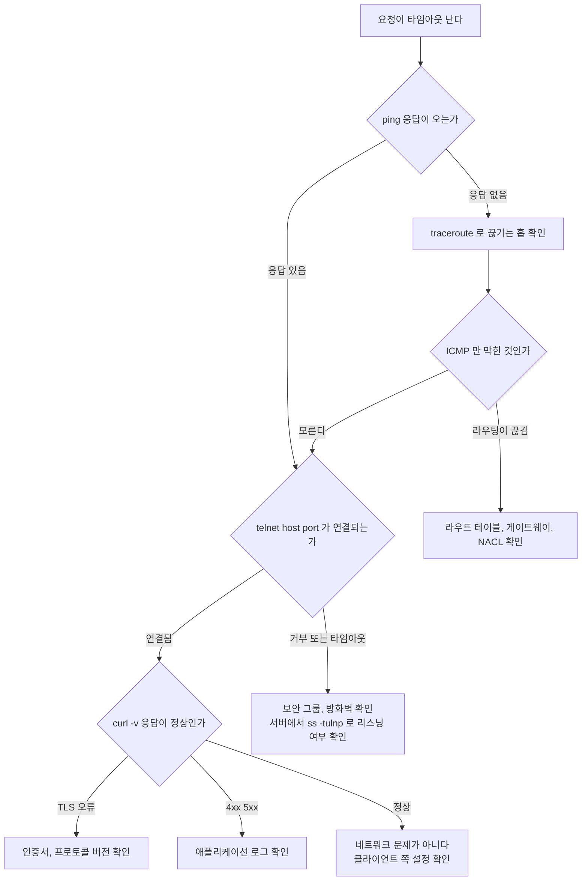
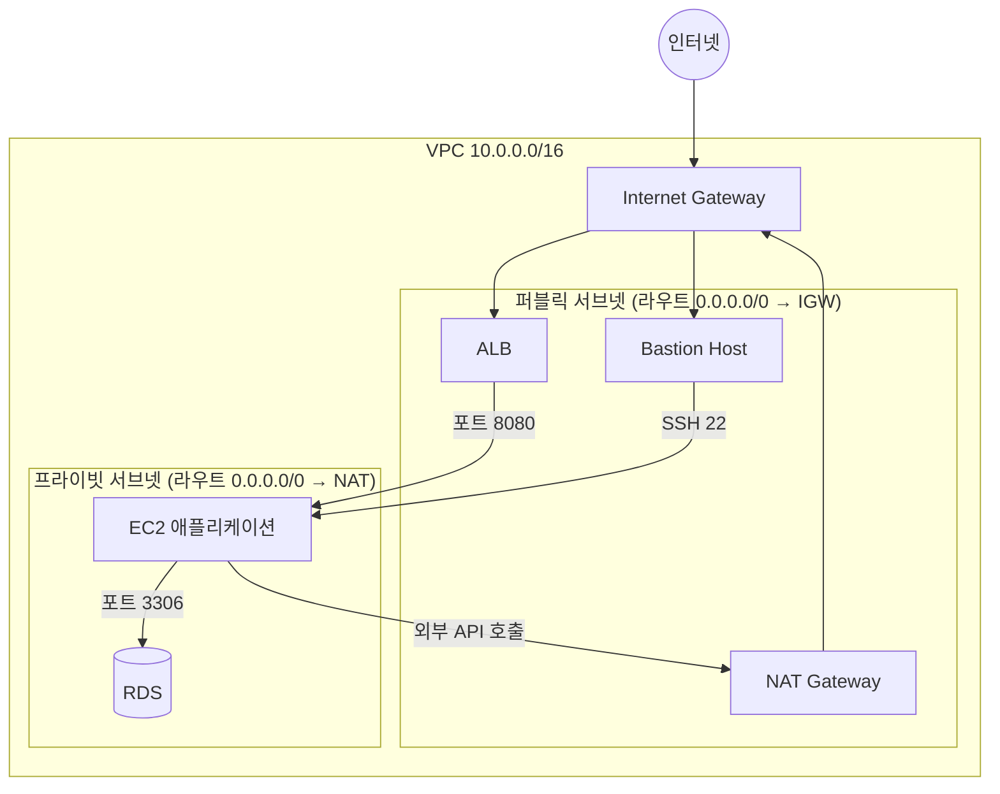

# 백엔드 신입 필독 20선

백엔드 개발자로 첫 취업을 준비하거나 막 입문한 사람을 위해 정리했다. 순서에 의도가 있다. 언어와 스프링 입구 → 네트워크 → 데이터베이스 → 클라우드 → 설계와 운영 순으로 읽어야 앞 단계에서 배운 개념이 뒤 단계의 바탕이 된다. VPC부터 보면 서브넷을 왜 나누는지 와닿지 않고, SSH를 모르는 상태에서 EC2를 보면 "접속은 어떻게 하나?"에서 막힌다.

20편만으로는 빈 곳이 있다. SQL 기초, Git, Docker, 인증, 트랜잭션, 캐시, 테스트, 로깅은 20편 안에 한 편도 없는데 신입 첫 달에 전부 부딪힌다. 이 주제들은 [20선과 함께 읽는 문서](#20선과-함께-읽는-문서)에 단계별로 묶어 두었다.

---

## 읽는 순서와 의존 관계

단계는 일직선이 아니다. 아래 그림에서 실선은 앞 단계를 알아야 뒤 단계가 읽힌다는 뜻이고, 점선은 그 단계 옆에서 같이 읽으면 좋은 입문 문서다.



4단계로 들어가는 선이 두 개다. VPC는 네트워크를 모르면 읽히지 않고, RDS는 데이터베이스를 모르면 왜 쓰는지 모른다. 그래서 2단계와 3단계를 모두 끝낸 뒤에 클라우드로 간다. 1단계의 스프링 문서 중 JPA는 SQL을 모르면 생성되는 쿼리를 읽지 못하므로, 3단계에서 인덱스를 보고 나서 JPA를 읽도록 3단계 끝에 두었다.

---

## 20편 한눈에

번호는 읽는 순서다. 오른쪽 칸은 그 문서를 읽고 나서 혼자 할 수 있어야 하는 일이다.

**1단계 — 언어와 JVM, 스프링 입구**

| 번호 | 문서 | 읽고 나서 할 수 있어야 하는 것 |
|---|---|---|
| 1 | JVM 구조 및 메모리 관리 | `OutOfMemoryError: Java heap space`와 `Metaspace`를 구분하고, Minor GC와 Full GC가 도는 조건을 설명한다 |
| 2 | JVM Options and Memory Management | `-Xmx`, `-Xms`, `-XX:+UseG1GC`를 보고 의미를 말하고 스테이징 서버에 맞게 조정한다 |
| 3 | Marker Interface | `Serializable`이 메서드 없이 어떻게 동작하는지 설명한다 |
| 4 | Spring MVC와 REST API 설계 | 컨트롤러 하나를 만들고 상태 코드와 예외 응답을 의도대로 내려준다 |
| 5 | Spring 테스트 | `@WebMvcTest`와 `@SpringBootTest`를 상황에 맞게 골라 테스트를 짠다 |

**2단계 — 네트워크와 HTTP**

| 번호 | 문서 | 읽고 나서 할 수 있어야 하는 것 |
|---|---|---|
| 6 | HTTP | POST와 PUT, 401과 403의 차이를 근거와 함께 답한다 |
| 7 | SSH | 키 페어를 만들어 서버에 등록하고 `~/.ssh/config`로 서버를 관리한다 |
| 8 | 네트워크 관리 | `ss`, `netstat`으로 열린 포트와 소켓 상태를 확인한다 |
| 9 | 네트워크 트러블슈팅 | 타임아웃이 났을 때 DNS, 라우팅, 포트, 애플리케이션 중 어디가 문제인지 좁힌다 |

**3단계 — 데이터베이스**

| 번호 | 문서 | 읽고 나서 할 수 있어야 하는 것 |
|---|---|---|
| 10 | RDS | EC2에 직접 설치한 MySQL과 RDS의 차이, Multi-AZ와 Read Replica의 용도를 구분한다 |
| 11 | Aurora DB | Aurora를 선택하는 이유와 비용이 더 드는 이유를 설명한다 |
| 12 | 인덱스 가능성 | `EXPLAIN`을 보고 인덱스를 타는지 판단하고 복합 인덱스 순서를 정한다 |
| 13 | 컬럼 접미 패턴 | 팀 컬럼 규칙에 맞춰 스키마를 설계한다 |
| 14 | Spring Data JPA | 리포지토리 메서드가 어떤 쿼리를 만드는지 로그로 확인한다 |

**4단계 — 클라우드 입문**

| 번호 | 문서 | 읽고 나서 할 수 있어야 하는 것 |
|---|---|---|
| 15 | EC2 | 인스턴스 유형과 구매 옵션을 비교해 첫 서버를 고른다 |
| 16 | ECS | Fargate Task Definition을 작성하고 Task Role과 Execution Role을 구분한다 |
| 17 | VPC | 퍼블릭/프라이빗 서브넷에 서버를 배치하고 외부 통신이 안 될 때 확인할 순서를 안다 |

**5단계 — 설계와 운영**

| 번호 | 문서 | 읽고 나서 할 수 있어야 하는 것 |
|---|---|---|
| 18 | CI/CD Pipeline | 파이프라인이 실패한 스텝을 로그에서 찾아 원인을 가려낸다 |
| 19 | Prometheus & Grafana | 대시보드에서 장애 시작 시점을 찾고 알림 임계값을 정한다 |
| 20 | Infrastructure Design Principles | "트래픽이 10배 늘면?"에 스케일 아웃과 스케일 업의 근거를 들어 답한다 |

---

## 1단계 — 언어와 JVM, 스프링 입구

### 왜 JVM부터 시작하나

자바 백엔드 개발자로 일하면서 JVM을 모르면 OOM이 났을 때 로그를 봐도 무슨 말인지 모른다. `java.lang.OutOfMemoryError: Java heap space`와 `java.lang.OutOfMemoryError: Metaspace`는 원인이 다르고 해결 방법도 다르다. 이걸 구분하려면 Heap, Metaspace, Stack이 무엇인지 먼저 알아야 한다.

1. **[JVM 구조 및 메모리 관리](../Language/Java/JVM%20관련/JVM%20구조%20및%20메모리%20관리.md)**

   Heap/Stack/Metaspace의 역할 구분이 핵심이다. GC가 언제 돌고 어떤 객체를 수거하는지 흐름을 잡아야 한다. 면접에서 "GC가 뭔가요?"로 끝나지 않고 "Minor GC와 Major GC의 차이는?"까지 나온다. 객체가 Heap 안에서 어떻게 이동하는지는 아래 그림이 전부다.



   Survivor 안에서 S0과 S1을 오가며 복사되는 동안 age가 하나씩 오른다. 이 age가 임계값(HotSpot의 G1과 Parallel GC는 기본 최대 15)에 닿으면 Old로 올라간다. 면접용으로는 이 화살표를 손으로 그릴 수 있으면 된다. 실무에서 문제가 되는 화살표는 "Survivor 공간이 모자라면 조기 승격"이다. 수명이 짧은 객체가 Old로 새어 들어가면 Old가 빨리 차고 Full GC가 잦아진다.

2. **[JVM Options and Memory Management](../Language/Java/JVM%20관련/JVM_Options_and_Memory_Management.md)**

   개발 환경에서는 기본값으로 문제없다가 스테이징에 올리면 OOM이 터지는 경우가 있다. 그때 `-Xmx`, `-Xms`, GC 관련 옵션을 건드려야 하는데 아무 설정도 모르면 손을 못 댄다. 적어도 `-Xmx`와 `-XX:+UseG1GC` 정도는 눈에 익혀둬야 한다.

```bash
# 실행 중인 JVM의 GC 상태를 1초 간격으로 10번 출력
# PID는 jps 명령어로 확인
jstat -gcutil <pid> 1000 10

# 출력 예시
#  S0     S1     E      O      M     CCS    YGC     YGCT    FGC    FGCT     GCT
#   0.00  58.33  34.56  23.12  94.34  91.22    12    0.234     1    0.456    0.690
#
# E(Eden), O(Old) 영역이 계속 100%에 가까우면 GC가 감당 못하고 있다는 신호다.
# FGC(Full GC) 횟수가 계속 오르면 OOM이 멀지 않은 상태다.
```

3. **[Marker Interface](<../Language/Java/객체지향 프로그래밍 (OOP)/interface/Marker_Interface.md>)**

   `Serializable`이나 `Cloneable`처럼 메서드 없이 타입만 부여하는 패턴이다. 직접 만들 일은 드물지만 Spring 프레임워크 코드를 읽다가 마주치고 당황하는 경우가 많다. 패턴 자체보다 "왜 이렇게 설계했는가"를 이해하는 것이 핵심이다.

### 스프링 입구

JVM을 봤으면 바로 스프링으로 넘어가 요청 하나가 컨트롤러에서 응답으로 나가는 흐름을 직접 만들어 본다. 신입 과제와 첫 업무는 대부분 여기서 시작한다.

4. **[Spring MVC와 REST API 설계](../Framework/Java/Spring/Spring_MVC_REST_API.md)**

   컨트롤러, 요청 바인딩, 예외 처리, 상태 코드 매핑을 다룬다. 신입이 자주 틀리는 부분은 검증 실패와 존재하지 않는 리소스, 권한 없음을 전부 `500`이나 `200`에 에러 본문으로 내려주는 것이다. HTTP 문서(6번)와 같이 보면 상태 코드를 고르는 기준이 생긴다.

5. **[Spring 테스트](../Framework/Java/Spring/Spring_Test.md)**

   테스트를 한 번도 안 짠 채로 입사하면 첫 PR에서 "테스트 어디 있어요?"를 듣는다. 모든 테스트를 `@SpringBootTest`로 짜면 컨텍스트 로딩이 느려져 테스트 스위트가 몇 분씩 걸린다. 컨트롤러만 보는 슬라이스 테스트와 전체 컨텍스트 테스트를 나누는 기준을 여기서 잡는다.

---

## 2단계 — 네트워크와 HTTP

백엔드 개발자로 일하면서 가장 자주 마주치는 문제는 "왜 API 응답이 안 오나?"다. 그 답을 찾으려면 HTTP부터 TCP, DNS까지 흐름을 알아야 한다. 이 4편은 API 디버깅의 바탕이다.

6번을 읽기 전에 [네트워크 기초](../Network/Networking_Fundamentals.md)를 먼저 읽는다. 회선 교환과 패킷 교환, 포트와 소켓, NAT, 방화벽이 트래픽을 막는 경우를 한 문서에 모아 두었고, 8번의 `ss` 출력과 9번의 타임아웃 원인 판단이 그 내용을 전제로 한다.

6. **[HTTP](<../Network/7 Layer/Application Layer/Http/HTTP.md>)**

   신입이 가장 허술하게 넘어가는 주제다. POST와 PUT의 차이, 상태 코드 200/201/204/400/401/403/404/500의 의미, 헤더에서 Content-Type과 Authorization이 왜 중요한지 정확히 알아야 한다. REST API 설계 면접에서 기초가 흔들리면 설명이 엉킨다. 특히 401과 403의 차이를 묻는 면접관이 많은데, 둘 다 "접근 불가"처럼 보여서 헷갈린다. 401은 누구인지 모르겠다는 뜻이고 403은 누구인지는 알지만 권한이 없다는 뜻이다. 이 구분이 인증과 인가의 구분이라서 [인증/인가 기초](백엔드_신입_인증_인가_기초.md)를 바로 이어서 읽으면 좋다.

7. **[SSH](../DevOps/Linux/보안/SSH.md)**

   첫 배포 서버에 붙으려면 SSH부터 써야 한다. 비밀번호 인증 방식의 위험성, RSA 키 페어 생성 및 등록, `~/.ssh/config`로 다중 서버 관리하는 방법 정도는 알아야 팀 서버에 처음 붙을 때 헤매지 않는다.

```bash
# ~/.ssh/config로 다중 서버 관리
Host dev-server
    HostName 10.0.1.100
    User ec2-user
    IdentityFile ~/.ssh/dev-key.pem
    ServerAliveInterval 60

Host prod-bastion
    HostName 54.x.x.x
    User ec2-user
    IdentityFile ~/.ssh/prod-key.pem

# 설정해두면 ssh dev-server 한 줄로 접속 가능
# IdentityFile 권한이 400이 아니면 Permission denied 뜬다 (chmod 400 ~/.ssh/dev-key.pem)
# ServerAliveInterval은 세션 끊김 방지 — 없으면 idle 타임아웃으로 연결이 끊긴다
```

8. **[네트워크 관리](../DevOps/Linux/네트워크/네트워크_관리.md)**

   `netstat -tulnp`로 어떤 포트가 열려있는지, `ss -s`로 소켓 상태 요약, `tcpdump`로 실제 패킷 확인하는 법은 실무에서 생각보다 빠르게 필요한 순간이 온다. 포트 충돌 문제나 보안 그룹 설정 확인할 때 이 명령어들로 시작한다.

9. **[네트워크 트러블슈팅](../DevOps/Linux/네트워크/네트워크_트러블슈팅.md)**

   연결 타임아웃이 났을 때 서버 문제인지, 네트워크 문제인지, 보안 그룹 문제인지 구분하는 흐름이 핵심이다. `ping → traceroute → telnet <host> <port> → curl -v` 순서로 레이어를 좁혀가는 방식을 익혀야 한다.



   그림에서 눈여겨볼 곳은 `ping` 실패 뒤에 `telnet`으로 바로 가는 선이다. 보안 그룹이 ICMP(ping)는 막고 TCP 포트만 열어 둔 서버가 흔하다. `ping`이 실패했다고 서버가 죽었다고 단정하면 안 되고, 포트 확인을 건너뛰지 않아야 한다. 반대 경우도 있다. `ping`은 되는데 `curl`이 안 되면 포트 레벨 문제다. `telnet`이 설치돼 있지 않은 서버가 많아서 `nc -vz <host> <port>`로 같은 확인을 한다.

---

## 3단계 — 데이터베이스

쿼리는 짤 줄 아는데 인덱스를 왜 걸어야 하는지 모르는 상태로 취업하는 경우가 많다. 이 5편은 "쿼리 작성" 수준에서 "데이터베이스를 다루는" 수준으로 올라가는 과정이다. SELECT, JOIN, GROUP BY가 아직 어색하면 [SQL 기초](백엔드_신입_SQL_기초.md)를 먼저 읽고 온다.

10. **[RDS](../Cloud/AWS/Database/RDS.md)**

    EC2에 MySQL 직접 설치하는 것과 RDS의 차이를 정확히 알아야 한다. 자동 백업, Multi-AZ, 읽기 전용 복제본이 각각 어떤 상황에서 필요한지, 비용은 어떻게 다른지가 실무 설계 결정에 직접 영향을 준다. Multi-AZ가 고가용성 목적이고 Read Replica가 읽기 분산 목적이라는 차이를 면접에서 자주 묻는다.

11. **[Aurora DB](../Cloud/AWS/Database/Aurora_DB.md)**

    RDS MySQL과 Aurora MySQL은 엔진 레벨에서 다르다. Aurora의 스토리지가 6개 복사본을 3개 AZ에 분산 저장한다는 구조를 모르면 "Aurora가 더 비싼데 왜 쓰나요?" 질문에 대답 못한다. Serverless v2가 나오고 나서 소규모 서비스에서도 Aurora를 쓰는 경우가 늘었다.

12. **[인덱스 가능성](../DataBase/RDBMS/인덱스_가능성.md)**

    가장 실무적인 내용이다. 어떤 쿼리에 인덱스가 탈지, 왜 `LIKE '%keyword'`는 인덱스를 못 타는지, 복합 인덱스의 컬럼 순서가 왜 중요한지를 여기서 잡아야 한다. 인덱스를 무조건 많이 걸면 오히려 INSERT/UPDATE 성능이 떨어진다는 것도 함께 이해해야 한다.

```sql
-- EXPLAIN으로 인덱스 사용 여부 확인
EXPLAIN SELECT * FROM orders
WHERE user_id = 100 AND status = 'PENDING'
ORDER BY created_at DESC;

-- type 컬럼이 'ALL'이면 풀스캔
-- 'ref'나 'range'면 인덱스를 탄 것
-- rows 숫자가 클수록 느리다

-- 복합 인덱스 순서 예시
-- (user_id, status)로 인덱스를 걸면 user_id 단독 조회는 타지만
-- status 단독 조회는 인덱스를 못 탄다
CREATE INDEX idx_orders_user_status ON orders (user_id, status);

-- LIKE 검색: 앞에 와일드카드가 있으면 인덱스를 못 탄다
SELECT * FROM users WHERE name LIKE '%김%';   -- 풀스캔
SELECT * FROM users WHERE name LIKE '김%';    -- 인덱스 탐
```

13. **[컬럼 접미 패턴](../DataBase/RDBMS/Column_Suffix_Pattern.md)**

    팀에서 `_at`, `_id`, `_yn`, `_count` 같은 접미사 규칙을 맞추는 건 코드 리뷰에서 바로 지적받는 사항이다. 신입 때는 "이런 거 왜 신경 써야 하나" 싶지만, 컬럼명 규칙이 일관되지 않으면 나중에 쿼리 짤 때 `is_deleted`인지 `deleted_yn`인지 매번 스키마를 뒤져야 한다. 레거시 코드베이스일수록 이 혼선이 심하다.

14. **[Spring Data JPA](../Framework/Java/Spring/Spring_Data_JPA.md)**

    인덱스까지 봤으면 JPA가 만드는 쿼리를 읽을 수 있다. 신입이 JPA에서 가장 먼저 부딪히는 문제는 연관 엔티티를 반복문에서 꺼낼 때 쿼리가 건수만큼 나가는 N+1이다. 로컬 데이터가 열 건일 때는 티가 안 나다가 운영 데이터에서 응답이 수 초로 늘어난다. `spring.jpa.show-sql`이나 SQL 로그를 켜서 리포지토리 메서드 하나가 쿼리를 몇 번 보내는지 세는 습관을 이 문서에서 들인다.

    JPA를 쓰면 `@Transactional`을 거의 반드시 만난다. 같은 클래스 안에서 `@Transactional` 메서드를 호출하면 프록시를 거치지 않아 트랜잭션이 안 걸리는 문제, 롤백이 `RuntimeException`에만 걸리는 기본 동작은 [Spring AOP & 트랜잭션 심화](../Framework/Java/Spring/AOP_트랜잭션.md)와 [트랜잭션과 락](../DataBase/RDBMS/Transaction_and_Lock.md)에서 이어서 본다.

---

## 4단계 — 클라우드 입문

AWS를 처음 접할 때 서비스가 너무 많아서 어디서부터 시작해야 할지 모르는 경우가 있다. EC2 → ECS → VPC 순서로 보면 컴퓨팅 → 컨테이너 → 네트워크 레이어가 쌓이면서 전체 그림이 잡힌다. ECS 앞에서 컨테이너 자체가 낯설면 [Docker 입문](백엔드_신입_Docker_입문.md)을 먼저 본다.

15. **[EC2](../Cloud/AWS/Compute/EC2.md)**

    인스턴스 유형(t3, m5, c5)의 차이, 온디맨드/스팟/예약 구매 옵션의 비용 구조, EBS 볼륨 붙이는 법을 알아야 한다. 첫 배포 서버를 만들 때 인스턴스 타입을 잘못 골라서 나중에 마이그레이션하는 사태를 방지하려면 기초를 짚고 가야 한다. t3.micro와 t3.medium의 CPU 버스팅 동작 방식 차이도 알아두면 좋다.

16. **[ECS](../Cloud/AWS/Containers/ECS.md)**

    EC2에 직접 Docker를 띄우는 것과 ECS Fargate의 차이를 이해해야 한다. Fargate는 서버 관리 없이 컨테이너를 실행하는데, Task Definition에서 CPU/메모리 할당과 환경 변수 설정이 실무에서 가장 자주 건드리는 부분이다. 처음 마주치는 어려운 지점은 IAM 역할이다. Task Role과 Task Execution Role의 용도가 다르다.

17. **[VPC](../Cloud/AWS/Network/VPC.md)**

    서브넷을 퍼블릭/프라이빗으로 나누는 이유, 인터넷 게이트웨이와 NAT 게이트웨이의 역할 차이, 보안 그룹과 NACL이 각각 어디서 동작하는지가 핵심이다. 아래는 웹 서비스 하나를 올릴 때 가장 흔한 배치다.



    그림에서 EC2와 RDS는 인터넷에서 들어오는 선이 없다. 외부 사용자는 ALB로만 들어오고, 운영자는 Bastion을 거쳐서만 EC2에 붙는다. EC2가 외부 API나 패키지 저장소를 호출할 때는 NAT Gateway를 지나 나간다. NAT는 나가는 방향만 열어 주므로 밖에서 EC2로 먼저 접속할 수는 없다. 이 구조에서 "EC2가 외부와 통신이 안 된다"는 증상이 나오면 프라이빗 서브넷의 라우트 테이블에 NAT 경로가 있는지, NAT Gateway가 퍼블릭 서브넷에 있는지부터 확인한다. NAT를 프라이빗 서브넷에 만들어 놓고 안 된다고 하는 경우가 실제로 있다. 보안 그룹은 스테이트풀, NACL은 스테이트리스라는 차이도 트러블슈팅에서 자주 나온다. RDS의 보안 그룹 인바운드에는 IP 대역 대신 EC2의 보안 그룹을 소스로 지정하는 쪽이 서버가 늘어나도 규칙을 안 건드려서 편하다.

---

## 5단계 — 설계와 운영

코드를 짜는 것과 시스템을 운영하는 것은 다른 기술이다. 이 단계는 "코드가 돌아가는 환경"에 대한 감각을 키우는 과정이다.

18. **[CI/CD Pipeline](../DevOps/CI_CD/CI_CD_Pipeline.md)**

    GitHub Actions 기준으로, 코드를 Push하면 테스트 → 빌드 → 배포까지 자동으로 돌아가는 파이프라인 흐름을 잡아야 한다. 파이프라인이 실패했을 때 원인을 직접 찾지 못하고 선배에게 묻는 상황이 신입 때 자주 생긴다. 로그를 읽는 방법과 스텝별 실패 원인을 구분하는 법을 함께 본다. 워크플로 파일을 직접 써 보려면 [GitHub Actions 입문](백엔드_신입_Git_Hub_Actions_입문.md)이 이어진다.

19. **[Prometheus & Grafana](../DevOps/Monitoring/Prometheus_Grafana.md)**

    장애가 나고 "언제부터 문제가 생겼나요?" 질문을 받을 때 Grafana 대시보드가 없으면 로그를 직접 뒤져야 한다. Prometheus가 메트릭을 수집하고 Grafana가 시각화하는 구조, 알림 임계값 설정 방법을 기초 수준에서 알아야 온콜 대응에 참여할 수 있다. CPU/메모리/JVM 힙 메트릭을 보는 것부터 시작한다. 메트릭이 "언제부터"를 알려 준다면 "무슨 일이 있었나"는 로그가 알려 준다. 로그 레벨과 MDC로 요청 단위 추적 ID를 남기는 방법은 [Spring Boot 로깅](../Framework/Java/Spring/Spring_Logging.md)에서 잡는다.

20. **[Infrastructure Design Principles](../DevOps/Principles/Infrastructure_Design_Principles.md)**

    확장성, 가용성, 비용의 균형을 맞추는 결정이 실제로 어떻게 이루어지는지를 다룬다. 면접에서 "트래픽이 10배 늘면 어떻게 할 것인가?" 질문에 답하는 기반이 된다. 스케일 아웃 vs 스케일 업, 스테이트리스 설계가 왜 중요한지를 여기서 잡는다. 이론적 이해보다 실제로 어느 지점에서 무엇을 선택하는지 판단 기준을 익히는 게 목적이다.

---

## 20선과 함께 읽는 문서

20편 밖에 있지만 신입이 첫 달에 쓰는 주제들이다. 어느 단계 옆에서 읽는지를 같이 적었다.

| 주제 | 문서 | 같이 읽는 시점 |
|---|---|---|
| Git | [Git 자주 사용하는 명령어](../DevOps/Git/Git_자주_사용하는_명령어.md) | 1단계 전. 첫 PR을 올리기 전에 `rebase`, `reset`, `stash`를 구분해 둔다 |
| SQL 기초 | [백엔드 신입 SQL 기초](백엔드_신입_SQL_기초.md) | 3단계 전. JOIN과 GROUP BY가 어색하면 인덱스 문서가 읽히지 않는다 |
| 인증/인가 | [백엔드 신입 인증/인가 기초](백엔드_신입_인증_인가_기초.md) | 2단계 HTTP 직후. 401과 403, JWT와 세션 |
| 트랜잭션 | [트랜잭션과 락](../DataBase/RDBMS/Transaction_and_Lock.md) | 3단계 JPA와 함께. 격리 수준과 락이 왜 필요한지 |
| 캐시 | [Redis Cache Strategy](../DataBase/NoSQL/Redis/Redis_Cache_Strategy.md), [Spring CacheManager 설정](../Framework/Java/Spring/Spring_Cache.md) | 3단계 뒤. DB 조회가 느릴 때 쓰는 첫 수단 |
| Docker | [백엔드 신입 Docker 입문](백엔드_신입_Docker_입문.md) | 4단계 ECS 전 |
| GitHub Actions | [백엔드 신입 GitHub Actions 입문](백엔드_신입_Git_Hub_Actions_입문.md) | 5단계 CI/CD와 함께 |

20선 안의 Spring MVC(4번), Spring 테스트(5번), Spring Data JPA(14번), Spring 로깅(19번 본문)까지 합치면 REST API, 테스트, 로깅도 빠짐없이 다룬다.

---

## 선택으로 읽는 문서

아래 세 편은 20선에서 뺐다. 자바 백엔드로 취업한다면 우선순위가 낮다. 해당하는 상황이 오면 그때 읽는다.

!!! note "선택 — Node.js나 프론트엔드 코드를 같이 만지는 팀"
    **[ES6 Class](../Language/JavaScript/09_ES6_및_고급문법/ES6%20Class.md)**

    Node.js로 백엔드를 짜거나 프론트엔드 코드를 같이 읽어야 할 때 필요하다. ES6 이전의 프로토타입 기반 상속과 class 문법의 차이를 모르면 레거시 코드가 낯설다. `super()` 호출 순서나 정적 메서드의 동작은 Java와 다른 점이 있다.

!!! note "선택 — API 스펙을 TypeScript로 정의하는 팀"
    **[Interface Deep Dive](../Language/TypeScript/타입%20및%20타입%20정의/Object%20Types/Interface_Deep_Dive.md)**

    인터페이스와 타입 별칭(type alias)의 차이, 인덱스 시그니처를 모르면 타입 정의 파일을 읽는 데 시간이 걸린다. Java의 interface와 비슷해 보이지만 구조가 같으면 같은 타입으로 취급하는 점이 다르다.

!!! note "선택 — 클라우드 네트워크 문서에서 용어가 막힐 때"
    **[MacAddress](../Network/7%20Layer/Data%20Link%20Layer/MacAddress.md)**

    L2 계층의 주소다. 평소 애플리케이션을 짜는 데는 필요 없고, ARP 테이블이나 ENI를 봐야 하는 네트워크 트러블슈팅에서 처음 필요해진다. 그때 읽어도 늦지 않다.

---

## 20편을 마친 다음

[MSA 아키텍처](../Architecture/MSA/서비스_분해_및_도메인_설계.md)나 [Kafka](../Backend/Messaging/Message_Queue.md)로 넘어가면 된다. 이 20편이 바탕에 있으면 MSA의 서비스 분리 이유가 "트렌드라서"가 아니라 "단일 서버의 어떤 한계 때문에"로 읽힌다.
